# Checkout across Cart, Inventory, Payment and Order

## Design in brief

- Checkout starts when the customer presses **Place order**. Order stores the cart's lines and prices as a snapshot. Cart is not changed until the order is confirmed.
- Inventory reserves all lines in one transaction, or none. A reservation holds stock for 10 minutes. When the hold lapses, stock returns to sale whatever the payment state is.
- Only Payment calls the provider. Charges use the order id as the idempotency key. Refunds use the order id plus a `refund` suffix.
- Provider webhooks are deduplicated by provider event id, stored in Payment before any state changes.
- If a payment succeeds after the hold has lapsed, the order is cancelled as out of stock, the full amount is refunded, and the customer is emailed.
- Refunds are retried until the provider confirms them. A refund row is never deleted.

## Flowchart

```mermaid
flowchart TD
    START(["Customer presses Place order"]):::cart
    START --> CART_REQ["Cart: POST /orders with cart id<br/>Cart reads its own lines and prices<br/>Cart rows unchanged"]:::cart
    CART_REQ --> ORDER_NEW["Order: create order in state PLACED<br/>Stores: orders, order_lines (snapshot of lines and prices)<br/>Order id is the key for every later step"]:::order
    ORDER_NEW --> RESERVE["Order: POST /reservations to Inventory<br/>body: order id and lines"]:::order
    RESERVE --> SHORT{"Inventory: does every line have enough free stock?"}:::inv

    SHORT -->|"No, one or more lines short"| NOTHING["Inventory: reserve nothing<br/>Stores: no rows changed<br/>Replies 409 with the short SKUs"]:::inv
    NOTHING --> OUT["Order: status REJECTED_OUT_OF_STOCK<br/>No payment requested"]:::order
    OUT --> FAIL_CART["Cart: on CheckoutFailed, keep cart exactly as it was<br/>Customer is shown the short items"]:::cart

    SHORT -->|"Yes"| HOLD["Inventory: one transaction for all lines<br/>Move qty from free to held per line<br/>Stores: reservations HELD with expires_at = now + 10 min"]:::inv
    HOLD -.->|"10 min pass with no claim"| EXPIRE["Inventory expiry job: reservation EXPIRED<br/>Held qty returned to free stock<br/>Order is not cancelled here"]:::inv

    HOLD --> PAYREQ["Order: status PAYMENT_PENDING<br/>POST /charges to Payment<br/>idempotency key = order id"]:::order
    PAYREQ --> CHARGE["Payment: store charge PENDING<br/>Call provider charge with key = order id<br/>Stores: charges"]:::pay
    CHARGE --> PROVIDER["Provider: accepts request<br/>Outcome arrives later by webhook"]:::ext

    PROVIDER -.->|"seconds, up to 30 min"| HOOK(["Provider webhook: charge succeeded or declined"]):::ext
    HOOK --> DUP{"Payment: is this provider event id already in webhook_events?"}:::pay
    DUP -->|"Yes, repeat delivery"| ACK_DUP["Payment: reply 200 and change nothing<br/>No event is published again"]:::pay
    DUP -->|"No, first delivery"| APPLY["Payment: one DB transaction<br/>Insert event id, set charge outcome if still PENDING<br/>Stores: webhook_events, charges"]:::pay
    APPLY --> OUTCOME{"Charge outcome?"}:::pay

    OUTCOME -->|"Declined"| DECL["Payment: publish PaymentDeclined"]:::pay
    DECL --> REL["Order: status PAYMENT_DECLINED<br/>POST release to Inventory"]:::order
    REL --> FREE["Inventory: reservation RELEASED<br/>Held qty returned to free stock"]:::inv
    FREE --> FAIL_CART2["Cart: on CheckoutFailed, cart unchanged<br/>Customer sees payment failed"]:::cart

    OUTCOME -->|"Succeeded"| SUCC["Payment: publish PaymentSucceeded"]:::pay
    SUCC --> CLAIM["Order: POST claim to Inventory"]:::order
    CLAIM --> HELD{"Inventory: is the reservation still HELD?"}:::inv

    HELD -->|"Yes, hold is live"| SOLD["Inventory: reservation CLAIMED<br/>Held qty becomes sold, one conditional update<br/>Stores: reservations CLAIMED"]:::inv
    SOLD --> CONF["Order: status CONFIRMED, publish OrderConfirmed<br/>Stores: order_status_history"]:::order
    CONF --> EMPTY["Cart: on OrderConfirmed, delete cart lines<br/>Stores: cart_lines emptied"]:::cart
    EMPTY --> DONE_OK(["Order confirmed, customer gets confirmation email"]):::order

    HELD -->|"No, hold lapsed, stock may be sold"| LATE["Order: status CANCELLED_OUT_OF_STOCK"]:::order
    LATE --> REFREQ["Order: publish PaymentRefundRequired, full amount<br/>Order emails customer: cancelled as out of stock, refund on its way"]:::order
    REFREQ --> REFUND["Payment: POST full refund to provider<br/>idempotency key = order id plus refund<br/>Stores: refunds PENDING"]:::pay
    REFUND --> REFOK{"Provider accepted the refund?"}:::pay
    REFOK -->|"Yes"| REFDONE["Payment: refund SUCCEEDED once provider confirms<br/>Stores: refunds"]:::pay
    REFDONE --> DONE_REF(["Customer has full refund"]):::ext
    REFOK -->|"No, error or timeout"| RETRY["Payment: keep refund PENDING<br/>Stores: attempt count and last error<br/>Retry with backoff, same key"]:::pay
    RETRY --> ALERT["After N attempts: alert ops, status REFUND_STUCK<br/>Retries continue, row is never deleted"]:::pay
    ALERT --> REFUND
    RETRY --> REFUND

    classDef cart fill:#e0f2fe,stroke:#0369a1,color:#0c4a6e
    classDef order fill:#fef9c3,stroke:#a16207,color:#422006
    classDef inv fill:#dcfce7,stroke:#15803d,color:#14532d
    classDef pay fill:#fce7f3,stroke:#be185d,color:#500724
    classDef ext fill:#f1f5f9,stroke:#475569,color:#0f172a,stroke-dasharray: 4 3
```

## Legend

| Colour | Service | Role in the diagram |
|---|---|---|
| Blue | Cart | Starts checkout, keeps cart unchanged on failure, empties cart on confirmation |
| Yellow | Order | Owns order state, snapshot, orchestration, customer email |
| Green | Inventory | Holds, claims, releases and expires stock |
| Pink | Payment | Only service that talks to the provider; webhook dedupe; refunds |
| Grey dashed | External | Provider, customer, and webhook delivery |

Solid arrows are synchronous HTTP calls or events on the broker. Dashed arrows are timers or external callbacks.

## What each service stores

| Service | Stores | Notes |
|---|---|---|
| Cart | `carts`, `cart_lines` | Changed by customer edits, and by emptying on `OrderConfirmed`. Nothing is written on Place order. |
| Inventory | `stock_levels` (sku, on_hand, held), `reservations` (order id, lines, status HELD / CLAIMED / RELEASED / EXPIRED, expires_at) | Free stock = on_hand minus held. Claim, release and expiry each use a conditional update on status, so only one can win. |
| Payment | `charges` (order id key, amount, provider charge id, status), `refunds` (order id, amount, status, attempts, last error), `webhook_events` (provider event id unique, processed_at) | Webhook insert and charge update share one transaction. |
| Order | `orders` (id, cart id, status, total), `order_lines` (sku, qty, unit price snapshot), `order_status_history` | Order is the only service that emails the customer. |

Every service publishes its events through a transactional outbox, so a state change and its event are never out of step.

## Failure branches

| Scenario | Trigger | What happens | What the customer sees |
|---|---|---|---|
| Short stock | Any line lacks free stock | Nothing reserved, no payment requested, status REJECTED_OUT_OF_STOCK | Short items listed; cart unchanged |
| Declined payment | Webhook reports decline | Reservation released, status PAYMENT_DECLINED | Payment failed; cart unchanged |
| Late success after hold lapsed | Webhook succeeds after the claim finds the hold gone | Full refund, status CANCELLED_OUT_OF_STOCK, email sent | Cancellation email and full refund |
| Failed refund | Provider error or timeout | Retry with backoff and the same key; ops alerted after N attempts; row kept until confirmed | Refund confirmation email once the provider confirms |
| Duplicate webhook | Same provider event id delivered again | Second delivery returns 200 and changes nothing | Nothing |
| Retried charge request | Order retries POST /charges | Same idempotency key, so the provider returns the existing charge | Nothing |
| Claim call fails in transit | Network error on Order's claim call | Order retries the claim. The `PaymentSucceeded` event stays on the broker until it is acknowledged. | Nothing, unless the hold has lapsed by then |

## Decisions to confirm and open boundaries

1. **Late success with stock still free.** This design refunds whenever the claim finds the hold gone, even if nobody has bought the stock yet. That follows the rule "never keep money for an order we can't fulfil" literally. Re-reserving free stock on a late success would be a separate product decision.
2. **Webhook never arrives.** The brief does not cover a provider outage beyond 30 minutes. A recommended addition is a Payment reconciler that polls the provider for charges still PENDING after 30 minutes. This is not in the brief.
3. **Payment still pending at 10 minutes.** Stock is released at 10 minutes while the order stays PAYMENT_PENDING until the webhook arrives. The customer may see "pending" for up to 30 minutes.
4. **Refund outcome webhooks.** Refund outcomes also arrive by webhook and should be deduplicated the same way as charge outcomes, using the provider event id in `webhook_events`.
