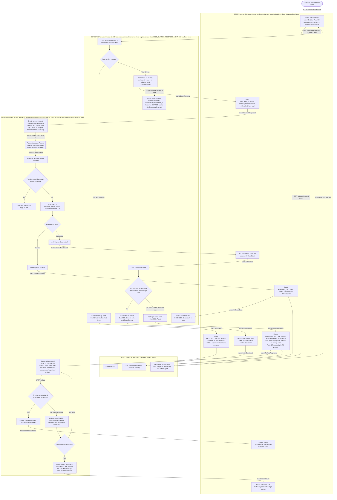

# Checkout across Cart, Inventory, Payment and Order

## How to read this

- **Order** coordinates checkout. It decides what happens next after each event and owns the order's status.
- The other three services do one job each and report back with an event: **Cart** holds the basket, **Inventory** holds stock, and **Payment** talks to the payment provider.
- Services never read each other's tables. Two things cross a service boundary:
  - **HTTP calls** are used where the caller needs an answer straight away (Order asking Cart for the basket).
  - **Events on the broker** are used for everything else. A box labelled `emit X` publishes event X.
- Every service writes its state change and its outgoing event in the same database transaction (an outbox table). A separate relay then publishes the event.
  - A crash can therefore never leave "state changed, event lost".
  - Events are delivered at least once, so each consumer keeps an inbox table of event ids it has already handled and ignores repeats.

## Flowchart

## Failure branches

| Case | Where it branches | What happens | Cart |
|---|---|---|---|
| **Short stock** | Inventory, decision "Is every line in stock?" | Nothing is reserved (one transaction, all or nothing). No payment is requested. `StockShort` lists the short items, and Order stores them as REJECTED_SHORT_STOCK and shows them to the customer. | Untouched |
| **Declined payment** | Payment, decision "Provider outcome?" | `PaymentDeclined` makes Order set PAYMENT_DECLINED. Order emits `ReleaseStock` and Inventory frees the hold at once, so the stock does not sit idle for the rest of the 10 minutes. | Untouched |
| **Late success after the hold lapsed** | Inventory, decision "Hold still HELD, or lapsed but every line still free?" | The payment succeeded but the claim fails because the stock has gone. Order cancels as CANCELLED_OUT_OF_STOCK, requests a full refund and emails the customer. No partial orders are shipped, because the claim covers all lines or none. | Untouched |
| **Failed refund** | Payment, decision "Provider accepted and completed the refund?" | The refund record is never deleted. A retry worker keeps retrying with the same idempotency key (`refund-<order id>`), so a retry cannot refund twice. After the retry limit the record becomes STUCK, an alert goes to ops, and it stays in the queue until a person resolves it. Order shows the refund as STUCK. | Untouched |
| **Duplicate webhook** | Payment, decision "Provider event id already in webhook_events?" | The provider event id has a unique constraint. A repeat hits the constraint, is acknowledged with 200 and is not processed. No event is emitted twice. | n/a |

## What each service stores

| Service | Owns |
|---|---|
| **Cart** | Carts, cart lines, current prices. It is emptied only when it receives `OrderConfirmed`. |
| **Order** | Orders and their line and price snapshot (frozen at Place order), status, short-item list, refund status, outbox and inbox. |
| **Inventory** | Stock levels, and reservations with order id, lines, `expires_at` and state (HELD, CLAIMED, RELEASED, EXPIRED). It also keeps an outbox and an inbox. |
| **Payment** | Payments (one per order), `webhook_events` (unique provider event id), refunds (state, attempts, next retry time), outbox and inbox. |

## Order statuses

PLACED, then one of:
- REJECTED_SHORT_STOCK
- AWAITING_PAYMENT, then one of:
  - PAYMENT_DECLINED
  - CONFIRMED
  - CANCELLED_OUT_OF_STOCK (refund status PENDING, then REFUNDED or STUCK)

## Rules that make this safe

1. **Order first, then reserve, then pay.** Payment is only requested after `StockReserved`, so a short basket never causes a charge.
2. **One idempotency key per money movement.** The charge uses the order id and the refund uses `refund-<order id>`. If Payment times out and retries, the provider returns the original result.
3. **Claim is decided in one place.** Only Inventory decides whether a claim succeeds, in a single transaction. The expiry job and a late claim therefore cannot both win.
4. **Hold expiry does not cancel the order.** While AWAITING_PAYMENT, a lapsed hold changes nothing in Order, because the payment may still succeed (up to 30 minutes). The stock decision is made at claim time.
5. **The cart is emptied by `OrderConfirmed` only.** Every other path leaves it as it was. Clearing is safe to repeat.
6. **Snapshot is final.** Pricing and lines come from the order's own snapshot after Place order. Cart edits and price changes after that moment do not touch the order.
7. **Payment success for an order that is no longer waiting.** If `PaymentSucceeded` arrives for an order that is not AWAITING_PAYMENT (for example, already cancelled), Order requests a refund rather than ignoring the money.

## Choices to confirm

- **Late claim:** I let a claim succeed on a lapsed hold if every line is still free at that moment. This avoids refunding a customer when the stock is still there. If you want strictly "lapsed means refund", remove the "or lapsed but every line still free" clause.
- **No webhook:** If the provider sends no webhook after about 35 minutes, Payment should ask the provider for the payment status. This is not drawn in the chart.
- **Cart clearing:** `OrderConfirmed` removes only the lines in the order's snapshot. Anything the customer added after pressing Place order stays in the cart. This is not drawn in the chart.
- **Double-click on Place order:** Order allows one open order per cart, so a double click returns the existing order instead of creating a second one. This is not drawn in the chart.
- **Emails:** Order sends them, so no fifth service is needed.
