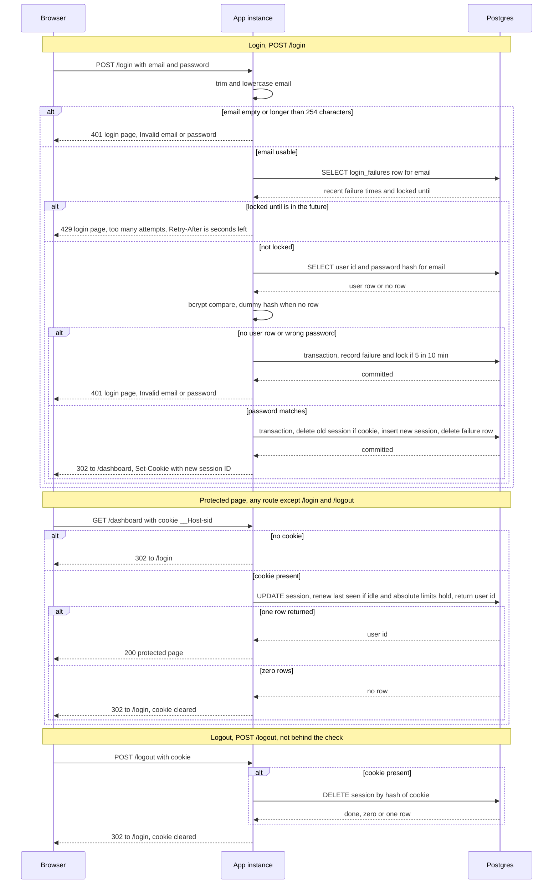

# Login with server-side sessions: design

## Summary

Sign-in is `POST /login` with an email and password. On success the server stores a session row in Postgres and sets a cookie that holds only a random session ID. Every page except `/login` and `/logout` first passes a shared check, which looks up the session, renews its idle timer and passes the user ID on. Five failed attempts within 10 minutes lock an email for 15 minutes. All state lives in Postgres, so both app instances see the same sessions and failure counts.

## Terms

- **Session ID**: 32 random bytes, base64url-encoded. This is the cookie value. Postgres stores only its SHA-256 hash.
- **Session row**: one row in `sessions` per signed-in browser.
- **Idle limit**: 30 minutes after the last request. Every protected request restarts it.
- **Absolute limit**: 12 hours after login. Fixed, so activity does not extend it.
- **Normalized email**: the email with spaces trimmed and letters lowercased.
- **Failure row**: one row per normalized email in `login_failures`. It holds the last 5 failure times and an optional lock time.
- **Fail closed**: when storage fails, deny access and keep the cookie.

## Main flow

The diagram shows the three flows: login, a request for a protected page, and logout.



## Design decisions and rules

1. **Storage: Postgres, no Redis.** Both instances already share the database, so it is the one store that is consistent across them with no new service. The data is small and low-volume, and atomic statements and row locks give correct counting across two instances. Redis would add a system to run, secure and back up. Revisit if per-request session writes show up in latency.
2. **Session ID.** 256 random bits from `crypto.randomBytes`. Only its hash is stored, so a database read does not yield usable cookies.
3. **Cookie.** Named `__Host-sid`, with `HttpOnly; Secure; SameSite=Lax; Path=/` and no `Domain`. The value is the opaque ID only. It has no `Max-Age` or `Expires`, so it is a browser-session cookie that usually disappears when the browser closes. Clearing it uses the same attributes with `Max-Age=0`.
4. **Expiry check.** Every protected request runs this one statement. It uses Postgres `now()`, so the two instances never disagree about time:

   ```sql
   UPDATE sessions SET last_seen_at = now()
   WHERE id_hash = $1
     AND last_seen_at > now() - interval '30 min'
     AND absolute_expires_at > now()
   RETURNING user_id
   ```

   One row means the session is accepted and the user ID is passed on. Zero rows means rejected for any reason (idle, absolute, deleted or unknown). The user sees the same redirect to `/login` with the cookie cleared in every case.
5. **Shared check.** One middleware runs before every route except `/login` and `/logout`. It runs the statement in step 4. The route receives the user ID and loads its data without querying sessions itself. If the check fails, the middleware sends the redirect or 503, and the route does not run.
6. **Cleanup.** Each app instance runs a timer every 10 minutes with two idempotent deletes: sessions where `last_seen_at <= now() - 30 min` or `absolute_expires_at <= now()`, and failure rows with no failure in the last 10 minutes and no active lock. Expired rows are never accepted, so cleanup only limits storage size. If both instances run it, row locks serialize the deletes and the second run finds nothing left. A failed run is logged and retried on the next tick, with no user-visible effect.
7. **What counts as a failed attempt.** A `POST /login` whose normalized email is non-empty and at most 254 characters. That includes a wrong password, an empty password and an email with no `@`. A missing or over-long email gets 401 with no database lookup, because it has no row to count against. Unknown emails are checked against a precomputed dummy bcrypt hash at the same cost, and their failures are recorded too. So the response and timing do not reveal whether the account exists.
8. **Failure counting.** One transaction per failed attempt. It inserts the failure row if none exists (`INSERT ... ON CONFLICT DO NOTHING`), locks it with `SELECT ... FOR UPDATE`, appends `now()` and keeps the last 5. If there are 5 entries and the oldest is within 10 minutes, it sets `locked_until = now() + 15 min`. This catches any 5 failures in any 10-minute window.
9. **Lockout.** Applies per normalized email, whether or not the account exists. A locked attempt returns 429 before any password check. It is not counted and does not extend the lock. The lock lasts 15 minutes from when it is set. By then the stored failure times are more than 10 minutes old, so the next failure starts fresh.
10. **Login success always rotates.** One transaction deletes the session named by the incoming cookie (if any), inserts the new session with `last_seen_at = now()` and `absolute_expires_at = now() + 12 hours`, and deletes the failure row. This happens even when the browser sent a valid cookie. After commit, the reply is 302 to `/dashboard` with `Set-Cookie`. If the transaction fails, nothing changes and no cookie is issued.
11. **Logout.** If a cookie is present, delete its session by hash. Then reply 302 to `/login` with the cookie cleared. Logout is not behind the check. A missing, idle-expired, absolute-expired or unknown session gets the same reply as a live one, so the user never sees the check's redirect here.
12. **Pages.** `GET /login` shows the form. Nothing redirects a signed-in user away from `/login`. A `POST /login` with a valid cookie is a normal login.
13. **Logs** record hashed or truncated session IDs, never passwords or raw IDs.
14. **Local HTTP development** needs HTTPS or an exception, because `Secure` cookies are not sent over plain HTTP.
15. **Responses** all carry `Cache-Control: no-store`. The app does not retry. The user retries by reloading. How long a request waits is set by the Postgres client's timeouts.

### Schema

```sql
CREATE TABLE sessions (
  id_hash             bytea PRIMARY KEY,          -- SHA-256 of the cookie value
  user_id             bigint NOT NULL REFERENCES users(id),
  created_at          timestamptz NOT NULL DEFAULT now(),
  last_seen_at        timestamptz NOT NULL,       -- idle clock, set on login and every request
  absolute_expires_at timestamptz NOT NULL        -- set on login to now() + 12 hours, never changed
);
CREATE INDEX ON sessions (last_seen_at);
CREATE INDEX ON sessions (absolute_expires_at);

CREATE TABLE login_failures (
  email           text PRIMARY KEY,               -- lowercase, trimmed
  recent_failures timestamptz[] NOT NULL DEFAULT '{}',  -- last 5 failure times
  locked_until    timestamptz
);
```

## What the user sees when storage fails

| Where | What fails | Response | Effect |
|---|---|---|---|
| Login, lockout or user lookup | Query error | 503 login page: "We could not sign you in right now. Try again in a moment." | Nothing changes. The lockout check is never skipped. |
| Login, failure write after a bad password | Write error | Same 503 | The attempt is not silently uncounted. |
| Login, session transaction after a correct password | Transaction error | Same 503 | No cookie is issued. The old session and failure count stay. |
| Protected request, session lookup | Query error | 503 "Sign-in check unavailable, try again." | Not treated as signed in. The route does not run. The cookie is kept, because the server session may still be valid. |
| Protected request, route loading its data (after the check passed) | Query error | The app's existing error page | The session stays valid, because the check already renewed it. |
| Logout, delete | Query error | 503 "Could not sign you out, try again." | The cookie is kept, because the server session may still be live. |

## Open questions

- Per-email lockout lets anyone block a real user for 15 minutes. This follows the brief. A per-IP limit could be added later.
- CSRF: `SameSite=Lax` covers most cross-site POSTs. A per-form token is not in the brief and is not added here.
- `last_seen_at` is written on every protected request. If load grows, throttle it to once a minute. The idle limit then becomes minute-granular.
- Password changes do not revoke sessions. Password reset is out of scope.