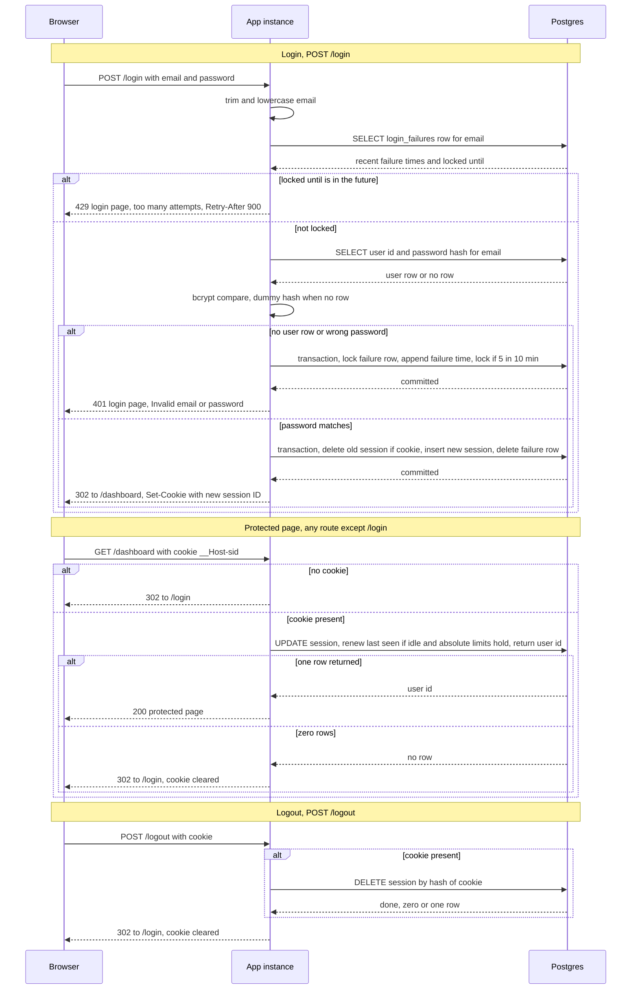

# Login with server-side sessions: design

## Decisions

1. **Storage: Postgres, no Redis.** Sessions and failure counters live in two new tables in the existing Postgres database. Both instances already share it, so it is the only store that is consistent across them with no new service. The data is small and low-volume (a team scheduling app). Atomic upserts and row locks give correct failure counting across two instances. Redis would add a system to run, back up, secure and monitor, and it would buy only lower-latency lookups that this app does not need. Revisit if per-request session writes show up in latency numbers.

2. **Session ID: 256 random bits.** Generate 32 bytes from a CSPRNG (`crypto.randomBytes`), encode as base64url. Store only the SHA-256 hash of the ID, so a database read does not yield usable cookies. Every successful login generates a new ID, never reuses one.

3. **Cookie: `__Host-sid`.** Attributes are `HttpOnly; Secure; SameSite=Lax; Path=/`, with no `Domain`. The value is the opaque session ID only. The cookie has no `Max-Age` or `Expires`, so the server is the only authority on expiry. Clearing the cookie uses the same attributes with `Max-Age=0`. Local HTTP development needs an exception or HTTPS, because `Secure` cookies are not sent over plain HTTP.

4. **Expiry is checked on the server, on every protected request, using the database clock.** One conditional statement both checks and renews the session:
   `UPDATE sessions SET last_seen_at = now() WHERE id_hash = $1 AND last_seen_at > now() - interval '30 min' AND absolute_expires_at > now() RETURNING user_id`.
   Zero rows means missing, unknown, idle-expired or absolute-expired, and all four get the same treatment: clear the cookie and redirect to `/login`. Using `now()` from Postgres avoids clock skew between the two instances.

5. **Abandoned sessions are cleaned up by a periodic job.** Every 10 minutes, either instance runs an idempotent delete: sessions where `last_seen_at <= now() - 30 min` or `absolute_expires_at <= now()`, and failure rows with no recent failures and no active lock. Running on both instances is harmless. Expired rows are never accepted, so cleanup affects storage size only. A failed cleanup run is logged and retried on the next tick, and it has no user-visible effect.

6. **Failure counting: exact sliding window.** Table `login_failures` holds one row per email (lowercase), with `recent_failures timestamptz[]` capped at the last 5 failure times and `locked_until timestamptz`. On each failed attempt, inside one transaction with `SELECT ... FOR UPDATE` on the row, append `now()` and keep only the last 5. If there are 5 entries and the oldest is within 10 minutes of now, set `locked_until = now() + 15 min`. This catches any 5 failures within any 10-minute period. A locked attempt returns 429 before any password check. It is not recorded as a failure and it does not extend the lock. A successful login deletes the row.

7. **No account enumeration.** Failures are recorded for every submitted email, whether or not the account exists. Unknown emails are checked against a precomputed dummy bcrypt hash at the same cost, so timing matches. Every login attempt runs the same lockout lookup. The 401 and 429 bodies do not depend on whether the account exists. Email input is trimmed, lowercased and capped at 254 characters, which bounds the number of `login_failures` rows that unknown addresses can create.

8. **Successful login is one transaction.** Delete the session named by the incoming cookie (if any), insert the new session, and delete the failure row. Commit, then reply with 302 to `/dashboard` and `Set-Cookie` for the new ID. If the transaction fails, nothing changes: the old session stays, the failure count stays, and no cookie is issued.

9. **Logout is idempotent.** Delete the session by hash if a cookie is present, then reply with 302 to `/login` and a cleared cookie. The reply is the same whether or not a session existed.

10. **Storage failure behaviour (fail closed, never fail open).**
    - Login, lockout lookup or user lookup fails: show the login page with HTTP 503 and "We could not sign you in right now. Try again in a moment." The lockout check is never skipped.
    - Login, failure write fails after a bad password: 503 with the same message. The attempt is not silently uncounted.
    - Login, session transaction fails after a correct password: 503. No cookie is issued.
    - Protected request, session lookup fails: 503 page "Sign-in check unavailable, try again." The request is not treated as signed in, and the cookie is kept, because the server session may still be valid.
    - Logout, delete fails: 503 "Could not sign you out, try again," and the cookie is kept, because the server session may still be live. Destroying the server session is required before clearing the cookie.
    - All responses carry `Cache-Control: no-store`. Logs record hashed or truncated session IDs, never passwords or raw IDs.

## Schema

```sql
CREATE TABLE sessions (
  id_hash            bytea PRIMARY KEY,          -- SHA-256 of the cookie value
  user_id            bigint NOT NULL REFERENCES users(id),
  created_at         timestamptz NOT NULL DEFAULT now(),
  last_seen_at       timestamptz NOT NULL,       -- idle clock, reset on every request
  absolute_expires_at timestamptz NOT NULL       -- created_at + 12 hours, fixed
);
CREATE INDEX ON sessions (last_seen_at);
CREATE INDEX ON sessions (absolute_expires_at);

CREATE TABLE login_failures (
  email           text PRIMARY KEY,              -- lowercase, trimmed
  recent_failures timestamptz[] NOT NULL DEFAULT '{}',  -- last 5 failures
  locked_until    timestamptz
);
```

## Sequence diagram



## Rules that do not fit on the arrows

- **Session states.** Active (`last_seen_at` within 30 minutes and `absolute_expires_at` in the future) means accepted. Idle-expired and absolute-expired are both rejected with no distinction shown to the user. Deleted sessions are rejected like unknown ones.
- **Idle and absolute limits.** The idle clock restarts on every protected request. The absolute limit of 12 hours from login is fixed and not extended by activity. Whichever comes first ends the session.
- **Lockout.** Lockout applies per normalized email, whether or not the account exists. Attempts during a lock do not count and do not extend it. The lock lasts 15 minutes from the moment it is set. Once it expires, old failure times are more than 10 minutes old, so the next failure starts fresh.
- **Login success always rotates.** A new ID is issued even when the browser already sent a valid one. The old session is deleted in the same transaction as the new one is created.
- **Cookie carries only the opaque ID.** No user ID, email or role is stored in the cookie. The user is looked up from the session row.
- **Redirect targets.** Any request without a valid session goes to `/login`, and a cookie that is present but invalid is cleared on that response.

## Open tradeoffs (not decided here)

- **Per-email lockout can be used to lock out a real user.** Five bad attempts from anyone block that email for 15 minutes. This follows the brief. A per-IP limit could be added later if it becomes a problem.
- **CSRF.** `SameSite=Lax` blocks cross-site POSTs in most browsers, which covers `/login` and `/logout` in the common case. A per-form CSRF token is a reasonable addition. It is not in the brief.
- **Per-request write.** Every protected request writes `last_seen_at`. This is acceptable at team scale. If load grows, the write can be throttled to once per minute, at the cost of the idle limit being checked at one-minute granularity.
- **Password change or reset.** Existing sessions are not revoked by password changes. Password reset is out of scope, so this is left for when it is added.