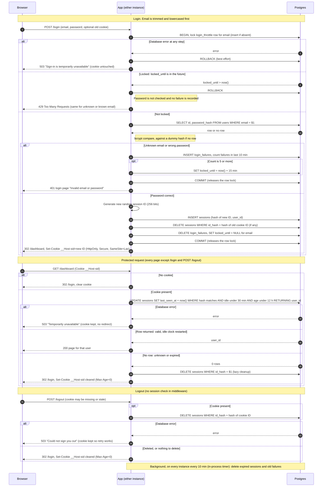

# Design: Login with server-side sessions

## Summary

Every page except `/login` requires a session. The session is a random opaque ID in a cookie, and its state lives in the existing Postgres, so both instances see the same data and no new infrastructure is added. Main flow: `POST /login` checks the brute-force limit, then the password, then creates a new session and sets the cookie. Each protected request validates and refreshes the session with one database statement. Logout deletes the session. Every expiry decision uses the database clock (`now()`), so drift between the two instances cannot matter. The design assumes only a request filter ("middleware") that runs before every route, and the existing load balancer.

## Terms

- **Session ID**: 32 random bytes (OS CSPRNG), base64url encoded. Only its SHA-256 hash is stored, so a leaked database holds no usable IDs.
- **Idle limit / absolute limit**: a session ends after 30 minutes with no requests, or 12 hours after login, whichever comes first.
- **Lockout**: after 5 failed logins for one email within any 10 minutes, that email is refused for 15 minutes with HTTP 429.
- **Fail closed**: if the database cannot confirm something, the app never creates or accepts a session.

## Decisions

**Storage: Postgres, no Redis.** Traffic is one small team's, and Postgres is already deployed, backed up and shared by both instances. A primary-key lookup plus a small update per request is cheap. Redis would add a second stateful service and a second failure mode for every request. It is worth adding only if session writes become a measured bottleneck, and all access sits behind one session-store module so moving is easy. Process memory is ruled out by two instances with no sticky sessions.

**Cookie.** `__Host-sid=<id>; Path=/; HttpOnly; Secure; SameSite=Lax`. No `Domain` (required by `__Host-`). No `Max-Age` or `Expires`, because the server decides expiry. Clearing sends the same name and attributes with `Max-Age=0`. `SameSite=Lax` keeps browsers from sending the cookie on cross-site POSTs, so no separate CSRF token is added for `POST /login` and `POST /logout`.

**Schema** (new tables; `users` is unchanged):

```sql
CREATE TABLE sessions (
  id_hash      bytea       PRIMARY KEY,          -- SHA-256 of the session ID
  user_id      bigint      NOT NULL REFERENCES users(id) ON DELETE CASCADE,
  created_at   timestamptz NOT NULL DEFAULT now(),
  last_seen_at timestamptz NOT NULL DEFAULT now()
);
CREATE TABLE login_throttle (
  email        text        PRIMARY KEY,          -- lowercase; need not exist in users
  locked_until timestamptz
);
CREATE TABLE login_failures (
  email     text        NOT NULL,
  failed_at timestamptz NOT NULL DEFAULT now()
);
CREATE INDEX login_failures_idx ON login_failures (email, failed_at);
```

(Optional indexes on `sessions.last_seen_at` and `created_at` can speed up the cleanup job.)

## Steps

**Login (`POST /login`)**

1. Trim and lowercase the email. Throttling is keyed on this string whether or not the account exists, so a 429 never reveals whether an account exists.
2. Open a transaction and take a row lock on that email's `login_throttle` row (insert it if absent). Concurrent attempts for one email are serialized and cannot slip past the limit.
3. If `locked_until > now()`, roll back and answer 429. The password is not checked and no failure is recorded, so the lock is not extended.
4. Look up the user by email and run a bcrypt comparison. For an unknown email, compare against a fixed dummy hash of the same cost so timing matches.
5. Unknown email or wrong password: insert a `login_failures` row. If that email now has 5 or more failures in the last 10 minutes, set `locked_until = now() + 15 minutes`. Commit and answer 401 with the login page "Invalid email or password". Both cases take this same path and give the same response.
6. Correct password: in the same transaction, insert a new session (a fresh random ID, never derived from the incoming cookie, which prevents session fixation), delete the session the incoming cookie pointed to (if any), delete the email's failures and set `locked_until = NULL`. Commit, then answer 302 to `/dashboard` with the new cookie. Returning to the originally requested page is not part of this design.
7. A 401 or 429 does not touch any existing session or cookie. `GET /login` always shows the plain HTML login form, even if the browser has a valid session.

**Protected request (every route except `/login` and `POST /logout`)**

1. No cookie: reply 302 to `/login` with a clearing cookie (same reply as an expired session, so all cases look alike).
2. Otherwise run one atomic statement that validates and refreshes:

```sql
UPDATE sessions
   SET last_seen_at = now()
 WHERE id_hash = $1
   AND last_seen_at > now() - interval '30 minutes'   -- idle limit
   AND created_at   > now() - interval '12 hours'     -- absolute limit
RETURNING user_id;
```

3. One row back: the session is valid and the idle clock has restarted. The handler gets `user_id` and loads its own data. `created_at` is never updated, so the 12-hour limit cannot be extended.
4. Zero rows (unknown or expired): run `DELETE FROM sessions WHERE id_hash = $1`, clear the cookie and redirect to `/login`.
5. Expiry is enforced by this statement, not by cleanup, so an expired row that still exists cannot authenticate.

**Logout (`POST /logout`)** skips the session check in middleware.

1. If a cookie is present, run `DELETE FROM sessions WHERE id_hash = $1` on its hash. Deleting zero rows, or having no cookie, is not an error.
2. Reply 302 to `/login` with the cleared cookie. The response is identical with or without a session.

**Cleanup.** A timer in each app process runs every 10 minutes. Overlapping runs from the two instances are harmless because the deletes are idempotent. If a run fails it is logged and the next tick retries. If the job stops entirely, tables grow but security is unaffected.

```sql
DELETE FROM sessions WHERE last_seen_at < now() - interval '30 minutes'
                        OR created_at   < now() - interval '12 hours';
DELETE FROM login_failures WHERE failed_at < now() - interval '10 minutes';
DELETE FROM login_throttle t WHERE (t.locked_until IS NULL OR t.locked_until < now())
  AND NOT EXISTS (SELECT 1 FROM login_failures f WHERE f.email = t.email);
```

## When things fail

Fail closed. The 503 pages use the same text for every cause and carry no details; details go to server logs.

| Situation | Response |
|---|---|
| Login: any database error | 503 "Sign-in is temporarily unavailable. Please try again." Cookie untouched, not counted as a failed attempt. The app sends ROLLBACK (a dead connection is abandoned by Postgres), so everything in the transaction, including failure rows, is lost. |
| Protected page: database error on session check | 503 "Temporarily unavailable. Please reload." The cookie is not cleared and there is no redirect, because the session may still be valid. |
| Logout: database error on delete | 503 "Could not sign you out. Please try again." The cookie is kept so a retry can find the session. The browser is never told it is logged out while the server session is alive. |
| Cleanup job fails | Logged, retried at the next tick. |

Known trade-offs:
- Per-email lockout lets someone deliberately lock a known email out for 15 minutes. The requirement asks for this. Per-IP limiting is out of scope.
- Every protected request does one database write, for exactness of the idle rule. If it ever hurts, update `last_seen_at` only when it is more than 1 minute stale, at the cost of up to 1 minute of imprecision.

## Sequence diagram



## Open questions

- The language, web framework and middleware mechanism are not specified in the brief; the design assumes only a pre-route filter.
