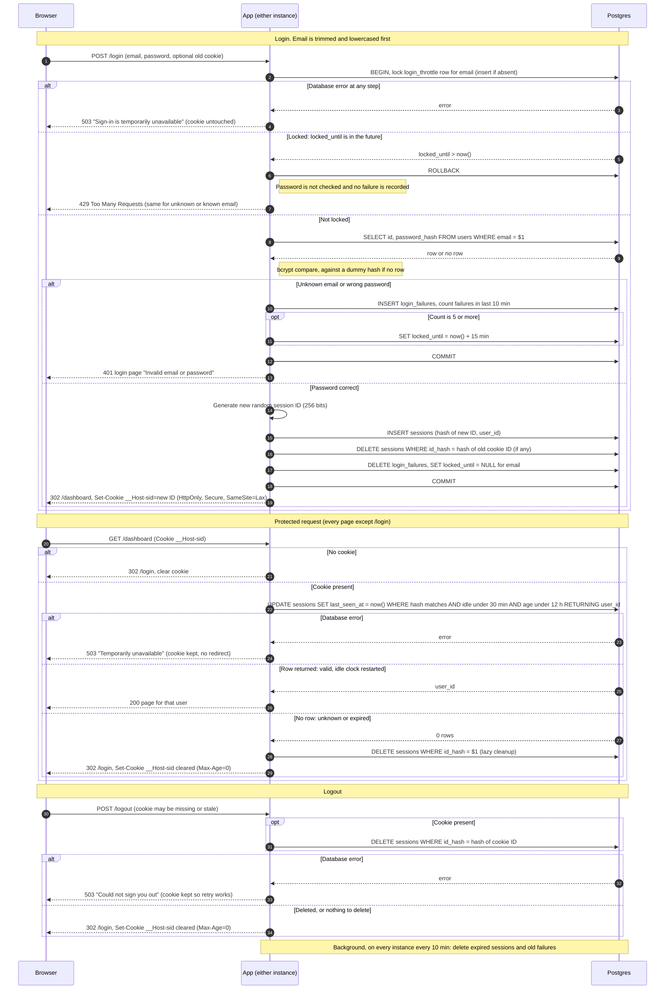

# Design: Login with server-side sessions

## Summary

Every page except `/login` requires a session. The session is a random opaque ID in a cookie. All state lives in the existing Postgres, so both instances see the same data and no new infrastructure is added. Every expiry decision uses the database clock (`now()`), so clock drift between the two instances cannot matter.

## Decisions

**1. Where sessions and failure counts live: Postgres. No Redis.**
- The app has one small team's traffic, and Postgres is already deployed, backed up and shared by both instances. A primary-key lookup plus a small update per request is cheap at this scale.
- Redis would add a second stateful service to run, secure, back up and monitor. It would also add a second failure mode for every request. It earns its place only if session writes become a measured bottleneck. Moving then is easy because all access sits behind one session-store module.
- Process memory is ruled out by the two-instance, no-sticky-sessions setup.

**2. Schema (new tables; `users` is unchanged)**

```sql
CREATE TABLE sessions (
  id_hash      bytea       PRIMARY KEY,          -- SHA-256 of the session ID
  user_id      bigint      NOT NULL REFERENCES users(id) ON DELETE CASCADE,
  created_at   timestamptz NOT NULL DEFAULT now(),
  last_seen_at timestamptz NOT NULL DEFAULT now()
);
CREATE INDEX sessions_last_seen_idx ON sessions (last_seen_at);
CREATE INDEX sessions_created_idx   ON sessions (created_at);

CREATE TABLE login_throttle (
  email        text        PRIMARY KEY,          -- lowercase; need not exist in users
  locked_until timestamptz
);
CREATE TABLE login_failures (
  email     text        NOT NULL,
  failed_at timestamptz NOT NULL DEFAULT now()
);
CREATE INDEX login_failures_idx ON login_failures (email, failed_at);
```

**3. Session ID.** 32 bytes from the OS CSPRNG, base64url encoded (256 bits). Only its SHA-256 hash is stored, so a leaked database or backup contains no usable session IDs. The cookie holds the raw ID and nothing else.

**4. Cookie.** `__Host-sid=<id>; Path=/; HttpOnly; Secure; SameSite=Lax`.
- No `Domain`, as the `__Host-` prefix requires.
- No `Max-Age` or `Expires`, so it is a browser-session cookie. The server decides expiry, so the cookie never needs to be re-sent to slide the idle timer.
- Clearing sends the same name and attributes with `Max-Age=0`.
- `SameSite=Lax` stops browsers sending the cookie on cross-site POSTs. That covers `POST /logout` and `POST /login`, so no separate CSRF token is added for these two routes.

**5. How expiry is checked and recorded.** One atomic statement per protected request both validates and refreshes:

```sql
UPDATE sessions
   SET last_seen_at = now()
 WHERE id_hash = $1
   AND last_seen_at > now() - interval '30 minutes'   -- idle limit
   AND created_at   > now() - interval '12 hours'     -- absolute limit
RETURNING user_id;
```

- One row back means valid, and the idle clock has been restarted in the same step.
- Zero rows means missing, unknown or expired. All three get the same treatment.
- `created_at` is never updated, so the 12-hour limit cannot be extended.
- Expiry is enforced by this predicate, not by the cleanup job. An expired row that has not been removed yet still cannot authenticate.

**6. How abandoned sessions are removed.**
- Lazily: when the check above matches nothing, the request also runs `DELETE FROM sessions WHERE id_hash = $1`.
- Periodically: every instance runs this every 10 minutes. Overlapping runs are harmless because the delete is idempotent.
  ```sql
  DELETE FROM sessions WHERE last_seen_at < now() - interval '30 minutes'
                          OR created_at   < now() - interval '12 hours';
  DELETE FROM login_failures WHERE failed_at < now() - interval '10 minutes';
  DELETE FROM login_throttle t WHERE (t.locked_until IS NULL OR t.locked_until < now())
    AND NOT EXISTS (SELECT 1 FROM login_failures f WHERE f.email = t.email);
  ```
- If the job stops, the table grows but security is unaffected (see decision 5).

**7. Brute-force limit.**
- The email is trimmed and lowercased first. Throttling is keyed on that string, whether or not the account exists. This is what keeps a 429 from revealing whether an account exists.
- A login attempt opens a transaction and takes a row lock on that email's `login_throttle` row (inserted if absent). Concurrent attempts for one email are therefore serialized and cannot slip past the limit.
- If `locked_until > now()`, answer 429 immediately. The password is not checked. The attempt is not recorded as a failure, so it does not extend the lock.
- A failure inserts a `login_failures` row. If the count of that email's failures in the last 10 minutes is now 5 or more, set `locked_until = now() + 15 minutes`. Any 5 failures inside a sliding 10-minute window trigger it.
- When the lock ends, all 5 triggering failures are over 10 minutes old, so the count starts again from zero.
- A success deletes that email's failures and sets `locked_until = NULL`. A success can only happen when the email is not locked.

**8. No account-existence leak.**
- Unknown email and wrong password go through the same code path and return the same 401 and body ("Invalid email or password").
- For an unknown email, the app still runs a bcrypt comparison against a fixed dummy hash of the same cost. This keeps response time the same.
- Both cases record a failure under the submitted email.

**9. What the user sees when storage fails.** Fail closed. Never create or accept a session without a successful database check.

| Situation | Response |
|---|---|
| Login: any database error (throttle check, user lookup, session insert) | HTTP 503, page "Sign-in is temporarily unavailable. Please try again." No cookie change. Not counted as a failed attempt. |
| Protected page: database error during session check | HTTP 503 page "Temporarily unavailable. Please reload." The cookie is **not** cleared and there is no redirect to `/login`, because the session may still be valid and a redirect would force a pointless re-login. |
| Logout: database error on delete | HTTP 503 page "Could not sign you out. Please try again." The cookie is kept so a retry can still find the session. The browser is never told it is logged out while the server session is alive. |

The 503 pages use the same text for every cause and carry no details. Details go to server logs.

## Rules that do not fit on the arrows

- **Login success is one transaction.** It inserts the new session, deletes the session the incoming cookie pointed to (if any, valid or not), and clears the email's failure state. If it fails, none of it applies and the user gets the 503 above.
- The new session ID is always freshly generated and never derived from the incoming cookie. This prevents session fixation.
- A 401 or 429 response does not touch any existing session or cookie.
- **Logout** hashes the cookie ID (if present), runs `DELETE FROM sessions WHERE id_hash = $1`, and then replies with the cleared cookie and a redirect to `/login`. Deleting zero rows, or having no cookie at all, is not an error. The response is identical, so logout behaves the same with no session.
- **Public vs protected.** Middleware runs before every route. `/login` (GET and POST) is exempt. Everything else, including `POST /logout`, goes through the session check, except that logout's own handler tolerates a missing session instead of redirecting.
- **Known trade-off.** Per-email lockout lets someone deliberately lock a known email out for 15 minutes. The requirement asks for exactly this behavior. Per-IP limiting is not in scope.
- **Cost.** Every protected request does one database write. This is accepted for exactness of the 30-minute idle rule. If it ever hurts, update `last_seen_at` only when it is more than 1 minute stale, at the cost of up to 1 minute of imprecision.

## Sequence diagram


