# Sign in with Google: flow, state and failures

Google sign-in is a second way into the existing password login. Each attempt is a short Redis flow with a state, nonce and PKCE verifier. Google accounts are matched only by `sub`, stored in a new `google_identities` table, and every success ends in the same `start_session(user_id)` call as a password login. A linked account goes straight in. An unlinked account whose verified email matches an existing user must first prove that user's password.

The flowchart is the source of truth. The notes and tables after it say where each piece of state lives, what removes it, and what happens on failure.

## Terms

- **Flow**: one Google round trip, from start to callback. Stored in Redis under `goidc:<state>` for 600 s.
- **state**: a random value sent to Google and echoed back. The same value is stored in the browser cookie `goidc_state`.
- **intent**: `login` or `settings`. It says which path the callback takes.
- **origin page**: the page the user started from, either the login page or Account Settings. Stored in the flow.
- **sub**: Google's permanent id for an account. We identify Google accounts only by `sub`, never by email.
- **pending link**: a verified Google sign-in waiting for the account's password. Stored in Redis under `glink:<token>` for 600 s. The browser cookie `glink` holds the same token.
- **sid**: the existing session cookie.
- **start_session(user_id)**: the existing function. It creates the session and redirects to `next` only if it is a relative path on our site, otherwise to `/home`.

## Diagram

```mermaid
flowchart TD
  subgraph ENTRY["Entry points"]
    LOGIN["Login page: Sign in with Google"]
    SETTINGS["Account Settings: Link Google, POST with CSRF token"]
    UNLINKBTN["Account Settings: Unlink Google, POST"]
  end

  subgraph START["Start a flow"]
    STARTLOGIN["GET /auth/google/start, intent login, origin login page, next"]
    STARTSET["POST /settings/google/link, intent settings, origin settings page"]
    SIGNEDQ{"User signed in?"}
    SIGNOUT["Redirect to login page, no flow started"]
    SETQ{"User already has a Google account?"}
    SETALREADY["Back to settings: already linked, no flow started"]
    MKFLOW["Store flow in Redis key goidc:STATE, TTL 600 s, holding state, nonce, PKCE verifier, intent, user_id for settings, origin page, next. Set cookie goidc_state to STATE, HttpOnly Secure SameSite Lax Max-Age 600"]
    REDISFAIL["Error page, no redirect to Google"]
    TOGOOGLE["Redirect to Google authorize URL, scope openid email profile, PKCE S256, state, nonce"]
  end

  CONSENT["Google consent screen"]

  subgraph CALLBACK["Callback"]
    CB["GET /auth/google/callback with state and code or error"]
    STATEQ{"state equals goidc_state cookie and flow exists? Consume with GETDEL"}
    BADSTATE["Error page: sign-in link invalid or expired. Nothing changes, existing session kept"]
    ERRQ{"Google returned an error?"}
    NEUTRAL["Redirect to origin page: Google sign-in was not completed"]
    EXCH["Exchange code at Google token endpoint with PKCE verifier. Validate ID token: signature, iss, aud, exp, nonce. Read only sub, email, email_verified"]
    EXCHFAIL["Error page: Google sign-in failed, try again. Nothing created, no pending link. Code not retried"]
  end

  INTENTQ{"Intent?"}

  subgraph SETLINK["Settings link"]
    SESSQ{"sid maps to a live sessions row whose user_id is the flow user_id?"}
    SESSBAD["Error page: not signed in as this account. Flow already consumed"]
    LQ1{"sub already in google_identities?"}
    LSAME["Back to settings: already linked to this user"]
    LREFUSE1["Back to settings: refuse, this Google account belongs to another user"]
    LQ2{"This user already has a different Google account?"}
    LREFUSE2["Back to settings: refuse, unlink the current Google account first"]
    LINS["INSERT google_identities sub, user_id. Stored email unchanged"]
    LCONFLICT["Back to settings: refuse, changed meanwhile"]
    LDONE["Back to settings: Google linked"]
  end

  subgraph LOGINPATH["Login path"]
    LQ0{"sub already linked to a user?"}
    LOCKQ1{"Linked user locked_until in the future?"}
    LLOCKED["Login page: Account temporarily locked"]
    VERQ{"email_verified is true?"}
    REFUNVER["Login page: Google email not verified, use email and password. Nothing created"]
    EMQ{"Lowercased email matches a users row?"}
    HASQ{"That user already has a google_identities row?"}
    REFOTHER["Login page: refuse, this account already has a different Google account"]
    CREATE["One transaction: INSERT users with lowercased email, password_hash NULL, email_verified_at now, then INSERT google_identities for the new user"]
    PEND["Create pending link glink:TOKEN, TTL 600 s, holding sub, user_id, next. Set cookie glink. Redirect to confirm page"]
  end

  subgraph CONFIRM["Password confirmation, 600 s from the callback"]
    PFORM["Confirm page: ask for the account password, with Cancel button"]
    PPOST["POST password, token read from glink cookie"]
    PQ{"Pending link found for the token?"}
    PEXP["Login page: sign-in expired, start again"]
    PLOCKQ{"locked_until in the future?"}
    PLOCKED["Delete pending link. Login page: Account temporarily locked. Password not checked"]
    PCHK{"bcrypt check against pending user_id. NULL password_hash counts as wrong"}
    PFAIL["failed_logins plus 1"]
    PFIVE{"failed_logins reached 5?"}
    PWRONG["Show incorrect password. Pending link kept"]
    PLOCKSET["Set locked_until to now plus 15 min, failed_logins to 0. Delete pending link. Login page: incorrect password message"]
    PINS{"INSERT google_identities succeeds?"}
    PCONFLICT["Delete pending link. Login page: refuse, changed meanwhile"]
    POK["failed_logins to 0. Set email_verified_at if NULL. Delete pending link"]
    PCANCEL["Cancel POSTs to server. Delete pending link. Login page"]
  end

  SIGNIN["start_session user_id: delete old sid row if sent, insert sessions row, set sid cookie, redirect to next or /home"]

  LOGIN --> STARTLOGIN
  SETTINGS --> STARTSET
  STARTLOGIN --> MKFLOW
  STARTSET --> SIGNEDQ
  SIGNEDQ -- "no" --> SIGNOUT
  SIGNEDQ -- "yes" --> SETQ
  SETQ -- "yes" --> SETALREADY
  SETQ -- "no" --> MKFLOW
  MKFLOW -- "Redis write fails" --> REDISFAIL
  MKFLOW -- "ok" --> TOGOOGLE
  TOGOOGLE --> CONSENT
  CONSENT -- "approves or presses Cancel" --> CB
  CB --> STATEQ
  STATEQ -- "no, or Redis is down" --> BADSTATE
  STATEQ -- "yes" --> ERRQ
  ERRQ -- "yes" --> NEUTRAL
  ERRQ -- "no" --> EXCH
  EXCH -- "network error, non-2xx, or invalid ID token" --> EXCHFAIL
  EXCH -- "valid" --> INTENTQ
  INTENTQ -- "settings" --> SESSQ
  INTENTQ -- "login" --> LQ0
  SESSQ -- "no" --> SESSBAD
  SESSQ -- "yes" --> LQ1
  LQ1 -- "this user" --> LSAME
  LQ1 -- "another user" --> LREFUSE1
  LQ1 -- "not linked" --> LQ2
  LQ2 -- "yes" --> LREFUSE2
  LQ2 -- "no" --> LINS
  LINS -- "unique violation" --> LCONFLICT
  LINS -- "ok" --> LDONE
  LQ0 -- "yes" --> LOCKQ1
  LQ0 -- "no" --> VERQ
  LOCKQ1 -- "yes" --> LLOCKED
  LOCKQ1 -- "no" --> SIGNIN
  VERQ -- "no" --> REFUNVER
  VERQ -- "yes" --> EMQ
  EMQ -- "no" --> CREATE
  EMQ -- "yes" --> HASQ
  CREATE -- "unique violation on email, check once more" --> EMQ
  CREATE --> SIGNIN
  HASQ -- "yes" --> REFOTHER
  HASQ -- "no" --> PEND
  PEND --> PFORM
  PFORM --> PPOST
  PPOST --> PQ
  PQ -- "no" --> PEXP
  PQ -- "yes" --> PLOCKQ
  PLOCKQ -- "yes" --> PLOCKED
  PLOCKQ -- "no" --> PCHK
  PCHK -- "no" --> PFAIL
  PFAIL --> PFIVE
  PFIVE -- "no" --> PWRONG
  PWRONG --> PFORM
  PFIVE -- "yes" --> PLOCKSET
  PCHK -- "yes" --> PINS
  PINS -- "unique violation" --> PCONFLICT
  PINS -- "ok" --> POK
  POK --> SIGNIN
  PFORM -- "Cancel" --> PCANCEL
  UNLINKBTN --> UQ{"users.password_hash set?"}
  UQ -- "no" --> UNOPW["Settings: set a password first, use Forgot password for the reset email"]
  UQ -- "yes" --> UDEL["Delete google_identities row for this user. Back to settings: Google unlinked"]
```



## Steps

1. **Start.** Login starts a flow for anyone. Settings needs a signed-in user, and the flow records that user's id. A signed-out user is sent to the login page and no flow starts. If the flow cannot be written to Redis, show an error page and do not redirect to Google.
2. **Google round trip.** Google shows its consent screen. Approving and pressing Cancel both return to the callback. Google's error parameter is handled in step 3.
3. **Callback checks.** The `state` in the URL must equal the `goidc_state` cookie, and a flow record must exist. The record is deleted at once (GETDEL), whatever the outcome. If Google sent an error, the user returns to the origin page with a neutral message.
4. **Code exchange.** Exchange the code with the PKCE verifier. Validate the ID token (signature, iss, aud, exp, nonce) and read only `sub`, `email` and `email_verified`. Tokens are discarded. A failed exchange shows an error and creates nothing. The code is not retried, so the user starts a new flow.
5. **Settings link.** The sid cookie must map to a live, unexpired `sessions` row whose `user_id` equals the flow's `user_id`. Then link as the diagram shows. The email is not compared and the stored email is never changed.
6. **Login, linked `sub`.** After the lock check, go straight to `start_session`. No password and no email comparison. A link cannot outlive its user, because `google_identities.user_id` cascades on delete.
7. **Login, unlinked `sub`.** Refuse if `email_verified` is false. If a user has the lowercased email, that user must not already have another Google account. Then the flow goes to the password step (step 8). If no user has the email, create a user with no password and a verified email, link it, and sign in.
8. **Password confirmation.** The confirm page asks for the account password. The token comes from the `glink` cookie, and the pending link holds the `user_id`, so the form carries no user id. A missing or expired link goes back to login. A locked account is refused without checking the password. The password is checked against the stored `user_id`. A NULL hash counts as wrong. A wrong password adds one to `failed_logins`. The fifth one sets a 15-minute lock, resets the count, and deletes the link. A right password resets `failed_logins`, inserts the `google_identities` row (a conflict is refused), sets `email_verified_at` if it is NULL, and deletes the link. Cancel deletes the link. If the user walks away, the link expires after 600 s and grants nothing.
9. **Session.** Every successful Google sign-in calls `start_session(user_id)`, the same as a password login. No new session type is created.

## Failures

| Failure | Result | Changes made |
|---|---|---|
| Unknown, expired, used or cookie-mismatched state, or Redis down at callback | Error page: sign-in link invalid or expired | None. Existing session kept. The flow expires by TTL |
| Redis unavailable at start | Error page, no redirect to Google | None |
| Google error parameter, e.g. Cancel | Origin page with neutral message | Flow consumed |
| Settings callback where sid does not map to a live session for the flow `user_id` | Error page | Flow consumed |
| Code exchange fails: network error, non-2xx, bad signature, or bad iss, aud, exp or nonce | Error page: Google sign-in failed, try again | Nothing created, no pending link. Code not retried |
| Unlinked `sub` with `email_verified` false | Refuse, point to email and password | Nothing created |
| Verified email matches a user who already has another Google account | Refuse | Nothing created |
| Settings link where `sub` belongs to another user | Refuse | None |
| Settings link where this user already has a different Google account | Refuse, unlink first | None |
| Unique violation on user create (email race) | Repeat the email check once. If still conflicting, error page | Transaction rolled back |
| Unique violation on link insert (settings or confirm) | Refuse, changed meanwhile | Transaction rolled back. At confirm, the pending link is deleted |
| Linked user locked at login | Account temporarily locked | None |
| Pending link missing or expired | Login page: sign-in expired, start again | Link gone by TTL |
| Account locked at confirm | Account temporarily locked. Password not checked | Pending link deleted |
| Wrong password, or NULL hash, fewer than 5 | Incorrect password, stay on form | `failed_logins` plus 1. Pending link kept |
| Fifth wrong password | Incorrect password message on login page | `locked_until` set 15 min, `failed_logins` 0, pending link deleted. The next Google attempt meets the lock at confirm |
| Cancel at confirm | Back to login | Pending link deleted |
| Unlink without a password | Set a password first, using Forgot password | None |
| Unlink with a password | Google unlinked | `google_identities` row deleted |

Forgot password sets `password_hash` and deletes all sessions, so the user signs in again afterwards.

## Where state lives

| State | Where | Lifetime | What removes it |
|---|---|---|---|
| Flow record: state, nonce, PKCE verifier, intent, user_id (settings only), origin page, next | Redis `goidc:<state>` | 600 s | GETDEL at the first callback, whatever the outcome, or TTL |
| Cookie `goidc_state` (the state value) | Browser, HttpOnly, Secure, SameSite=Lax (so Google's redirect carries it) | 600 s | Cleared on the callback response, or expiry |
| Pending link: sub, user_id, next | Redis `glink:<token>` | 600 s from the callback | Success, Cancel, lock, or TTL. A wrong password keeps it |
| Cookie `glink` (the token) | Browser, same attributes | 600 s | Cleared with the pending link, or expiry |
| Google account link | Postgres `google_identities` (new) | Permanent | Unlink (only with a password), or user deletion. A Google email change never removes it |
| Google-created user | Postgres `users`, `password_hash` NULL | Permanent | User deletion |
| Lockout | `users.failed_logins`, `locked_until` (existing) | Existing rules | Lock expiry. A successful password check resets `failed_logins` |
| Session | `sessions` row and `sid` cookie (existing) | 14 days, slid | Sign-out, password reset, or replacement by `start_session` |
| Google access token, refresh token, raw ID token | Not stored | In memory during the callback | Discarded once the three claims are read |

Redis holds only short-lived flow data. If Redis is down, Google sign-in shows an error page and password login still works.

## Schema change

```sql
ALTER TABLE users ALTER COLUMN password_hash DROP NOT NULL;

CREATE TABLE google_identities (
  sub       TEXT PRIMARY KEY,                    -- Google account id from the ID token
  user_id   BIGINT NOT NULL UNIQUE REFERENCES users(id) ON DELETE CASCADE,
  linked_at TIMESTAMPTZ NOT NULL DEFAULT now()
);
```

The primary key on `sub` gives one user per Google account. The unique `user_id` gives one Google account per user. The database enforces both, so races surface as unique violations. Any code that compares against `password_hash` must handle NULL.

## Open questions

These are decisions the brief does not settle. Each has a default.

1. **Locked account.** A linked user with a future `locked_until` is refused. Default: honour the lock.
2. **Session holder links Google.** Settings linking needs no password, so anyone with a live session could link a Google account and later sign in as that user. The brief allows this. Consider a recent-login check before linking.
3. **`email_verified_at` on link.** When an existing user links through the password step, set it if NULL, since Google has verified the email. Default: yes.
4. **Failed-login count.** Google-only sign-in does not change `failed_logins`. Only the password step resets it. Default: no change.
5. **CSRF.** The existing docs do not mention a CSRF token. The link and unlink POSTs assume the app has one.
6. **Restarted flow.** A second callback replaces the `glink` cookie and pending record, and the old record expires on its own. Default: accept.
7. **Settings entry while signed out.** The settings link redirects to login and starts no flow.
8. **Existing emails.** Does every existing `users.email` hold lowercase text? The plan relies on the lowercase-on-write rule in `schema.sql` and does not check existing rows.