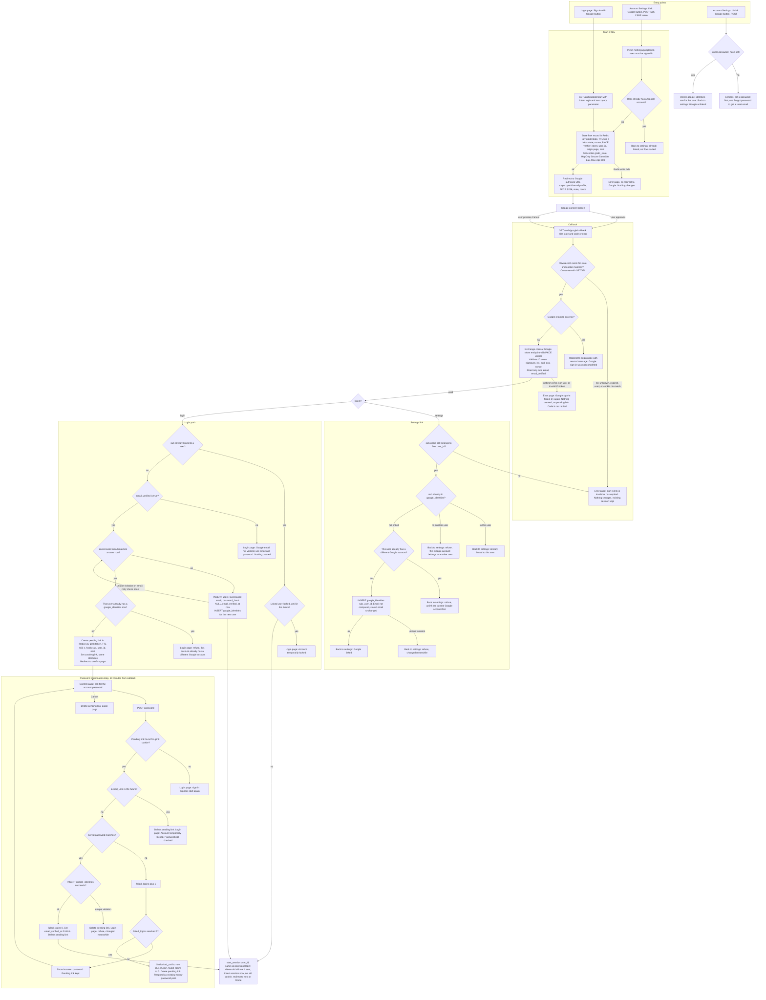

# Sign in with Google: flow, state and failures

This plan builds on the existing password login. Google sign-in ends in the same `start_session(user_id)` call, and wrong passwords use the existing `failed_logins` and `locked_until` rules. Two things are new: a short-lived flow held in Redis and a `google_identities` table. Google accounts are matched only by `sub`.

The flowchart is the source of truth. The tables below it say where each piece of state lives and what removes it.



## Where new state lives

| State | Where | Lifetime | What removes it |
|---|---|---|---|
| Flow record: state, nonce, PKCE verifier, intent, user_id (settings only), origin page, next | Redis key `goidc:<state>` | 600 s from start | GETDEL at the first callback, whatever the outcome, or TTL expiry |
| Flow cookie `goidc_state` | Browser, HttpOnly, Secure, SameSite=Lax (Lax so it is sent on Google's top-level redirect) | 600 s | Cleared on the callback response, or expiry |
| Pending link: sub, user_id, next | Redis key `glink:<token>` | 600 s from the callback that created it | Success, Cancel, lock, or TTL. A wrong password keeps it |
| Pending cookie `glink` | Browser, same attributes | 600 s | Cleared with the pending link |
| Google account link | Postgres `google_identities` (new, permanent) | Permanent | Unlink (only with a password), or user deletion (cascade). A Google email change never removes it |
| Google-created user | Postgres `users`, password_hash NULL | Permanent | User deletion |
| Lockout | `users.failed_logins`, `locked_until` (existing) | Existing rules | Lock expiry. A successful password check resets failed_logins |
| Session | `sessions` row and `sid` cookie (existing) | 14 days, slid | Sign-out, password reset, or replacement by start_session |
| Google access token, refresh token, raw ID token | Not stored | In memory during the callback only | Discarded once the three claims are read |

Redis holds only short-lived flow data. If Redis is down, Google sign-in fails with an error page, and password login still works.

## Failures

| Failure | Result | Changes made |
|---|---|---|
| Unknown, expired, used, or cookie-mismatched state | Error page: sign-in link invalid or expired | None. Existing session kept |
| Redis unavailable at start | Error page, no redirect to Google | None |
| Redis unavailable at callback | Error page | None. The flow expires by TTL |
| Google error parameter, e.g. Cancel | Back to origin page with neutral message | Flow record consumed |
| Settings callback where sid no longer belongs to flow user_id | Error page | Flow record consumed |
| Code exchange fails: network error, non-2xx, bad signature, or bad iss, aud, exp or nonce | Error page: Google sign-in failed, try again | Nothing created, no pending link. The code is not retried, so the user starts a new flow |
| Unlinked sub with email_verified false | Refuse, point to email and password | Nothing created |
| Verified email matches a user who already has another Google account | Refuse | Nothing created |
| Settings link where sub belongs to another user | Refuse | None |
| Settings link where this user already has a different Google account | Refuse, unlink first | None |
| Unique violation on user create (email race) | Repeat the email check once. If still conflicting, error page | Failed attempt rolled back |
| Unique violation on link insert | Refuse | Transaction rolled back |
| Pending link expired | Login page: sign-in expired, start again | Pending link gone by TTL |
| Wrong password, not yet 5 | Show incorrect password, stay on form | failed_logins plus 1. Pending link kept |
| Fifth wrong password | Respond as the existing wrong-password path. Next attempt gets Account temporarily locked | locked_until set 15 min, failed_logins 0, pending link deleted |
| Account locked at confirm | Account temporarily locked. Password not checked | Pending link deleted |
| Cancel at confirm | Back to login | Pending link deleted |
| Unlink without a password | Set a password first, using Forgot password | None |
| Unlink with a password | Google unlinked | google_identities row deleted |

Forgot password sets a password_hash and deletes all sessions, so the user signs in again afterwards.

## Schema change

```sql
ALTER TABLE users ALTER COLUMN password_hash DROP NOT NULL;

CREATE TABLE google_identities (
  sub       TEXT PRIMARY KEY,                    -- Google account id from the ID token
  user_id   BIGINT NOT NULL UNIQUE REFERENCES users(id) ON DELETE CASCADE,
  linked_at TIMESTAMPTZ NOT NULL DEFAULT now()
);
```

The primary key on `sub` gives one user per Google account. The unique `user_id` gives one Google account per user. Both are enforced by the database, so races surface as unique violations. Any code that compares against `password_hash` must handle NULL. A password attempt on a NULL-hash account should get the same response as a wrong password and count as a failure, so the response does not reveal whether the account has a password.

## Decisions to confirm

The brief does not settle these. Defaults are given.

1. **Locked account, Google sign-in.** A linked user with a future `locked_until` is refused with Account temporarily locked. Google sign-in skips the password, but the lock is an account state. Default: honour it.
2. **Session holder links Google.** Settings linking needs no password, so someone holding a live session could link their own Google account and sign in as the user later. The brief allows this. Consider a recent-login check before linking.
3. **email_verified_at on link.** When linking an existing user through the password step, set `email_verified_at` if it is NULL, since Google has verified the email. Default: yes.
4. **Failed-login count on Google sign-in.** Google-only sign-in does not change `failed_logins`. Only the password step resets it. Default: no change.
5. **CSRF.** The existing docs do not mention a CSRF token. The link and unlink POSTs assume the app has one.
6. **Restarted flow.** A second callback replaces the `glink` cookie and pending record. The old pending record expires on its own. Default: accept this.
7. **Settings entry while signed out.** The settings link should redirect to login. The flow is not started.