# Sign in with Google: flow, state and failures

Users start Google sign-in from the login page, or link Google from Account Settings. The server sends the browser to Google, Google sends it back to our callback with a one-time `code`, and the server swaps that code for an ID token. From the token we read only `sub`, `email` and `email_verified`. We then sign the user in, create a user, ask for a password to confirm a link, or refuse. Every successful sign-in ends in the existing `start_session`, so a Google session is the same as a password session.

## Background (existing system)

- One backend service renders the pages (no SPA, no mobile app). PostgreSQL holds `users`, `sessions` and `password_reset_tokens`; emails are stored lowercased. Redis exists and holds only short-lived data today.
- Password login (`POST /login`): if `locked_until` is in the future, it says "Account temporarily locked" and does not check the password. A wrong password adds 1 to `failed_logins`; at 5 it sets `locked_until` to now + 15 minutes and resets the counter to 0. A right password resets the counter and calls `start_session`.
- `start_session(user_id)` deletes any `sessions` row named by an incoming `sid` cookie, inserts a new row, sets the `sid` cookie (HttpOnly, Secure, SameSite=Lax), and redirects to `next` if it is a relative path on our site, otherwise to `/home`. It works whether or not someone is already signed in, so a user signed in as someone else is replaced.
- Password reset (`POST /forgot`) emails a one-hour link. Using it sets a new `password_hash`, marks the email verified and deletes all of the user's sessions.

## Terms

- **`state`**: a random value per attempt. It goes to Google, comes back in the callback query string, and is the Redis key of the attempt.
- **`nonce`**: a random value per attempt. Google puts it inside the ID token and the callback checks it matches, so an old token cannot be replayed.
- **PKCE `code_verifier`**: a random secret per attempt. At the start we send Google only its S256 hash. At code exchange we send the verifier itself, so a stolen `code` is useless to anyone else.
- **ID token**: a signed token from Google holding `sub`, `email` and `email_verified`. It comes back in reply to our server-to-server code exchange; the browser never sees it.
- **`sub`**: Google's permanent account id. We identify Google accounts by it, never by email.
- **Attempt**: one round trip to Google, stored as `goog:attempt:{state}` in Redis.
- **Pending link**: a login attempt whose verified Google email matches an existing user and is waiting for that user's password. Stored as `goog:pending:{pid}`, where `pid` is a fresh random id. It has its own key and cookie because the attempt is already consumed by then.

## Flowchart

```mermaid
flowchart TD
  LP["Login page: Continue with Google"] --> ST
  SP["Account Settings: Link Google, user is signed in"] --> ST

  ST["POST /auth/google/start with mode and next<br/>link mode: must be signed in with no Google linked, else back to Settings with message"]
  ST --> MK["Server makes state, nonce, PKCE verifier<br/>Redis SET goog:attempt:state TTL 600<br/>set cookie gstate<br/>redirect browser to Google: code flow, S256 challenge, scope openid email profile"]
  MK --> GG["User at Google"]
  GG --> CB["Google redirects browser to GET /auth/google/callback?code and state, or error"]

  CB --> C1{"state in query, cookie gstate equals state,<br/>and Redis GETDEL finds the attempt?<br/>(TTL expiry enforces the 10 minutes)"}
  C1 -- no --> ERRP["Error page. Nothing changes."]
  C1 -- yes --> C1b["Attempt is now consumed. Clear gstate."]
  C1b --> C2{"Google sent an error param?"}
  C2 -- yes --> BACK["Return to where the attempt started<br/>Login page or Settings, with neutral message,<br/>no details shown"]
  C2 -- no --> C3{"link mode and the signed-in user<br/>is not the attempt's user_id?"}
  C3 -- yes --> ERRP
  C3 -- no --> EX["Server calls Google's token endpoint with code and code_verifier<br/>and receives the ID token"]
  EX --> C4{"Exchange OK and ID token valid:<br/>iss, aud, exp, nonce match?"}
  C4 -- no --> BACKF["Return to origin with neutral try-again message<br/>Log it. No retry, the code is single use.<br/>Nothing is created or linked."]
  C4 -- yes --> C5{"mode?"}

  C5 -- login --> L1{"google_identities row for sub?"}
  L1 -- yes --> SS
  L1 -- no --> L2{"email_verified true?"}
  L2 -- no --> REF1["Login page: use email and password.<br/>Nothing created."]
  L2 -- yes --> L3{"User with lowercased email?"}
  L3 -- none --> CR["One transaction: insert user with NULL password_hash,<br/>email_verified_at now, plus google_identities row"]
  CR -- ok --> SS
  CR -- unique conflict --> BACKF
  L3 -- exists --> L4{"That user already has a Google account linked?"}
  L4 -- yes --> REF2["Refuse: account already has a different Google account.<br/>Nothing changes."]
  L4 -- no --> PD["Make pid. Redis SET goog:pending:pid TTL 600<br/>set cookie glink<br/>redirect to GET /auth/google/confirm"]

  PD --> P0
  P0{"glink cookie and pending key still exist?"}
  P0 -- no --> EXP["Login page: confirmation expired, start again.<br/>Clear glink."]
  P0 -- yes --> FORM["Confirm page: enter account password"]
  FORM --> P1{"POST confirm: locked_until in the future?"}
  P1 -- yes --> DISC1["Delete pending and glink.<br/>Show Account temporarily locked.<br/>Password not checked."]
  P1 -- no --> P2{"bcrypt matches?"}
  P2 -- no --> P3["failed_logins + 1"]
  P3 --> P4{"Reached 5?"}
  P4 -- yes --> DISC2["Set locked_until now + 15 min, failed_logins 0.<br/>Delete pending and glink. Show locked message."]
  P4 -- no --> FORM
  P2 -- yes --> P5["failed_logins = 0<br/>insert google_identities sub, user_id"]
  P5 -- ok --> DEL["Delete pending and glink"]
  DEL --> SS
  P5 -- unique conflict --> DISC3["Delete pending and glink.<br/>Refuse: already linked."]

  C5 -- link --> K1{"google_identities row for sub?"}
  K1 -- "other user" --> REF3["Settings: that Google account is linked to someone else.<br/>Nothing changes."]
  K1 -- "this user" --> OKS["Settings: already linked"]
  K1 -- none --> K2["Insert google_identities sub, user_id<br/>no password asked, emails need not match"]
  K2 -- ok --> DONE["Settings: Google linked"]
  K2 -- unique conflict --> REF3

  SS["start_session(user_id)<br/>delete old sid row if any, insert sessions row, set sid cookie<br/>redirect to next if relative, else /home<br/>Same session as password login"]

  UL["Settings: Unlink Google"] --> U1{"password_hash not NULL?"}
  U1 -- yes --> U2["Delete google_identities row"]
  U1 -- no --> U3["Refuse: set a password first using the existing<br/>reset email, POST /forgot"]
```

## Endpoints and rules

- `POST /auth/google/start` begins an attempt. It takes `mode=login|link` and an optional `next`, and uses the app's normal CSRF protection.
- `GET /auth/google/callback` receives Google's redirect.
- `GET` and `POST /auth/google/confirm` show and handle the password confirmation. They find the pending link by the `glink` cookie only.
- `POST /settings/google/unlink` removes the link.
- **Callback is honoured once.** It reads `state` from the query string and deletes the attempt in one atomic step (`GETDEL`). A replayed, forged or expired `state` finds nothing.
- **Attempt is bound to a browser.** The `gstate` cookie must equal `state`. This stops an attacker from making a victim finish the attacker's own Google login. The cookie is compared before any Redis read, so a forged request never consumes a real attempt.
- **Why confirm with a password.** Without it, someone controlling a Google account with the same verified email as an existing user could take that account over. Link mode needs no password because the user is already signed in.
- **Google-only users.** `users.password_hash` becomes nullable. A null hash never matches, so password login treats it as a wrong password with the same generic message. Such users can set a password through the existing reset email, which works because it only sets `password_hash` and deletes sessions.
- **Lockout covers password guessing only.** Signing in with an already-linked Google account ignores `locked_until` and does not touch `failed_logins`.
- **No changes to users.** Linking never changes `users.email` or `email_verified_at`, and a changed Google email changes nothing, because matching is by `sub` only. Link mode needs no verified email.
- **`next`** is stored in the attempt and re-validated by `start_session`. Settings attempts return to Settings.
- **Already signed in.** Login mode and the confirm page do not require being signed out; a successful sign-in replaces the existing session. Link mode requires being signed in and creates no session.
- **Not stored.** No Google access or refresh tokens, and no copy of the Google email. `sub`, `email` and `email_verified` are read from the ID token only during the callback.

## Where each piece of state lives

| State | Where | Written when | Removed by |
|---|---|---|---|
| `google_identities(sub PK, user_id NOT NULL UNIQUE → users ON DELETE CASCADE, created_at)` | PostgreSQL, permanent | Google-created user, confirmed password link, or Settings link | Unlink, or deleting the user (cascade) |
| `users.password_hash` made nullable | PostgreSQL, permanent | Google-created users get NULL | Password reset sets a hash |
| `goog:attempt:{state}` = `{code_verifier, nonce, mode, user_id (link mode only), next}` | Redis, TTL 600 s | `POST /auth/google/start` | `GETDEL` at the callback, or TTL |
| Cookie `gstate` = `state` (HttpOnly, Secure, SameSite=Lax, Max-Age 600) | Browser | `POST /auth/google/start` | Cleared at the callback, or expiry |
| `goog:pending:{pid}` = `{sub, user_id, next}` | Redis, TTL 600 s, not extended by wrong passwords | Callback finds a verified email matching an existing user | Success, lockout (new or already active), refusal, or TTL |
| Cookie `glink` = `pid` (same flags, Max-Age 600) | Browser | Same moment as the pending key | Cleared whenever the pending key is deleted, or expiry |
| `sessions` row and `sid` cookie | Existing | Only through `start_session` | Existing sign-out, expiry and reset rules |

The database enforces uniqueness: `sub` as primary key means one Google account links to at most one user, and `UNIQUE(user_id)` means one user has at most one Google account. A race ends in a unique violation, the transaction rolls back, and the user sees a refusal or try-again message. Nothing else changes.

## What happens on each failure

| Situation | Result | State changed |
|---|---|---|
| Unknown, expired (over 10 minutes), reused or missing `state`, or `gstate` mismatch | Error page | None |
| Link mode, but the user is signed out or is not the user who started | Error page | None |
| Google returns `error` (for example, Cancel) | Back to the login page or Settings with a neutral message such as "Google sign-in didn't complete. You can try again or use email and password." | Attempt consumed only |
| Code exchange fails (network error, timeout, `invalid_grant`, non-200) or the ID token fails validation | Back to the origin with a neutral try-again message; the user starts a new attempt because the code is single use | Attempt consumed; logged; nothing created or linked |
| Unlinked `sub`, `email_verified` false or missing | Login page tells the user to use email and password | None |
| Verified email matches a user who already has a Google account | Refuse with a message | None |
| Wrong password on confirm | Confirm form shows again with the same pending link; TTL does not extend | `failed_logins` +1 |
| Fifth wrong password, or account already locked | Locked message; pending link and `glink` deleted | Existing lockout fields only |
| No confirmation within 10 minutes | Login page says it expired, start again | Pending key expires |
| Settings link, `sub` linked to another user | Refuse | None |
| Settings link, `sub` already linked to this user | Message "already linked" | None |
| Settings link, this user already has a different Google account | Refuse | None |
| Two requests race to create or link the same user or `sub` | Loser gets a unique violation and a refusal or try-again message | None |
| Unlink with no password | Message to set a password through the existing reset email | None |
| Unlink with a password | `google_identities` row deleted | Row removed |

## Open questions

- None known. Exact message wording and logging format are left to implementation.