# Sign in with Google: flow, state and failures

## Background

This section is for engineers who haven't seen the existing code.

- One backend service renders the pages. There is no SPA and no mobile app.
- PostgreSQL holds `users`, `sessions` and `password_reset_tokens`. Emails are stored lowercased.
- Redis exists and today holds only short-lived data such as rate limits.
- Password login (`POST /login`) works like this:
  - It checks `locked_until`. If the account is locked it says "Account temporarily locked" and does not check the password.
  - A wrong password adds 1 to `failed_logins`. At 5, it sets `locked_until` to now + 15 minutes and resets `failed_logins` to 0.
  - A right password resets `failed_logins` to 0 and calls `start_session(user_id)`.
- `start_session(user_id)` does three things:
  - It deletes any `sessions` row named by an incoming `sid` cookie.
  - It inserts a new `sessions` row and sets the `sid` cookie (HttpOnly, Secure, SameSite=Lax).
  - It redirects to `next` if that is a relative path on our site, otherwise to `/home`.
- Every successful Google sign-in ends by calling `start_session`. Nothing else creates a session.

## Decisions this plan makes

- **Endpoints.**
  - `POST /auth/google/start` begins an attempt. It takes `mode=login|link` and an optional `next`. It uses the app's normal CSRF protection.
  - `GET /auth/google/callback` receives Google's redirect.
  - `GET` and `POST /auth/google/confirm` handle the password confirmation.
  - `POST /settings/google/unlink` removes the link.
- **Where the temporary state lives.** It lives in Redis, not Postgres. Redis TTL expiry provides the 10-minute limit with no cleanup job.
- **Honouring a callback once.** The callback reads and deletes the attempt in one atomic step (`GETDEL`). A replayed, forged or expired `state` finds nothing.
- **Binding the attempt to a browser.** A cookie `gstate` holds the same value as `state`. The callback requires both to match. This stops an attacker from making a victim finish the attacker's own Google login.
- **No password needed for Google-only users.** `users.password_hash` becomes nullable. A null hash never matches any password. Password login treats it as a wrong password with the same generic message.
- **Locked accounts.** The lockout protects password guessing only. A Google sign-in to an already-linked account is not blocked by `locked_until`, and it does not touch `failed_logins`.
- **Verified status.** Linking to an existing user does not change that user's `email`. It also does not change `email_verified_at`.
- **Link mode.** It needs no verified email, because we use only `sub`.

## Where each piece of state lives

| State | Where | Written when | Removed by |
|---|---|---|---|
| `google_identities(sub PK, user_id NOT NULL UNIQUE → users ON DELETE CASCADE, created_at)` | PostgreSQL, permanent. It stores no email and no tokens. | Google-created user, confirmed password link, or Settings link. | Unlink, or deleting the user (cascade). |
| `users.password_hash` made nullable | PostgreSQL, permanent | Google-created users get NULL. | Password reset sets a hash. |
| `goog:attempt:{state}` = JSON `{code_verifier, nonce, mode, user_id (link mode only), next, started_at}` | Redis, TTL 600 s | `POST /auth/google/start` | `GETDEL` at the callback (used once), or TTL expiry. |
| Cookie `gstate` = `state` (HttpOnly, Secure, SameSite=Lax, Max-Age 600) | Browser | `POST /auth/google/start` | Cleared at the callback, or expiry. |
| `goog:pending:{pid}` = JSON `{sub, user_id, next}` (no email, no tokens) | Redis, TTL 600 s, not extended by wrong passwords | Callback hits the "verified email matches an existing user" case. | Deleted on success, on lockout (new or already active), on refusal, or by TTL. |
| Cookie `glink` = `pid` (HttpOnly, Secure, SameSite=Lax, Max-Age 600) | Browser | Same moment as the pending key | Cleared whenever the pending key is deleted, or expiry. |
| `sessions` row and `sid` cookie | Existing | Only through `start_session` | Existing sign-out, expiry and reset rules. |

The uniqueness rules are enforced by the database.
- `sub` as primary key means one Google account links to at most one user.
- `UNIQUE(user_id)` means one user has at most one Google account.
- Any race between two requests ends in a unique violation. That is handled as "refuse", and the transaction rolls back.

## Flowchart

```mermaid
flowchart TD
  LP["Login page: Continue with Google"] --> ST
  SP["Account Settings: Link Google, user is signed in"] --> ST

  ST["POST /auth/google/start with mode and next<br/>link mode: must be signed in with no Google linked, else back to Settings with message"]
  ST --> MK["Make state, nonce, PKCE verifier<br/>Redis SET goog:attempt:state TTL 600<br/>set cookie gstate<br/>redirect to Google: code flow, S256 challenge, scope openid email profile"]
  MK --> GG["User at Google"]
  GG --> CB["GET /auth/google/callback"]

  CB --> C1{"state present, cookie gstate equals state,<br/>and Redis GETDEL finds the attempt<br/>started within 600 s?"}
  C1 -- no --> ERRP["Error page. Nothing changes."]
  C1 -- yes --> C1b["Attempt is now consumed. Clear gstate."]
  C1b --> C2{"Google sent an error param?"}
  C2 -- yes --> BACK["Return to where the attempt started<br/>Login page or Settings, with neutral message,<br/>no details shown"]
  C2 -- no --> C3{"link mode and the signed-in user<br/>is not the attempt's user_id?"}
  C3 -- yes --> ERRP
  C3 -- no --> EX["Exchange code with code_verifier at Google"]
  EX --> C4{"Exchange OK and ID token valid:<br/>iss, aud, exp, nonce match?"}
  C4 -- no --> BACKF["Return to origin with neutral try-again message<br/>Log it. No retry, the code is single use.<br/>Nothing is created or linked."]
  C4 -- yes --> C5{"mode?"}

  C5 -- login --> L1{"google_identities row for sub?"}
  L1 -- yes --> SS
  L1 -- no --> L2{"email_verified true?"}
  L2 -- no --> REF1["Login page: use email and password.<br/>Nothing created."]
  L2 -- yes --> L3{"User with lowercased email?"}
  L3 -- none --> CR["One transaction: insert user with NULL password_hash,<br/>email_verified_at now, plus google_identities row"]
  CR -- ok --> SS
  CR -- unique conflict --> BACKF
  L3 -- exists --> L4{"That user already has a Google account linked?"}
  L4 -- yes --> REF2["Refuse: account already has a different Google account.<br/>Nothing changes."]
  L4 -- no --> PD["Redis SET goog:pending:pid TTL 600<br/>set cookie glink<br/>show password confirm page"]

  PD --> P0
  P0{"glink cookie and pending key still exist?"}
  P0 -- no --> EXP["Login page: confirmation expired, start again.<br/>Clear glink."]
  P0 -- yes --> FORM["Confirm page: enter account password"]
  FORM --> P1{"POST confirm: locked_until in the future?"}
  P1 -- yes --> DISC1["Delete pending and glink.<br/>Show Account temporarily locked.<br/>Password not checked."]
  P1 -- no --> P2{"bcrypt matches?"}
  P2 -- no --> P3["failed_logins + 1"]
  P3 --> P4{"Reached 5?"}
  P4 -- yes --> DISC2["Set locked_until now + 15 min, failed_logins 0.<br/>Delete pending and glink. Show locked message."]
  P4 -- no --> FORM
  P2 -- yes --> P5["failed_logins = 0<br/>insert google_identities sub, user_id"]
  P5 -- ok --> DEL["Delete pending and glink"]
  DEL --> SS
  P5 -- unique conflict --> DISC3["Delete pending and glink.<br/>Refuse: already linked."]

  C5 -- link --> K1{"google_identities row for sub?"}
  K1 -- "other user" --> REF3["Settings: that Google account is linked to someone else.<br/>Nothing changes."]
  K1 -- "this user" --> OKS["Settings: already linked"]
  K1 -- none --> K2["Insert google_identities sub, user_id<br/>no password asked, emails need not match"]
  K2 -- ok --> DONE["Settings: Google linked"]
  K2 -- unique conflict --> REF3

  SS["start_session(user_id)<br/>delete old sid row, insert sessions row, set sid cookie<br/>redirect to next if relative, else /home<br/>Same session as password login"]

  UL["Settings: Unlink Google"] --> U1{"password_hash not NULL?"}
  U1 -- yes --> U2["Delete google_identities row"]
  U1 -- no --> U3["Refuse: set a password first using the existing<br/>reset email, POST /forgot"]
```

## What happens on each failure

| Situation | Result | State changed |
|---|---|---|
| Unknown, expired, reused or missing `state`, or `gstate` cookie mismatch | Error page | None. A forged or mismatched request never consumes a real attempt that lacks the cookie, because the cookie check comes first. |
| Round trip over 10 minutes | The Redis key is gone, or `started_at` is stale. Error page. | None. |
| Google returns `error` (for example, Cancel) | Back to the login page or Settings with a neutral message such as "Google sign-in didn't complete. You can try again or use email and password." | The attempt is consumed. Nothing else. |
| Code exchange fails (network error, timeout, `invalid_grant`, non-200) or the ID token fails validation | Back to the origin with a neutral try-again message. The code is single use, so the user starts a new attempt. | The attempt is consumed. Nothing created or linked. The failure is logged. |
| Link mode, but the user is signed out or is a different user than the one who started | Error page | None. |
| Unlinked `sub`, `email_verified` false or missing | Login page tells the user to use email and password. | None. |
| Verified email matches a user who already has a Google account | Refuse with a message. | None. |
| Wrong password on confirm | Existing lockout counter (+1). The confirm form shows again with the same pending link, and the TTL does not extend. | `failed_logins` |
| Fifth wrong password, or the account is already locked | Locked message. The pending link and `glink` are deleted. | Existing lockout fields only. |
| No confirmation within 10 minutes | Login page says it expired, start again. | The pending key expires. |
| Settings link, `sub` linked to another user | Refuse. | None. |
| Settings link, `sub` already linked to this user | Message "already linked". | None. |
| Settings link, this user already has a different Google account | Refuse. | None. |
| Two requests race to create or link the same user or `sub` | The loser hits a unique violation, the transaction rolls back, and the user sees a refusal or try-again message. | None |
| Unlink with no password | Message telling the user to set a password through the existing reset email. | None |
| Unlink with a password | The `google_identities` row is deleted. | Row removed. |

## Other notes

- **Changed Google email.** Matching is by `sub` only. A linked user whose Google email changes still reaches the same account. Google never writes to `users.email`.
- **Unchanged flows.** Password login, sign-out and reset are unchanged apart from the null-hash rule. Reset also works for Google-created users, because it only sets `password_hash` and deletes sessions.
- **`next` handling.** `next` is stored in the attempt and re-validated by `start_session` as a relative path. Settings attempts return to Settings.
- **Not stored.** We keep no Google access or refresh tokens, and no copy of the Google email. We read `sub`, `email` and `email_verified` from the ID token only during the callback.
