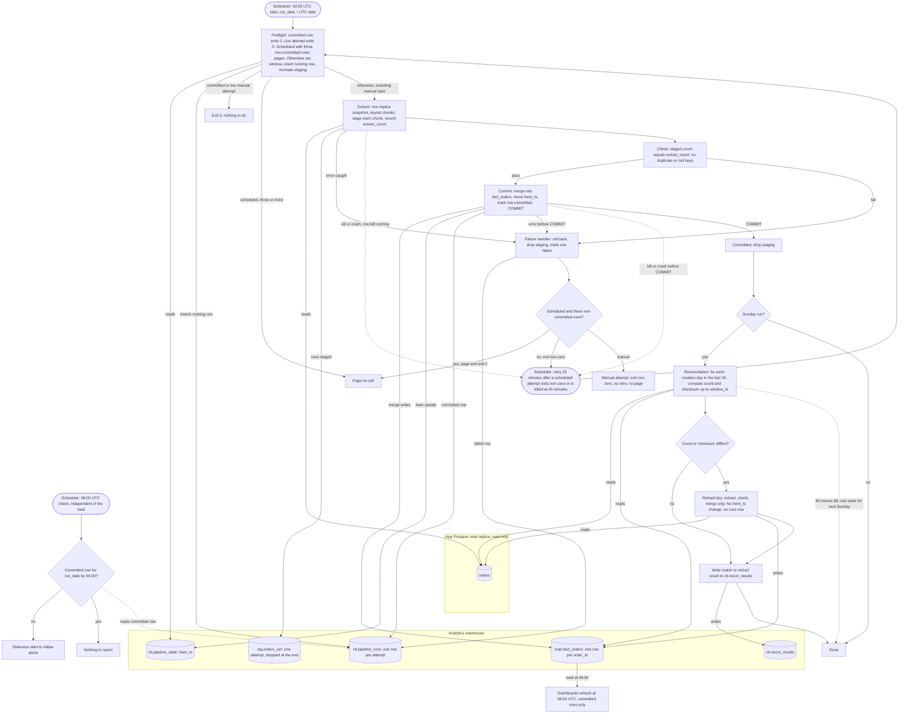

# Nightly orders ETL: pipeline flowchart and design notes

## Summary

Each night one job copies the `orders` rows that changed in a window from the app's read replica into the warehouse, and merges them into `mart.fact_orders`, which holds one current row per order. The window runs from the high-water mark minus 2 hours, up to 02:00 UTC. The merge, the high-water mark move and the attempt's `committed` mark happen in one warehouse transaction, so dashboards see either the whole previous night or the whole new one. Each night gets three scheduled attempts. After the third failure, on-call is paged. On Sundays, a reconciliation compares counts and checksums for the last 30 creation days and reloads any day that differs.

## Terms

- **run_date**: the UTC date of a night's 02:00 start. One night is one run_date.
- **window_hi**: 02:00 UTC on run_date. Every attempt for that night uses the same value. Rows updated after it wait for a later night.
- **window_lo**: hwm_ts minus 2 hours. The night's first attempt fixes it and every later attempt reuses it. The 2 hours cover the up to 90 minutes between a row's `updated_at` and the moment the row becomes visible.
- **hwm_ts** (high-water mark): window_hi of the last committed night.
- **attempt**: one run of the job for a run_date. Each attempt writes one row to `ctl.pipeline_runs`, numbered one above the rows already there. Manual attempts count.
- **trigger**: `scheduled` or `manual`, stored on the attempt's row.
- **staging** (`stg.orders_run`): one attempt's copy of its extracted rows. It is dropped at the end of the attempt.
- **commit**: the single warehouse transaction that merges staging into the fact table, moves hwm_ts and marks the attempt's row `committed`.

## Diagram

## Steps

1. **Start.** The scheduler starts attempt 1 at 02:00 UTC with trigger `scheduled`. If a scheduled attempt exits non-zero or is killed at the 45-minute limit, the scheduler starts the next one 15 minutes later. On-call starts a manual attempt, and nothing retries it. The scheduler only reads exit status and enforces the kill. It never reads the warehouse. Everything else runs inside the job, which reads the replica and writes the warehouse.

2. **Preflight.** Every start runs these checks in order:
   1. If a committed row exists for run_date, exit 0.
   2. If a `running` row for run_date is under 45 minutes old, and either that row or this start is manual, another attempt is live. Exit 0 and change nothing. Otherwise mark every `running` row for run_date `timed out`. A scheduled start only follows a process that has exited, so its leftover rows are dead.
   3. If the start is scheduled and there are three or more non-committed rows for run_date (`failed`, `timed out` or manual), page on-call and exit 0. The leftover marking above has already run, so a killed attempt counts.
   4. Set the window and insert this attempt's `running` row, with run_date, attempt number, trigger and started_at. The first attempt for run_date computes window_hi and window_lo. Every later attempt, manual ones included, copies both from the latest row for run_date, so the window never changes.
   5. Drop and recreate `stg.orders_run`. Only a dead attempt can leave it behind.

3. **Extract.** Open one REPEATABLE READ transaction on the replica. Read `orders` in keyset chunks ordered by (updated_at, order_id), taking rows with updated_at after window_lo and at most window_hi. Write each chunk to staging. At the end, store extract_count (rows read) on the attempt's row and close the replica transaction. A row updated after window_hi is picked up by the next night, whose window starts 2 hours before this one's window_hi.

4. **Check.** Staging must hold exactly extract_count rows, with no repeated order_id and no null order_id or updated_at. A failure goes to the failure handler.

5. **Commit.** One warehouse transaction does three things:
   1. Merge. For each staged order, insert it if it is new. If it exists, replace it only when the staged updated_at is equal to or later than the stored one. Copy created_at, deleted_at and the other columns, and set is_deleted to (deleted_at is not null).
   2. Set hwm_ts to window_hi, but only if hwm_ts is lower.
   3. Mark this attempt's row `committed`, with its row counts.

   Then COMMIT, and drop staging. A failure before COMMIT rolls back all three together, so fact_orders and hwm_ts are unchanged. If the connection drops during COMMIT, the outcome is unknown, and the next preflight settles it. A committed row for run_date means the commit happened. If there is none, nothing changed. The next attempt uses the same stored window, and its preflight marks the leftover row `timed out`.

6. **Dashboards.** At 06:00 UTC they refresh from `mart.fact_orders`, which holds only committed rows.

A deleted order is a write like any other. It bumps updated_at, loads like any change and stays with `is_deleted = true`. Nothing is removed. Re-running a night writes the same values, and a row never moves back to an older version.

## What happens when things fail

| What fails | What happens |
|---|---|
| Extract error, failed check or caught commit error | Failure handler: roll back any open transaction, drop staging, mark the attempt's row `failed` with the error text, exit non-zero. hwm_ts does not change. The next two rows apply. |
| Scheduled attempt fails, with fewer than three non-committed rows for run_date | The scheduler retries 15 minutes later with the same stored window. |
| Scheduled attempt fails, with three non-committed rows now | Page on-call and exit 0, so the scheduler stops. |
| Manual attempt fails | Exit non-zero. Nothing retries it, and it does not page, because on-call started it. |
| Killed at 45 minutes, or crashes, after the attempt's row is inserted | The row stays `running`. A scheduled attempt is retried as usual. The retry's preflight marks the row `timed out`. Any open warehouse transaction rolls back when its session ends. |
| Third scheduled attempt is killed or crashes | No page yet. The retry starts 15 minutes later. Its preflight marks the row `timed out`, sees three non-committed rows, pages on-call and exits 0. |
| Manual start while a `running` row is under 45 minutes old | Exit 0 with a message. Start again once that row is 45 minutes old. |
| Night not committed by 06:00 | At 06:00 UTC a check looks in `ctl.pipeline_runs` for a committed row with that run_date. It runs every day, Sundays included, and does not wait for reconciliation. If there is none, a staleness alert goes to #data-alerts. The load keeps going, and dashboards show the previous night. |
| Night committed late, for example at 03:00 | hwm_ts is still 02:00 of its run_date, so the next window is correct. |
| Night skipped (three attempts failed) | hwm_ts does not move. The next window starts from the older hwm, so it also loads the skipped night's changes. Windows grow after each skipped night. The brief sets no limit. |
| On-call wants the data sooner | Start a manual attempt for that run_date. It skips the three-attempt rule, uses the stored window and counts as an attempt. This is optional, because the next night covers the gap. |
| Killed during Sunday reconciliation | Days recorded so far stay. An uncommitted day rolls back. The scheduler's retry exits at preflight because the night is committed, so reconciliation is not resumed that week. Unfinished days are checked the next Sunday. |

Timing: attempt 1 starts at 02:00, and each scheduled attempt ends at most 45 minutes after it starts. Worst case, three 45-minute kills and two 15-minute gaps end the attempts at 04:45 UTC, and a page after a killed third attempt comes by 05:00. Both come before the 06:00 check. Manual attempts fall outside this timing, because on-call starts them.

## Reconciliation (Sundays)

Reconciliation runs in the same job process, after that night's commit succeeds. It has the same 45-minute kill, so it gets only the time the load left. If the Sunday night never commits, reconciliation is skipped that week, and the next Sunday's 30-day window covers those days. It covers creation days from run_date minus 30 through run_date minus 1. For each day D:

1. Find the order_ids on the replica with updated_at after window_hi. Ignore them on both sides for this comparison. The nightly load picks them up, and ignoring them prevents false mismatches from older warehouse versions.
2. On the replica, read `orders`. In the warehouse, read `mart.fact_orders`, which keeps created_at. Over rows with created_at on D, updated_at at most window_hi, and not ignored, compute COUNT(*) and a checksum on each side. The checksum is the sum, modulo 2^64, of a 64-bit hash of the text `order_id|updated_at`, with updated_at in UTC at fixed microsecond precision.
3. If both match, write a match row to `ctl.recon_results`. If they differ, reload day D. Extract its rows from the replica with updated_at at most window_hi, then stage, check and merge them, using the same Extract, Check and merge steps as the nightly load. The reload does not change hwm_ts and writes no `ctl.pipeline_runs` row, because it is not an attempt. Its result, success or failure, goes to `ctl.recon_results`. A failed reload is retried the next Sunday and does not affect the night.
4. If the warehouse holds an order_id for D that the replica lacks, record it as an anomaly in `ctl.recon_results`. Do not delete it, because the app never hard-deletes.

## State

- **Replica:** nothing. The job only reads it.
- **`ctl.pipeline_state`:** one row, hwm_ts. It is seeded once, when the ctl schema is created, with a fixed first backfill start. It changes only in the commit.
- **`ctl.pipeline_runs`:** one row per attempt, written at preflight. It holds run_date, attempt number, trigger, window_lo, window_hi, status (`running`, `failed`, `timed out`, `committed`), started_at, extract_count, row counts, error text and timestamps. Keeping the attempt count and the window here means a scheduler restart cannot reset them.
- **`stg.orders_run`:** scratch for one attempt. It is dropped at the end of the attempt, or by the next preflight if the attempt died.
- **`mart.fact_orders`:** one row per order_id, with created_at, is_deleted and deleted_at. It is the only table dashboards read.
- **`ctl.recon_results`:** the outcome of each Sunday comparison.

## Open questions

- What fixed first backfill start seeds hwm_ts, and how large is the first load?
- Which scheduler runs the job, and does it enforce the 45-minute kill and the 15-minute gap? Its retry rule depends on the exit status.
- Do dashboards query live between their 06:00 refreshes, or only at 06:00?
- Who is on call for the page? The brief does not name a team.
- Can the replica hold one snapshot transaction for up to 45 minutes without harming replication or vacuum?
- Does the warehouse support multi-statement transactions with snapshot reads, and does it roll back an open transaction when its session ends? If not, build `fact_orders_next` in full and swap it in, at the cost of a full rebuild each night. The commit and kill rules above assume it does.
- Does the replica have a primary key on order_id, an index on updated_at, and a created_at that never changes?
- The 45-minute attempt limit is this design's choice, not the brief's. Is it right? The same limit also covers Sunday reconciliation, which gets about 5 minutes after a 40-minute load. Should reconciliation get its own limit?
- Two starts at the same instant could both pass the live-attempt check in preflight. Is that acceptable?