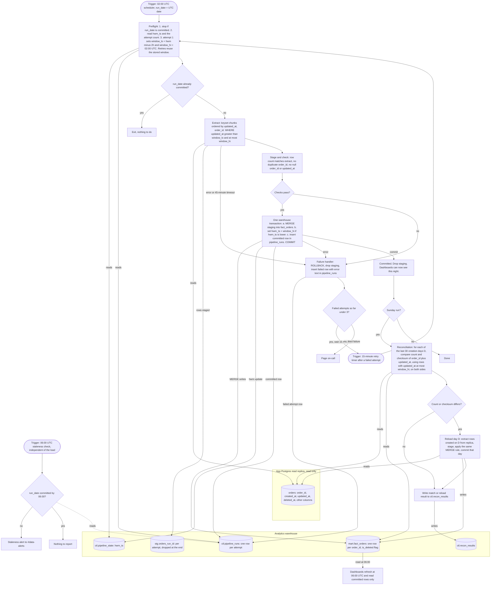

# Nightly orders ETL: pipeline flowchart and design notes

## Diagram



## What starts each step

| Step | Starts when | Reads | Writes |
|---|---|---|---|
| Preflight | The 02:00 UTC trigger, or the 15-minute retry timer after a failed attempt | `ctl.pipeline_state`, `ctl.pipeline_runs` | Nothing |
| Extract | Preflight finds no committed row for `run_date` | Replica `orders` (read only) | Staging, through a bulk load |
| Stage and check | Extract completes | Staging | Nothing |
| Commit | Checks pass | Staging | `mart.fact_orders`, `ctl.pipeline_state`, `ctl.pipeline_runs` |
| Failure handler | Any error, any failed check, or the 45-minute attempt timeout | Nothing | `ctl.pipeline_runs` (failed row) |
| Dashboards | 06:00 UTC, regardless of load status | `mart.fact_orders` | Nothing |
| Staleness check | 06:00 UTC, separately from the load | `ctl.pipeline_runs` | `#data-alerts` if not committed |
| Reconciliation | Same run, after a Sunday commit | Replica and `mart.fact_orders` | `mart.fact_orders` (reloads), `ctl.recon_results` |

## Where state lives

- **Replica:** nothing. The pipeline only reads it, so it holds no bookkeeping.
- **Warehouse `ctl.pipeline_state`:** one row, `hwm_ts` = `window_hi` of the last committed night. It changes only inside the commit transaction.
- **Warehouse `ctl.pipeline_runs`:** one row per attempt. It holds `run_date`, `attempt`, `window_lo`, `window_hi`, `status` (running, failed, committed, timed out), row counts, error text, and timestamps. The retry counter lives here, so a scheduler restart cannot reset the retries. The 06:00 check reads it too.
- **Warehouse `stg.orders_<run_id>`:** scratch space. It is recreated at the start of each attempt and dropped after commit or failure.
- **Warehouse `mart.fact_orders`:** the serving table, one row per `order_id`. It is the only table dashboards read.
- **Warehouse `ctl.recon_results`:** the outcome of each Sunday comparison.

## Extraction and window

- `window_hi` is the scheduled 02:00 UTC instant, not the wall clock when the job starts. Retries therefore use the same window, and a retry gives the same result as the first attempt.
- `window_lo = hwm_ts - 2 hours`. Extraction is `updated_at > window_lo AND updated_at <= window_hi`.
- Extraction runs in keyset chunks ordered by `(updated_at, order_id)` to limit load on the replica. A row that becomes visible after its chunk has passed is still covered: its `updated_at` is at or before `window_hi`, so it is inside the next night's lookback window, provided it becomes visible within 90 minutes of `updated_at`.
- The 2-hour lookback covers the 90-minute bulk-import delay, with margin.

## Merge logic

Staging is checked before any warehouse change. The checks are: the row count matches the extract count, `order_id` is unique in staging, and `order_id` and `updated_at` are not null.

Then, in one transaction:

```sql
MERGE INTO mart.fact_orders AS t
USING stg.orders_<run_id> AS s
ON t.order_id = s.order_id
WHEN MATCHED AND s.updated_at >= t.updated_at THEN UPDATE SET
  -- all source columns, plus:
  is_deleted = (s.deleted_at IS NOT NULL),
  deleted_at = s.deleted_at,
  updated_at = s.updated_at
WHEN NOT MATCHED THEN INSERT (...) VALUES (..., s.deleted_at IS NOT NULL);
```

- A staged row replaces the warehouse row only if its `updated_at` is at least the warehouse row's `updated_at`. An older extract therefore cannot overwrite a newer version. Re-running a night rewrites identical values, so it does no harm.
- Deleted orders stay in the table with `is_deleted = true` and their `deleted_at`. Nothing is removed.
- Rows with equal `updated_at` are treated as the same version. Writes are stamped with the write time, so ties are not expected. If one occurs, the MERGE is idempotent and the chosen value is the staged one.

## High-water mark

- `hwm_ts` advances to `window_hi` in the same transaction as the MERGE and the `pipeline_runs` commit row. The statement is `UPDATE ctl.pipeline_state SET hwm_ts = :window_hi WHERE hwm_ts < :window_hi`, so the mark cannot move backward.
- If anything fails before COMMIT, the transaction rolls back and the mark stays where it was. The next attempt then uses the same window.
- Dashboards show the "data as of" value, which is `hwm_ts`.

## Atomicity for dashboards

- The MERGE and the mark update are one warehouse transaction. Dashboards read committed snapshots, so they see either the complete previous night or the complete new night.
- The design assumes the warehouse supports multi-statement transactions with snapshot reads. If it does not, build `fact_orders_next` in full and swap it in atomically. That costs a full rebuild each night.

## Failure, retry, and paging

Attempt timeline, assuming each attempt fails quickly:

- Attempt 1 starts at 02:00 UTC.
- Attempt 2 starts 15 minutes after attempt 1 fails, at about 02:15.
- Attempt 3 starts 15 minutes after attempt 2 fails, at about 02:30.
- If attempt 3 fails, the job pages on-call. Nothing is paged after a successful retry.

- Each attempt has a 45-minute timeout. A hung attempt is treated as failed. Worst case, three timeouts plus two 15-minute gaps finish at 04:45 UTC, which leaves over an hour before 06:00.
- A failed attempt rolls back its transaction, drops its staging table, and writes a failed row to `ctl.pipeline_runs`. The retry decision reads that table.
- The 06:00 check reads `ctl.pipeline_runs`. If there is no committed row for `run_date`, including when an attempt is still running at 06:00, it posts a staleness alert to #data-alerts. The alert is in addition to any page, and dashboards keep showing the previous committed night.

## Reconciliation (Sunday, after the night's commit)

- It runs in the Sunday run, after the commit, so it never compares against a partially applied night. It covers the 30 most recent full creation days, ending the day before `run_date`.
- For each day D, the replica and the warehouse each compute, over rows created on D with `updated_at <= window_hi`:
  - `COUNT(*)`
  - A checksum: the sum, modulo 2^64, of a 64-bit hash of the canonical text `order_id|updated_at`. The text uses UTC with fixed microsecond precision, so the two sides agree on format.
- The `updated_at <= window_hi` filter is what stops false mismatches. Rows written after the night's window exist on the replica but not yet in the warehouse, and the filter excludes them on both sides.
- A day that differs is reloaded. Its rows are extracted from the replica by `created_at` and go through the same stage, check, and MERGE logic, committed one day at a time. The MERGE cannot roll a row back to an older version.
- If the replica has no row for an `order_id` that the warehouse holds for that day, the job reports it and does not delete. The app never hard-deletes, so that situation is an anomaly.
- Results go to `ctl.recon_results`.

## Assumptions to confirm

- `orders` has a primary key on `order_id`, a `created_at` column, and an index on `updated_at` on the replica. Without the index, the extract query will be slow.
- The replica is a single Postgres instance, so each extract query runs on one snapshot.
- The warehouse supports multi-statement transactions with snapshot reads (see Atomicity).
- All timestamps are stored and compared in UTC.
