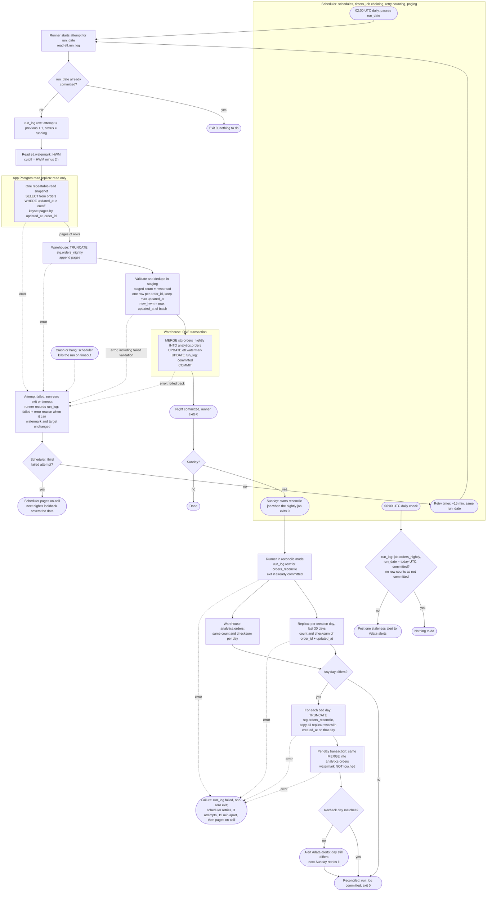

# Nightly orders ETL: replica to warehouse

A runner script, started by the scheduler at 02:00 UTC, copies changed `orders` rows from the app's read replica into a staging table in the warehouse. It then merges them into `analytics.orders` and advances the watermark, all in one warehouse transaction. A 06:00 check alerts if the night has not committed. On Sundays, after the nightly load exits 0, the scheduler starts the same runner in reconcile mode to repair days that the nightly overlap missed.

## Terms

- **Runner:** a script the scheduler launches. It reads the replica (read-only) and reads and writes the warehouse. Mode `nightly` does extract, stage, validate and commit. Mode `reconcile` does the weekly repair.
- **Scheduler:** holds schedules, timers, job chaining, retry counting and paging. It counts attempts from exit codes and timeouts, allowing 3 per job invocation. It kills a run that exceeds the runner timeout.
- **run_date:** the UTC date of the 02:00 firing. The scheduler passes it to the runner. Retries and the Sunday reconcile job keep the same value, even after midnight UTC.
- **Watermark (HWM):** the largest `updated_at` the pipeline has safely loaded. Each night reads rows with `updated_at` later than HWM minus 2 hours (the cutoff). The 2 hours cover the 90-minute bulk transactions with a 30-minute margin.
- **Attempt:** one try of a job for a run_date. The runner also writes an attempt number into `run_log`, but only for diagnosis. The scheduler's count decides.

## Where state lives

All state is in the warehouse. Nothing is written to the app database.

| Object | Purpose |
|---|---|
| `analytics.orders` | Target table, one row per `order_id`, with an `is_deleted` flag. Dashboards read only this table. |
| `etl.watermark` | One row for `pipeline = 'orders'` with `high_water_mark`. Seeded to the epoch for the first backfill. |
| `etl.run_log` | One row per `(job, run_date)`, where job is `orders_nightly` or `orders_reconcile`. Columns: `attempt` (diagnostic), `status` (running, failed, committed), `error`, `started_at`, `committed_at`. It records "already committed, exit" and feeds the staleness check. |
| `stg.orders_nightly`, `stg.orders_reconcile` | Staging tables that dashboards never read. Each is truncated at the start of every attempt (reconcile: at the start of each day's reload). |

## Flowchart



## Notes

**What starts each step**

- **Nightly load:** the scheduler fires at 02:00 UTC with `run_date`. After a failed attempt, the retry timer fires 15 minutes later with the same `run_date`.
- **Staleness check:** a separate scheduler job at 06:00 UTC, independent of the load, so it fires even if the load hangs or is retrying. It looks at the `orders_nightly` row for today's UTC date. If the row is missing or not `committed`, it posts one alert to #data-alerts. It does not repeat.
- **Dashboards:** refresh themselves at 06:00 UTC on their own schedule. This pipeline does not trigger them. They only read `analytics.orders`.
- **Reconciliation:** on Sundays, when the nightly job exits 0, the scheduler launches the runner in reconcile mode with the same `run_date`.
- **Manual re-run:** on-call re-runs a job through the scheduler as a new invocation with the same `run_date`, with a fresh count of 3 attempts. It reuses the same `run_log` row (`failed` back to `running`, `attempt` keeps increasing). A Sunday nightly re-run that exits 0 chains reconciliation as usual.

**Steps of the nightly load**

1. **Attempt start.** The runner reads `run_log` for this job and `run_date`. If committed, it exits 0. Otherwise it sets `attempt = previous + 1` and `status = running` (inserting the row on the first attempt). A stale `running` row left by a crash is simply overwritten.
2. **Extract.** It reads the watermark and queries the replica for `updated_at > HWM - 2h` in one repeatable-read, read-only snapshot, paged by `(updated_at, order_id)`, so the batch is consistent and memory stays bounded.
3. **Stage.** Pages are appended to `stg.orders_nightly` after truncating it. A half-filled staging table is harmless because nothing reads it.
4. **Validate.** The staged count must equal the number of rows read, otherwise the attempt fails. If an `order_id` appears twice, keep the row with the greatest `updated_at`. Compute `new_hwm = max(updated_at)` over the batch (not the wall clock). The 2-hour lookback is applied only when reading the watermark, never when storing it.
5. **Commit.** One warehouse transaction merges, moves the watermark and marks the run committed, so the night is all-or-nothing:

```sql
BEGIN;
MERGE INTO analytics.orders t
USING (SELECT s.*, (s.deleted_at IS NOT NULL) AS is_deleted
       FROM stg.orders_nightly s) s
  ON t.order_id = s.order_id
WHEN MATCHED AND s.updated_at >= t.updated_at THEN UPDATE SET /* all columns */
WHEN NOT MATCHED THEN INSERT /* all columns */;

UPDATE etl.watermark
   SET high_water_mark = GREATEST(high_water_mark, :new_hwm)
 WHERE pipeline = 'orders';          -- skipped if the batch was empty

UPDATE etl.run_log SET status = 'committed', committed_at = now()
 WHERE job = 'orders_nightly' AND run_date = :run_date;
COMMIT;
```

The first backfill uses this same path with the watermark at the epoch, merging the whole history in one transaction.

**Merge logic and idempotency**

- The match is on `order_id`. An update applies only when `s.updated_at >= t.updated_at`, so the overlap re-extracts the same orders harmlessly (equal versions overwrite with identical data) and a stale version never replaces a newer one.
- `is_deleted` is derived from `deleted_at IS NOT NULL` on every merge. Deletes are writes that bump `updated_at`. Rows are never removed.
- Re-running a night rebuilds staging and merges again. The watermark only moves forward (`GREATEST`). A retry that finds the night already committed exits 0, which covers a lost commit acknowledgement. The `run_log` update shares the merge's transaction, so it cannot disagree with the data.
- There is no lock. Reconciliation starts only after the nightly load commits, and the `>=` guard keeps the merge safe even if a manual reconciliation overlaps a load.

**Reconciliation**

- It keeps its own `run_log` row (`job = 'orders_reconcile'`, same `run_date`) and uses the same retry and paging policy as the nightly load.
- **Compare:** for each order-creation day (`created_at` date, UTC) in the last 30 days, compare `COUNT(*)` and an order-independent checksum between replica and warehouse. The checksum is a sum, modulo 2^64, of a hash of `order_id || '|' || updated_at` (UTC microseconds). Both sides must compute it identically at the same timestamp precision. Deleted rows are included.
- **Reload:** each mismatched day is fully reloaded from the replica through `stg.orders_reconcile` with the same `MERGE`, in its own transaction, so one bad day does not block the others. The watermark is never touched.
- **Verify:** after a reload the day is rechecked. If it still differs, alert #data-alerts. The run is still marked committed and exits 0, because a retry minutes later would not change the result. The next Sunday retries that day.
- **Retry after failure:** a retried attempt starts over with the comparison. Days already fixed now match and are skipped.

## What happens when things fail

| Failure | Result |
|---|---|
| Error, failed validation, or merge rollback | Nothing in flight survives. Watermark and target are unchanged because they change only in the final commit. The runner records `failed` and the reason in `run_log` when it can. |
| Crash or hang | The scheduler kills the run on timeout. A non-zero exit or timeout counts as a failed attempt, even if `run_log` still says `running`. |
| Failed attempt 1 or 2 | The scheduler retries from the start 15 minutes later with the same `run_date`. |
| Third failed attempt | The scheduler pages on-call. Nothing else is done. The watermark did not move, so the next night reads from the same cutoff and picks up the missed rows, unless on-call re-runs the night first. Dashboards keep showing the last committed data. |
| Load not committed by 06:00 | One staleness alert to #data-alerts. No follow-up when the load commits later. |
| Dashboard refresh at 06:00 | `analytics.orders` changes only in the one atomic commit, so dashboards see either last night's complete state or the new complete state, never a partial load. |
| Rows visible later than the lookback (for example replica lag) | Caught by the Sunday reconciliation, not the nightly job. |
| Sunday load fails all three attempts | Reconciliation is skipped until on-call's manual re-run succeeds, or on-call starts reconciliation by hand. |
| Reconcile failure | `run_log` marked failed, non-zero exit, same retry and paging policy as the nightly load. |

## Assumptions to confirm

- The warehouse supports multi-statement transactions with snapshot isolation for readers, so a dashboard never sees a mid-merge state.
- Reconciliation uses the same retry and paging policy as the nightly load. The brief did not specify this.
- `orders.created_at` is stable and never rewritten, so day buckets match on both sides.
- The scheduler can chain a job on another job's exit code, count attempts per invocation, and run a job manually with a given `run_date`. If it cannot chain, the runner would start reconcile mode itself after a Sunday commit.

## Open questions

- Whether the warehouse can merge the whole history in one transaction for the first backfill. If not, the backfill needs chunking, which this plan does not define.
- The runner timeout value is not chosen.
