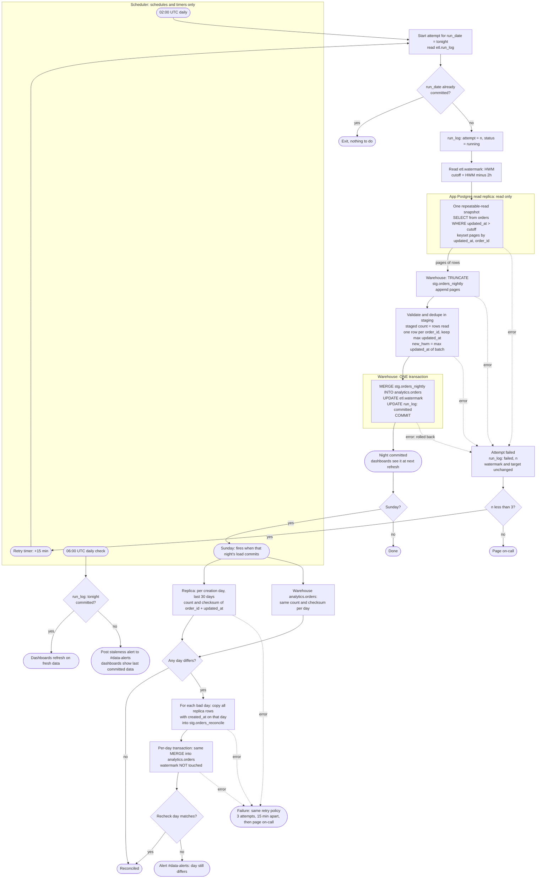

# Nightly orders ETL: replica to warehouse

## Where state lives

All state is in the warehouse. Nothing is written to the app database, and the scheduler keeps only schedules and timers.

| Object | Purpose |
|---|---|
| `analytics.orders` | Target table, one row per `order_id`, with an `is_deleted` flag. Dashboards read only this table. |
| `etl.watermark` | One row for `pipeline = 'orders'` with `high_water_mark`, a timestamp. Seeded to the epoch for the first backfill. |
| `etl.run_log` | One row per `(job, run_date)` with `attempt`, `status` (running, failed, committed), `started_at` and `committed_at`. This is the idempotency record and the attempt counter. The staleness check reads it. |
| `stg.orders_nightly`, `stg.orders_reconcile` | Staging tables in a schema that dashboards never read. The nightly job truncates its table at the start of every attempt. |

## Flowchart



## What starts each step

- **Nightly load:** the scheduler fires at 02:00 UTC. After a failed attempt, the scheduler's retry timer fires 15 minutes later and starts the same `run_date` again. The attempt number comes from `etl.run_log`.
- **Staleness check:** a separate scheduler job at 06:00 UTC. It does not depend on the load job, so it still fires if the load hangs or is stuck retrying.
- **Reconciliation:** the scheduler starts it on Sundays, only after that night's load has committed. If the Sunday load fails all three attempts, reconciliation is skipped. The on-call engineer pages in that case and can start reconciliation by hand once the load is fixed.

## Data movement

1. **Extract.** The job reads the watermark and queries the replica for `updated_at > HWM - 2h`. That 2-hour window covers the 90-minute bulk transactions with a 30-minute margin. The query runs in one repeatable-read, read-only snapshot, paged by `(updated_at, order_id)`. This keeps the batch consistent and keeps memory bounded.
2. **Stage.** Pages are appended to `stg.orders_nightly` in the warehouse. A half-filled staging table is harmless because nothing reads it.
3. **Validate.**
   - The staged row count must equal the number of rows read.
   - If an `order_id` appears twice, keep the row with the greatest `updated_at`.
   - Compute `new_hwm = max(updated_at)` over the batch, not the wall clock. If the replica lags, the watermark then reflects what was actually seen.
4. **Commit.** One warehouse transaction does three things, so the night is all-or-nothing:

```sql
BEGIN;
MERGE INTO analytics.orders t
USING (SELECT s.*, (s.deleted_at IS NOT NULL) AS is_deleted
       FROM stg.orders_nightly s) s
  ON t.order_id = s.order_id
WHEN MATCHED AND s.updated_at >= t.updated_at THEN UPDATE SET /* all columns */
WHEN NOT MATCHED THEN INSERT /* all columns */;

UPDATE etl.watermark
   SET high_water_mark = GREATEST(high_water_mark, :new_hwm)
 WHERE pipeline = 'orders';          -- skipped if the batch was empty

UPDATE etl.run_log SET status = 'committed', committed_at = now()
 WHERE job = 'orders_nightly' AND run_date = :run_date;
COMMIT;
```

## Merge logic and idempotency

- **Key and guard:** the match is on `order_id`, and an update applies only when `s.updated_at >= t.updated_at`.
  - The overlapping window re-extracts the same orders every night. Equal versions overwrite with identical data.
  - A stale version can never replace a newer one, for example during a reconciliation reload.
- **Deleted orders:** `is_deleted` is derived from `deleted_at IS NOT NULL` on every merge. Deletes are writes, so they bump `updated_at` and flow through the same path. Rows are never removed from the warehouse.
- **Re-running a night:** staging is rebuilt and the merge is idempotent. The watermark only moves forward (`GREATEST`).
  - A retry first checks `run_log`. If the night is already committed, it exits. This covers a commit whose acknowledgement was lost.
  - The `run_log` update is inside the same transaction as the merge, so it cannot disagree with the data.
- **Single writer:** the job takes a lock row in `etl.run_log`, so the nightly load and the reconciliation never write `analytics.orders` at the same time.

## Failure and retry

- **A failed attempt** rolls back anything in flight. The watermark and target are unchanged, because they change only in the final commit. The job records `failed` with the attempt number in `run_log`.
- **Retries:** attempts 2 and 3 run 15 minutes after the previous failure, from the start (re-extract, restage, re-merge). After the third failed attempt, the job pages on-call.
- **Dashboards at 06:00:** they read `analytics.orders`, which only ever changes in the one atomic commit. They see either last night's complete state or the new complete state, never a partial load. If the night is not committed at 06:00, the staleness check posts to #data-alerts.
- **Late-arriving rows beyond the lookback** (for example, replica lag) are caught by the Sunday reconciliation, not by the nightly job.

## Reconciliation details

- **Comparison:** for each order-creation day (`created_at` date, UTC) in the last 30 days, compare `COUNT(*)` and an order-independent checksum of `order_id` + `updated_at` between the replica and the warehouse.
  - The checksum is a sum, modulo 2^64, of a hash of `order_id || '|' || updated_at`, with `updated_at` as UTC microseconds.
  - Both sides must compute it identically and store timestamps at the same precision.
  - Deleted rows are included on both sides, so counts match.
- **Reload:** a mismatched day is reloaded in full from the replica. This runs through `stg.orders_reconcile`, with the same `MERGE` and the same `>=` guard, in its own transaction per day. One bad day does not block the others.
- **Watermark:** reconciliation never touches it.
- **Verification:** after a reload the day is rechecked. If it still differs, for example because the replica is still behind, an alert goes to #data-alerts and the next Sunday retries it.

## Assumptions to confirm

- The warehouse supports multi-statement transactions with snapshot isolation for readers, so the dashboard refresh never sees a mid-merge state. This is what makes the all-or-nothing guarantee hold.
- Reconciliation uses the same retry and paging policy as the nightly load. The brief did not specify this.
- The `orders` table has a stable `created_at` that is not rewritten, so the day buckets are the same on both sides.
