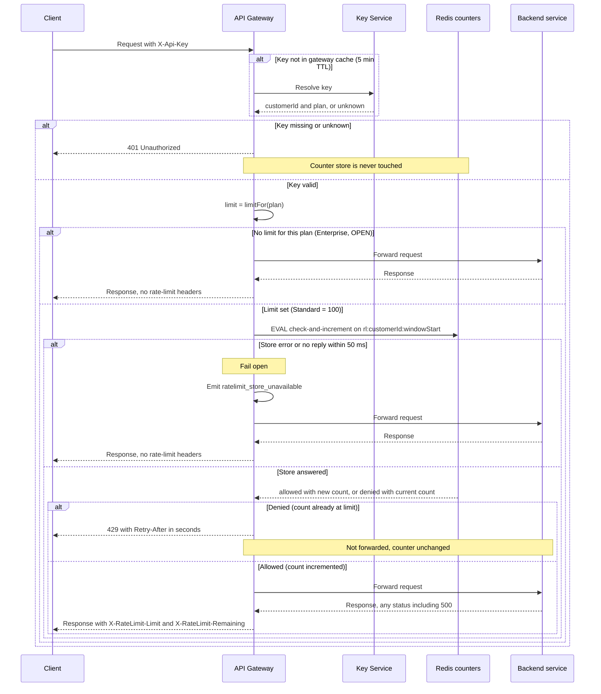

# Per-customer rate limiting on the public API

Design for a first version. The gateway checks a shared per-customer counter in Redis after authentication and before forwarding. Counters are one fixed one-minute window per customer.

## Sequence



## Notes

**Counter key and store.** Key is `rl:{customerId}:{windowStart}`, where `windowStart` is the epoch second of the start of the current clock minute. Keying on `customerId` (not the API key) gives one budget per customer across all of their keys (requirement 1). Redis is shared by all six gateway instances, so the count is global (requirement 7).

**Check and increment are one atomic step.** A Lua script runs inside Redis, so concurrent requests on different instances cannot overshoot:

```lua
local n = tonumber(redis.call('GET', KEYS[1]) or '0')
if n >= tonumber(ARGV[1]) then return {0, n} end   -- denied, nothing incremented
n = redis.call('INCR', KEYS[1])
if n == 1 then redis.call('EXPIRE', KEYS[1], ARGV[2]) end  -- ARGV[2] = 120 s
return {1, n}                                        -- allowed
```

Rejected requests return before `INCR`, so a 429 does not use budget (requirement 4). A request that passes is counted before it is forwarded, so a backend 500 still uses budget (requirement 5).

**Retry-After.** `windowEnd = (floor(now / 60) + 1) * 60`. `Retry-After = max(1, ceil(windowEnd - now))`, in whole seconds. The gateway uses its own clock, so instance clocks must be kept in sync (NTP). A few seconds of skew only moves the value by about that much.

**Headers on allowed responses.** `X-RateLimit-Limit` is the plan limit. `X-RateLimit-Remaining` is `limit - n`, where `n` is the count returned by the script.

**Fail open.** The Redis client has a 50 ms timeout on the script call only. On error or timeout the request is forwarded and `ratelimit_store_unavailable` is emitted. These responses carry no `X-RateLimit-*` headers, because the gateway does not know the count. If the timeout fires after Redis already ran the script, that one request is counted and the gateway does not know it. This is an accepted small inaccuracy.

**Authentication first.** The 401 path returns before any store call (requirement 3). Key resolution is unchanged; the rate-limit step only consumes the `customerId` and `plan` that the gateway already gets.

**Known trade-off.** A fixed window lets a customer send up to about 200 requests across a minute boundary (100 at the end of one window and 100 at the start of the next). A sliding window or token bucket would smooth this, but the fixed window is simpler and fits a first version.

**Store durability.** A Redis failover can lose the most recent increments. Losing them only allows a few extra requests in that window, and the fail-open rule already accepts store outages, so this is acceptable for v1.

**Plan changes.** The gateway caches plan for 5 minutes, so a plan change takes up to 5 minutes to affect the limit. This is existing behavior.

## Open decisions

- **Enterprise limit: OPEN.** Product has not set a number. The diagram shows the Enterprise path as "no limit" only as a placeholder. Do not ship a number until product decides. Until then, the limit lookup should return an explicit "not set" value, and the gateway should treat it as the no-check branch shown above.
- **Metric and alert.** Confirm the owner and alert threshold for `ratelimit_store_unavailable`, since fail-open hides store outages from clients.
- **Redis topology.** Single primary with replica, or managed Redis. Keys are per customer, so Redis Cluster would not split a customer's counter across shards.
