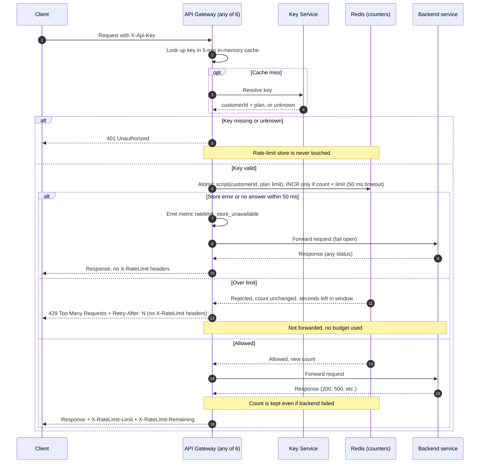

# Per-customer rate limiting: design (v1)

After the gateway authenticates a request, it asks one shared Redis counter whether that customer still has budget in the current minute. If yes, it forwards the request and adds rate-limit headers. If no, it replies 429 and forwards nothing. If Redis is slow or broken, the gateway forwards anyway (fail open).

### Terms

- **Gateway:** the public API Gateway, 6 stateless instances. Any instance can get any request.
- **Plan limit:** requests per minute for a plan. Standard = 100. **Enterprise = OPEN (Product has not decided; no number chosen).**
- **Window:** a fixed one-minute slice aligned to the clock, taken from Redis time.
- **Counter:** one Redis key per customer per window, `rl:{customerId}:{windowStart}`. All of a customer's API keys share it.
- **Fail open:** forward the request when the counter store cannot answer.

### Diagram

### Notes

- **Store:** one managed Redis instance with a replica for failover. All gateways share it, so counts are shared across instances.
- **Limit:** the gateway takes the plan from the Key Service answer, looks up the plan limit in its config (a plain plan-name to number map), and passes it to the script. `X-RateLimit-Limit` is that limit; `X-RateLimit-Remaining = limit - count`, never below 0.
- **Atomic script:** read Redis `TIME`; `windowStart = floor(time / 60)*60`; `count = GET key` (0 if missing); if `count >= limit`, return rejected plus `windowStart + 60 - time`; otherwise `INCR`, set `EXPIRE 120` if the key is new, and return the new count. Redis runs scripts one at a time, so concurrent requests from different gateways cannot both take the last slot. Rejected requests do not increment.
- **Expiry:** `EXPIRE 120` only cleans up old counters; any value of 60 or more works.
- **Clocks:** only Redis time is used, for both the window and `Retry-After`. `Retry-After` is the seconds left in the window, rounded up, at least 1. Gateway clock drift does not matter.
- **Window:** fixed, so a customer can burst up to 2x the limit across a boundary. Accepted for v1.
- **Counting:** the increment happens at check time, before forwarding. A backend failure does not refund it.
- **Auth first:** the 401 branch exits before any Redis call.
- **Headers:** only allowed responses carry `X-RateLimit-*`. A 429 carries `Retry-After` only. A fail-open response carries neither, because the values are unknown.
- **Plan or key changes:** the 5-minute key cache is existing behavior and is unchanged. A plan change or key revocation can take up to 5 minutes to take effect.

### When things fail

| Failure | What happens |
|---|---|
| Key missing or unknown | 401, no counter touched |
| Redis error or no answer in 50 ms | Forward, emit `ratelimit_store_unavailable`, no `X-RateLimit-*`. No retry, local counter or circuit breaker in v1. During an outage each request waits up to 50 ms extra before being forwarded. |
| Timeout, but Redis ran the script anyway | The count may be 1 too high for that request. Accepted. |
| Redis failover to the replica | Replication is asynchronous, so recent counts may be lost and customers may briefly get extra budget. Requests during the switch fail open. |
| Backend returns 500 | The response is passed back and the count is kept |
| Backend times out or is unreachable | Not changed by this design; the count is kept |
| Key Service slow or down on a cache miss | Not changed by this design |
| Plan has no configured limit | Not decided (see open questions) |

### Open questions

- Enterprise limit: owned by Product. It must be set in plan config before launch. The gateway has no default and must not guess one.
- What the gateway does at runtime if a plan is unknown or has no limit in config.
- What a client gets when the Key Service is slow or down on a cache miss, or when the backend times out or is unreachable. This is existing gateway behavior and is not documented here.
- Who watches the `ratelimit_store_unavailable` metric (alert or dashboard).
