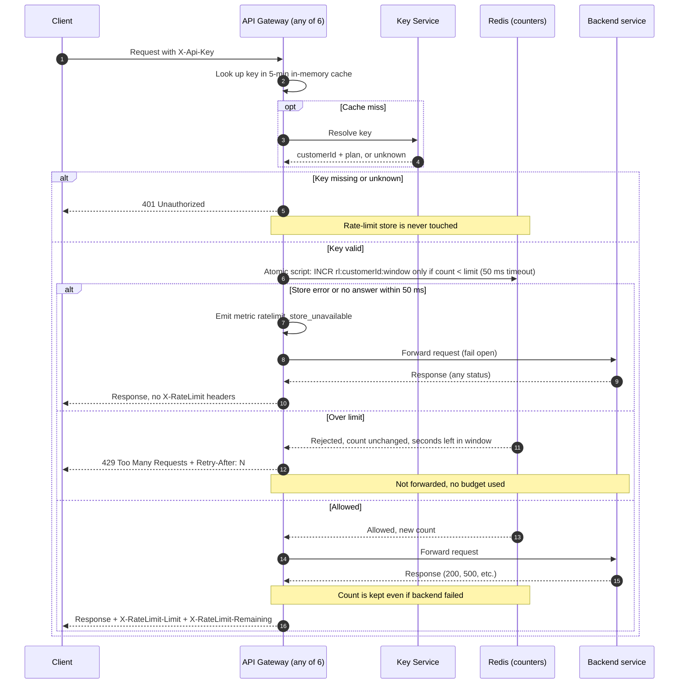

## Per-customer rate limiting: design (v1)

### Decisions

- **Store:** Redis, a single shared instance (managed, with a replica for failover). All 6 gateway instances use it, so counts are shared (req. 7).
- **Key:** `rl:{customerId}:{windowStart}`, where `windowStart = floor(now / 60s)`. It is per customer, so all of a customer's API keys share one counter (req. 1).
- **Window:** fixed one-minute window aligned to the clock. The counter key expires 120 s after creation, so old windows clean themselves up. A customer can burst up to 2x the limit across a window boundary. This is accepted for v1.
- **Limits:** Standard = 100 per minute. **Enterprise = OPEN (product has not decided; no number chosen).** The limit comes from plan config, so setting it later needs no design change. Until it is set, Enterprise limit handling must be resolved before launch.
- **No overshoot:** the check is one atomic Lua script on Redis. It reads the counter, and increments only if `count < limit`. Redis runs scripts one at a time, so concurrent requests on different instances cannot both take the last slot. Rejected requests do not increment, so 429s use no budget (req. 4).
- **Retry-After:** `ceil(windowStart + 60 - now)` in whole seconds, at least 1. The script returns the Redis server time and the gateway uses that, so instance clock drift does not matter.
- **Counting:** the increment happens at check time, before forwarding. A backend failure (such as 500) does not refund it (req. 5).
- **Fail open:** the Redis call has a 50 ms timeout. On a timeout or error, the gateway forwards the request, emits the metric `ratelimit_store_unavailable`, and adds no `X-RateLimit-*` headers (the values are unknown, and we do not invent them). There is no retry, no local fallback counter, and no circuit breaker in v1.

### Diagram

### Notes on what the diagram can't show

- **Limit value:** `limit` comes from the plan (Standard 100; Enterprise open). `X-RateLimit-Limit` is that value. `X-RateLimit-Remaining = limit - count`, never below 0.
- **Atomic script, in words:** compute the window key from Redis time; `count = GET key` (0 if missing); if `count >= limit`, return rejected plus `windowStart + 60 - now`; otherwise `INCR` the key, set `EXPIRE 120` if it is new, and return the new count.
- **Auth first (req. 3):** the 401 branch exits before any Redis call, so a bad key cannot read or change a counter.
- **Fail-open scope:** only the Redis call is covered by the 50 ms budget. Key Service and backend behavior is unchanged.
- **Known limits of v1:** the 2x burst at window boundaries; Redis is a single point of latency (bounded to 50 ms per request, and during an outage every request pays that 50 ms until Redis recovers); no limit enforcement while failing open, which is the intended tradeoff.
- **Open item:** the Enterprise limit, owned by Product.