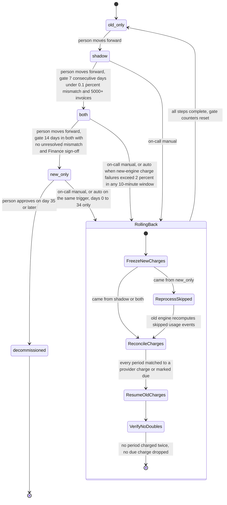

# Billing engine rollout: state machine

Billing moves from the old engine to the new one through four modes in order: `old_only`, `shadow`, `both`, `new_only`. A person makes each forward move once its gate is met. A rollback from `shadow`, `both` or `new_only` freezes new-engine charges, reconciles every billing period against the ledger and the payment provider, hands charging back to the old engine, and ends in `old_only` with all gate counters reset.

## Terms

- **billing_mode**: the global flag in the config service that names the engine that charges. Workers read it before each charge and do not cache it.
- **Shadow store**: a separate store where the engine that is not charging writes its invoices.
- **Mismatch**: a customer's invoice total that differs by more than one cent between the two engines.
- **Gate**: the condition that must hold before a forward move.
- **Freeze**: stop all new-engine charges. Frozen is a rollout state, not a fifth `billing_mode` value.
- **Due charge**: a billing period with an invoice total above zero and no successful provider charge.
- **Idempotency key**: an ID per customer and billing period, sent to the payment provider so a second charge for the same period is rejected. Whether the provider supports it today is an open question.
- **Rollout controller**: the component that runs the forward moves and rollback steps. Its form is not decided.

## State diagram

Notes on the diagram:

- Only one move or rollback runs at a time. A running rollback refuses forward moves. A trigger that fires during a rollback is logged and ignored.
- The person checks the gate before writing `billing_mode`. The brief does not say whether the config service enforces gates.
- From `shadow`, nothing new is charged, so freezing and resuming change nothing. Reconcile still runs against the ledger and provider charges.
- `decommissioned` is a person's decision. The brief says the old engine "may" be decommissioned after 35 days in `new_only`, so the clock only closes the rollback path.

## Steps

Forward moves, in the order they happen:

1. **old_only**: the old engine reads usage events, computes invoices, writes the ledger and charges. The new engine is off.
2. **shadow**: a person moves forward from `old_only`. The old engine still charges and writes the ledger. The new engine reads the same usage events and writes its invoices to the shadow store. It never charges and never writes the ledger. Its errors are recorded only.
3. **both**: a person moves forward once the gate is met: 7 consecutive days with a mismatch rate under 0.1 percent and at least 5,000 invoices compared. The new engine now charges and writes the ledger. The old engine keeps computing every invoice into the shadow store without charging, so it can take over at any time.
4. **new_only**: a person moves forward once the gate is met: 14 days in `both` with no unresolved mismatches and Finance sign-off. The old engine stops computing. The 35-day rollback clock starts on entry.
5. **decommissioned**: a person approves it on day 35 or later with no rollback. This is terminal. After day 35 there is no way back.

The nightly comparison runs in `shadow` and `both`. For each customer it pairs the invoice the charging engine wrote to the ledger with the invoice the other engine wrote to the shadow store. The mismatch rate for a day is mismatched invoices divided by invoices compared that day.

Rollback steps. A rollback can start from `shadow`, `both` or `new_only`. On-call starts it by hand at any time within the 35-day limit. In `both` or `new_only`, it also starts automatically when the new engine's charge failure rate is above 2 percent over any 10-minute window. The rollout controller runs these steps, and an automatic trigger runs the same ones. No step retries itself. If a step fails, on-call restarts it by hand. During steps 1 to 3, `billing_mode` keeps its current value and nobody charges. Due charges wait until step 4. They are delayed, not dropped.

1. Freeze new-engine charging for all customers. No new charge is sent. A charge already sent to the provider may finish. Wait until each one has a result or has been looked up at the provider.
2. Only from `new_only`: the old engine recomputes the usage events it skipped. They must still be in the 35-day log.
3. Reconcile each customer and billing period against provider charges and ledger entries. A period the new engine charged is not charged again. A period with a computed invoice and no provider charge is marked due.
4. Set `billing_mode` to `old_only` and resume old-engine charging. Before charging each due period, the old engine looks up that customer and period at the provider.
5. Verify there are no duplicate charges and no dropped due charges. Log the result and reset the gate counters. The mode is now `old_only`, and the path to `shadow` starts again from zero.

## Where the state lives

- `billing_mode` in the config service is the only source of truth for which engine charges.
- The usage event log (35-day retention) and the billing ledger (system of record) do not change. The ledger is the authority for what was billed.
- Nightly comparison results are written per customer to the shadow store. Gate values (mismatch counts, invoice counts, days in `both`) are computed from those stored results, not held in memory.
- A rollout log records every move and rollback step, with the time, the actor (person or automatic trigger) and the gate values used. Its storage is not decided.

## What happens when something fails

| Failure | What happens |
| --- | --- |
| Flag write fails | No move. The mode stays where it was. Retry. |
| Worker cannot read the flag | It keeps the last mode it read and alerts. It does not switch engines. |
| Nightly comparison fails or does not run for a day | That day does not count toward the 7-day gate and the streak restarts. This is our reading of "consecutive". |
| Mismatch found in `both` | The `both` to `new_only` gate stays closed until the mismatch is resolved. The rollout does not correct the charge the new engine already made. |
| Charge failure rate above 2 percent in any 10-minute window, in `both` or `new_only` | Automatic rollback starts. No person gates it. |
| New-engine errors in `shadow` | Recorded. They never trigger a rollback. |
| A rollback trigger fires during a rollback | Logged and ignored. |
| A rollback step fails | Stop at that step. Keep new charges frozen. Alert on-call. On-call looks up the provider for an existing charge for that customer and period, then restarts the step by hand. Never charge on a guess. |
| Rollback from `new_only` on day 35 or later | Impossible. The skipped events have aged out of the 35-day log. |
| After any rollback | The mode is `old_only`. The path to `shadow` starts again with all gate counters at zero. |

## Open questions

- Failure rate: what is the denominator (attempts, or all charges), and how many attempts must a 10-minute window hold before the rate counts?
- Freeze: how do workers see the freeze while `billing_mode` still names the new engine during steps 1 to 3? How long does step 1 wait for a pending charge before it looks it up?
- Flag timing: how fast does a flag change reach all workers? What stops two workers that read different modes during a flip from both charging the same period?
- Gate enforcement: does the config service check gates, or only people?
- Unresolved mismatch: who resolves it, how is it marked resolved, and is a wrongly made charge corrected?
- Idempotency key: is it in place with the payment provider today? If not, must it exist before `both`, and what stops double charges until then?
- The 5000-invoice threshold: a total over the 7 days (assumed here) or a daily figure?
- Storage for the rollout log and gate counters.
- The 35-day clock starts on entry to `new_only` (assumed here).
- At decommissioning, what is shut down or deleted, and does the shadow-store data survive?