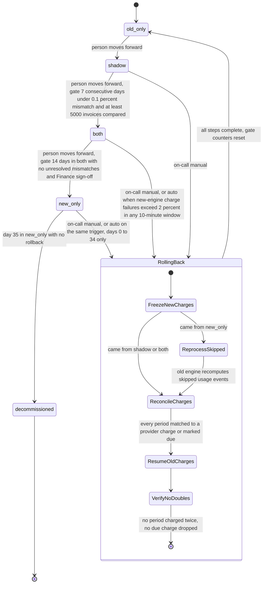

# Billing engine rollout: state machine

## What each mode does

- **old_only**: the old engine reads usage events, computes invoices, writes the ledger and charges. The new engine is off.
- **shadow**: the old engine still charges and writes the ledger. The new engine reads the same usage events and writes invoices to a separate shadow store. It never charges and never writes the ledger. A nightly job compares the two engines per customer. A mismatch is any invoice total that differs by more than one cent. New-engine errors here are recorded only.
- **both**: the new engine charges and writes the ledger. The old engine keeps computing every invoice into the shadow store without charging, so it can take over at any time. The nightly comparison continues.
- **new_only**: the old engine stops computing. The 35-day clock for a rollback starts when this mode is entered.
- **decommissioned**: terminal. Reached on day 35 in `new_only` with no rollback. There is no way back after this point.

## Where the state lives

- The mode is the global `billing_mode` flag in the config service. Workers read it and act on it. It is the only source of truth for which engine charges.
- The usage event log (35-day retention) and the billing ledger (system of record) are unchanged by the rollout. The ledger is the authority for what was billed.
- Gate evidence (daily mismatch counts, invoice counts, the day count in `both`) is not named in the brief. Proposed: the nightly comparison writes per-customer results to the shadow store, and gates are computed from those results. Counters must be derived from stored results, not held in memory.
- Proposed: each transition and each rollback step is appended to a rollout log, with the time, the actor (person or automatic trigger) and the gate values used.
- Proposed: every charge carries an idempotency key per customer and billing period, so the payment provider rejects a second charge for the same period. This is the main protection against double charges.

## What happens when something fails

- **Flag write fails**: no transition happens. The mode stays where it was. Retry.
- **Worker cannot read the flag**: it keeps the last mode it read and alerts. It does not switch engines on its own.
- **Nightly comparison fails or does not run for a day**: that day does not count toward the 7-day gate, and the consecutive streak restarts. This is an interpretation of "consecutive".
- **Mismatch found in `both`**: the `both` to `new_only` gate stays closed until the mismatch is resolved.
- **Charge failure rate above 2 percent in any 10-minute window in `both` or `new_only`**: automatic rollback starts. It is not gated by a person.
- **New-engine errors in `shadow`**: recorded, never trigger rollback.
- **A rollback step fails**: stop at that step, keep charges frozen for the affected customers, alert on-call, and resume the step idempotently. Before any retry of a charge, look up the provider for an existing charge for that customer and period. Never re-charge on a guess.
- **Rollback from `new_only` after day 35**: impossible. Skipped usage events have aged out of the 35-day log, so the old engine cannot reprocess them.
- **After any rollback**: the rollout returns to `old_only`, and the path to `shadow` starts again with all gate counters at zero.

## Rollback steps, in order

1. Freeze new-engine charging for the affected customers. Check in-flight charges against the provider.
2. If coming from `new_only`, the old engine reprocesses the skipped usage events, which must still be in the 35-day log.
3. Reconcile each customer and billing period against provider charges and ledger entries. A period already charged by the new engine is not charged again. A period that is due and uncharged goes to the old engine.
4. Resume old-engine charging and set `billing_mode` to `old_only`.
5. Verify there are no duplicate charges and no dropped due charges. Log the result and reset the gate counters.

## Open points

- The brief does not say whether the 5000-invoice threshold is a total over the 7 days or a daily figure. This note assumes a total.
- The brief does not say where gate counters or the rollout log are stored. The proposal above is one option that needs a decision.
- The 35-day clock is assumed to start on entry to `new_only`, not on the first skipped event. These are the same day in practice, since events are skipped from entry onward.