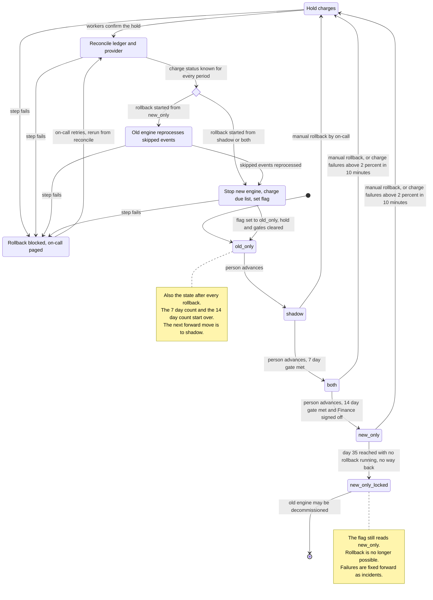

# Billing engine rollout: state machine

## Summary

The rollout has four modes, set by one flag, `billing_mode`. A person advances the mode one step at a time by telling the rollout controller, which checks the gate and then sets the flag. Rollback is a separate, resumable procedure of four steps (Hold, Reconcile, Reprocess, Resume). From `shadow`, `both` or `new_only` it always ends in `old_only` and resets the gates. On day 35 in `new_only` a permanent lock begins and there is no rollback.

Double-charge safety rests on one rule: every charge is keyed by customer and billing period. Both engines check that key against the billing ledger and the payment provider before charging. So a worker with a stale mode, or a handover between engines in a half-billed period, cannot charge a period twice.

## Terms

- **Rollout controller:** the service that holds rollout state, checks gates, sets the flag, runs rollback and watches the charge failure rate.
- **Shadow store:** where the engine that is not charging writes its invoices, for comparison.
- **Due charge:** a ledger invoice for a customer and billing period with no charge for that key in the ledger or at the provider.
- **Hold:** a flag in the controller's record. While it is set, workers make no normal charges. Only the rollback's own charges in the Resume step are exempt.

## Diagram

## What each mode does

| Mode | Old engine | New engine | Charges and ledger |
|---|---|---|---|
| `old_only` | Computes, charges, writes the ledger. | Off. | Old engine only. |
| `shadow` | Same as `old_only`. | Reads the same usage events and writes invoices to the shadow store. Never charges, never writes the ledger. | Old engine only. |
| `both` | Computes every invoice into the shadow store so it stays current. Does not charge. | Computes, charges, writes the ledger. | New engine only. |
| `new_only` | Stopped. It skips usage events. | Does everything. | New engine only. |
| `new_only_locked` | Stopped, may be decommissioned. | Does everything. | New engine only. |

The nightly job compares the two engines' invoices per customer in `shadow` and `both`. It always compares the ledger invoice with the shadow-store invoice for the same customer. A mismatch is any invoice total that differs by more than one cent.

## Moving forward

1. A person asks the controller to advance. Meeting a gate never moves the mode by itself.
2. The controller refuses unless the gate is met, then sets the flag. Only the next mode is allowed, in the order `old_only`, `shadow`, `both`, `new_only`.
   - **`shadow` to `both`:** 7 consecutive days each with a mismatch rate under 0.1%, and at least 5,000 invoices compared. After the switch the new engine charges every period that has no charge for its key. Periods the old engine already charged are skipped by the key check.
   - **`both` to `new_only`:** 14 days in `both` (a total, not necessarily consecutive, counting only days with a completed comparison), no unresolved mismatches, and Finance sign-off. The old engine charges nothing in `both`, so it leaves no uncharged periods behind. At the switch it finishes its current shadow-store run, then stops computing.

## Rollback

Rollback can start from `shadow`, `both` or `new_only` and always ends in `old_only`. Two things start it:
- On-call, by hand, at any time before day 35 in `new_only`.
- The controller, automatically, when the new engine's charge failure rate is above 2% over any 10-minute window, in `both` or `new_only` only. New-engine errors in `shadow` are recorded and never trigger a rollback.

A running rollback ignores further triggers. Day 35 is counted from entry into `new_only`. A rollback that started before day 35 runs to the end. The lock applies only if no rollback is running when day 35 arrives.

| Step | What happens | Why |
|---|---|---|
| 1. Hold | The controller records a hold. Before every normal charge, a worker checks the record. While the hold lasts, charge requests wait and are retried after it ends; none are dropped. The new engine starts no new invoice runs. Usage events keep arriving in the log and wait. The step ends when every worker has confirmed the hold. | Nothing new is charged or invoiced while the controller works out who is owed what. |
| 2. Reconcile | Charges in flight are not waited for. For every billing period with a ledger invoice, read the ledger and ask the payment provider by customer and period key. Any charge with an unknown outcome, such as a timeout, is looked up this way before anything is retried. The step ends when every period has a known status. Periods with a ledger invoice and no charge form the due list. | This is the double-charge guard, and it builds the list of charges that are due but not made. |
| 3. Reprocess (only from `new_only`) | The old engine reads the usage events it skipped, up to the present, and writes invoices to the ledger only for periods with no ledger invoice. Each invoice is keyed by customer and period, so running it again replaces the same invoice. | The old engine stopped computing in `new_only`, so it is behind. From `both` it is current, and from `shadow` it never stopped. |
| 4. Resume | In this order: (a) stop the new engine and record that it is stopped; (b) the old engine charges the due list using the amount on each ledger invoice, not its own recomputed amount, and these charges are exempt from the hold; (c) set the flag to `old_only`; (d) clear the hold and the gate counters. Events that arrived after step 3 are handled by the old engine's normal runs once the hold ends. | A charge the new engine had in progress is caught by the key check. Periods already charged are never charged again, and due charges are not dropped. |

Between 4(a) and 4(c) the flag still shows the starting mode, but nothing computes: the new engine is stopped and, under the hold, the old engine runs no invoice runs. The only charges are the rollback's own. The ledger is the system of record, so the ledger invoice is the amount owed even where the old engine's shadow-store invoice differs.

Rollback from `shadow` has almost nothing to reconcile because the new engine never charged. It still runs all the steps, so there is one path.

## Where the rollout state lives

| State | Lives in | Notes |
|---|---|---|
| Current mode | `billing_mode` flag in the config service | One global value. Workers read it. |
| Time of entry into the current mode | Controller's durable record | Needed for the 14-day and 35-day clocks. |
| Rollback progress and hold | Same controller record (rollback id, starting mode, current step, whether the new engine is stopped, start time) | The flag has only four values, so progress cannot live there. Charging workers check this record before each normal charge. |
| Gate evidence | Nightly comparison results, kept per day | Feeds the 7-day streak, the invoice count and the unresolved-mismatch list. |
| Who has been charged | Billing ledger plus the payment provider | Always the final authority in reconcile. |
| Usage events | Usage event log, kept 35 days | Source for shadow computation and for Reprocess. |

## What happens when something fails

| Failure | Result |
|---|---|
| New-engine error in `shadow` | Recorded. No rollback. |
| Charge failure rate above 2% over 10 minutes in `both` or `new_only` | Automatic rollback, starting at Hold. |
| Nightly comparison does not run or fails | That day does not count. The 7-day streak is broken. In `both` the 14-day count skips that day. |
| Payment provider times out on a charge | Outcome unknown. Look it up by key before any retry. Never blind-retry. |
| A rollback step fails | The rollback goes to "blocked" and on-call is paged. The hold stays on, the flag is unchanged, and the new engine stays stopped if Resume had already stopped it. On-call retries and the run restarts from Reconcile. This is safe: Reconcile rebuilds the due list from the ledger and provider, so charges Resume already made are seen as charged; Reprocess rewrites the same keyed invoices; Resume charges only periods with no charge for that key. The flag is not set to `old_only` until the due list is charged. |
| A worker holds a stale `billing_mode` after a forward move | The charge key check stops a second charge for the same period (see open question 7). |
| Config service unreachable | Workers keep their last known mode. No forward move can be made. |
| Rollout controller unreachable or slow | Workers cannot read the hold record, so they do not charge. Charge requests wait and are retried. Billing is delayed, never doubled. No forward move or automatic rollback happens until it returns. |
| Day 35 reached in `new_only` | If no rollback is running, the state becomes `new_only_locked`. Both rollback triggers are off. Charge failures are handled as incidents, fixed forward. |
| Rollback finishes | State is `old_only` with gates reset. The rollout restarts at `shadow`. |

## Open questions

These need an answer before the controller is written.

1. **Late rollback from `new_only`.** Events skipped on the first day of `new_only` expire from the 35-day log on day 35. A rollback started on day 33 or 34 may not finish Reprocess in time and would lose invoices. Letting a running rollback finish past day 35 is my reading of the brief, not stated in it. Proposed: pin the log at rollback start if the platform allows it; otherwise warn when remaining time is less than the estimated reprocessing time.
2. **The 2% trigger.** With no minimum charge count per window, a quiet period could trigger a rollback on one failure. It is also undefined whether a declined card counts as a failure or only system and provider errors do.
3. **"At least 5,000 invoices compared."** Assumed to be the total across the 7-day window, with each day separately under 0.1%.
4. **"Resolved" mismatch.** Assumed a person closes it with a reason. Auto-expiry does not count.
5. **Missing new-engine invoices in `shadow`.** An invoice the new engine failed to produce should probably count as a mismatch. The brief only says errors are recorded.
6. **Decommission.** The lock is automatic at day 35 and does not depend on decommissioning actually happening, which is a later human choice.
7. **Shared charge key.** "One charge per customer and billing period, checked by both engines" is my design requirement, not the brief's. It is what makes no-double-charge enforceable, and Reprocess being safe to rerun is a matching requirement on the old engine. Also undecided: how a flag change reaches all workers at once, what a worker does with a charge it started under the old value, and who may send the advance command.
8. **Hold details.** No time limit on worker confirmations in Hold; a worker that never confirms blocks the rollback and pages on-call. How a worker tells a rollback charge from a normal one (for example by rollback id on the request) is not decided. Also unspecified is whether invoice runs are scheduled per period or continuous; the plan only needs each charge to carry its customer and period key.
