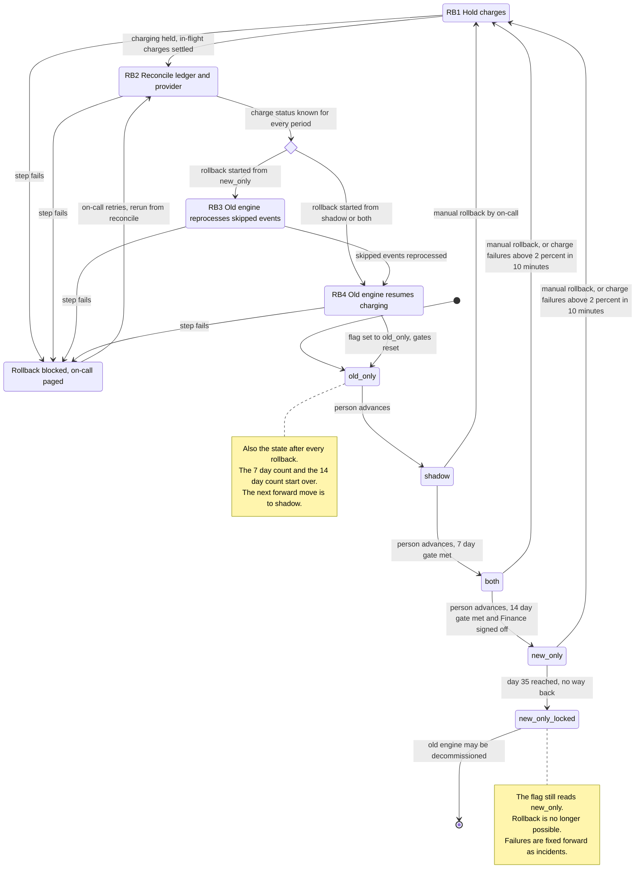

# Billing engine rollout: state machine

## Summary

The rollout has four modes, set by one flag, `billing_mode`. Forward moves are single steps made by a person, and each is gated. Rollback is a separate, resumable procedure of four steps. From `shadow`, `both` or `new_only` it always ends in `old_only`, and it resets the gates. A permanent lock begins on day 35 in `new_only`, after which there is no rollback.

Double-charge safety rests on one rule: every charge is keyed by customer and billing period. Both engines check that key against the billing ledger and the payment provider before charging.

## Diagram

## What each mode does

| Mode | Old engine | New engine | Charges and ledger |
|---|---|---|---|
| `old_only` | Computes, charges, writes the ledger. | Off. | Old engine only. |
| `shadow` | Same as `old_only`. | Reads the same usage events and writes invoices to the shadow store. Never charges and never writes the ledger. | Old engine only. |
| `both` | Computes every invoice into the shadow store, so it stays current. Does not charge. | Computes, charges, writes the ledger. | New engine only. |
| `new_only` | Stopped. It skips usage events. | Does everything. | New engine only. |
| `new_only_locked` | Stopped, and may be decommissioned. | Does everything. | New engine only. |

The nightly job compares the two engines' invoices per customer. It runs in `shadow` and `both`. A mismatch is any invoice total that differs by more than one cent.

**Gates for forward moves.** A gate is necessary but not sufficient, because a person still makes the move.
- **`shadow` to `both`:**
  - 7 consecutive days, each with a mismatch rate under 0.1%.
  - At least 5,000 invoices compared.
- **`both` to `new_only`:**
  - 14 days in `both` with no unresolved mismatches.
  - Finance sign-off.
- **No skipping.** The order is `old_only`, `shadow`, `both`, `new_only`.

## Rollback

Rollback can start from `shadow`, `both` or `new_only`, and it always ends in `old_only`. Two things can start it:
- On-call can start it by hand at any time before day 35 in `new_only`.
- It starts automatically when the new engine's charge failure rate is above 2% over any 10-minute window. This applies only in `both` and `new_only`. New-engine errors in `shadow` are recorded and never trigger a rollback.

A rollback that is already running ignores further triggers.

| Step | What happens | Why |
|---|---|---|
| RB1 Hold charges | Both engines stop charging. In-flight charges are allowed to settle. | Nothing new can be charged while the controller works out who is owed what. |
| RB2 Reconcile | For every billing period, read the ledger and ask the payment provider. Any charge with an unknown outcome, such as a timeout, is looked up by its customer and period key before anything is retried. | This is the double-charge guard. It also builds the list of charges that are due but not made. |
| RB3 Reprocess (only from `new_only`) | The old engine reads the usage events it skipped and brings its invoices current. | The old engine stopped computing in `new_only`, so it is behind. From `both` it is already current, and from `shadow` it never stopped. |
| RB4 Resume | The old engine charges only the periods that RB2 found due and not charged. Then the flag is set to `old_only`, the new engine is stopped, and the gate counters are cleared. | Periods the new engine already charged are never charged again. Due charges are not dropped. |

Rollback from `shadow` has almost nothing to reconcile, because the new engine never charged. Steps RB1 to RB4 still run, so there is one path.

## Where the rollout state lives

| State | Lives in | Notes |
|---|---|---|
| Current mode | `billing_mode` flag in the config service | One global value. Workers read it. |
| Time of entry into the current mode | Rollout controller's durable record | Needed for the 14-day and 35-day clocks. The flag alone does not hold it. |
| Rollback progress | Same controller record (rollback id, starting mode, current step, started time) | The flag has only four values, so progress cannot live there. Charging workers must also check this record for the hold. |
| Gate evidence | Nightly comparison results, kept per day | Feeds the 7-day streak, the invoice count and the unresolved-mismatch list. |
| Who has been charged | Billing ledger, the system of record, plus the payment provider | Always the final authority in reconcile. |
| Usage events | Usage event log, kept 35 days | Source for shadow computation and for RB3. |

## What happens when something fails

| Failure | Result |
|---|---|
| New-engine error in `shadow` | Recorded. No rollback. |
| Charge failure rate above 2% over 10 minutes in `both` or `new_only` | Automatic rollback, entering RB1. |
| Nightly comparison does not run or fails | That day does not count. The 7-day streak is broken. In `both`, the 14-day clock does not count that day, and the day is treated as unverified. |
| Payment provider times out on a charge | The outcome is unknown. Look it up by key before any retry. Never blind-retry. |
| A rollback step fails | The rollback goes to "blocked" and on-call is paged. Charging stays held. Steps are idempotent, so on-call retries and the run restarts from RB2. The flag is not set to `old_only` until RB4 finishes. |
| Config service unreachable | Workers keep their last known mode. No forward move can be made. A rollback hold is read from the controller record. |
| Day 35 reached in `new_only` | The state becomes `new_only_locked`. The automatic and manual rollback triggers are off. Charge failures are handled as incidents, with the fix going forward. |
| Rollback finishes | The state is `old_only` with gates reset. The rollout restarts at `shadow`. |

## Assumptions and open questions

These need an answer before the controller is written.

1. **Late rollback from `new_only`.** The log keeps 35 days. The events skipped on the first day of `new_only` expire on day 35. A rollback started on day 33 or 34 may not finish RB3 before they expire, and that would lose invoices.
   - Proposed rule: pin the log at rollback start if the platform allows it. Otherwise the controller warns when the remaining time is less than the estimated reprocessing time.
2. **Minimum volume for the 2% trigger.** One failure in ten charges is 10%. Without a minimum number of charges per window, a quiet period could trigger a rollback.
3. **"At least 5,000 invoices compared."** I assumed this is the total across the 7-day window, and that each day must be under 0.1% separately.
4. **Meaning of "resolved" mismatch.** I assumed a person closes it with a reason. Auto-expiry would not count as resolved.
5. **Missing new-engine invoices in `shadow`.** An invoice that the new engine failed to produce should probably count as a mismatch. The brief only says errors are recorded.
6. **Decommission.** I modelled the lock as automatic at day 35, and decommissioning as a later human choice. The lock does not depend on decommissioning actually happening.
7. **Shared charge key.** The rule "one charge per customer and billing period, checked by both engines" is my design requirement. The brief does not state it. It is what makes the no-double-charge rule enforceable.
