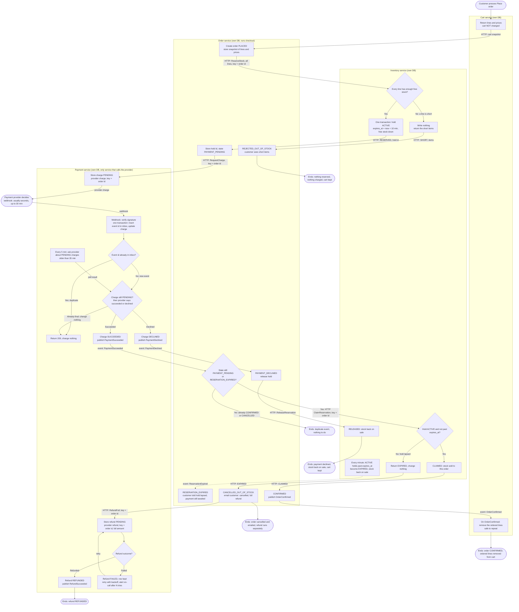

# Checkout across Cart, Inventory, Payment and Order

## What this is

Order runs checkout. It reads the cart snapshot from Cart, holds stock in Inventory, asks Payment to charge the customer, and then confirms the order or cancels it. Stock is held before any money is requested. Main flow: Place order, then cart snapshot, then hold stock for 10 minutes, then charge, then the provider's webhook says paid, then claim the hold, then the order is CONFIRMED and its lines leave the cart. If the payment succeeds after the hold has lapsed, the order is cancelled, emailed and refunded in full.

## Terms

- **Snapshot**: the cart's lines and prices, copied into the order when Place order is pressed.
- **Hold**: Inventory's 10-minute reservation of stock for one order. It ends in a claim or it lapses.
- **Claim**: turns an ACTIVE hold that has not expired into sold stock.
- **Idempotency key**: an id sent with a request. Repeating the request with the same key has no further effect. For holds, charges and refunds the key is the order id.
- **Charge / refund**: Payment's record of one payment or refund, keyed by order id.
- **Webhook**: the provider's HTTP call to Payment that reports a charge outcome.
- **Inbox**: Payment's table of webhook event ids it has already handled. A repeat is skipped.
- **Outbox**: each service writes its outgoing event in the same transaction as its state change. A relay publishes it to the **broker**.
- **Communication**: HTTP when a caller needs an answer. Broker events for notifications. Solid arrows below are HTTP, dashed arrows are events.

## Flowchart

## Failure cases

| Case | What happens | Where it ends |
|---|---|---|
| A line is short | Inventory writes nothing. Order sets REJECTED_OUT_OF_STOCK and shows the short items. | Nothing reserved, nothing charged, cart kept |
| Payment declined | Payment marks the charge DECLINED. Order releases the hold. | Stock back on sale, cart kept |
| Hold lapses before the webhook | Sweeper marks the hold EXPIRED. Order tells the customer the hold lapsed and keeps waiting for payment. | Still open until the webhook arrives |
| Payment succeeds after the hold lapsed | The claim returns EXPIRED. Order cancels as out of stock, emails the customer and asks Payment for a full refund. | Order cancelled, refund runs separately |
| Refund fails at the provider | The refund row stays FAILED. Payment retries with backoff and alerts on-call after N tries. | Never dropped silently |
| Duplicate webhook | The event id is already in the inbox. Payment returns 200 and changes nothing. | No change |
| Webhook and poll both report the outcome | Whichever arrives second finds the charge already final and changes nothing. | No change |
| Checkout fails at any other point | The cart is never emptied before CONFIRMED. | Cart kept, customer can try again |

## Open questions

- What is N, the number of refund retries before an alert?
- Is the customer told if a refund finally fails after the cancellation email?
- What happens when an HTTP reply is lost? The idempotency key makes a retry safe, but the retry rule is not set here.
- Does the every-5-minutes poll (Recon) stay? The brief does not require it. It is the only way to learn an outcome if a webhook is lost.