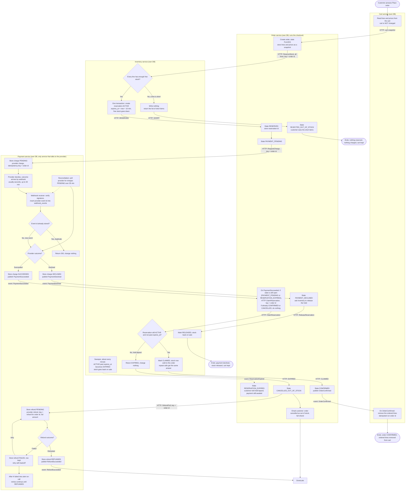

# Checkout across Cart, Inventory, Payment and Order

## Shape of the design

- **Order is the orchestrator.** It starts checkout when the customer presses Place order, and it decides each next step from the replies and events it receives.
- **Cart is read-only until the order is confirmed.** It hands over a snapshot of its lines and prices, and it only removes lines after `OrderConfirmed`.
- **Inventory owns stock holds.** A hold lasts 10 minutes. Stock is taken only when a hold is claimed, and a hold that lapses returns stock to sale.
- **Payment is the only service that calls the payment provider.** It uses the order id as the idempotency key on charges and refunds. It records the provider's webhook outcomes, and it drops repeat webhooks.
- **Commands that need an answer use HTTP. Notifications use broker events.** Each service writes its state change and its outgoing event in one database transaction (transactional outbox). Each consumer records the ids of messages it has processed (inbox), so redelivery is harmless.

## Flowchart

## Who stores what

| Service | Stores | Written when |
|---|---|---|
| Cart | Live cart and its lines; processed message ids | Customer edits the cart; ordered lines removed on `OrderConfirmed` |
| Order | Order row with state, price snapshot, reservation id, charge reference; outbox; inbox; email log | Each state change |
| Inventory | Stock per SKU (on hand, held); reservations (order id unique, lines, status ACTIVE / CLAIMED / RELEASED / EXPIRED, `expires_at`); outbox | Reserve, claim, release, sweep |
| Payment | Charges (order id unique, amount, status, provider ref); `webhook_events` (provider event id unique); refunds (order id unique, status, attempts, next retry); outbox | Charge, each webhook, each refund attempt |

## Failure branches

| Branch | What happens | Cart |
|---|---|---|
| Short stock | Inventory writes nothing and returns the short items. Order goes to REJECTED_OUT_OF_STOCK. No payment is requested. | Kept |
| Declined payment | Payment stores DECLINED and publishes `PaymentDeclined`. Order releases the hold, so stock goes back on sale. | Kept |
| Late success after hold lapsed | The hold lapses at 10 minutes and stock is released. The webhook arrives later. `ClaimReservation` returns EXPIRED, so Order cancels as out of stock, requests a full refund, and emails the customer. | Kept |
| Failed refund | Refund row is marked FAILED and kept. It is retried with backoff. After N failures, on-call is alerted, and reconciliation keeps retrying until REFUNDED. The refund is never dropped. | Kept |
| Duplicate webhook | Event id is already in `webhook_events`, so the service returns 200 and changes nothing. A duplicate `PaymentSucceeded` reaching Order is a no-op because the state is already final. A repeated claim gets the same answer. | Unchanged |
| Webhook never arrives | Reconciliation polls the provider for charges PENDING over 35 minutes and feeds the same outcome path. | Unchanged |
| Call result unknown (timeout) | Retry with the same order id key. Inventory reserve and claim are idempotent per order id. If the result is still unknown, Order asks Inventory for the reservation status before deciding. | Unchanged |

## Why the risky cases are safe

- **No double charge.** Payment keeps one charge per order id (unique key) and sends the order id to the provider as the idempotency key.
- **No double processing of webhooks.** The provider event id is stored with a unique constraint in the same transaction that changes the charge state.
- **Stock is never sold twice.** The claim is a conditional update: it succeeds only if the reservation is ACTIVE and `expires_at` is still in the future. Only one of a sweep and a claim can win.
- **No money kept for an unfulfillable order.** A claim that comes after the hold has lapsed always leads to a full refund.
- **Cart is never lost on failure.** Cart changes only after `OrderConfirmed`.

## Decisions to confirm

1. **Which cart lines are cleared.** The diagram removes only the ordered lines, so items added during checkout survive. Clearing the whole cart would be simpler, but it could drop those items.
2. **Provider charge on hold lapse.** The diagram leaves the provider charge running when the hold lapses. The provider may still succeed, which is why the refund path exists. Cancelling the pending charge, where the provider supports it, is an optional extra.
3. **Thresholds.** The N failed-refund tries before an alert, the 35-minute reconciliation age, and the sweeper interval are proposals, not requirements.
4. **Refund outcome channel.** The diagram assumes the refund result comes back either synchronously or by webhook. Confirm which the provider uses.