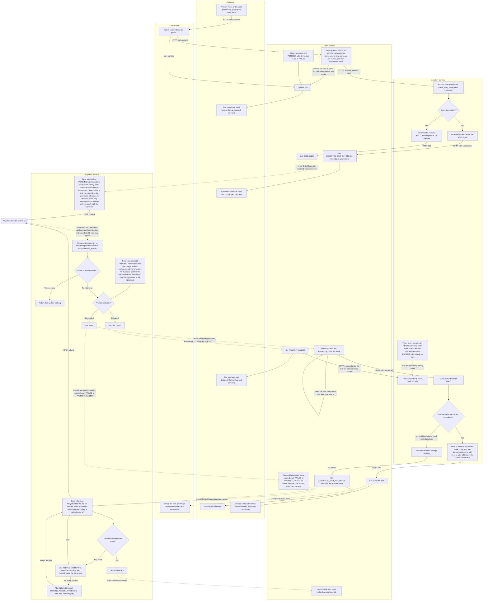

# Checkout across Cart, Inventory, Payment and Order

Checkout is split across four services. When the customer presses Place order, Order snapshots the cart, Inventory reserves all the stock, and only then does Payment ask the provider to charge. The provider answers later by webhook. If payment succeeds, Order claims the stock and confirms the order, and Cart is emptied. If the stock has gone by then, the customer is refunded in full and the order is cancelled.

## Terms

- **Order** is the coordinator. It starts each step and records the overall outcome. It only calls other services' APIs or reacts to their events, and never touches their data.
- **Hold** is a reservation of stock that lasts 10 minutes. **Claim** turns a hold into a sale (`SOLD`).
- **Idempotency key** is a value sent with a provider request so that a retry can never charge or refund twice. Charges use the order id. Refunds use `refund-<order id>`.
- **Webhook** is the provider's callback that reports whether a charge succeeded or was declined. It takes seconds to 30 minutes, and the same webhook may arrive more than once.
- **Solid arrows** in the diagram are synchronous HTTP calls, labelled with the call. **Dotted arrows** are events on the shared message broker, labelled with the event name.
- **Uppercase words** such as `RESERVED` are statuses stored in that service's own database. Each service owns its database, and no service reads another's tables.
- **Events are never lost.** A service writes each event into its own database in the same transaction as the status change. A relay publishes it until the broker acknowledges it.
- **Repeated events are harmless.** The broker delivers at least once, so a service acts on an event only when its own record is in the status that event expects, and otherwise ignores it. Order acts on `PaymentSucceeded` or `PaymentDeclined` only while the order is `RESERVED`, and on `RefundSucceeded` only if the order is not yet `REFUNDED`. Payment creates a payment or refund only if none exists for that order id. Cart keeps the last event handled per order.
- **The customer's page does not wait on the webhook.** `POST /orders` returns at once with the order id, and the page polls `GET /orders/{id}`, more slowly after the first minute. It stops only on a final status: `CONFIRMED`, `REJECTED_OUT_OF_STOCK`, `PAYMENT_FAILED`, `FAILED` or `REFUNDED`. For `PENDING`, `RESERVED` or `PAID` it shows "processing". For `CANCELLED_OUT_OF_STOCK` it shows "out of stock, refund on its way". It keeps polling in those cases, because a payment can take up to 30 minutes and a refund can take longer.

## Diagram

The swimlanes are Customer, Order, Cart, Inventory and Payment, plus the external payment provider.

## Steps

1. **Place order.** The logged-in customer presses Place order. The request carries no cart or customer data. Order takes the customer id and email from the login session and asks Cart for that customer's cart. Each press gets a new order id, except that if the cart already has an open order (`PENDING`, `RESERVED` or `PAID`), that order is returned, so a double press cannot create two. Order saves the lines, prices, total, currency and email as a new `PENDING` order. This snapshot is the only price source from here on. The request then returns, and the page polls.
2. **Reserve stock before any payment.** Order calls Inventory with the order id and lines. Inventory checks all lines in one local transaction. If any line is short, it reserves nothing and returns the short items. Order sets `REJECTED_OUT_OF_STOCK`, the customer sees which items are short, and no payment is requested.
3. **Hold.** If every line is available, Inventory reserves all of them and sets the hold to expire in 10 minutes. Reserving the same order id twice returns the same reservation, so Order can retry a failed or timed-out call a few times with the same order id.
4. **Charge.** Order sets `RESERVED` and publishes `OrderReserved` with the order id, total and currency from the snapshot. Payment saves a `PENDING` payment row and asks the provider to charge that amount, with the order id as the idempotency key and as the provider's reference. A timer in Payment re-sends any payment still `PENDING` with no result, using the same key, so a crash mid-retry loses nothing and the customer is never charged twice. If the provider rejects the request outright, Payment treats it as declined (step 7).
5. **Wait for the webhook.** The webhook carries the provider's event id and the order id, which is how Payment finds the payment. The order stays `RESERVED` meanwhile, and the hold may expire. That is expected, and the claim step handles it. While the order is open, the customer cannot start a new checkout for that cart. That is deliberate, because a second order could cause a second charge. If no webhook has arrived 35 minutes after the charge, a timer in Payment asks the provider for the payment's status and handles the answer as if it were a webhook, but only if the payment is still `PENDING`.
6. **Ignore repeats.** Payment inserts the provider's event id into `processed_events`, which has a unique constraint. If the id is already there, Payment returns 200 and does nothing else.
7. **Declined payment.** Payment sets `DECLINED` and publishes `PaymentDeclined`. Order sets `PAYMENT_FAILED` (final) and asks Inventory to release the hold once. If the release fails, the 1-minute expiry timer frees the stock anyway. The cart is untouched, and a new press makes a new order.
8. **Successful payment.** Payment sets `PAID` and publishes `PaymentSucceeded`. If the order is `RESERVED`, Order sets `PAID` and asks Inventory to claim the stock. Inventory decides in one local transaction, so a claim cannot race with expiry.
   - If the hold is intact, it marks the stock `SOLD`.
   - If the hold has lapsed but the stock is still free, it re-takes every line at once. This avoids a pointless refund.
   - If any line has been sold to someone else, it refuses and changes nothing, so we never ship a partial order. Go to step 10.
   - If the claim call fails or times out, the order stays `PAID` and Order repeats the same claim with backoff (claims are idempotent per order id), alerting ops after N tries.
   - If the order is already `FAILED` or `PAYMENT_FAILED` (for example the 5-minute timer fired first), Order does not claim. It publishes `RefundRequested` and emails the customer that the order was not placed and is being refunded. The refund runs as in step 11, and `RefundSucceeded` then sets `REFUNDED`.
9. **Confirmed.** Order sets `CONFIRMED` and publishes `OrderConfirmed`. Only now does Cart empty the cart.
10. **Late success, out of stock.** Order sets `CANCELLED_OUT_OF_STOCK`, emails the customer, and publishes `RefundRequested`. Payment refunds the full amount. The cart is untouched.
11. **Refunds are never dropped.** The refund is a stored row in Payment, not an in-memory retry. If the provider rejects it or times out, the status becomes `REFUND_RETRYING` and Payment retries with backoff and the same key, so a refund that actually went through cannot be paid out twice. After N failed tries the status becomes `REFUND_NEEDS_ATTENTION` and ops are alerted, and Payment keeps retrying. Payment publishes `RefundSucceeded` only when the provider confirms. Order then sets `REFUNDED` and emails the customer that the refund is complete.

## What each service stores

| Service | Owns | Notable fields and rules |
|---|---|---|
| **Cart** | Carts and cart lines | Lines and current prices. Emptied only on `OrderConfirmed`. Records the last event handled per order. |
| **Inventory** | Stock levels and reservations | Reservation per order id with lines, status (`HELD`, `SOLD`, `RELEASED`, `EXPIRED`) and `expires_at`. Reserve, claim and release are idempotent per order id. |
| **Payment** | Payments, refunds, processed webhook events | Payment per order id with amount, currency and status (`PENDING`, `PAID`, `DECLINED`). Refund per order id with status (`REQUESTED`, `REFUND_RETRYING`, `REFUND_NEEDS_ATTENTION`, `REFUNDED`) and attempt count. `processed_events` has a unique provider event id. |
| **Order** | Orders | Snapshot of lines and prices, total, currency, customer id and email, and status (`PENDING`, `RESERVED`, `PAID`, `CONFIRMED`, `REJECTED_OUT_OF_STOCK`, `PAYMENT_FAILED`, `FAILED`, `CANCELLED_OUT_OF_STOCK`, `REFUNDED`). Also sends the customer emails. |

Every service also keeps its outgoing events in its own database until published.

## What happens when things fail

In every case the cart stays as it was, unless the order is confirmed.

| Situation | Stock | Money | Customer |
|---|---|---|---|
| A line is short | Nothing reserved | No charge | Told which items are short |
| Cart call fails, reserve call fails after retries, or Order crashes while `PENDING` (5-minute timer) | Nothing reserved, or the hold expires on its own | No charge | Order `FAILED`, can retry |
| Payment declined | Hold released, or expires if the release fails | Nothing to refund | Told, can retry |
| Payment succeeds, hold lapsed, stock gone | Claim refused | Full automatic refund | Emailed, order cancelled |
| Payment succeeds but order is already `FAILED` or `PAYMENT_FAILED` | No claim | Full automatic refund | Emailed |
| No webhook after 35 minutes | Hold expires on its own | Payment asks the provider and acts on the answer | No new checkout until then |
| Claim call fails | Retried until answered | Order stays `PAID`, ops alerted | Sees "processing" |
| Refund fails at the provider | n/a | Retried and alerted, never dropped | Sees "refund on its way" |
| Webhook or event delivered twice | No second claim | No second action | No second cart clear |
| Charge retried, or Payment crashes mid-retry | n/a | Same idempotency key, one charge only | n/a |

## Open questions

- Where do the customer's payment details come from? The brief does not say. A likely answer is a token from the provider's own checkout widget, sent with Place order and passed to Payment, but this is not decided.
- The retry counts, backoff, polling interval, the 5-minute `PENDING` limit and the value of N are not set.
- If the provider's status check at 35 minutes still shows no result, nothing further is defined.
- Assumed, to confirm: the provider lets Payment attach the order id as a reference and returns it in the webhook, and can report a payment's status on request (the brief does not cover this).
- Assumed, to confirm: the customer is logged in and Order can get their id and email from the session, and Order sends the emails because no notification service exists.
- Assumed, to confirm: the broker delivers at least once, and Order calls Inventory directly over HTTP because it needs an immediate yes or no.