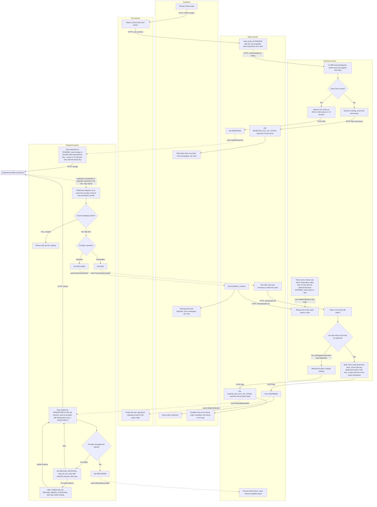

# Checkout across Cart, Inventory, Payment and Order

## How to read this

- Each box is labelled with the service that does the step. The swimlanes are Customer, Order, Cart, Inventory and Payment, plus the external payment provider.
- Solid arrows are synchronous HTTP calls, and the label gives the call. Dotted arrows are events on the shared message broker, and the label gives the event name.
- Uppercase words such as `RESERVED` are statuses stored in that service's own database.
- Order is the coordinator. It starts each step and records the overall outcome. It never touches another service's data. It only calls the service's API or reacts to its events.

## Walkthrough

1. **Place order.** Order asks Cart for the cart's lines and prices and saves them with the new order as `PENDING`. This snapshot is the only price source for the rest of the flow, so later cart edits or price changes cannot change the order.
2. **Reserve stock before any payment.** Order calls Inventory with the order id and lines. Inventory checks all lines in one local transaction.
   - If any line is short, it reserves nothing and returns the short items.
   - Order then sets `REJECTED_OUT_OF_STOCK` and tells the customer which items are short.
   - No payment is ever requested, and the cart is untouched.
3. **Hold.** If every line is available, Inventory reserves all of them and sets the hold to expire in 10 minutes. Reserving the same order id twice returns the same reservation, so a retried HTTP call is harmless.
4. **Charge.** Order publishes `OrderReserved`. Payment saves a `PENDING` payment and asks the provider to charge, with the order id as the idempotency key. If the call times out, Payment retries with the same key, so the customer cannot be charged twice.
5. **Wait for the webhook.** The result arrives by webhook, usually within seconds and at most 30 minutes later. The order stays `RESERVED` while it waits, and the hold may expire in the meantime. That is expected, and the claim step handles it.
6. **Ignore repeats.** Payment inserts the provider's event id into `processed_events`, which has a unique constraint. If the id is already there, Payment returns 200 and does nothing else. The webhook can therefore be delivered many times without being processed twice.
7. **Declined payment.** Payment publishes `PaymentDeclined`. Order sets `PAYMENT_FAILED` and asks Inventory to release the hold (the timer would do it anyway). The customer is told, and the cart is untouched so they can retry.
8. **Successful payment.** Payment publishes `PaymentSucceeded`. Order asks Inventory to claim the stock. Inventory decides in a single local transaction, so a claim can never race with expiry.
   - If the hold is still intact, it marks the stock `SOLD`.
   - If the hold has lapsed but the stock is still free, it re-takes every line at once. This saves a pointless refund, and it also keeps the all-or-nothing rule.
   - If any line has been sold to someone else, it refuses the claim and changes nothing, so we never ship a partial order.
9. **Confirmed.** Order sets `CONFIRMED` and publishes `OrderConfirmed`. Only now does Cart empty the cart. Cart handles that event idempotently, so a repeated delivery is harmless.
10. **Late success, out of stock.** Order sets `CANCELLED_OUT_OF_STOCK`, emails the customer, and publishes `RefundRequested`. Payment refunds the full amount, using `refund-<order id>` as the idempotency key. The cart is still untouched.
11. **Refund failures are never dropped.** The refund is a stored row in Payment, not an in-memory retry.
    - If the provider rejects it or times out, the status becomes `REFUND_RETRYING`. Retries use backoff and the same key, so a refund that actually went through cannot be paid out twice.
    - After N failed tries, the status becomes `REFUND_NEEDS_ATTENTION` and an alert goes to ops. Payment still keeps retrying.
    - Payment publishes `RefundSucceeded` only when the provider confirms. Order then emails the customer that the refund is complete.

## What each service stores

| Service | Owns | Notable fields and rules |
|---|---|---|
| **Cart** | Carts and cart lines | Lines and current prices. Emptied only on `OrderConfirmed`. Keeps a record of the last event handled for each order, so a repeat is ignored. |
| **Inventory** | Stock levels and reservations | Reservation per order id with lines, status (`HELD`, `SOLD`, `RELEASED`, `EXPIRED`) and `expires_at` (10 minutes after creation). Reserve, claim and release are idempotent per order id. |
| **Payment** | Payments, refunds, processed webhook events | Payment per order id with status (`PENDING`, `PAID`, `DECLINED`). Refund per order id with status (`REQUESTED`, `REFUND_RETRYING`, `REFUND_NEEDS_ATTENTION`, `REFUNDED`) and attempt count. `processed_events` has a unique provider event id. |
| **Order** | Orders | Snapshot of lines and prices, total, and status (`PENDING`, `RESERVED`, `PAID`, `CONFIRMED`, `REJECTED_OUT_OF_STOCK`, `PAYMENT_FAILED`, `CANCELLED_OUT_OF_STOCK`). Also sends the customer emails. |

No service reads another's tables. Every cross-service fact above arrives as an HTTP response or a broker event.

## Failure paths at a glance

| Situation | Result for stock | Result for money | Result for the cart |
|---|---|---|---|
| A line is short | Nothing reserved | No charge requested | Unchanged, customer told which items are short |
| Payment declined | Hold released | Nothing to refund | Unchanged |
| Payment succeeds, hold lapsed, stock gone | Claim refused | Full automatic refund | Unchanged |
| Refund fails at the provider | n/a | Retried and alerted, never dropped | Unchanged |
| Webhook delivered twice | No second claim | No second action | No second clear |
| Charge request retried | n/a | Same idempotency key, one charge only | n/a |

## Assumptions to confirm

- Order calls Inventory directly over HTTP, because it needs an immediate yes or no. The later steps use broker events, which the broker must deliver at least once, so every consumer is idempotent by order id.
- If a webhook has not arrived after about 35 minutes, Payment should ask the provider for the payment's status and process the answer as if it were a webhook. The brief does not cover this case.
- Order sends the customer emails, because no notification service exists.
