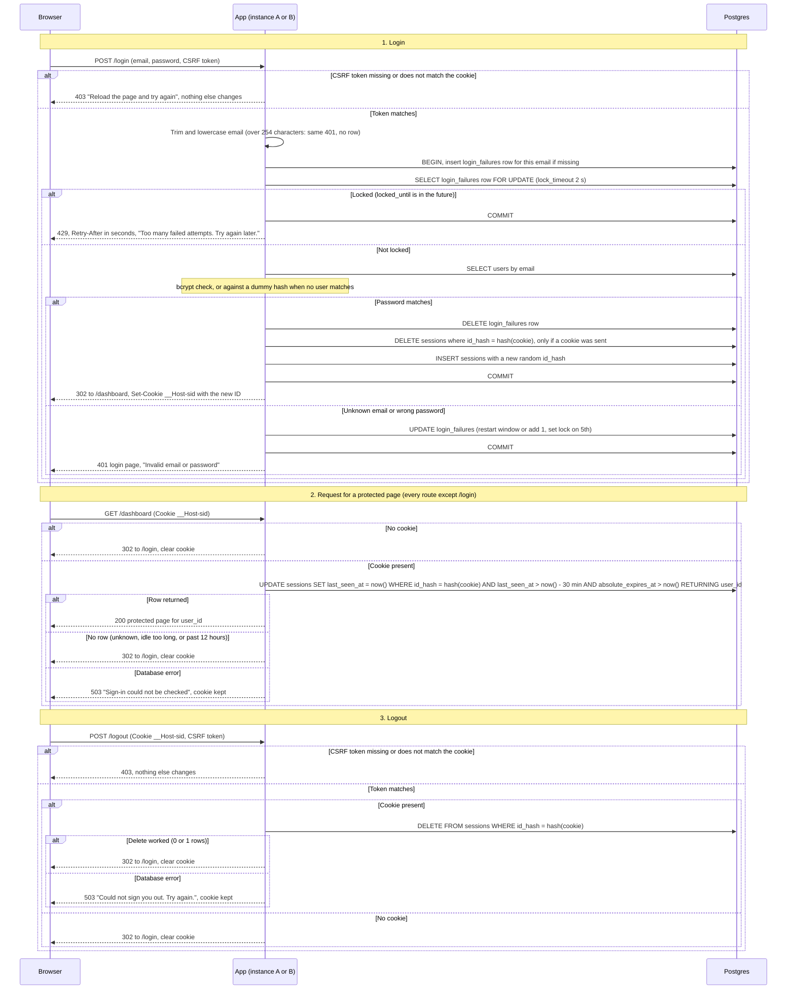

# Login with server-side sessions: design

## Summary

Today every page is public, and nothing tracks who is signed in. The app is server-rendered HTML with form posts. It runs as two identical instances behind a load balancer with no sticky sessions, and it uses one Postgres database that has a `users` table.

After this change, every page except `/login` needs a signed-in user. A user posts email and password to `/login`. If the password is right, the server stores a session row in Postgres and sends the browser a random session ID in a cookie. Each later request sends that ID back. The server checks the session and moves its idle timer forward. Logout deletes the session row. Failed logins are counted per email, and five failures lock that email for 15 minutes.

Both instances share the same Postgres database, so all session and failure state lives there.

## Terms

- **Session**: a row in `sessions` that links a session ID to a user.
- **Session ID**: 32 random bytes, base64url encoded (43 characters). The browser holds it. The database stores only its SHA-256 hash, `id_hash`.
- **`__Host-sid` cookie**: holds only the session ID.
- **`__Host-csrf` cookie**: holds a random token that must match a hidden form field. It stops other sites from forging login and logout posts.
- **Failure row**: a row in `login_failures` that counts failed logins for one email.
- **Lock**: a failure row whose `locked_until` is in the future.
- **Database clock**: `now()` in Postgres. Every expiry check uses it, so both instances agree.

## Design choices

1. **Storage: Postgres, no Redis.** Both instances already share Postgres, and login already depends on it through `users`. Redis would add a second stateful system and a gap between creating a session and the user table. Postgres gives the atomic updates and per-email row locks this needs. Revisit only if request volume grows enough to matter.
2. **Session IDs are hashed.** The database stores only the SHA-256 hash, so a leaked table does not give live sessions.
3. **Expiry is checked in the database.** One conditional statement checks and refreshes the session on each request, using the database clock.
4. **Cleanup runs on every instance.** Each instance runs the same job every 15 minutes. Running it twice is harmless, and each run deletes at most 1000 rows per table so locks stay short.
5. **Storage failure fails closed.** No protected content is served when storage is down, and no one is told they are signed out when they are not.

## Steps

Each step lists what starts it, what it does, which data it keeps, and what happens when it fails. The sequence diagram below shows the same steps in detail.

**1. Login (`POST /login`)**

- **Starts when:** the browser posts email, password and the CSRF token.
- **What it does:**
  1. Checks the CSRF token against the `__Host-csrf` cookie. If it is missing or wrong, returns 403 and changes nothing.
  2. Trims and lowercases the email. If it is over 254 characters, returns the same 401 as a wrong password and writes no row.
  3. Starts a transaction. Creates the failure row for this email if none exists, then locks it. The wait for the lock is at most 2 seconds.
  4. If the row is locked, commits and returns 429, with `Retry-After` in seconds. The password is not checked.
  5. Otherwise, looks up the user by email and checks the password with bcrypt. The row lock is held during this check. If no user matches, it checks against a dummy hash so timing stays similar.
  6. If the password matches: deletes the failure row, deletes the session that this browser's cookie points to (if a cookie was sent), inserts a new session with a new random ID, commits, and redirects to `/dashboard` with the new cookie.
  7. If the email is unknown or the password is wrong: updates the failure row, commits, and returns the login page with 401 "Invalid email or password".
- **Data kept:** `login_failures` and `sessions` rows.
- **When it fails:** see the failures table.

**2. Request for a protected page (every route except `/login`)**

- **Starts when:** the browser requests a page.
- **What it does:**
  1. If there is no `__Host-sid` cookie, redirects to `/login` and clears the cookie.
  2. If the cookie is present, one database statement looks up the session by the hash of the cookie. It matches only if `last_seen_at` is within the last 30 minutes and `absolute_expires_at` is in the future. On a match, it sets `last_seen_at` to now, returns the user ID, and the page is served for that user.
  3. If no row comes back (unknown session, idle too long, or past 12 hours), redirects to `/login` and clears the cookie.
- **Data kept:** `sessions.last_seen_at` moves forward on every valid request.
- **When it fails:** see the failures table.

**3. Logout (`POST /logout`)**

- **Starts when:** the browser posts the cookie and the CSRF token.
- **What it does:** checks the CSRF token. On a mismatch, returns 403 and changes nothing. Otherwise, if a cookie is present, deletes that session row before replying. Then redirects to `/login` and clears the cookie. With no cookie, or with an expired or repeated session, the reply is the same.
- **Data kept:** deletes the `sessions` row.
- **When it fails:** see the failures table.

**4. Cleanup (background)**

- **Starts when:** a timer on each instance fires every 15 minutes.
- **What it does:** deletes at most 1000 rows per table per run. It deletes `sessions` where `absolute_expires_at < now()` or `last_seen_at < now() - 30 min`. It deletes `login_failures` where `window_started_at < now() - 10 min` and the lock is absent or past.
- **Data kept:** removes rows only. Expired rows are ignored anyway, so a missed run does no harm.
- **When it fails:** the next run retries.

## Sequence diagram

## Notes on the diagram

- **Cookies.** `__Host-sid` is set with `HttpOnly; Secure; SameSite=Lax; Path=/`, with no `Domain` and no `Max-Age`, so the browser drops it when it closes. To clear it, the server sends `Set-Cookie: __Host-sid=; Path=/; Secure; HttpOnly; SameSite=Lax; Max-Age=0`. `__Host-csrf` has the same attributes and holds only a random token. The server sets it on every page that has a form.
- **Session rules.** A session is valid only while `last_seen_at` is within the last 30 minutes and `absolute_expires_at` is in the future, both on the database clock. Each valid request moves `last_seen_at` forward. The 12-hour limit never moves.
- **Failure rules.** A failure row starts counting on the first failure. A later failure restarts the count at 1 if the window started 10 or more minutes ago. Otherwise it adds 1. The 5th failure in the window sets `locked_until` to 15 minutes ahead. When `locked_until` passes, the row counts as clear. Attempts during a lock change nothing. A successful login deletes the row.
- **Lock before password.** While an email is locked, its password is never compared, even if it is correct.
- **Identical 401.** An unknown email and a wrong password get the same status, body and headers. The dummy hash keeps timing close. Failure rows are kept for unknown emails too, so a 429 does not reveal whether an account exists. The 5th failure also gets the 401, so the user learns about the lock on the next attempt. This is deliberate.
- **Locks and sessions.** A lock blocks new logins for that email only. It does not end existing sessions. Login deletes only this browser's session, so sessions on other devices stay valid.

## What happens when things fail

| Failure | Where | Response | Data change |
|---|---|---|---|
| CSRF token missing or wrong | login, logout | 403 | none |
| Row lock wait exceeds 2 s | login | 503 "Sign-in is temporarily unavailable. Try again shortly." | rolled back, nothing counted |
| Any other database error during login | login | 503, same login page, no cookie | rolled back |
| Session insert fails | login | 503, same login page, no cookie | rolled back, so the failure count is untouched |
| Database error on a protected page | any protected page | 503 "Sign-in could not be checked. Try again shortly.", cookie kept | none |
| Logout delete fails | logout | 503 "Could not sign you out. Try again.", cookie kept | none |
| Cleanup job fails | background | retried at the next 15-minute run | none; expired rows are ignored anyway |

A lock-timeout error counts as a database error. It is never reported as a 401.

## Limits

| Rule | Value |
|---|---|
| Failures before lock | 5 |
| Failure window | 10 minutes, fixed, starts at first failure |
| Lock duration | 15 minutes, not extended by attempts made while locked |
| Idle timeout | 30 minutes, reset by every valid request |
| Absolute lifetime | 12 hours from login |
| Cleanup interval | 15 minutes, at most 1000 rows per table per run |
| Login `lock_timeout` | 2 seconds |
| Email length cap | 254 characters |

## Build and rollout

- **Load testing.** Load test the per-request write and the per-email row lock before rollout. The lock holds a database connection during bcrypt.
- **Storage interface.** Put session and failure access behind a small store interface, so Redis could replace Postgres later without changing the handlers.
- **Accepted risk: targeted lockout.** Per-email locking lets anyone lock a known user out for 15 minutes. The brief requires per-email limits, so this is accepted. A per-IP limit is a recommended follow-up.

## Open questions

- The brief says the cookie carries only the opaque session ID. This plan adds a second cookie, `__Host-csrf`, with a random token and no user data. Is that acceptable? If not, a different login-CSRF defense is needed.
- The bcrypt cost factor is not set. It decides how long each login holds its row lock.
- Some browsers restore session cookies after a restart. Whether that happens here is not known.
- Local development needs HTTPS for `Secure` cookies. Local TLS or a documented exception: the approach is not chosen.