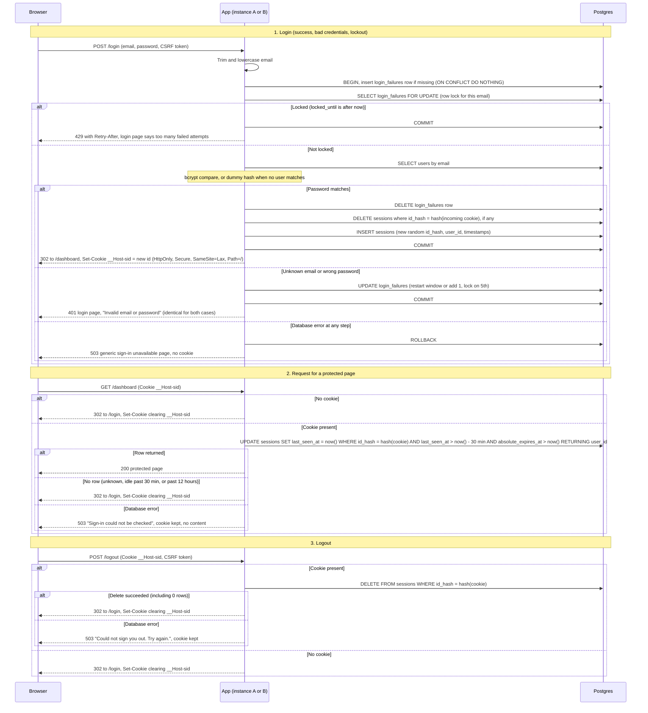

# Login with server-side sessions: design

## Decisions

1. **Storage: PostgreSQL, no Redis.** Sessions and failure counts live in two new tables in the existing Postgres database. Both instances already share it, and login already depends on it through `users`, so there is no new failure mode to operate. Login needs atomic conditional updates and a per-email row lock, which Postgres provides directly. Per-request cost is one indexed `UPDATE` by primary key, which is trivial for a small team. Redis would add a second stateful system and a second consistency boundary between session creation and the user table. Its TTLs would be convenient, but timestamp columns plus a cleanup job do the same work. Revisit only if request volume grows enough to matter.

2. **Session ID.** 32 bytes from a CSPRNG, base64url encoded (43 characters). The database stores only SHA-256 of the ID (`id_hash`), so a leaked table does not yield live sessions.

3. **Cookie.** Name `__Host-sid`, attributes `HttpOnly; Secure; SameSite=Lax; Path=/`, no `Domain`, and no `Max-Age`. The `__Host-` prefix forces `Secure`, `Path=/` and no `Domain`. The browser holds only the opaque ID. The server is the sole authority on expiry.

4. **Expiry check.** One conditional statement both checks and touches the session:
   `UPDATE sessions SET last_seen_at = now() WHERE id_hash = $1 AND last_seen_at > now() - interval '30 minutes' AND absolute_expires_at > now() RETURNING user_id`
   Every expiry comparison uses the database clock (`now()`), not an application clock, so the two instances always agree.

5. **Session columns.** `id_hash` (PK), `user_id` (FK to `users`), `created_at`, `last_seen_at`, `absolute_expires_at = created_at + 12 hours`. The idle deadline is `last_seen_at + 30 minutes`.

6. **Failure counts.** Table `login_failures`: `email` (PK, normalized), `window_started_at`, `failure_count`, `locked_until` (nullable).
   - Rows are keyed on every submitted email, known or unknown. This is what keeps the 429 from revealing whether an account exists.
   - The window is fixed and starts at the first failure. If the previous window is at least 10 minutes old, the next failure restarts the count at 1.
   - The 5th failure sets `locked_until = now() + 15 minutes`. That 5th attempt still gets the identical 401, because its password was checked and was wrong.
   - Attempts made while locked return 429 and do not extend the lock.
   - After `locked_until` passes, the row is treated as empty on the next attempt.
   - A successful login deletes the row.

7. **Serializing attempts per email.** The login transaction takes `SELECT ... FOR UPDATE` on the email's `login_failures` row before reading the lock state or checking the password. Concurrent guesses for one email queue behind each other, so the 5-failure limit holds exactly and cannot be beaten by parallel requests. The login transaction sets `lock_timeout = 2s`. A timeout returns 503 (see decision 11).

8. **Unknown-email timing.** When no user matches, bcrypt runs against a precomputed dummy hash, so response time does not reveal whether the email exists.

9. **Atomic login.** Counter reset, old-session deletion, and new-session insert happen in one transaction. If session creation fails, the failure counter is left untouched and no cookie is issued.

10. **Cleanup of abandoned state.** Every instance runs the same job every 15 minutes. Both instances may run it; it is idempotent.
    - Delete sessions where `absolute_expires_at < now()` or `last_seen_at < now() - 30 minutes`.
    - Delete `login_failures` rows where `window_started_at < now() - 10 minutes` and the lock is absent or past.
    - Each run deletes at most 1000 rows, so long locks are avoided.
    - Expired rows are harmless even before cleanup, because every check ignores them.

11. **Storage-failure policy: fail closed everywhere.**
    - Login: the transaction fails, the response is 503 with the generic page "Sign-in is temporarily unavailable. Try again shortly." No counter change, no session, no cookie. It is never reported as a 401.
    - Protected page: 503 "Sign-in could not be checked. Try again shortly." No protected content is served. The cookie is kept, because this is not an auth failure.
    - Logout: if the delete fails, return 503 "Could not sign you out. Try again." and keep the cookie. Telling the user they are signed out while the server session lives would be false.

12. **Login form CSRF.** Login and logout forms carry a synchronizer token. `SameSite=Lax` blocks cross-site POSTs for logout, but a cross-site login POST sends no session cookie, so it would otherwise log a victim's browser into an attacker's account.

13. **Session fixation.** Handled by decision 9's issue of a brand-new ID on every successful login.

## Constants

| Rule | Value |
|---|---|
| Failures before lock | 5 |
| Failure window | 10 minutes, fixed, starts at first failure |
| Lock duration | 15 minutes, not extended by attempts made while locked |
| Idle timeout | 30 minutes, reset by every request |
| Absolute lifetime | 12 hours from login |
| Cleanup interval | 15 minutes |
| Login `lock_timeout` | 2 seconds |

## Sequence

## Rules that do not fit on the arrows

- **Session lifecycle.** A session is valid only while `last_seen_at > now() - 30 min` and `absolute_expires_at > now()`, both on the database clock. Each valid request moves `last_seen_at` forward. The 12-hour limit is never extended.
- **Failure-count lifecycle.** `clean` moves to `counting` on the first failure. `counting` moves back to `clean` on success, or when the window is at least 10 minutes old at the next failure (count restarts at 1). `counting` moves to `locked` on the 5th failure. `locked` moves to `clean` once `locked_until` passes, and attempts during the lock do not change the row.
- **Identical responses.** Unknown email and wrong password differ in neither status, body, headers, nor timing (dummy bcrypt). The lock applies to unknown emails too, so 429 does not reveal account existence either.
- **Lockout blocks before the password check.** While locked, the password is never compared, even if it is correct.
- **Logout is idempotent.** A missing session, an expired session, or a repeated logout all give the same 302 and cookie clearing.
- **Email normalization.** Trim and lowercase only. Cap length at 254 characters, which bounds `login_failures` growth from random addresses.

## Residual risks and follow-ups

- **Targeted lockout.** Per-email locking lets anyone lock a known user out for 15 minutes. The brief requires per-email limits, so this is accepted. A per-IP limit at the load balancer or in the app is a recommended follow-up.
- **Local development.** `Secure` cookies require HTTPS, so local development needs TLS or a documented exception.
- **Storage swap.** Session and failure-count access should sit behind a small store interface, so Redis could replace Postgres later without touching the handlers.
- **Load testing.** The per-request write and the per-email row lock (which holds a connection during bcrypt) should be load tested before rollout.