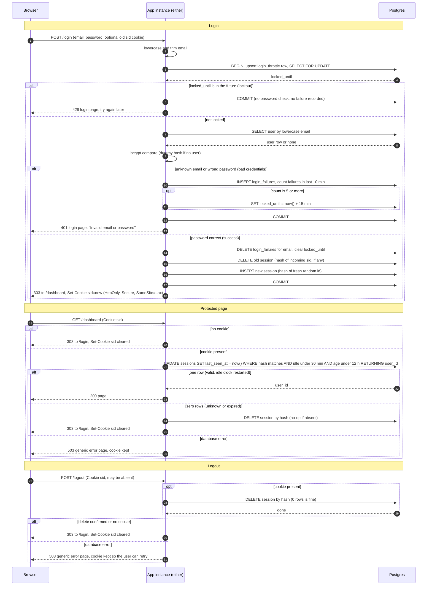

# Login with server-side sessions: design

Every page except `/login` will need a signed-in user. A successful `POST /login` creates a session row in Postgres and sets a cookie holding only a random ID. Every protected request looks that ID up in Postgres and restarts the idle clock. `POST /logout` deletes the row.

Today the app is server-rendered (HTML pages and form posts, no API clients) and every page is public. Two identical instances run behind a load balancer with no sticky sessions, so any request can reach either one. One Postgres database already has a `users` table: `id`, `email` (lowercase, unique), `password_hash` (bcrypt). Sign-up and password reset are out of scope, so accounts are created elsewhere.

## Terms

- **Session**: a row in `sessions`. It proves a browser logged in as one user.
- **Idle limit / absolute limit**: a session ends after 30 minutes with no requests, or 12 hours after login, whichever comes first.
- **Throttle**: the lockout rule. 5 failures for one email within 10 minutes locks that email for 15 minutes.

## Decisions

| Choice | Decision | Why |
|---|---|---|
| Session and failure storage | Postgres tables `sessions`, `login_throttle`, `login_failures`. Redis is not added. | Both instances already share this database. A new service means more to deploy, secure, back up and monitor. Load is small, so one indexed write per request is cheap. Failure counts can then change in the same transaction as the login check. |
| Session ID | 32 bytes from a CSPRNG, base64url encoded. | Unguessable. The cookie holds only this value. |
| What is stored | SHA-256 of the ID (`id_hash`), never the raw ID. | A leaked dump or backup cannot be replayed as live sessions. |
| Cookie | `sid=<id>; Path=/; HttpOnly; Secure; SameSite=Lax`, no `Max-Age` or `Expires`. | The server decides expiry. Clearing uses the same name, `Path` and flags with `Max-Age=0`. |
| Clock | Every time comparison uses Postgres `now()`. | The instances can disagree on time. The database is the single authority. |
| Expiry recording | Store only `created_at` and `last_seen_at`. | Idle deadline is `last_seen_at + 30 min`. Absolute deadline is `created_at + 12 h`. Nothing is recomputed if the rules change. |
| Expiry check | One atomic `UPDATE` that checks and touches the session. | No race between "check" and "touch". |
| Cleanup | Lazy delete when an expired session is presented, plus a sweep every 5 minutes on each instance. | The sweep is an idempotent `DELETE`, so no coordination between instances. |
| Throttle scope | By email only, after lowercasing and trimming. | The brief defines the limit per email. |
| Redirects after POST | 303 See Other. | Browsers follow with GET. |
| Storage failure | Fail closed with a generic 503 page. | Never let a request through, or skip the throttle, because storage is down. |

## State

```sql
CREATE TABLE sessions (
  id_hash      bytea       PRIMARY KEY,           -- sha256(session id)
  user_id      bigint      NOT NULL REFERENCES users(id) ON DELETE CASCADE,
  created_at   timestamptz NOT NULL DEFAULT now(),
  last_seen_at timestamptz NOT NULL DEFAULT now()
);
CREATE INDEX sessions_last_seen_idx ON sessions (last_seen_at);
CREATE INDEX sessions_created_idx   ON sessions (created_at);

CREATE TABLE login_throttle (
  email        text        PRIMARY KEY,           -- lowercased and trimmed, whether or not a user exists
  locked_until timestamptz,                       -- null if not locked
  updated_at   timestamptz NOT NULL DEFAULT now()
);

CREATE TABLE login_failures (
  email     text        NOT NULL,
  failed_at timestamptz NOT NULL DEFAULT now()
);
CREATE INDEX login_failures_idx ON login_failures (email, failed_at);
```

## Sequence diagram



## Steps

`GET /login` is public and shows the email and password form. It knows nothing about lockout. The 401 and 429 responses re-show the same form with a message. A visitor who is already signed in still sees the form, and submitting it replaces their session.

### 1. Login attempt

- **Starts when:** the browser sends `POST /login`.
- **Does, in one transaction per email:**
  1. Lowercase and trim the email. Use it as the throttle key for every attempt, including emails with no account.
  2. Insert the `login_throttle` row if missing, then `SELECT ... FOR UPDATE` it. This serializes attempts for one email across both instances, so parallel guesses cannot slip past the count. The lock is held while bcrypt runs, which is acceptable at this scale. Set `lock_timeout` to 5 seconds.
  3. If `locked_until > now()`, answer 429. Do not check the password and do not record a failure.
  4. Look up the user. If none, run bcrypt against a fixed dummy hash so unknown emails take about as long as wrong passwords. Treat this as a failure.
  5. On failure: insert a `login_failures` row and count rows for the email with `failed_at > now() - 10 min`. If the count is 5 or more, set `locked_until = now() + 15 min`. Answer 401 with the identical body for every failure: the login page showing "Invalid email or password". The 5th failure still gets 401. The 429 starts on the next attempt.
  6. On success: delete the email's `login_failures` rows, set `locked_until = NULL`, then create the session (below) and commit.
- **Session creation:** always generate a fresh ID, even if the browser sent one. In the same transaction, insert the new row and delete the row matching the incoming cookie, if any. Set the new cookie and redirect to `/dashboard` only after the commit. The old ID is dead from that moment.
- **Keeps data in:** `login_throttle`, `login_failures`, `sessions`.
- **When it goes wrong:** any database error or lock timeout rolls back and returns 503 with no `Set-Cookie`. The password is never checked without the throttle working. A 429 applies to any email string, so it reveals nothing about whether an account exists.

### 2. Protected request

- **Starts when:** any request to a route other than `/login`. One shared middleware handles it.
- **Does:** if there is no cookie, go straight to the clear-and-redirect below. Otherwise hash the cookie value and run:
  ```sql
  UPDATE sessions SET last_seen_at = now()
  WHERE id_hash = $1
    AND last_seen_at > now() - interval '30 minutes'
    AND created_at   > now() - interval '12 hours'
  RETURNING user_id;
  ```
  One row means the session is valid and the idle clock has restarted. The middleware attaches `user_id` as the current user and the page handler runs. Zero rows means the session is unknown or expired. Run `DELETE FROM sessions WHERE id_hash = $1` (harmless if absent), clear `sid`, and redirect to `/login`.
- **Keeps data in:** `sessions`.
- **When it goes wrong:** a database error returns 503 and keeps the cookie. The session may still be valid, and redirecting would wrongly sign out a user who did nothing wrong.

### 3. Logout

- **Starts when:** the browser sends `POST /logout`.
- **Does:** if there is a cookie, `DELETE FROM sessions WHERE id_hash = $1` and wait for it to finish. With no cookie or an unknown ID it affects 0 rows. Then reply 303 to `/login` with the cookie cleared, so the response is the same with or without a session.
- **Keeps data in:** `sessions`.
- **When it goes wrong:** if the delete cannot be confirmed, return 503 and keep the cookie so the user can retry. The idle and absolute limits still bound the session.
- **CSRF:** `SameSite=Lax` stops other sites from triggering logout with a cross-site POST.

### 4. Cleanup sweep

- **Starts when:** an in-process timer on each instance fires every 5 minutes, starting at boot.
- **Does:**
  ```sql
  DELETE FROM sessions WHERE last_seen_at < now() - interval '30 minutes'
                          OR created_at   < now() - interval '12 hours';
  DELETE FROM login_failures WHERE failed_at < now() - interval '10 minutes';
  DELETE FROM login_throttle WHERE (locked_until IS NULL OR locked_until < now())
    AND NOT EXISTS (SELECT 1 FROM login_failures f WHERE f.email = login_throttle.email);
  ```
  Expired rows are already rejected by step 2, so the sweep only reclaims space and needs no exactness. The throttle cleanup also bounds growth from attackers submitting many different emails.
- **Keeps data in:** the same three tables.
- **When it goes wrong:** a failed sweep logs the error and tries again at the next tick. If it meets a throttle row locked by a login, it waits for that login to commit. If it deletes a throttle row first, the next login recreates it.

## When things fail

| Where | What the user sees | Cookie |
|---|---|---|
| Login, locked email | 429 login page | unchanged |
| Login, bad credentials | 401, "Invalid email or password" | unchanged |
| Login, database error or lock timeout | 503 | none set |
| Protected request, database error | 503 | kept |
| Logout, delete not confirmed | 503 | kept |
| Sweep | nothing | n/a |

Every 503 shows the same generic page: "Something went wrong. Please try again in a moment." It has no detail. The error and a request ID go to the server log, never the session ID or password.

## Open questions

- Login CSRF (a forged cross-site login post) is outside this brief and is not defended against.
- Holding the throttle row lock during bcrypt is fine for a small team. Revisit if login load grows.