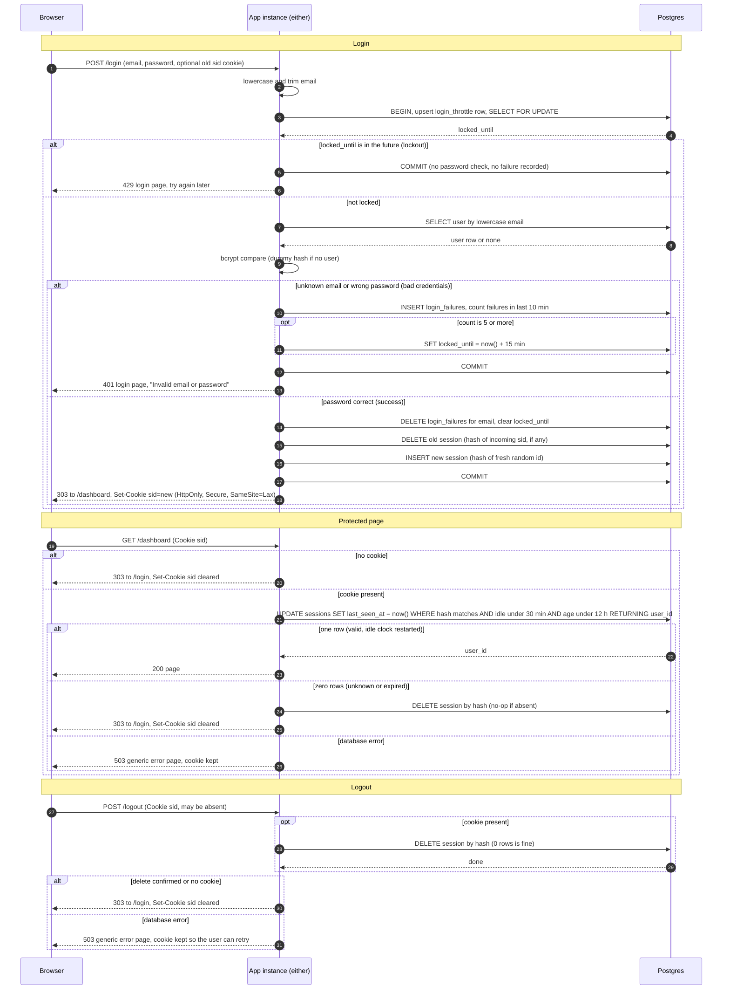

# Login with server-side sessions: design

## 1. Decisions

| Choice | Decision | Why |
|---|---|---|
| Session storage | Postgres table `sessions`. | Both instances already share this database. Redis is not added. A new service would mean more to deploy, secure, back up and monitor. Load is small (a team scheduling app), so one indexed write per request is cheap. |
| Failure counts | Postgres tables `login_throttle` and `login_failures`. | Same reasoning. They can be updated in the same transaction as the login check. |
| Session ID | 32 bytes from a CSPRNG, base64url encoded. | Unguessable. The cookie holds only this value. |
| What is stored | SHA-256 of the session ID (`id_hash`), never the raw ID. | A leaked database dump or backup cannot be replayed as live sessions. |
| Cookie | `sid=<id>; Path=/; HttpOnly; Secure; SameSite=Lax`, with no `Max-Age` or `Expires`. | The server decides expiry, so the cookie is just a browser-session handle. Clearing it uses the same name, `Path` and flags with `Max-Age=0`. |
| Clock | Every time comparison uses Postgres `now()`. | The two app instances can disagree on time. The database clock is the single authority. |
| Expiry recording | Store only `created_at` and `last_seen_at`. Derive both deadlines. | Idle deadline is `last_seen_at + 30 min`. Absolute deadline is `created_at + 12 h`. Nothing needs recomputing when rules change. |
| Expiry check | One atomic statement that checks and touches the session (section 3). | A request that finds a valid session also restarts its idle clock, with no race between "check" and "touch". |
| Cleanup | Lazy delete when an expired session is presented, plus a sweep every 5 minutes on each instance. | The sweep is a plain `DELETE ... WHERE expired`. It is idempotent, so both instances can run it without coordination. |
| Redirects after POST | 303 See Other. | Browsers follow with GET. |
| Storage failure | Fail closed with a generic 503 page (section 3). | Never let a request through, or skip the throttle, because storage is down. |

## 2. State

```sql
CREATE TABLE sessions (
  id_hash      bytea       PRIMARY KEY,           -- sha256(session id)
  user_id      bigint      NOT NULL REFERENCES users(id) ON DELETE CASCADE,
  created_at   timestamptz NOT NULL DEFAULT now(),
  last_seen_at timestamptz NOT NULL DEFAULT now()
);
CREATE INDEX sessions_last_seen_idx ON sessions (last_seen_at);
CREATE INDEX sessions_created_idx   ON sessions (created_at);

CREATE TABLE login_throttle (
  email        text        PRIMARY KEY,           -- lowercased and trimmed, whether or not a user exists
  locked_until timestamptz,                       -- null if not locked
  updated_at   timestamptz NOT NULL DEFAULT now()
);

CREATE TABLE login_failures (
  email     text        NOT NULL,
  failed_at timestamptz NOT NULL DEFAULT now()
);
CREATE INDEX login_failures_idx ON login_failures (email, failed_at);
```

## 3. Rules that don't fit on the arrows

**Login attempt, in one transaction per email**
1. Lowercase and trim the email. Use that string as the throttle key for every attempt, including emails that have no account.
2. Insert the `login_throttle` row if missing, then `SELECT ... FOR UPDATE` it. This serializes attempts for one email across both instances. Parallel guesses cannot all slip past the count, so the limit of 5 is exact. The row lock is held while bcrypt runs, which is acceptable at this scale.
3. If `locked_until > now()`, answer 429 immediately. The password is not checked and no failure is recorded.
4. Look up the user. If there is none, run bcrypt against a fixed dummy hash, so unknown emails take about as long as wrong passwords. Treat the result as a failure.
5. On failure:
   - Insert a `login_failures` row.
   - Count rows for the email where `failed_at > now() - 10 min`.
   - If the count is 5 or more, set `locked_until = now() + 15 min`.
   - Answer 401 with the identical body in every failure case: the login page showing "Invalid email or password". This includes the 5th failure, which still gets 401. The 429 starts on the next attempt.
6. On success:
   - Delete that email's `login_failures` rows and set `locked_until = NULL`.
   - Create the new session (rule below).
   - Commit.

This applies to any email string, so a 429 reveals nothing about whether an account exists.

**Session creation and fixation defence**
- Always generate a fresh ID.
- In the same transaction, insert the new row and delete the row whose hash matches the incoming cookie, if there is one.
- Set the new cookie only after the commit. The old ID is dead from that moment.

**Protected request check**

This statement uses the hash of the cookie value.
```sql
UPDATE sessions SET last_seen_at = now()
WHERE id_hash = $1
  AND last_seen_at > now() - interval '30 minutes'
  AND created_at   > now() - interval '12 hours'
RETURNING user_id;
```
- One row returned means the session is valid and the idle clock has restarted. Continue with that `user_id`.
- Zero rows means the cookie is missing, unknown or expired. Run `DELETE FROM sessions WHERE id_hash = $1`, which is harmless if there is no row. Then send `Set-Cookie` to clear `sid` and redirect to `/login`. A missing cookie skips the database and goes straight to the clear-and-redirect.

**Logout**
- `DELETE FROM sessions WHERE id_hash = $1` and wait for it to finish before replying.
- With no cookie, or an unknown ID, the delete simply affects 0 rows.
- Always reply with a cleared cookie and a 303 to `/login`, so the response is the same with or without a session.
- `SameSite=Lax` stops other sites from triggering a logout through a cross-site POST. Login CSRF is outside this brief.

**Cleanup sweep (every 5 minutes, per instance)**
```sql
DELETE FROM sessions WHERE last_seen_at < now() - interval '30 minutes'
                        OR created_at   < now() - interval '12 hours';
DELETE FROM login_failures WHERE failed_at < now() - interval '10 minutes';
DELETE FROM login_throttle WHERE (locked_until IS NULL OR locked_until < now())
  AND NOT EXISTS (SELECT 1 FROM login_failures f WHERE f.email = login_throttle.email);
```
Expired rows are already rejected by the check above. The sweep only reclaims space, so it needs no exactness. The throttle cleanup also bounds growth from attackers submitting many different emails.

**Storage failure behaviour**
- Any database error or timeout returns HTTP 503 with a generic page: "Something went wrong. Please try again in a moment." The body contains no detail. The error and a request ID go to the server log, never the session ID or password.
- `POST /login`: if the throttle or session write fails, roll back, send no `Set-Cookie` and let nobody in. The password is never checked without the throttle working.
- Protected request: return 503 and do not clear the cookie. The session may still be valid, and redirecting to `/login` would wrongly sign out a user who did nothing wrong.
- `POST /logout`: if the delete cannot be confirmed, return 503 and keep the cookie, so the user can retry and the session is not left alive and unreachable. The idle and absolute limits still bound it.

## 4. Sequence diagram



## 5. Requirement coverage

| Req | Where handled |
|---|---|
| 1 | Lowercase and trim at step 1 of the login rules. |
| 2 | Single 401 path for unknown email and wrong password, with the dummy bcrypt hash for timing. |
| 3 | `login_failures` sliding 10-minute count, `locked_until` of 15 minutes, 429 before any password check, and success clears both. |
| 4 | Fresh ID, old session deleted and new one inserted in one transaction, then 303 to `/dashboard`. |
| 5 | Cookie holds only the opaque ID, with the three flags. |
| 6 | `last_seen_at` touched on every valid request. 30-minute idle and 12-hour absolute limits are in the one `UPDATE`. |
| 7 | Missing, unknown or expired sessions get a cleared cookie and a redirect. |
| 8 | Server-side delete is confirmed before replying. The same response is sent with or without a session. |
