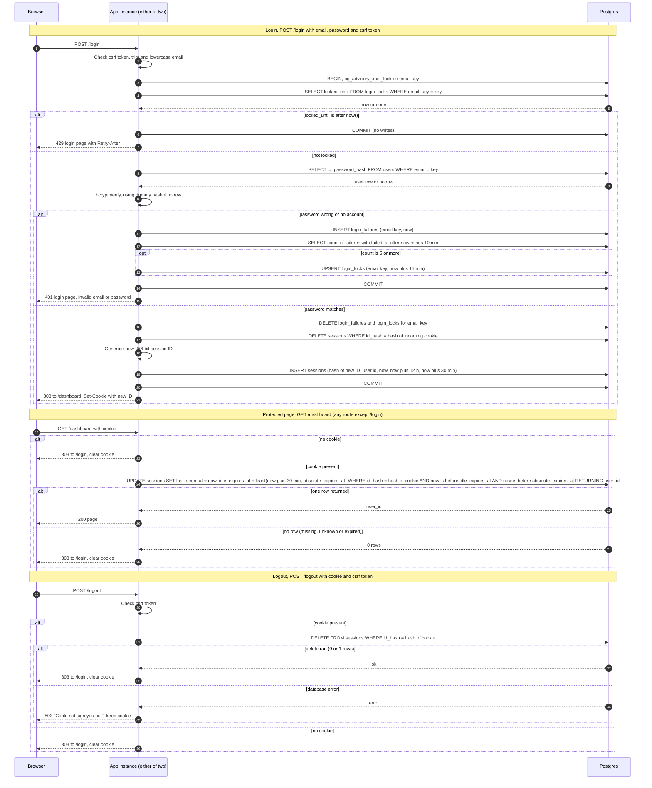

# Login with server-side sessions: design

## Summary

Today the app is server-rendered HTML with no sign-in, and every page is public. The app runs as two identical instances behind a load balancer with no sticky sessions. After this change, every page except `/login` requires a signed-in user.

Sessions and failed-login counts live in Postgres, which both instances already share. Redis is not used. Session volume at team scale is small, so Redis would add a service to run, back up and monitor for no gain. The main flow: `POST /login` checks the email and password, then issues a new random session ID in a cookie. Each later request checks that ID on the server and slides its 30-minute idle window. `POST /logout` deletes the session.

## Terms

- **Session:** a row in `sessions` that says which user is signed in and when that ends.
- **Session ID:** a random 256-bit value in the browser cookie. The database stores only its SHA-256 hash (`id_hash`), so a database read does not yield usable tokens.
- **Idle expiry:** 30 minutes after the last request. Every request restarts it.
- **Absolute expiry:** 12 hours after login. It is set at login and never extended.
- **Email key:** the email, trimmed and lowercased.
- **Failure row:** one row in `login_failures` for each failed attempt.
- **Lock:** one row in `login_locks` that refuses logins for one email key until `locked_until`.

```
sessions(id_hash bytea PK, user_id FK users.id, created_at, last_seen_at,
         absolute_expires_at, idle_expires_at)   -- index on idle_expires_at
login_failures(email_key text, failed_at timestamptz)  -- index (email_key, failed_at)
login_locks(email_key text PK, locked_until timestamptz)
```

## Diagram



## Notes

- **Session validity:** a session is valid if and only if `now() < idle_expires_at`. Because `idle_expires_at` is capped at `absolute_expires_at`, the 12-hour limit needs no separate check.
- **Expiry clock:** every expiry comparison uses the Postgres clock (`now()`), never an app server clock, so both instances agree.
- **Recording each request:** every protected request runs the single `UPDATE` in the diagram. It checks the session and slides the idle window in one statement. It writes on every request, with no throttling, so the 30-minute clock is exact. The cost is one indexed write per request.
- **Lockout:** failures are counted per email key, including unknown emails. Without that, the 429 would reveal which addresses exist. The 5th failure within any rolling 10 minutes sets a lock for 15 minutes from that moment. The lock is fixed. Refused attempts do not extend it. The lock check runs before the password check and before any account lookup. A successful login clears that email's failures and lock.
- **Concurrency:** each login runs in one transaction that first takes `pg_advisory_xact_lock(hashtext(email_key))`. Two instances therefore cannot both see 4 failures and both let a 5th attempt through. The transaction may hold a connection during bcrypt. That is acceptable at this scale.
- **Unknown email:** the code still runs bcrypt against a fixed dummy hash at the same cost, so response time does not reveal whether an account exists.
- **Successful login:** one transaction deletes the email key's failures and lock, deletes the session named by the incoming cookie (if any), inserts the new session, and commits. The cookie is set and the user redirected only after commit.
- **Failed login while signed in:** the current session is left alone.
- **Cookie:** `__Host-session=<id>; Path=/; HttpOnly; Secure; SameSite=Lax`. There is no `Domain` and no `Max-Age`, so it is a browser-session cookie. Server-side limits still apply. Clearing sends the same name with an empty value and `Max-Age=0`. The cookie holds no user data.
- **Access control:** session checking is middleware on every route. Only `GET /login`, `POST /login` and static assets are exempt. Static files carry no user data, so the login page can load its CSS and JavaScript.
- **CSRF:** `POST /login` and `POST /logout` carry a CSRF token, using the app's existing mechanism if it has one, otherwise a new one. `SameSite=Lax` stops cross-site POSTs from sending the session cookie to `/logout`. It does not stop login CSRF, where an attacker signs the victim into the attacker's account.
- **Background cleanup:** each instance runs a job every 10 minutes. It deletes, in batches of 1,000, sessions past `idle_expires_at`, failure rows older than 10 minutes, and locks past `locked_until`. Running it on both instances is harmless because deletes are idempotent. Expired rows are never accepted, so cleanup affects storage only, not security. If a run fails, the rows stay until a later run removes them.

## What happens when things fail

Nothing is served on error.

| Case | Status | Body | Cookie |
|---|---|---|---|
| Unknown email or wrong password | 401 | Login page: "Invalid email or password" | Unchanged |
| Locked email, any address | 429 | Login page, with `Retry-After` | Unchanged |
| Login succeeds | 303 to `/dashboard` | none | New `__Host-session` set |
| Login, any DB error before commit | 503 | Login page: "We could not sign you in right now. Try again in a minute.", `Retry-After: 30`. No password check happens, because the lock cannot be checked (fail closed). | Not set |
| Protected page, no cookie, or missing, unknown or expired session | 303 to `/login` | none | Cleared |
| Protected page, DB error | 503 | "Sign-in is temporarily unavailable.", with `Retry-After` | Kept. Do not redirect: the session may still be valid, and a transient error must not sign people out. |
| Logout, any session state, including no session | 303 to `/login` | none | Cleared |
| Logout, DB error | 503 | "Could not sign you out. Try again." | Kept, so a retry works. The session still expires on its own. |

The diagram shows the normal paths and the rejections. The table covers the storage-error paths.

## Open questions

Known gaps, outside the brief:

- Lockout is per email only. An attacker can lock out a known user for 15 minutes by repeating bad attempts. A per-IP limit would reduce this, but the brief does not ask for one.
- Sessions are rotated only at login, not during use. This matches requirement 4.
- There is no "sign out everywhere" action.