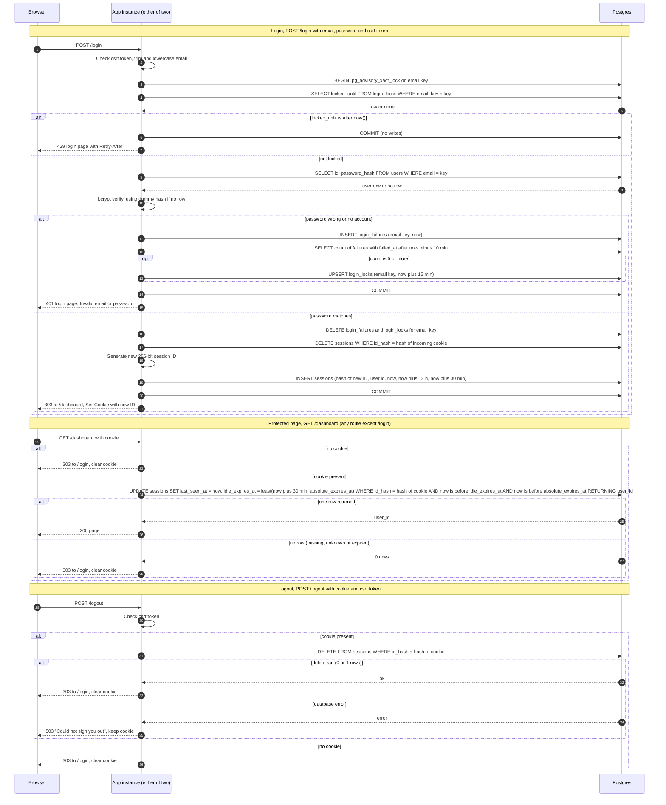

# Login with server-side sessions: design

## Choices

1. **Session store: PostgreSQL table `sessions`, not Redis.** Both instances already share Postgres, which holds `users`. Sessions are few at team scale, so this adds no new service to run, back up, or monitor. Login lockout counting can share the same transaction as session writes. The cost is one indexed write per protected request. If load outgrows Postgres, revisit Redis with TTLs. That is not needed now.

2. **Session ID: 256 random bits.** The ID comes from a CSPRNG (32 bytes, base64url). The database stores only the SHA-256 hash of the ID as the primary key, so a database read does not yield usable session tokens.

3. **Cookie: `__Host-session=<id>; Path=/; HttpOnly; Secure; SameSite=Lax`.** No `Domain`, no `Max-Age`, so it is a browser-session cookie. Server-side limits still apply. Clearing sends the same name with an empty value and `Max-Age=0`. The cookie holds no user data.

4. **Session row:** `id_hash` (PK), `user_id`, `created_at`, `last_seen_at`, `absolute_expires_at` (login time + 12 h, fixed at login and never extended), and `idle_expires_at` = least(`last_seen_at` + 30 min, `absolute_expires_at`).

5. **Expiry check and recording.** Every expiry comparison uses the Postgres clock (`now()`), never an app server clock, so both instances agree. Each protected request runs one `UPDATE ... WHERE id_hash = ? AND now() < idle_expires_at AND now() < absolute_expires_at RETURNING user_id`. That single statement checks the session and slides the idle window. It writes on every request, with no throttling, so the 30-minute clock is exact.

6. **Cleanup.** Each instance runs a job every 10 minutes that deletes, in batches of 1,000, sessions with `idle_expires_at < now()`, `login_failures` older than 10 minutes, and `login_locks` past `locked_until`. Running it on both instances is harmless because deletes are idempotent. Expired rows are never accepted, so cleanup affects storage only, not security.

7. **Failure counting.**
   - `login_failures(email_key, failed_at)` records every failed attempt, keyed by the trimmed, lowercased email as typed. Unknown emails are recorded too. Without that, the 429 would reveal which addresses exist.
   - Rolling window: when the count of rows with `failed_at > now() - 10 min` reaches 5, the 5th failure writes `login_locks(email_key PK, locked_until = now() + 15 min)`.
   - The lock is a fixed 15 minutes. Attempts during the lock are refused without a password check, so they do not extend it.

8. **Concurrency.** Each login runs in one transaction that first takes `pg_advisory_xact_lock(hashtext(email_key))`. Two instances therefore cannot both see 4 failures and both let a 5th attempt through. The transaction may hold a connection during bcrypt. That is acceptable at this scale.

9. **Timing.** When no user row matches, the code verifies against a fixed dummy bcrypt hash at the same cost. Response time then does not reveal whether an account exists.

10. **Login success** runs in one transaction: delete the `login_failures` and `login_locks` rows for the key, delete the session named by the incoming cookie (if any), insert a new session with a fresh ID, then commit. The cookie is set and the user redirected only after commit. If the transaction fails, nothing changes: failure counts stay, the old session stays, and the user sees 503.

11. **Failed login does not touch an existing session.** A bad password while signed in leaves the current session alone.

12. **Storage-failure behaviour.** Nothing is served on error.
    - **Login, any DB error before commit:** 503 login page ("We could not sign you in right now. Try again in a minute.") with `Retry-After: 30`. No cookie is set. Lockout cannot be checked, so no password check happens (fail closed).
    - **Protected request, DB error:** 503 page ("Sign-in is temporarily unavailable.") with `Retry-After`. Do not redirect to `/login`, and do not clear the cookie. The session may still be valid, and a transient error must not sign people out.
    - **Logout, DB error:** 503 ("Could not sign you out. Try again.") and keep the cookie, so a retry works. The session still expires on its own.

13. **Default deny.** Session checking is middleware on every route. Only `GET /login`, `POST /login`, and static assets are exempt. Static files carry no user data, so the login page can load its CSS and JavaScript.

14. **CSRF.** `POST /login` and `POST /logout` carry a CSRF token. Use the app's existing mechanism if it has one, otherwise add one. `SameSite=Lax` stops cross-site POSTs from sending the session cookie to `/logout`. It does not stop login CSRF, where an attacker signs the victim into the attacker's account.

## Schema

```
sessions(id_hash bytea PK, user_id FK users.id, created_at, last_seen_at,
         absolute_expires_at, idle_expires_at)   -- index on idle_expires_at
login_failures(email_key text, failed_at timestamptz)  -- index (email_key, failed_at)
login_locks(email_key text PK, locked_until timestamptz)
```

## Sequence



## Rules that do not fit on the arrows

- **Session validity:** valid if and only if `now() < idle_expires_at`. Because `idle_expires_at` is capped at `absolute_expires_at`, the 12-hour limit needs no separate branch.
- **Lockout:** counted per normalized email, including unknown emails. Lock check happens before the password check and before any account lookup. Lock duration is 15 minutes from the 5th failure. Successful login clears the count.

| Case | Status | Body | Cookie |
|---|---|---|---|
| Unknown email or wrong password | 401 | Login page, "Invalid email or password" | Unchanged |
| Locked email, any address | 429 | Login page, with `Retry-After` | Unchanged |
| Success | 303 to `/dashboard` | — | New `__Host-session` set |
| Protected page, no or invalid session | 303 to `/login` | — | Cleared |
| Protected page, storage error | 503 | "Sign-in is temporarily unavailable" | Kept |
| Logout, any session state | 303 to `/login` | — | Cleared |
| Logout, storage error | 503 | "Could not sign you out" | Kept |

## Known gaps (outside the brief)

- Lockout is per email only. An attacker can lock out a known user for 15 minutes by repeating bad attempts. A per-IP limit would reduce this, but the brief does not ask for one.
- Sessions are not rotated during use, only at login, which matches requirement 4.
- There is no "sign out everywhere" action.