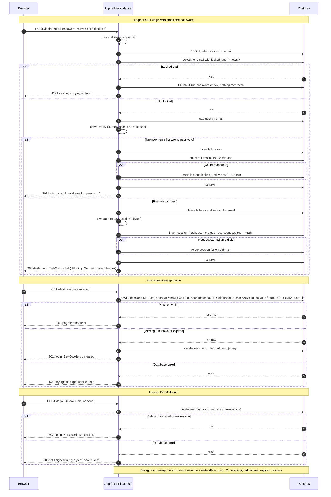

# Design: login with server-side sessions

## What this is

Today every page of the app is public. This design adds sign-in. Every page except `/login` needs a signed-in user.

The app is server-rendered and runs as two identical instances behind a load balancer, with no sticky sessions. Both share one Postgres database, which already has a `users` table (`id`, `email` stored lowercase, `password_hash` as bcrypt).

On login, the app checks the password and creates a row in a new `sessions` table. It sends the browser a cookie holding only a random ID. Every later request looks that ID up in Postgres. Logout deletes the row. Sign-up and password reset are out of scope.

## Terms

- **Session ID:** 32 random bytes from the CSPRNG, base64url-encoded. It is the only thing in the cookie.
- **id_hash:** `SHA-256(session ID)`. The table stores this, never the raw ID, so a leaked database dump cannot be replayed as live cookies.
- **Idle limit:** a session ends after 30 minutes with no requests.
- **Absolute limit:** a session ends 12 hours after login, whatever the activity.
- **Lockout:** once an email has 5 failed logins within 10 minutes, logins for that email are refused for 15 minutes.

## Decisions

| Question | Choice |
|---|---|
| Where sessions live | New `sessions` table in the existing Postgres. Both instances share it. |
| Where failure counts and lockouts live | New `login_failures` and `login_lockouts` tables in the same Postgres. |
| Redis? | **Not added.** Postgres is already shared and durable. A session check is one primary-key update, which is easy load for a small team app. Redis would be a new service to run, secure and monitor, and a second place where an outage logs everyone out. Revisit only if measured session load hurts the database. |
| Cookie | `sid=<id>; Path=/; HttpOnly; Secure; SameSite=Lax; Max-Age=43200`. The server decides validity. `Max-Age` is a convenience only. |
| Expiry check | On every protected request, in one SQL statement. The app never trusts the cookie's age. |
| Expiry record | `created_at` and `expires_at` (login time + 12 hours) are set at login. `last_seen_at` is rewritten on every valid request, which restarts the idle clock. |
| Clock | All comparisons use Postgres `now()`, so the two instances cannot disagree. |
| Cleanup of abandoned rows | Each instance runs a delete job every 5 minutes. Expired rows are already invalid, so this only saves space. See step 6. |
| Storage failure | Fail closed with a plain 503 page. See "What happens when things fail". |

Tables:

```
sessions        (id_hash bytea PK, user_id → users.id,
                 created_at, last_seen_at, expires_at)   -- index on last_seen_at, expires_at
login_failures  (email text, failed_at timestamptz)       -- index on (email, failed_at)
login_lockouts  (email text PK, locked_until timestamptz)
```

The failure and lockout tables are keyed by the submitted lowercase email string, not by `users.id`. Unknown emails are counted and locked exactly like real ones, so a 429 reveals nothing about whether an account exists.

## Sequence diagram



## Steps in detail

Each step names what starts it, what it does, what data it touches and what it does on failure.

**1. Login attempt.**
- Starts: `POST /login` with email and password.
- Does: trim and lowercase the email once, and use that value everywhere below. Open one transaction that begins with `pg_advisory_xact_lock(hashtext(email))`. This serializes attempts on the same email across both instances, so parallel guesses cannot slip past the limit of 5. The bcrypt check runs while the lock is held, which only blocks other attempts on that email.
- Data: `login_lockouts`, `users`.
- Fails: any database error rolls back and returns 503 (see the failure table).

**2. Lockout check.**
- Starts: inside the login transaction.
- Does: look for a lockout row with `locked_until > now()`. If one exists, return 429 at once. No user lookup, no password check, nothing recorded. A refused attempt does not extend the lockout.
- Data: `login_lockouts`.
- Fails: if the lockout cannot be read, return 503. Skipping the check would defeat the limit.

**3. Password check and failure.**
- Starts: no lockout found.
- Does: load the user and verify the password. For an unknown email, run bcrypt against a fixed dummy hash of the same cost, so timing does not reveal whether the account exists. Both failures return 401 with the same login page and the text "Invalid email or password".
- On each failure: insert a `login_failures` row. If the count of that email's failures in the last 10 minutes reaches 5, upsert `login_lockouts` with `locked_until = now() + 15 minutes`. The 5th failing attempt still gets 401. The next one gets 429. The 15-minute lockout outlasts the 10-minute window, so old failures have aged out when it ends.
- Data: `users`, `login_failures`, `login_lockouts`.
- Fails: a database error rolls back and returns 503, never 401, so an outage is not mistaken for bad credentials.

**4. Login success.**
- Starts: password is correct.
- Does, in the same transaction:
  1. Delete that email's `login_failures` and `login_lockouts` rows.
  2. Generate a brand-new session ID, always, even if the browser sent one.
  3. Insert its hash with `created_at`, `last_seen_at` and `expires_at = now() + 12 hours`.
  4. Delete the row the incoming cookie's hash pointed to, if any.

  On commit, set the cookie and redirect to `/dashboard`. The new ID is never derived from the old one, and the old row is destroyed, so the session cannot be fixated.
- Data: `sessions`, `login_failures`, `login_lockouts`.
- Fails: the transaction rolls back, no session is issued, and the user gets 503.

**5. Protected request.**
- Starts: any request except `/login`.
- Does: run one statement that checks and touches the session together:

  ```
  UPDATE sessions SET last_seen_at = now()
  WHERE id_hash = $1
    AND last_seen_at > now() - interval '30 minutes'
    AND expires_at   > now()
  RETURNING user_id;
  ```

  A returned row means the user is signed in and the request goes ahead. No row means the session is missing, unknown or expired. The app then deletes any row for that hash, clears the cookie and redirects to `/login`. Because check and touch are one statement, two instances cannot race, and an expired session can never be revived by a late request.
- Data: `sessions`.
- Fails: return 503. Do not redirect and do not clear the cookie. The session may still be valid, and sending the user to a login form that also cannot work would be worse. Retrying works once the database recovers.

**6. Cleanup job.**
- Starts: a timer, every 5 minutes on each instance.
- Does: delete `sessions` where `last_seen_at < now() - interval '30 minutes' OR expires_at < now()`. Delete `login_failures` older than 10 minutes and expired `login_lockouts`. Deletes are idempotent, so two instances running at once is harmless.
- Data: all three new tables.
- Fails: log the error and try again at the next tick. User traffic is unaffected, because validity never depends on cleanup.

**7. Logout.**
- Starts: `POST /logout`, with or without a cookie.
- Does: `DELETE FROM sessions WHERE id_hash = $1` and commit before replying. A missing cookie skips the delete, and deleting zero rows is not an error. In every success case, clear the cookie and reply `302 /login`. The cookie is cleared with `Set-Cookie: sid=; Path=/; Max-Age=0; HttpOnly; Secure; SameSite=Lax`. Using `POST` with `SameSite=Lax` means a cross-site page cannot trigger logout.
- Data: `sessions`.
- Fails: see the failure table.

## What happens when things fail

The rule is to fail closed and never grant access on an error. The user sees a plain "Something went wrong on our side. Please try again in a moment." page with HTTP 503, with no detail about what failed.

| Step | On a database error |
|---|---|
| Login (steps 1 to 4) | Roll back, issue no session, show the 503 page. |
| Protected request | 503, cookie kept, no redirect. |
| Logout | 503, cookie kept, so the user can retry. The page says they are still signed in. The cookie is cleared only after a successful delete. |
| Cleanup job | Log it and retry at the next tick. |

## Requirement coverage

| # | Where it is met |
|---|---|
| 1 | Trim and lowercase before every lookup (step 1). |
| 2 | Same 401 response and page for both failures, dummy bcrypt for timing, lockouts keyed by string (steps 3 and 2). |
| 3 | Sliding 10-minute count, 15-minute lockout checked first, success clears the count, advisory lock prevents races (steps 1 to 4). |
| 4 | Always a new ID, and the old session row is deleted in the same transaction (step 4). |
| 5 | The cookie holds only the opaque ID, with the three flags (Decisions). |
| 6 | `last_seen_at` is touched on every valid request, `expires_at` is fixed at login, both checked in one statement (step 5). |
| 7 | Atomic validate-and-touch, with clear cookie and redirect on failure (step 5). |
| 8 | Delete before replying, same behaviour with no session (step 7). |

## Not covered

- A signed-in user who opens `/login` is not handled here.
- Return-to-page after login is not included, because the brief fixes success to `/dashboard`.

## Open questions

None.
