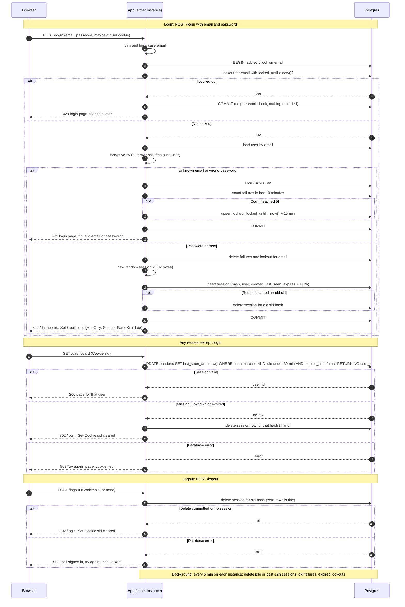

# Design: login with server-side sessions

## Decisions

| Question | Choice |
|---|---|
| Where sessions live | A new `sessions` table in the existing Postgres. Both instances share it, so no sticky sessions are needed. |
| Where failure counts and lockouts live | New `login_failures` and `login_lockouts` tables in the same Postgres. |
| Redis? | **Not added.** Postgres is already shared by both instances and is durable. A session lookup is one primary-key read plus one small update, which is easy load for a small team app. Redis would add a new service to run, secure, monitor and fail over, and it would add a second place where an outage logs everyone out. Revisit only if measured session-write load hurts the database. |
| Session ID | 32 bytes from the CSPRNG, base64url-encoded. The table stores only `SHA-256(id)` as `id_hash`, so a leaked database dump or backup cannot be replayed as live cookies. |
| Cookie | `sid=<id>; Path=/; HttpOnly; Secure; SameSite=Lax; Max-Age=43200`. It holds only the opaque ID. The server decides validity, and `Max-Age` is just a convenience. |
| How expiry is checked | On every protected request, in one atomic statement (see "Session validation"). The app never trusts a cookie's age. |
| How expiry is recorded | `created_at` and `expires_at` (= `created_at` + 12 h) are fixed at login. `last_seen_at` is rewritten on every valid request, which restarts the 30-minute idle clock. |
| Clock | All time comparisons use Postgres `now()`, never an app instance's clock, so the two instances cannot disagree. |
| Removing abandoned sessions | Expired rows are already invalid by the check above, so cleanup is only for space. Each instance runs `DELETE FROM sessions WHERE last_seen_at < now() - interval '30 minutes' OR expires_at < now()` every 5 minutes. The delete is idempotent, so concurrent runs on two instances are harmless. A request that finds an expired session also deletes that row. The same job deletes `login_failures` older than 10 minutes and `login_lockouts` that have expired. |
| Storage failure | Fail closed with a plain 503 page. See "Storage failures". |

## Tables

```
sessions        (id_hash bytea PK, user_id → users.id,
                 created_at, last_seen_at, expires_at)   -- index on last_seen_at, expires_at
login_failures  (email text, failed_at timestamptz)       -- index on (email, failed_at)
login_lockouts  (email text PK, locked_until timestamptz)
```

The failure and lockout tables are keyed by the submitted lowercase email string, not by `users.id`. Unknown emails therefore get counted and locked exactly like real ones, so a 429 reveals nothing about whether an account exists.

## Rules not shown on the arrows

**Email handling.** Trim and lowercase the submitted email once. Use that value for the user lookup, the failure count and the lockout.

**Login transaction.** The whole login attempt runs in one transaction that begins with `pg_advisory_xact_lock(hashtext(email))`. Concurrent attempts on the same email are serialized, even across the two instances, so parallel guesses cannot slip past the limit of 5. The bcrypt check runs while the lock is held. That is acceptable because it only blocks other attempts on the same email.

**Order of checks (requirement 3).**
1. Look for a lockout with `locked_until > now()`. If one exists, return 429 immediately. No password is checked, no user lookup happens, and nothing is recorded. A refused attempt does not extend the lockout.
2. Otherwise look up the user and verify the password.

**Identical failure responses (requirement 2).** For an unknown email, run bcrypt against a fixed dummy hash of the same cost, so response time does not reveal whether the account exists. Both failures return 401 with the same login page and the text "Invalid email or password".

**Counting failures.** On each failure, insert a row into `login_failures`. If `count(*) WHERE email = $1 AND failed_at > now() - interval '10 minutes'` reaches 5, upsert `login_lockouts` with `locked_until = now() + interval '15 minutes'`. The 5th failing attempt itself still gets 401. The next attempt gets 429. Because the window slides, any 5 failures inside any 10 minutes trigger the lockout. The lockout is 15 minutes, longer than the 10-minute window, so the old failures have aged out by the time it ends and the next attempt starts clean.

**Successful login.** Delete that email's `login_failures` and `login_lockouts` rows. Then, in the same transaction:
1. Generate a brand-new ID, always, even if the browser sent one.
2. Insert its hash.
3. Delete the row that the incoming cookie's hash pointed to, if any.

On commit, set the cookie and redirect to `/dashboard`. Because the old row is destroyed and the new ID is never derived from it, the session cannot be fixated.

**Session validation (requirement 7).** One statement does the idle check, the absolute check and the "touch":

```
UPDATE sessions SET last_seen_at = now()
WHERE id_hash = $1
  AND last_seen_at > now() - interval '30 minutes'
  AND expires_at   > now()
RETURNING user_id;
```

No row returned means the session is missing, unknown or expired. The app then deletes any row for that hash, clears the cookie and redirects to `/login`. A row returned means the user is signed in and the request proceeds. Doing the check and the touch in one statement means two instances cannot race: an expired session can never be revived by a late request.

**Clearing the cookie.** Send `Set-Cookie: sid=; Path=/; Max-Age=0; HttpOnly; Secure; SameSite=Lax`.

**Logout (requirement 8).** `DELETE FROM sessions WHERE id_hash = $1` is committed before the response is sent. Deleting zero rows is not an error, and a missing cookie skips the delete. In every case the reply is the same: clear the cookie and `302 /login`. `POST` plus `SameSite=Lax` means a cross-site page cannot trigger logout.

**Scope notes.** `/login` is the only public route. A signed-in user who opens `/login` is not handled here. Return-to-page after login is not included, because the brief fixes success to `/dashboard`.

## Storage failures

The rule is to fail closed and never grant access on an error. The user sees a plain "Something went wrong on our side. Please try again in a moment." page with HTTP 503, with no detail about what failed.

- **Login:** this includes failure to read the lockout. Skipping the lockout check would defeat the brute-force limit. The transaction rolls back and no session is issued. The page is shown with 503, not 401, so a database error is never mistaken for bad credentials.
- **Protected request:** return 503. Do not redirect to `/login` and do not clear the cookie. The session may still be valid, and bouncing users to a login form that also cannot work would be worse. Retrying works as soon as the database recovers.
- **Logout:** the session cannot be confirmed destroyed, and the brief requires destroying it before replying. So return 503 and keep the cookie, so the user can retry. The message says they are still signed in. The cookie is cleared only after a successful delete.
- **Cleanup job:** log the error and try again at the next tick. User traffic is unaffected, because validity never depends on cleanup.

## Sequence diagram



## Requirement coverage

| # | Where it is met |
|---|---|
| 1 | Lowercase and trim before every lookup. |
| 2 | Same 401 response and page for both failures, dummy bcrypt for timing, and lockouts keyed by string so 429 does not leak either. |
| 3 | Sliding 10-minute count, 15-minute lockout checked first with no password check, success clears the count, and the advisory lock prevents races. |
| 4 | Always a new ID, and the old session row is deleted in the same transaction. |
| 5 | The cookie holds only the opaque ID, with the three flags. |
| 6 | `last_seen_at` is touched on every valid request, `expires_at` is fixed at login, and both are checked in one statement. |
| 7 | The atomic validate-and-touch, with clear cookie and redirect on failure. |
| 8 | Delete before replying, with identical behaviour when there is no session. |
