# Sign in with Google: design and flow

## 1. Summary

Today, `POST /login` checks a password with bcrypt, locks the account for 15 minutes after 5 wrong passwords, and then calls `start_session`. That function stores a `sessions` row and sets the `sid` cookie.

Google sign-in adds a round trip to Google and ends in the same `start_session` call. The flow starts with a 10-minute Redis record keyed by `state`. The callback checks that state, exchanges the code and validates the ID token. Then it links an account, signs the user in, creates a Google-only account, or asks for the password of a matching account before linking.

## 2. Terms

- **Flow record**: a short-lived Redis entry keyed by the OIDC `state`. It holds the intent, nonce, PKCE verifier, `next` (login only) and `user_id` (link only).
- **Cookie `gstate`**: a browser cookie that holds the same `state`. It ties the callback to the browser that started the flow.
- **Pending record**: a short-lived Redis entry for a matched account that is waiting for its password. It holds user U, `sub`, `next` and a CSRF token. The cookie `gpl` holds its id.
- **CSRF token**: a random value in the pending record. The password form sends it back as a hidden field, so a form from another site cannot confirm.
- **Identity row**: the permanent `google_identities` row that links one Google `sub` to one user.
- **sub**: Google's permanent ID for a Google account. It does not change when the email changes. We never link by email.
- **email_verified**: Google's claim that it has verified the email address.
- **start_session**: the existing function that creates the session. Every successful Google sign-in ends here.

## 3. Flow

```mermaid
flowchart TD
    LOGIN["Login page<br/>Sign in with Google button"] --> START
    SETTINGS["Account Settings<br/>Link Google button, signed in only"] --> START
    START["GET /auth/google/start?intent=login or link&next=...<br/>Link: needs a valid sid session, else redirect to login<br/>Create state, nonce, PKCE verifier and challenge<br/>Save flow record in Redis, TTL 10 min<br/>Set cookie gstate to state"] --> GOOGLE
    GOOGLE{"Google consent screen"}
    GOOGLE -->|"Cancel or other error"| CB
    GOOGLE -->|"Approves"| CB
    CB["GET /auth/google/callback<br/>Always clears cookie gstate"] --> COOK{"gstate cookie equals state parameter?"}
    COOK -->|"No"| E_STATE["Error page<br/>Nothing changes, flow record not used"]
    COOK -->|"Yes"| GETDEL{"GETDEL flow record by state: found?"}
    GETDEL -->|"No: unknown, expired, or already used"| E_STATE
    GETDEL -->|"Yes"| ERRP{"Google sent an error param?"}
    ERRP -->|"Yes"| NEUTRAL["Redirect to start page with neutral cancelled message<br/>Login page for login, Settings for link<br/>Nothing changes"]
    ERRP -->|"No"| EXCH["POST to Google token endpoint<br/>code plus PKCE verifier"]
    EXCH -->|"Network error, non-200, or bad body"| E_EXCH["Error page: sign-in failed, try again<br/>Nothing changes"]
    EXCH -->|"ID token returned"| VAL{"ID token valid?<br/>signature, iss, aud, exp, nonce"}
    VAL -->|"No"| E_EXCH
    VAL -->|"Yes: keep sub, email, email_verified only"| INTENT{"Intent in flow record"}

    INTENT -->|"link"| LSESS{"sid session valid and its user equals flow user_id?"}
    LSESS -->|"No"| E_LSESS["Error page<br/>Nothing changes"]
    LSESS -->|"Yes"| LSUB{"sub already in google_identities?"}
    LSUB -->|"Yes, to this same user"| LINKED["Redirect to Account Settings: already linked"]
    LSUB -->|"Yes, to another user"| REF1["Redirect to Account Settings: refused, Google account is linked elsewhere"]
    LSUB -->|"No"| LOTHER{"This user already has a different Google account?"}
    LOTHER -->|"Yes"| REF2["Redirect to Account Settings: refused, unlink current Google account first"]
    LOTHER -->|"No"| LINS["INSERT google_identities sub and user_id"]
    LINS -->|"Unique violation, lost a race"| REF1
    LINS -->|"Inserted"| LINKED

    INTENT -->|"login"| LKSUB{"sub in google_identities?"}
    LKSUB -->|"Yes: use the linked user, ignore email"| SESS
    LKSUB -->|"No"| VERIF{"email_verified is true?"}
    VERIF -->|"No"| REFV["Login page: refused, use email and password<br/>Nothing created"]
    VERIF -->|"Yes"| MATCH{"users row with lowercased email exists?"}
    MATCH -->|"No"| CREATE["One transaction<br/>INSERT users with lowercased Google email, NULL password_hash and email_verified_at = now<br/>INSERT google_identities"]
    CREATE -->|"Email unique violation or DB error"| E_CREATE["Error page<br/>Transaction rolled back, nothing kept"]
    CREATE -->|"Created"| SESS
    MATCH -->|"Yes: user U"| UOTHER{"U already has a different Google account?"}
    UOTHER -->|"Yes"| REFO["Login page: refused, account linked to another Google account<br/>Nothing created"]
    UOTHER -->|"No"| PEND["Save pending record in Redis, TTL 10 min<br/>holds U, sub, next, CSRF token<br/>Set HttpOnly cookie gpl to its id<br/>Redirect to /auth/google/confirm"]
    PEND --> CONF

    CONF["GET /auth/google/confirm<br/>Read gpl cookie and load pending record"] --> PFOUND{"Pending record found?"}
    PFOUND -->|"No: expired or cleared"| EXP["Login page: sign-in expired<br/>Nothing created"]
    PFOUND -->|"Yes"| FORM["Password form for account U<br/>hidden field: CSRF token from pending record"]
    FORM --> POST["POST /auth/google/confirm with password and CSRF token"]
    POST -->|"CSRF token invalid"| E_CSRF["Error page<br/>Pending record kept, nothing changes"]
    POST -->|"Pending record gone"| EXP
    POST -->|"Pending record present"| PLOCK{"locked_until in the future?"}
    PLOCK -->|"Yes"| LOCKED["Delete pending record and clear gpl cookie<br/>Login page: Account temporarily locked<br/>Password not checked"]
    PLOCK -->|"No"| BCRYPT{"bcrypt password correct?"}
    BCRYPT -->|"No"| FAIL["failed_logins plus 1<br/>At 5: set locked_until to now plus 15 min, reset failed_logins to 0"]
    FAIL --> FLOCK{"Account now locked?"}
    FLOCK -->|"Yes"| LOCKED
    FLOCK -->|"No"| WRONG["Form again with generic wrong-password message<br/>Pending record keeps its original TTL"]
    WRONG --> FORM
    BCRYPT -->|"Yes"| RESET["failed_logins set to 0"]
    RESET --> RECHECK{"U still has no other Google account, and sub is still unlinked?"}
    RECHECK -->|"No"| REFR["Delete pending record and clear gpl cookie<br/>Login page: refused"]
    RECHECK -->|"Yes"| LINK2["INSERT google_identities sub and U"]
    LINK2 -->|"Unique violation"| REFR
    LINK2 -->|"Inserted"| CLEAR["Delete pending record and clear gpl cookie"]
    CLEAR --> SESS

    SESS["start_session user<br/>Delete old sid row if the browser sent one, insert sessions row, set sid cookie<br/>Redirect to next if relative, else /home"]
```



## 4. Steps

Each step says what starts it, what it does, which part keeps its data, and what happens when it fails. Every failure outcome is listed in the table in section 6.

1. **Start.**
   - *Starts:* the user clicks Sign in with Google on the login page, or Link Google in Account Settings.
   - *Does:* creates `state`, `nonce`, a PKCE verifier and challenge. It saves the flow record with a 10-minute TTL, sets `gstate` to the state, and redirects to Google. `next` must be a relative path on our site. For link, the flow stores the `user_id` of the current `sid` session. Without a valid session, the user goes to the login page and nothing is saved.
   - *Data kept:* the flow record (Redis) and the `gstate` cookie.
   - *On failure:* see the Start rows of the table.

2. **Callback check.**
   - *Starts:* Google redirects to `/auth/google/callback`.
   - *Does:* clears `gstate` on every response. It checks that the cookie equals the `state` parameter, then takes the flow record with GETDEL, so the record can be used only once.
   - *Why the cookie check:* without it, an attacker could start a flow with their own Google account and send a victim the callback link. PKCE does not stop this, because the verifier stays on our server.
   - *Data kept:* the flow record is removed here, whatever the outcome.
   - *On failure:* a missing, mismatched, unknown, expired or reused state gets an error page and changes nothing. This is the only case that gets an error page, because we cannot tell where the user started.

3. **Google error.**
   - *Starts:* Google sends an error, such as when the user presses Cancel.
   - *Does:* with a valid state, redirects to where the user started (the login page, or Settings for link) with a neutral cancelled message.
   - *Data kept:* none.
   - *On failure:* nothing changes.

4. **Code exchange and ID token.**
   - *Starts:* the callback has a code and no error.
   - *Does:* posts the code and PKCE verifier to Google's token endpoint. It checks the ID token:
     - the signature, against Google's published keys (cached by key id);
     - `iss` is Google's issuer and `aud` is our client ID;
     - `exp` is in the future and `nonce` equals the nonce in the flow record.

     It keeps only `sub`, `email` and `email_verified`. The email is lowercased before any lookup.
   - *Data kept:* none. The values live only in the request.
   - *On failure:* an error page, and nothing changes. The flow record is already gone, so a retry starts over with a new state.

5. **Link (Account Settings).**
   - *Starts:* the flow intent is link.
   - *Does:* checks that the browser's `sid` session still belongs to the user stored in the flow's `user_id`. This stops a flow from linking after the browser signs out or changes user. Then it checks `sub`. No password is asked, and the emails need not match.
   - *On success:* inserts the identity row and redirects to Account Settings. It does not call `start_session`, so the current session is kept.
   - *Data kept:* the identity row (Postgres).
   - *On failure:* see the Link rows of the table.

6. **Login.**
   - *Starts:* the flow intent is login.
   - *Does:* branches on what the `sub` and the email show:
     - `sub` is linked: use the linked user and ignore the email. Go to step 8. This path does not check `locked_until` and does not change counters (see the open questions).
     - `sub` is not linked and `email_verified` is false: refuse and point to email and password. Nothing is created.
     - `sub` is not linked, verified, and no user has that email: in one transaction, create a user with the lowercased Google email, a NULL `password_hash` and `email_verified_at` set to now. Insert the identity row. Go to step 8.
     - `sub` is not linked, verified, and matches user U: go to step 7. An email address can be reassigned, so a match alone does not prove the Google account belongs to U.
     - U already has a different Google account: refuse.
   - *Data kept:* the new user and identity row (Postgres) on account creation. The pending record and `gpl` cookie (Redis and browser) on a match.
   - *On failure:* see the Login rows of the table.

7. **Password confirm.**
   - *Starts:* the browser is sent to `/auth/google/confirm`.
   - *Does:* loads the pending record named by `gpl` and shows a password form for U, with the CSRF token as a hidden field. On POST:
     - the CSRF token must match, or the request fails;
     - if the account is locked, the password is not checked. The pending record is deleted and `gpl` is cleared;
     - the bcrypt check runs. A wrong password adds 1 to `failed_logins`. At 5, the account locks for 15 minutes and `failed_logins` resets to 0. If the account is now locked, the flow ends as a lock. Otherwise the form shows the generic wrong-password message, and the pending record keeps its original TTL;
     - a correct password sets `failed_logins` to 0. Then it rechecks that U still has no other Google account and that `sub` is still unlinked. If both hold, it inserts the identity row, deletes the pending record, clears `gpl` and goes to step 8.
   - *Data kept:* the pending record (Redis, 10 minutes from the callback), the identity row (Postgres), and the existing lockout columns.
   - *On failure:* see the Confirm rows of the table.

8. **Session.**
   - *Starts:* any successful Google sign-in.
   - *Does:* runs `start_session(user)`, the same as a password login. It deletes the old `sid` row if the browser sent one, inserts a `sessions` row, sets the `sid` cookie, and redirects to `next` if it is relative, or else to `/home`. The check on `next` runs again here.
   - *Note:* a confirm signs in as U even if the browser was signed in as someone else. The new session replaces the old one, as a password login does.
   - *Data kept:* the `sessions` row and the `sid` cookie.

## 5. Other rules

- **Google-only accounts** have a NULL `password_hash`. Password login treats them like an unknown email. It runs a dummy bcrypt check, shows the generic message, and changes no counters. The user signs in with Google, or uses Forgot password. The reset email's link sets a password.
- **Unlink** (`POST /settings/google/unlink`) is allowed only when `password_hash` is set. Otherwise it shows: "Set a password first: use Forgot password to receive the reset email." When allowed, it deletes the identity row and keeps the sessions.
- **Password reset** does not change `google_identities`.
- **No Google tokens are stored.** Google's email is written once, to `users.email`, when a Google-only account is created. Later sign-ins ignore it, and Google never changes `users.email`.

## 6. What happens when things fail

| Failure | Outcome | Changes |
|---|---|---|
| Start: Redis error or timeout | Error page: sign-in unavailable, try again | None |
| Start: link with no valid `sid` session | Redirect to login page | None |
| Callback: missing, mismatched, unknown, expired, or reused `state` or `gstate` | Error page | None |
| Callback: Redis error or timeout at GETDEL | Error page, try again | None. Any flow record left behind expires by TTL. |
| Callback: Google error param (for example, Cancel) with valid state | Start page with neutral cancelled message | None |
| Callback: code exchange fails (network, non-200, bad body) | Error page: sign-in failed, try again | None. A retry starts over. |
| Callback: ID token invalid (signature, iss, aud, exp, nonce) | Error page | None |
| Link: no valid `sid` session, or session user differs from flow `user_id` | Error page | None |
| Link: `sub` belongs to another user | Settings refusal | None |
| Link: user already has a different Google account | Settings refusal | None |
| Link: unique violation on insert (lost a race) | Settings refusal | None |
| Login: `sub` unlinked, `email_verified` false | Login page refusal, use email and password | None |
| Login: verified email, no user; insert fails (unique violation or DB error) | Error page | None. Transaction rolled back. |
| Login: matched user already has a different Google account | Login page refusal | None |
| Login: Redis error saving the pending record | Error page, try again | None |
| Confirm: pending record expired or cleared | Login page: sign-in expired | None |
| Confirm: Redis error reading the pending record | Error page, try again | None |
| Confirm: CSRF token invalid | Error page | None. Pending record kept. |
| Confirm: account locked (before or after a wrong password) | Login page: Account temporarily locked. Pending record deleted. | Lockout counters only |
| Confirm: wrong password | Same form with generic message | `failed_logins` +1 |
| Confirm: correct password, but a Google account is now linked or `sub` is taken | Login page refusal. Pending record deleted. | `failed_logins` reset to 0 (existing rule). No identity row. |
| Confirm: Redis error deleting the pending record after success | Sign-in still completes. The record expires by TTL and cannot link again, because `sub` is already linked. | Session created |
| Confirm: Postgres error on the link insert | Error page | None |

## 7. Where the state lives

| State | Where | Lifetime | Removed by |
|---|---|---|---|
| Flow record: intent, nonce, PKCE verifier, next, user_id | Redis, keyed by `state`, TTL 10 min | Start to first callback | GETDEL on the first callback that reaches it, whatever the outcome. Otherwise TTL expiry. |
| Cookie `gstate` | Browser, HttpOnly, Secure, SameSite=Lax | Start to callback | Cleared on every callback response. Otherwise cookie expiry. |
| Pending record: U, sub, next, CSRF token | Redis, random id, TTL 10 min from callback | Callback to successful confirm | Success, lock, refusal, or TTL expiry. A new pending record overwrites `gpl`, and the old one expires by TTL. |
| Cookie `gpl` | Browser, same flags as `gstate` | Same as pending record | Cleared on success, lock, or refusal. Otherwise cookie expiry. |
| `google_identities` row | Postgres, permanent | Until unlinked | Unlink in Account Settings, or user deletion (ON DELETE CASCADE) |
| New `users` row for a Google-only account | Postgres, permanent | Permanent | Deletion of that account only |
| `failed_logins`, `locked_until` | Existing `users` columns | Existing lockout rules | Existing rules |
| `sessions` row and `sid` cookie | Existing | Existing session rules | Sign-out, password reset, or expiry, as today |

## 8. Schema changes

```sql
ALTER TABLE users ALTER COLUMN password_hash DROP NOT NULL;

CREATE TABLE google_identities (
  google_sub TEXT PRIMARY KEY,                                    -- one Google account links to at most one user
  user_id    BIGINT NOT NULL UNIQUE REFERENCES users(id) ON DELETE CASCADE, -- one user has at most one Google account
  linked_at  TIMESTAMPTZ NOT NULL DEFAULT now()
);
```

Both UNIQUE constraints enforce the one-to-one rule under concurrency. If two callbacks race, the losing request is refused.

Redis holds only short-lived data. A link or a new account is written only to Postgres.

## 9. Open questions

- Should a locked account be refused at the callback, before the password page? The brief does not say. This design lets the confirm step report the lock, so the password is never checked while locked.
- Should a linked Google sign-in be refused while `locked_until` is in the future? This design says no, because the lock limits password guessing and Google sign-in checks no password. The owner should confirm this, since it lets Google sign-in get past a password lock.
- Should linking in Account Settings require `email_verified`? The brief does not require it. This design does not check it, because linking is by `sub` only.
- Should a correct password that then fails the recheck still reset `failed_logins`? This design resets it, following the existing "Right" rule.
- Do the existing Redis rate limits cover the confirm password form, or is a per-IP limit needed? The existing docs do not say.