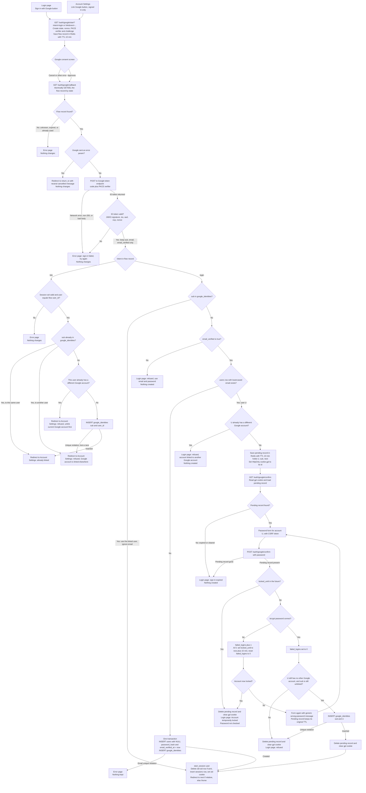

# Sign in with Google: design and flow

Google sign-in is added beside email and password. Both entry points, every callback outcome and the password-confirmation loop are in the flowchart below. Read the notes first if you have not seen `existing/auth_flow.md` or `existing/schema.sql`.

## Terms used below

- **Flow record**: a short-lived Redis entry keyed by the OIDC `state`. It is created at start and consumed by the first callback.
- **Pending record**: a short-lived Redis entry that holds a matched account while the user confirms with its password. A browser cookie `gpl` points to it.
- **Identity row**: the permanent `google_identities` row that links one Google `sub` to one user.
- **start_session**: the existing function. Every successful Google sign-in ends here, so it produces the same session as a password login.

## Flowchart



## Where each piece of state lives

| State | Where | Lifetime | Removed by |
|---|---|---|---|
| Flow record: intent, user_id (link only), next, return_to, nonce, PKCE verifier | Redis, key by `state`, TTL 10 min | Start to first callback | GETDEL on the first callback, whatever the outcome. Otherwise TTL expiry. |
| Pending record: user U, sub, next | Redis, key by random id, TTL 10 min from the callback | Callback to successful confirm | Success, lock, refusal, or TTL expiry. A new pending record replaces the old cookie value. |
| Cookie `gpl` (pending id) | Browser, HttpOnly, Secure, SameSite=Lax | Same as the pending record | Cleared on success, lock, or refusal. Otherwise expires with the cookie. |
| `google_identities` row: google_sub PK, user_id UNIQUE, linked_at | Postgres, permanent | Until unlinked | Unlink in Account Settings, or user deletion (ON DELETE CASCADE). |
| New `users` row for Google-only accounts | Postgres, permanent | Permanent | Only by existing account deletion. |
| `failed_logins`, `locked_until` | Existing `users` columns | Existing lockout rules | Existing rules. |
| `sessions` row and `sid` cookie | Existing | Existing session rules | Sign-out, password reset, or expiry, as today. |

Nothing stores Google access or refresh tokens. The Google email from the ID token is not persisted. `users.email` is never changed by Google.

## Schema changes

```sql
ALTER TABLE users ALTER COLUMN password_hash DROP NOT NULL;

CREATE TABLE google_identities (
  google_sub TEXT PRIMARY KEY,                              -- one Google account links to at most one user
  user_id    BIGINT NOT NULL UNIQUE REFERENCES users(id) ON DELETE CASCADE, -- one user has at most one Google account
  linked_at  TIMESTAMPTZ NOT NULL DEFAULT now()
);
```

Both UNIQUE constraints enforce the one-to-one rule under concurrency. They also catch a race between two callbacks, and the losing request is refused.

## Failure outcomes

| Failure | Outcome | Changes |
|---|---|---|
| Missing, unknown, expired, or reused `state` | Error page | None |
| Google error param (for example, Cancel) with valid state | Return to `return_to` with a neutral cancelled message | None |
| Code exchange fails (network, non-200, bad body) | Error page: sign-in failed, try again | None. The flow record is already gone, so a retry starts over with a new state. |
| ID token invalid (signature, iss, aud, exp, nonce) | Error page | None |
| Unlinked sub, `email_verified` false | Login page refusal pointing to email and password | None |
| Link: sub belongs to another user | Settings refusal | None |
| Link: user already has a different Google account | Settings refusal | None |
| Link: unique violation on insert | Settings refusal | None |
| Login: verified email, no user | Create user and identity in one transaction | New user, identity row, session |
| Login: email unique violation during create | Error page | None |
| Login: matched user already has a different Google account | Login refusal | None |
| Confirm: pending expired or cleared | Login page: sign-in expired | None |
| Confirm: account locked (before or after a wrong password) | Login page: Account temporarily locked. Pending record deleted. | Lockout counters only |
| Confirm: wrong password | Same form with generic message | `failed_logins` increments |
| Confirm: correct password but a Google account now linked, or sub taken | Login refusal. Pending record deleted. | `failed_logins` reset to 0 (existing rule). No identity row. |

## Notes for implementers

1. **Login with a passwordless account.** Users created through Google have `password_hash` NULL. `POST /login` must treat NULL like an unknown email: run a dummy bcrypt compare, show the generic message, and do not change counters. This is a change to step 3 of `auth_flow.md`.
2. **Unlink.** `POST /settings/google/unlink` checks `password_hash IS NOT NULL`. If it is NULL, it shows "Set a password first: use Forgot password to receive the reset email." Otherwise it deletes the identity row. Sessions are kept.
3. **Password reset.** Unchanged. It sets a password and marks the email verified. It does not touch `google_identities`. A user who has no password can use it to get one, which then allows unlinking.
4. **`next` and `return_to`.** Validate both as relative paths on our site when the flow record is created. `start_session` already applies the same check to `next`.
5. **CSRF.** The password form on the confirm page needs a CSRF token bound to the pending id. The brief does not say this, so it is an addition.
6. **Email comparison.** Lowercase the ID token email before any lookup. Match on `sub` first. Email is used only for the unlinked branch.
7. **Error versus neutral.** Only an invalid or unknown `state` gets an error page, because we cannot know where the user started. Every other outcome, including Google errors, returns the user to the start page with a message.

## Open questions

- Should a locked account be refused at callback, before the password page? The brief does not say. This design lets the confirm step report the lock, so the password is never checked while locked.
- Should linking in Account Settings require `email_verified`? The brief does not require it, and this design does not check it, since linking is by `sub` only.
- Should a correct password that is then refused (the recheck fails) still reset `failed_logins`? This design resets it, following the existing "Right" rule.
