# Sign in with Google (OpenID Connect)

This adds Google sign-in next to email and password. A user starts from the login page or from Account Settings, goes to Google, and comes back to one callback URL. The callback checks the attempt, reads the ID token and then signs the user in, creates or links an account, or asks for the account's password. Every successful Google sign-in ends in `start_session`, the same call a password login uses.

## How sign-in works today

- One backend service renders every page. PostgreSQL holds `users`, `sessions` and `password_reset_tokens`. Redis exists and so far holds only rate limits.
- `POST /login` lowercases the email and refuses if `locked_until` is in the future. Otherwise it checks bcrypt. A wrong password adds 1 to `failed_logins`. At 5, it sets `locked_until = now + 15 min` and resets `failed_logins` to 0. A right password resets `failed_logins` to 0 and calls `start_session(user_id)`.
- `start_session(user_id)` deletes the old `sessions` row if a `sid` cookie came in. It then inserts a new row, sets the `sid` cookie and redirects to `next` if that is a relative path, otherwise to `/home`.
- `users` has no "disabled" flag. Deleting a user cascades to its sessions and Google link.

This design changes one thing in these tables: `users.password_hash` becomes nullable. Linking from Settings is not a sign-in, so the user keeps the session they already have.

## Terms

- **Attempt**: one round trip to Google. It lives in Redis for 10 minutes and works once.
- **`mode`**: `login` (started from the login page) or `link` (started from Settings).
- **Pending link**: a Google `sub` waiting for the password of the existing account whose verified email matches. It lives in Redis for 10 minutes.
- **Link**: a row in the new `google_identities` table that ties one Google `sub` to one user.
- **`sub`**: Google's permanent ID for an account. We identify Google accounts by `sub`, never by email.

## Flowchart

```mermaid
flowchart TD
  subgraph ENTRY["Two entry points"]
    L["Login page button<br/>POST /auth/google/login<br/>no session or CSRF token needed<br/>saves mode=login and a checked next path"]
    S["Settings button Link Google<br/>POST /settings/google/link<br/>needs sid session and CSRF token<br/>saves mode=link and user_id"]
    S --> S1{"Does this user already<br/>have a Google link?"}
    S1 -- "yes" --> S2["Stay on Settings:<br/>already linked, nothing started"]
  end

  L --> B
  S1 -- "no" --> B
  B["begin_flow<br/>make random state, nonce and PKCE verifier<br/>Redis oidc:state:SHA256 of state, TTL 10 min<br/>cookie oidc_flow = state, HttpOnly Secure Lax, 10 min<br/>redirect to Google with S256 challenge,<br/>scope openid email profile"]
  B --> G(["Google: user signs in and consents"])
  G --> CB["GET /auth/google/callback<br/>top-level redirect, so the Lax sid cookie arrives<br/>always clears the oidc_flow cookie"]

  CB --> C1{"oidc_flow cookie equals state param<br/>AND Redis GETDEL of the record<br/>returns a record?"}
  C1 -- "no: unknown, expired,<br/>used or foreign" --> E1["Error page 400<br/>link to login page<br/>nothing is changed"]
  C1 -- "yes: record now deleted,<br/>so this attempt works once" --> C2{"mode is link AND current session<br/>user differs from saved user_id,<br/>or no session?"}
  C2 -- "yes" --> E1
  C2 -- "no" --> C3{"Google sent an error param<br/>or no code?"}
  C3 -- "yes, for example Cancel" --> R1["Redirect to origin<br/>login page or Settings<br/>neutral message: Google sign-in<br/>was not completed"]
  C3 -- "no" --> X["Back-channel POST to Google token endpoint<br/>code + code_verifier, short timeout"]
  X --> X1{"Exchange OK, and ID token valid?<br/>signature, iss, aud, exp,<br/>nonce equals saved nonce"}
  X1 -- "no: network error, timeout,<br/>invalid_grant, bad token" --> R2["Redirect to origin<br/>message: could not finish with Google,<br/>try again, or use email and password<br/>no retry of the code, nothing changed"]
  X1 -- "yes" --> T["Read sub, email, email_verified only<br/>lowercase the email<br/>discard all tokens, none are stored"]

  T --> M{"mode?"}

  M -- "link" --> K1{"google_identities row<br/>for this sub?"}
  K1 -- "belongs to this user" --> K2["Settings: already linked"]
  K1 -- "belongs to another user" --> K3["Settings: refuse,<br/>that Google account is linked elsewhere"]
  K1 -- "none" --> K4{"Does this user already have<br/>some other Google link?"}
  K4 -- "yes" --> K5["Settings: refuse,<br/>unlink the current one first"]
  K4 -- "no" --> K6["INSERT google_identities sub, user_id<br/>no password asked, emails need not match<br/>session unchanged"]
  K6 -- "unique violation from a race" --> K3
  K6 -- "ok" --> K7["Settings: Google linked"]

  M -- "login" --> D1{"google_identities row<br/>for this sub?"}
  D1 -- "yes: same account even if<br/>Google email changed" --> OK
  D1 -- "no" --> D2{"email_verified true?"}
  D2 -- "no" --> D3["Login page: refuse,<br/>use email and password<br/>nothing created"]
  D2 -- "yes" --> D4{"users row with<br/>this lowercased email?"}
  D4 -- "no" --> D5["One DB transaction:<br/>INSERT users with password_hash NULL,<br/>email_verified_at = now,<br/>INSERT google_identities"]
  D5 -- "unique violation on email<br/>user appeared meanwhile:<br/>re-run once from D4" --> D4
  D5 -- "unique violation on sub:<br/>re-run once from D1" --> D1
  D5 -- "ok" --> OK
  D4 -- "yes" --> D6{"Does that user already have<br/>a Google link?"}
  D6 -- "yes, a different Google account" --> D7["Login page: refuse,<br/>that account uses a different<br/>Google account"]
  D6 -- "no" --> D8["Store pending link<br/>Redis oidc:pending:SHA256 of token<br/>holds sub and user_id and next, TTL 10 min<br/>cookie oidc_pending = token, HttpOnly Secure Lax<br/>show Confirm with password page<br/>stored email is not changed"]

  D8 --> P["POST /login/google/confirm<br/>password + CSRF token<br/>no email typed: the account is the<br/>user_id in the pending record"]
  P --> P1{"oidc_pending cookie maps to<br/>a live Redis record?"}
  P1 -- "no: expired or missing" --> P2["Login page: took too long,<br/>start again"]
  P1 -- "yes" --> P3{"locked_until in the future?"}
  P3 -- "yes" --> P4["Delete pending record<br/>show: Account temporarily locked<br/>password not checked"]
  P3 -- "no" --> P5{"bcrypt matches?"}
  P5 -- "wrong" --> P6["failed_logins + 1<br/>existing lockout rule"]
  P6 --> P7{"reached 5?"}
  P7 -- "yes" --> P8["locked_until = now + 15 min<br/>failed_logins = 0<br/>delete pending record: link thrown away<br/>show: Account temporarily locked"]
  P7 -- "no" --> P9["Keep pending record, same TTL<br/>show page again: incorrect password"]
  P9 --> P
  P5 -- "right" --> P10["failed_logins = 0<br/>GETDEL pending record, then<br/>INSERT google_identities"]
  P10 -- "record already gone" --> P2
  P10 -- "unique violation on sub or user_id" --> D7
  P10 -- "ok" --> OK

  OK["start_session(user_id)<br/>same sessions row and sid cookie as password login<br/>redirect to saved next if relative, else /home<br/>delete oidc_pending cookie if present"]

  U["Settings: Unlink Google<br/>POST /settings/google/unlink<br/>session + CSRF"] --> U1{"users.password_hash<br/>is not NULL?"}
  U1 -- "yes" --> U2["DELETE google_identities row<br/>session and password unchanged"]
  U1 -- "no" --> U3["Refuse: set a password first<br/>using the existing Forgot password email<br/>POST /forgot"]
```

Notes on the chart:

- The callback is a top-level redirect from Google, so the `Lax` `sid` cookie arrives. That is how link mode knows who is signed in.
- Linked Google sign-in goes straight to `start_session`. No password is used, so `locked_until` and `failed_logins` are not touched.
- A user without a password always has a Google link, because unlinking needs a password. So the password-confirmation branch never meets a NULL hash.

## Where state lives and what removes it

| State | Where | Lifetime | Removed by |
|---|---|---|---|
| Attempt: `nonce`, PKCE `code_verifier`, `mode`, `user_id` (link mode only), checked `next` | Redis `oidc:state:<sha256(state)>` | 10 min TTL | Atomic `GETDEL` on the first callback, whatever the outcome. Otherwise the TTL. |
| Cookie `oidc_flow` (the raw `state`, ties the callback to the browser that started it) | Browser, HttpOnly, Secure, SameSite=Lax | 10 min | Cleared by every callback. Otherwise it expires. |
| Pending link: Google `sub`, matched `user_id`, `next` | Redis `oidc:pending:<sha256(token)>` | 10 min from the callback, not extended by wrong passwords | Correct password (`GETDEL`), account lock, an already-locked account, or the TTL |
| Cookie `oidc_pending` (random token) | Browser, HttpOnly, Secure, SameSite=Lax | 10 min | Cleared on success. Otherwise it expires, and a stale cookie finds no record. |
| **Permanent link**: new table `google_identities(sub TEXT PRIMARY KEY, user_id BIGINT NOT NULL UNIQUE REFERENCES users(id) ON DELETE CASCADE, created_at TIMESTAMPTZ NOT NULL DEFAULT now())` | PostgreSQL | Until unlinked | Unlink in Settings, or deletion of the user (cascade) |
| Session | Existing `sessions` row and `sid` cookie | Unchanged | Unchanged |
| Google tokens, Google email | Not stored | Never kept | Not applicable |

No cron job is needed. Redis TTLs clean up temporary state, and PostgreSQL holds only the link.

The two unique constraints enforce the link rules in the database, even when two requests race. `sub` is the primary key, so one Google account links to at most one user. `user_id` is unique, so a user has at most one Google account. Application checks only produce friendlier messages.

## What happens when things fail

| Failure | Result |
|---|---|
| Unknown, expired, reused or mismatched `state`, or a missing `oidc_flow` cookie | Error page with a link to the login page. Nothing is changed. Google is not contacted. |
| Link-mode callback with no session, or a different user's session | The same error page. |
| Google returns `error` (for example, Cancel) | The user returns to the login page or Settings with a neutral message. Nothing is changed. |
| Code exchange fails (timeout, network error, `invalid_grant`, 5xx) or the ID token fails validation | The code is never retried. The user returns to the origin with "could not finish with Google, try again". Nothing is created or linked. |
| `email_verified` is false and the `sub` is unlinked | Refused, pointing to email and password. Nothing is created. |
| Existing user already has a different Google account | Refused. No password prompt. |
| Unique-constraint race on `sub` or email during create or link | Re-run the decision once from the lookup. If it still conflicts, show the error page. |
| Pending link expired or its cookie is missing | Back to the login page to start again. |
| Wrong password in the confirmation loop | Counts toward the existing lockout. The pending link stays until the 5th failure. |
| Account locks or is already locked | The pending link is deleted and "Account temporarily locked" is shown. |
| Unlink without a password | Refused, with a pointer to the reset email. |

## Build changes

Run `ALTER TABLE users ALTER COLUMN password_hash DROP NOT NULL;` and create `google_identities`.

- Google-created users have no password.
- `POST /login` must treat a NULL hash as a wrong password. It should still run a dummy bcrypt compare so timing and the generic message stay the same.
- A Google-only user can add a password with the existing reset email (`POST /forgot`). It goes to the stored address, which for a Google-created user is the verified Google email at creation. The reset also marks the email verified.
- Add a Redis rate limit on the two start endpoints, the same way existing limits work.

## Decisions to review

- **Login-page `next` is carried in the attempt.** It is accepted only if it starts with a single `/` (not `//`) and contains no backslash or scheme. It is re-checked the same way before `start_session`. Settings always returns to Account Settings.
- **Starting from the login page needs no CSRF token.** It needs no session and changes nothing. `state` and the `oidc_flow` cookie tie the callback to the browser that started it. Settings and confirm change state, so they require one.
- **Linked Google sign-in ignores `locked_until`.** The lockout protects against password guessing and no password is used here. Change this if the lock should mean "no sign-in at all".
- **A Google sign-in does not reset `failed_logins`.**
- **Matching an existing user does not set `email_verified_at` or change the stored email.** The password confirmation proves ownership.

## Open questions

- Can users change their stored email today? The existing files show no such feature. This design never changes it, so a Google-created user's reset email always goes to the Google email they first signed up with.
