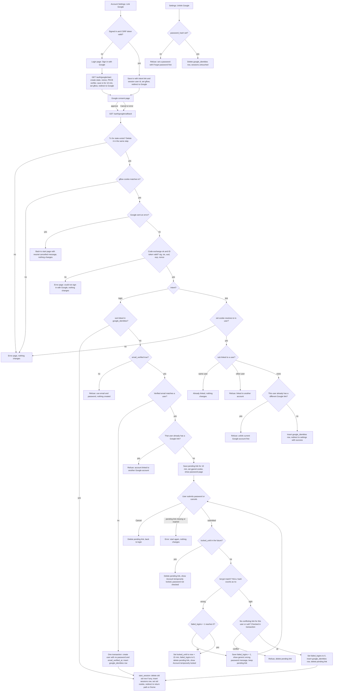

# Sign in with Google: flow and state design

## Summary

Today, `POST /login` checks email and password, applies the lockout rules, and calls `start_session`, which sets the `sid` cookie. This design adds Google sign-in as a second way in, using OpenID Connect with PKCE, `state` and `nonce`. It can start from the login page or from Account Settings. Every successful Google sign-in ends in the same `start_session` call as a password login, so there is no new session type. Google accounts are matched by Google's `sub`, never by email.

## Terms

- **sub**: Google's stable ID for an account. We match on it, never on email.
- **Transaction** (Redis `gauth:tx:{state}`): the record for one sign-in attempt. It holds the nonce, PKCE verifier, intent, return path, user id (settings only) and binding id. It lives 10 minutes and is deleted at the first callback.
- **Binding cookie** (`gflow`): a browser cookie that holds the binding id. It proves the callback comes from the browser that started the attempt.
- **Pending link** (Redis `gauth:pend:{id}`, id in the `gpend` cookie): the record that holds a Google `sub`, verified email, target user id and return path while the user types a password. It lives 10 minutes from the callback.
- **google_identities**: the Postgres table that links one Google `sub` to one user.
- **Intent**: `login` (started from the login page) or `link` (started from Account Settings).

## Flowchart



## Steps

Each step lists what starts it, what it does, what keeps its data, and what happens when it goes wrong. The failure table below has every case in full.

### 1. Start (login page or Settings)

- **Starts:** the user clicks Sign in with Google on the login page, or Link Google in Account Settings.
- **Does:** the login page starts with no session. Settings needs a signed-in session and a valid CSRF token, as other settings forms do. If either check fails, the user goes to the login page. Otherwise the server creates state, nonce, PKCE verifier and binding id. It saves the transaction for 10 minutes, sets `gflow`, and redirects to Google. Settings also records the session user id in the transaction, so the callback can check that the same browser is still signed in as that user.
- **Keeps data:** the transaction in Redis and the `gflow` cookie.
- **If it fails:** a failed Settings check goes to the login page with nothing changed. Redis failures are not covered (see open questions).

### 2. Callback

- **Starts:** Google redirects to `GET /auth/google/callback`.
- **Does:** in one step, it reads and deletes the transaction for the `state`, so each state works once. It checks that `gflow` matches the transaction. If Google sent an error, such as Cancel, it returns the user to their start page with a neutral message. Otherwise it exchanges the code with PKCE and checks the ID token: signature, `iss`, `aud`, `exp` and `nonce`. It reads only `sub`, `email` and `email_verified`, then discards the Google tokens.
- **Keeps data:** the transaction is gone whatever the outcome. `gflow` is cleared. No Google tokens are stored.
- **If it fails:** see the failure table. Unknown, expired, used or mismatched state gets an error page. A Google error gets the neutral message, but only after the state is validated. Exchange and ID token failures get an error page. In every case nothing is linked or created, and the user starts again.

### 3. Route a login

- **Starts:** the callback passed step 2 and the intent is `login`.
- **Does:** if `sub` is linked, go to step 7. If `email_verified` is false, refuse. If the verified email matches no user, go to step 4. If it matches a user who already has a Google link, refuse. Otherwise save a pending link, set `gpend`, and show the password page (step 5).
- **Keeps data:** nothing new in this step.
- **If it fails:** a refusal changes nothing. The user is told to use email and password.

### 4. Create a user from a new Google account

- **Starts:** a verified email with no matching user, and an unlinked `sub`.
- **Does:** in one database transaction, it creates a user with no password and `email_verified_at` set, and inserts the `google_identities` row. Then go to step 7.
- **Keeps data:** the `users` row and the link row, both permanent.
- **If it fails:** if a concurrent sign-up takes the same email, the `email` unique constraint fires. The transaction rolls back and the flow reruns from step 3, which then takes the matched-user path.

### 5. Confirm with the existing account's password

- **Starts:** step 3 found a verified email that matches an existing user with no Google link.
- **Does:** the user submits a password or cancels.
  - Cancel deletes the pending link and returns to login.
  - If `locked_until` is in the future, delete the pending link and show "Account temporarily locked." The password is not checked.
  - Otherwise check bcrypt. A NULL hash counts as wrong.
  - Wrong password: add 1 to `failed_logins`. At 5, set `locked_until` to now plus 15 minutes, set `failed_logins` to 0, and delete the pending link. Below 5, show the generic wrong-password message and keep the pending link.
  - Right password: set `failed_logins` to 0. In one transaction, check that no conflicting link exists for this user or this `sub`. If one exists, refuse and delete the pending link. If not, insert the link row and delete the pending link. Then go to step 7.
- **Keeps data:** the pending link in Redis lives 10 minutes from the callback, and is deleted on success, cancel, lockout, conflict or expiry. Counters stay in `users`.
- **If it fails:** see the failure table. The pending link is the only thing this step stores, and it never outlives its 10 minutes.

### 6. Link from Account Settings

- **Starts:** the callback passed step 2 and the intent is `link`.
- **Does:** check that the `sid` cookie resolves to the user in the transaction. If it does not, show the error page. If `sub` is already linked to this user, show "already linked." If it is linked to another user, refuse. If `sub` is free and this user already has a different Google link, refuse. Otherwise insert the link row and redirect to Settings with success. No password is asked, and the emails do not need to match.
- **Keeps data:** the link row, permanent.
- **If it fails:** every refusal changes nothing.

### 7. Sign in

- **Starts:** a linked `sub` at step 3, a new user at step 4, or a password-confirmed link at step 5.
- **Does:** call `start_session`. It deletes the old `sid` row if the browser sent one, inserts a `sessions` row, sets the `sid` cookie, and redirects to the return path or `/home`. This is the same result as a password login. Sign-in with a linked `sub` skips the lock check (see open questions).
- **Keeps data:** the `sessions` row, 14 days, existing rules.
- **If it fails:** no new failure case. It behaves as password login does.

### 8. Unlink Google

- **Starts:** the user clicks Unlink Google in Account Settings.
- **Does:** if `password_hash` is NULL, refuse and tell the user to set a password with Forgot password and their email. That flow sets a password, marks the email verified, and ends all sessions. Otherwise delete the `google_identities` row. Sessions are untouched.
- **Keeps data:** deleting the row removes the link.
- **If it fails:** the refusal changes nothing.

## What happens when things fail

| Case | Result | What changes |
|---|---|---|
| Unknown, expired, used or cookie-mismatched `state` | Error page | Nothing |
| Google sent an error (for example Cancel), state valid | Back to start page with neutral message | Nothing |
| Code exchange fails (network, non-2xx, `invalid_grant`) or ID token fails sig, `iss`, `aud`, `exp` or `nonce` | Error page: could not sign in with Google | Nothing. The transaction is already gone |
| Settings: not signed in or CSRF invalid | Login page | Nothing |
| Settings: `sid` does not resolve to the transaction user | Error page | Nothing |
| Login: unlinked, `email_verified` false | Refused, use email and password | Nothing created |
| Login: matched user already has another Google link | Refused | Nothing |
| Pending link missing or expired | Error, start again | Nothing |
| Wrong password, count below 5 | Generic message | `failed_logins` goes up by 1. Pending link kept |
| Fifth wrong password | Account temporarily locked | `locked_until` set, `failed_logins` 0, pending link deleted |
| Locked account submitted | Account temporarily locked | Pending link deleted. Password not checked |
| Conflict found at confirm | Refused | Pending link deleted |
| Settings: `sub` linked to another account | Refused | Nothing |
| Settings: user already has a different Google link | Refused | Nothing |
| Unlink without a password | Refused, set a password first | Nothing |
| Concurrent sign-up takes the same email | Transaction rolls back, flow reruns | Nothing from the failed attempt |

## Where state lives

| State | Where | Key | Holds | Lifetime | Removed by |
|---|---|---|---|---|---|
| Google link | Postgres `google_identities` | `user_id`, `google_sub` | the link | Permanent | Unlink, or user deletion (cascade) |
| Transaction | Redis | `gauth:tx:{state}` | nonce, PKCE verifier, intent, return path, user id (settings only), binding id | 600 s | Deleted at the first callback, whatever the outcome. Otherwise TTL |
| Binding cookie | Browser `gflow` | random value | matches the transaction's binding id | 600 s | Cleared at callback. Otherwise expiry |
| Pending link | Redis | `gauth:pend:{id}`, cookie `gpend` (Path=/auth/google) | `sub`, verified email, target user id, return path | 600 s from callback | Success, lockout, Cancel, conflict, or TTL |
| Session | Postgres `sessions` | `sid` cookie | session | 14 days | Sign-out, password reset, or `start_session` replacing it |
| Lockout | Postgres `users` | `failed_logins`, `locked_until` | counters | Existing rules | Existing rules. Shared with password login |
| Google tokens | Nowhere | not stored | nothing | Only during the callback | Discarded after reading the ID token |

Redis holds only short-lived data, as it does today. The TTL on the transaction enforces the 10-minute round trip. The TTL on the pending link enforces the 10-minute confirm window.

## Build notes

- Add one table and relax one column. Nothing else in the schema changes.

```sql
-- One Google account per user (user_id is the primary key)
-- and one user per Google account (google_sub is unique).
CREATE TABLE google_identities (
  user_id    BIGINT PRIMARY KEY REFERENCES users(id) ON DELETE CASCADE,
  google_sub TEXT NOT NULL UNIQUE,   -- Google's stable `sub`; never the email
  linked_at  TIMESTAMPTZ NOT NULL DEFAULT now()
);

-- Google-only users have no password.
ALTER TABLE users ALTER COLUMN password_hash DROP NOT NULL;
```

- Password login treats a NULL `password_hash` as a wrong password. It must not crash in bcrypt, and it must not reveal that the account has no password. The generic message stays the same.
- Google email is never written to `users.email`. The only Google claims kept are `sub`, `email` (used for matching) and `email_verified`.
- Start, callback and confirm use the existing Redis rate limits (numbers not set, see open questions).

## Open questions

1. **Locked accounts and Google sign-in.** The brief does not say whether a linked Google sign-in respects `locked_until`. Proposal: it does not. The lock guards password guessing. Needs confirmation.
2. **Verified flag on a confirmed link.** If `email_verified_at` is NULL when a password-confirmed link happens, should it be set? Proposal: leave it unchanged, to keep the change small. Needs confirmation.
3. **Binding cookie.** It is beyond the brief. It blocks login CSRF: without it, an attacker could start a flow with their own Google account and send a victim's browser to the callback, signing the victim into the attacker's account. The Lax cookie is still sent on the top-level redirect from Google. Needs confirmation.
4. **Google-only lockout.** Wrong passwords on a Google-only account (NULL hash) count toward the lock. This keeps the generic message and the same rules. Needs confirmation.
5. **Rate limits.** Start, callback and confirm should use the existing Redis rate limits. The brief sets no numbers.
6. **Redis unavailable.** The design does not say what happens if Redis is down during start, callback or confirm.