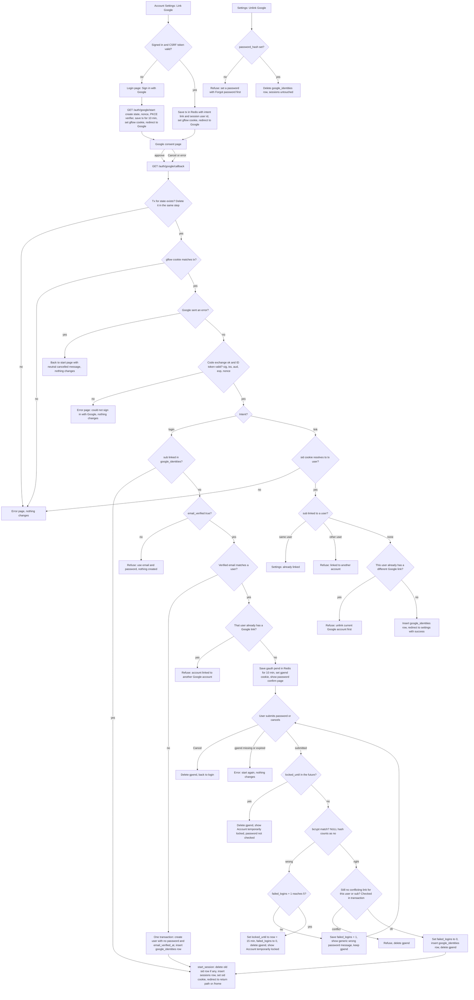

# Sign in with Google: flow and state design

This design adds Google sign-in beside email and password. It reuses `users`, `sessions`, `start_session`, and the lockout rules in `existing/auth_flow.md`. Every successful Google sign-in ends in the same `sid` session as a password login.

## What changes in the database

Add one table and relax one column. Nothing else in the existing schema changes.

```sql
-- One Google account per user (user_id is the primary key)
-- and one user per Google account (google_sub is unique).
CREATE TABLE google_identities (
  user_id    BIGINT PRIMARY KEY REFERENCES users(id) ON DELETE CASCADE,
  google_sub TEXT NOT NULL UNIQUE,   -- Google's stable `sub`; never the email
  linked_at  TIMESTAMPTZ NOT NULL DEFAULT now()
);

-- Google-only users have no password. The current NOT NULL constraint must go.
ALTER TABLE users ALTER COLUMN password_hash DROP NOT NULL;
```

Password login must treat a NULL `password_hash` as a wrong password. It must not crash in bcrypt and must not reveal that the account has no password. The generic message stays the same.

Google email is never written to `users.email`. The only Google claims we keep are `sub`, `email` (used for matching), and `email_verified`.

## Where each piece of state lives

| State | Where | Key or location | Holds | Lifetime | Removed by |
|---|---|---|---|---|---|
| Google link | Postgres `google_identities` | `user_id` and `google_sub` | the link | Permanent | Unlink in Settings, or user deletion (cascade) |
| Flow transaction | Redis | `gauth:tx:{state}` | nonce, PKCE verifier, intent (`login` or `link`), return path, user id (link only), binding id | 600 s | Deleted on the first callback, whatever the outcome. Otherwise TTL expiry |
| Browser binding | Browser cookie `gflow` | random value, HttpOnly, Secure, SameSite=Lax | matches the transaction's binding id | 600 s | Cleared at callback, otherwise expiry |
| Pending link | Redis | `gauth:pend:{id}`, id in cookie `gpend` (Path=/auth/google) | Google `sub`, verified email, target user id, return path | 600 s from callback | Success, lockout, Cancel, or TTL expiry |
| Session | Postgres `sessions` | existing `sid` cookie | session | 14 days, existing rules | Existing sign-out, password reset, or the old row deleted by `start_session` |
| Lockout | Postgres `users` | `failed_logins`, `locked_until` | counters | Existing rules | Existing rules. Shared with password login |
| Google tokens | Nowhere | not stored | nothing | Only in memory during the callback | Discarded after reading the ID token |

Redis holds only short-lived data, which matches today's use. The 10-minute round trip is enforced by the Redis TTL on the transaction. The 10-minute confirm window is enforced by the TTL on the pending link.

## Flowchart



## Notes on the flow

**Entry points.** The login page starts the flow with no session. Account Settings starts it with a session and requires a CSRF token like other settings forms. The settings entry records the session user id in the transaction, so the callback can check that the same browser is still signed in as that user. The callback then links to that user only.

**Callback order.** The transaction is read and deleted in one step, so a state can be used once. A second callback finds nothing and gets an error page. The binding cookie check is added beyond the brief. Without it, an attacker could start a flow with their own Google account and send the victim's browser to the callback, which would sign the victim into the attacker's account. The Lax cookie is still sent on the top-level redirect back from Google.

**Google error.** A Cancel or other error from Google returns the user to the page they started from, with a neutral message. This happens only after the state is validated. If the state is unknown, the user gets the error page instead, because there is no known start page.

**Failed code exchange.** A network error, a non-2xx response, `invalid_grant`, or an ID token that fails signature, `iss`, `aud`, `exp`, or `nonce` checks all produce the same error page. Nothing is linked or created. The transaction is already gone, so the user starts again. The PKCE verifier is never shown to the browser.

**Unlinked, verified email, no match.** The user and link are created in one transaction. If a concurrent sign-up takes the same email (the `email` unique constraint fires), the transaction rolls back and the flow reruns, which then takes the matched-user path.

**Password confirmation loop.** The pending link lives in Redis, not in the session, because no session exists yet. Wrong passwords use the same counter and lock as password login. The fifth failure locks the account and discards the pending link. Locked accounts reject the password before it is checked. Cancel also discards the pending link. The link can be used once, because success deletes it.

**Link from settings.** Emails do not need to match. The Google account must not be linked to anyone else, and the user must not already have a different Google account. Settings links are never confirmed with a password, because the session already proves who is signed in.

**Unlink.** Only users with a password can unlink. Google-only users get a message to use Forgot password with their email, which sets a password, marks the email verified, and ends all sessions. Unlinking does not end sessions.

**Failure modes covered.** The table below lists every refusal. Each one changes no account data.

| Case | Result |
|---|---|
| Unknown, expired, used, or cookie-mismatched state | Error page |
| Google error | Back to start with neutral message |
| Exchange or ID token failure | Error page |
| Unverified email, unlinked | Refused, use email and password |
| Matched user already has another Google link | Refused |
| Pending link expired or missing | Error, start again |
| Wrong password | Generic message, count increases, pending link kept |
| Lock reached | Locked message, pending link discarded |
| Conflict at confirm | Refused, pending link discarded |
| Settings link to another account | Refused |
| Settings link when user already has another Google link | Refused |
| Unlink without password | Refused, set password first |

## Decisions to confirm before build

1. **Locked accounts and Google sign-in.** The brief does not say whether a linked Google sign-in respects `locked_until`. Proposal: no. The lock guards password guessing, so Google sign-in skips it. Confirm.
2. **Verified flag on link.** When a password-confirmed link happens and `email_verified_at` is NULL, should it be set? Proposal: leave it unchanged, to avoid widening the change.
3. **Binding cookie.** This was added beyond the brief to block login CSRF. Confirm.
4. **Google-only lockout.** Wrong passwords on a Google-only account (NULL hash) count toward the lock. This keeps the generic message and the same rules. Confirm.
5. **Rate limits.** The start, callback, and confirm endpoints should use the existing Redis rate limits. The brief does not set numbers.