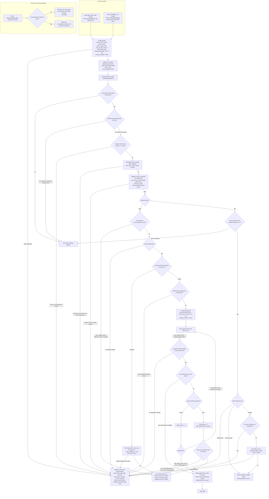

# Sign in with Google: flow and state

This note covers the flow for adding Google sign-in beside email and password. It assumes you have not seen the existing files, so the relevant facts come first.

## Existing system in brief

- One backend service renders the pages. PostgreSQL holds `users`, `sessions` and `password_reset_tokens`. Redis exists but is used only for short-lived data such as rate limits.
- `POST /login` lowercases the email and checks `locked_until`. If the account is locked, it rejects with "Account temporarily locked" and does not check the password. Otherwise it compares bcrypt.
  - A wrong password adds 1 to `failed_logins`. At 5, it sets `locked_until` to now + 15 minutes and resets `failed_logins` to 0.
  - A right password resets `failed_logins` to 0 and calls `start_session(user_id)`.
- `start_session` deletes the old `sessions` row if a `sid` cookie came in. It then inserts a new row, sets the `sid` cookie (HttpOnly, Secure, SameSite=Lax), and redirects to a valid relative `next` or to `/home`.
- Every successful Google sign-in calls this same `start_session`. There is no new session type.

## Schema changes

```sql
-- 1. Users created through Google have no password.
ALTER TABLE users ALTER COLUMN password_hash DROP NOT NULL;

-- 2. Permanent Google link. We store only the sub. We never store the Google email or any token.
CREATE TABLE user_google_accounts (
  sub       TEXT PRIMARY KEY,                                   -- one Google account links to at most one user
  user_id   BIGINT NOT NULL UNIQUE                              -- one user has at most one Google account
            REFERENCES users(id) ON DELETE CASCADE,
  linked_at TIMESTAMPTZ NOT NULL DEFAULT now()
);
```

- Code that reads `password_hash` must treat NULL as "no password". The password-login path must treat it as a wrong password, with the usual generic message. Password reset already works for these users: it sets a hash and marks the email verified.
- A passwordless user always has a Google link. Unlinking requires a password, so an existing-email match can never hit a passwordless unlinked user.

## Where state lives

| State | Where | Lifetime and removal |
|---|---|---|
| Attempt: `state`, `nonce`, PKCE `code_verifier`, mode (`login` or `link`), `user_id` (link mode only), validated `next` | Redis key `goauth:{state}` | TTL 600 s. Removed by the atomic `GETDEL` on the first callback, so one callback is honoured. Otherwise TTL removes it. |
| Browser binding for the attempt | Cookie `g_attempt` = `state` (HttpOnly, Secure, Lax, Max-Age 600) | Cleared at callback or expires. A newer attempt overwrites it, so the latest attempt wins. |
| Pending link awaiting password: `sub`, target `user_id`, `next` | Redis key `gconfirm:{token}` | TTL 600 s from when the password form is first shown. Removed on success, on account lock, or by TTL. Wrong passwords do not extend it. |
| Browser binding for the pending link | Cookie `g_confirm` = random `token` (HttpOnly, Secure, Lax, Max-Age 600) | Cleared with the key or expires. |
| Google link | `user_google_accounts` row | Permanent. Removed by Unlink or by deleting the user (cascade). |
| User created through Google | `users` row with NULL `password_hash` and `email_verified_at = now()` | Permanent. |
| Failed-password count and lock | Existing `users.failed_logins` and `locked_until` | Existing rules, unchanged. |
| Session | Existing `sessions` row and `sid` cookie | Existing rules, unchanged. |
| Google code, ID token, access token, Google email | Not stored | Read in memory during the callback, then dropped. We request no refresh token. |

If Redis is down or loses a key, the attempt or pending link counts as expired. The user is told to start again, and nothing is half-written. Eviction cannot create a link.

## Flowchart



## What each failure does

| Failure | Result | State changed |
|---|---|---|
| Unknown, expired, reused or cookie-mismatched `state` | Error page | None. (A reused `state` was already removed by its first callback.) |
| Google returned `error` (e.g. `access_denied`) or no `code` | Return to the start page with a neutral message, e.g. "Google sign-in was not completed." | None. The attempt is already spent. |
| Code exchange fails (network, timeout, non-200, `invalid_grant`) | Return to the start page: "We could not complete sign-in with Google. Try again." | None. We do not retry the exchange, because the code is single-use. The user starts a new attempt. |
| ID token invalid (signature, `iss`, `aud`, `exp`, `nonce`) or `sub` or `email` missing | Same as a failed exchange | None |
| Unlinked `sub`, `email_verified` false | Login page: "Your Google email isn't verified. Sign in with email and password." | None. No user is created. |
| Verified email matches a user who has a different Google account | Login page: refused, use email and password | None |
| Link-mode `sub` linked to another user, or the user already has another Google account | Settings: refused | None |
| Wrong password on confirm | Form shown again with the generic wrong-password message | `failed_logins` + 1. The pending key keeps its original TTL. |
| Fifth wrong password, or already locked | "Account temporarily locked", login page | Lock per existing rules. The pending key is deleted. |
| Pending link expired or missing on confirm | Login page: start again | None |
| Unique-constraint violation on insert (races) | Start page with a try-again message | The transaction is rolled back. The database constraints are the final guard for "at most one". |
| Redis unavailable at start | Start page: Google sign-in unavailable | None |

## Decisions the brief left open

- **Google sign-in ignores the password lockout.** The lockout exists to stop password guessing. An already-linked user signing in through Google is not blocked by `locked_until`, and Google sign-in does not touch `failed_logins`.
- **Linking does not change `email_verified_at`.** Only the create-new-user path sets it. Google never changes our stored email.
- **`state` is also bound to the browser by the `g_attempt` cookie.** This blocks login-CSRF, where someone replays their own callback in a victim's browser. The `Lax` cookie is still sent on Google's top-level redirect.
- **Linking from settings is a POST with a CSRF token**, so another site cannot start a link for a signed-in user. The callback also checks that the session user still equals the user who started the attempt.
- **A successful confirm or settings link does not rotate anything else.** Confirm ends in the normal `start_session`. Settings linking keeps the current session.
