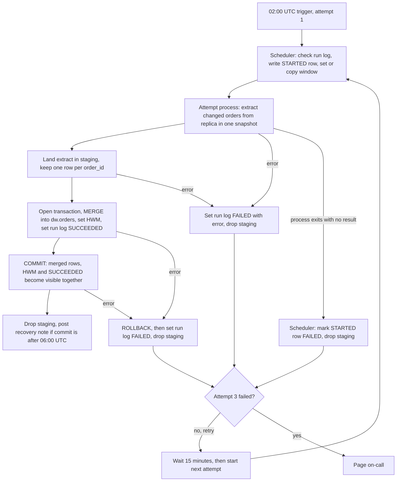

# Nightly orders ETL into the warehouse

Each night at 02:00 UTC, a scheduler runs one load. The load reads the changed `orders` rows from the app's read replica, stages them in the warehouse, and merges them into `dw.orders` in one warehouse transaction. The same transaction moves the high-water mark (HWM) forward and marks the attempt SUCCEEDED. That commit is the only point where dashboards see new data. On Sundays, a reconciliation compares the last 30 days of orders with the replica and reloads any day that differs.

## Terms

- **Cutoff**: 02:00 UTC on a night.
- **run_date**: the UTC date of that night's 02:00 trigger. All attempts for one night share it.
- **HWM**: the point up to which the warehouse holds every change. Stored in `etl_state.orders_watermark`.
- **Window**: the `updated_at` range one night extracts. It starts 2 hours before the HWM (not included) and ends at the cutoff (included).
- **Attempt**: one run of the load for a night. A night gets at most three scheduled attempts.
- **Attempt process**: the program the scheduler starts for each attempt. It runs steps 2 to 5 and writes the attempt's result.
- **Run log**: `etl_state.orders_run_log`. One row per attempt. Holds the attempt number, the window, the status and any error.
- **Status**: a run-log row is STARTED while its attempt runs, then SUCCEEDED or FAILED.
- **Staging**: `stg.orders_run_attempt_<run_date>_<attempt>`. A temporary table for one attempt. It is dropped when the attempt ends, whether it succeeded or failed.
- **dw.orders**: the only table dashboards read. It holds one row per `order_id`.

## Diagram



## Notes on the diagram

- Each attempt ends as SUCCEEDED or FAILED. SUCCEEDED is written inside the commit transaction. FAILED is written by the attempt process when it catches an error, or by the scheduler when the process exits with no result. That can happen at any step.
- A failure before the transaction opens has nothing to roll back. A failure inside it rolls back first.
- The scheduler starts a retry only after the previous attempt process has exited. So a STARTED row with no result belongs to a dead process.
- Dashboards read only committed data. They never read staging.

### Where the state lives

| Data | Where | Who writes it |
|---|---|---|
| HWM | `etl_state.orders_watermark` | Attempt process, in the commit transaction |
| Run log | `etl_state.orders_run_log` | Scheduler (STARTED, and FAILED for a dead process); attempt process (SUCCEEDED, FAILED) |
| Staging | `stg.orders_run_attempt_<run_date>_<attempt>` | Attempt process. Dropped when the attempt ends |
| Warehouse orders | `dw.orders` | Attempt process (merge); reconciliation (reload) |
| Reconciliation results | `etl_state.orders_recon_result` | Reconciliation |
| Source orders | App Postgres read replica | Nothing in the pipeline. Read only |

## Steps

Steps 2 to 5 run inside the attempt process. Each attempt runs the steps in order.

### 1. Start (scheduler)
- **Starts when:** the 02:00 UTC trigger, for attempt 1. A retry starts 15 minutes after the previous attempt process has exited. On-call can also start a manual rerun (see "When a night fails for good").
- **Does:** It checks the run log for run_date. If a SUCCEEDED row exists, it stops. If a STARTED row exists, it does not start a second attempt. Otherwise it writes a STARTED row with the next attempt number. Attempt 1 reads the HWM and sets the window. Later attempts copy the window from the previous attempt's row. Then it starts the attempt process and waits for it to exit.
- **Keeps its data:** the STARTED row in the run log.
- **If it goes wrong:** If it cannot write the STARTED row, it pages on-call and does not start the attempt.

### 2. Extract (attempt process)
- **Starts when:** step 1 starts the attempt process.
- **Does:** It reads `orders` on the replica in one snapshot, for rows whose `updated_at` is inside the window. One snapshot means no order appears twice in one extract. Deletes are writes, so deleted orders are included.
- **Keeps its data:** nothing. The rows pass straight to step 3.
- **If it goes wrong:** No transaction is open, so nothing needs rolling back. The attempt writes FAILED (see the failure table).

### 3. Land and dedupe (attempt process)
- **Starts when:** step 2 finishes.
- **Does:** It writes the extract to the attempt's staging table. Then it keeps one row per `order_id`, the one with the greatest `updated_at`, and sets `is_deleted = deleted_at IS NOT NULL`. Dedupe is needed because MERGE rejects duplicate source keys.
- **Keeps its data:** the staging table, until the attempt ends.
- **If it goes wrong:** No transaction is open, so nothing needs rolling back. The attempt writes FAILED.

### 4. Merge and commit (attempt process)
- **Starts when:** step 3 finishes.
- **Does:** It opens one warehouse transaction and runs the MERGE below. It sets the HWM to the window end, only if that is higher. It sets this attempt's run-log row to SUCCEEDED. Then it COMMITs. The merged rows, the HWM and the SUCCEEDED row become visible together.

```sql
MERGE INTO dw.orders AS t
USING stg.orders_run_attempt_<run_date>_<attempt> AS s
  ON t.order_id = s.order_id
WHEN MATCHED AND s.updated_at > t.updated_at THEN UPDATE SET <all columns from s>
WHEN NOT MATCHED THEN INSERT (<all columns>) VALUES (<all columns from s>);
```

The guard means an older copy never overwrites a newer row. Running the same window twice changes nothing. Rows are never removed. A soft delete stays as `is_deleted = true`.
- **Keeps its data:** `dw.orders` gets the rows, the HWM gets the new value and the run log gets SUCCEEDED. All three change in one commit.
- **If it goes wrong:** Any error before COMMIT rolls back. Nothing reaches `dw.orders`, and the HWM does not move. The attempt writes FAILED.

### 5. Recovery note (attempt process)
- **Starts when:** COMMIT succeeds.
- **Does:** If the commit time is after 06:00 UTC on run_date, it posts a recovery note to #data-alerts. That note closes the staleness alert.
- **Keeps its data:** nothing. The note is a message.
- **If it goes wrong:** The commit stays. A failed post does not undo it.

Whether the attempt succeeds or fails, its staging table is dropped and the process exits.

### Window
- Attempt 1 reads the HWM and sets start = HWM minus 2 hours (not included) and end = the cutoff (included). The 2-hour lookback covers bulk-import transactions that can stay open up to 90 minutes after their `updated_at`.
- Each run-log row holds its window. Later attempts copy it from the previous attempt's row for the same run_date.
- Retries never recompute the window from the current HWM. A retry at 02:30 still ends at 02:00.
- Rows updated after the cutoff are excluded, even if a late retry can see them. The next night takes them.

## What happens when things fail

| What fails | What happens |
|---|---|
| Cannot write the STARTED row (step 1) | Page on-call. The attempt does not start. |
| Extract, land or dedupe (steps 2 and 3) | No transaction is open, so nothing to roll back. The attempt writes FAILED with the error, drops staging and exits. |
| MERGE, HWM update or COMMIT returns an error (step 4) | ROLLBACK. Nothing reaches `dw.orders` and the HWM does not move. The attempt writes FAILED, drops staging and exits. |
| COMMIT result unknown, for example the connection drops | The retry checks the run log first. If SUCCEEDED exists, it stops. Otherwise it reruns the same window. If the first commit did land, the rerun changes nothing. |
| Attempt process exits with no result | The scheduler marks the STARTED row FAILED and drops that attempt's staging table. The database ends the dead session's transaction. If COMMIT had already succeeded, the row is SUCCEEDED and the scheduler leaves it. |
| Attempt 3 fails | Page on-call. Nothing reruns the night automatically. See the next section. |
| Scheduler stops | The 06:00 staleness check still runs. A restarted scheduler reads the attempt count from the run log. |

## When a night fails for good
- After attempt 3 fails, nothing reruns the night automatically. The HWM stays where it was.
- The next night starts from that same HWM. Its window starts 2 hours before the HWM, so it includes the missed night's changes. That window is longer than usual.
- Until a later night commits, `dw.orders` lacks the missed night's changes. The HWM does not move past them, because it moves only to a committed window end.
- On-call can rerun the missed night by hand. The rerun uses the window stored for that run_date and gets the next attempt number. It is not one of the three scheduled attempts. It starts only if the run log has no SUCCEEDED or STARTED row for run_date. A rerun cannot move the HWM backwards.

## Staleness check and dashboards
- At 06:00 UTC on run_date, a separate check looks for a SUCCEEDED row for run_date. It is not part of the retry chain.
- If there is none, it posts a staleness alert to #data-alerts. The alert names the night and the attempts so far. It says dashboards show data through the previous committed night.
- The check does not block dashboards or stop retries.
- Dashboards refresh at 06:00 UTC and read committed `dw.orders`. A night that commits after 06:00 appears at the next refresh, the following day at 06:00. A row reaches dashboards up to one night late, which is the intended unit of visibility.

## Sunday reconciliation
- **Starts when:** the Sunday night job (run_date is a Sunday) reaches a terminal state, committed or failed for good. The brief sets no time limit, so the reconciliation has none.
- **Does:** For each creation day in the last 30 days (UTC date of `created_at`), it compares the row count and a checksum of `(order_id, updated_at in UTC microseconds)` on the replica and in the warehouse. Deleted rows are included on both sides. It compares committed data only and never changes the HWM.
- **Checksum:** Both sides build the same text per row, hash it with md5, take the first 64 bits, and sum them modulo 2^64. The sum does not depend on row order. Before trusting the check, confirm both sides agree on a known day.
- **On a mismatch:** Reload that creation day from the replica by `created_at`, with no `updated_at` window, in one transaction with the same merge rule. Then compare again.
- **If it still mismatches:** Post a reconciliation alert and do not loop. A common cause is a replica behind the warehouse for that day. The guard keeps the newer warehouse row until the replica catches up.
- **Keeps its data:** The results go to `etl_state.orders_recon_result`.

## Assumptions to verify
1. `orders` has a `created_at` column. Reconciliation depends on it.
2. Writes to one order are serialized by a row lock, so `updated_at` increases with each committed version. Check this against bulk-import behaviour.
3. The replica supports snapshot reads for the extract.
4. The warehouse runs MERGE inside a multi-statement transaction, and readers see only committed data. If not, build `dw.orders_next` and swap it in within one transaction.
5. If the extract grows large, land it in object storage and bulk-load it into staging. The merge rules do not change.

## Open questions
- Should dashboards also refresh when a late night commits? The brief sets only the 06:00 refresh.
- Reconciliation covers only orders created in the last 30 days. A late update to an older order that the nightly job misses is not checked. Is that acceptable?
- The first run needs a starting HWM set by hand. That backfill decision is still open.
- A restarted scheduler that has lost track of a running attempt cannot tell it from a dead one. The brief does not say how.
- Reconciliation has no time limit. If it runs past 02:00 on Monday, it can overlap with the Monday load. Whether the warehouse allows two MERGEs into `dw.orders` at once is unknown.
- If two source rows for one order have the same `updated_at`, the dedupe step and the MERGE guard do not say which one wins.