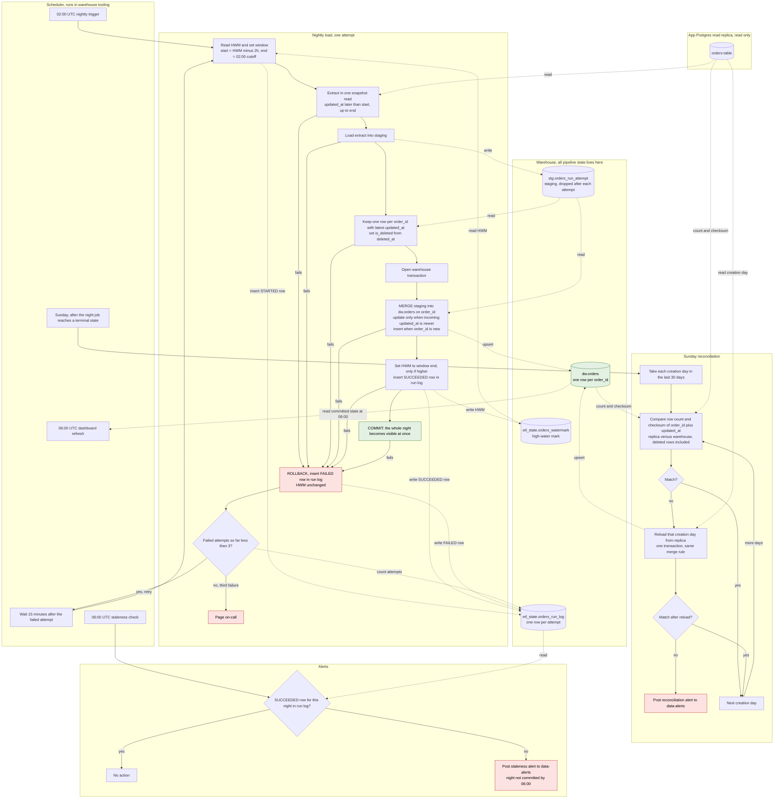

# Nightly orders ETL into the warehouse

Each night a scheduler starts one load. The load reads only from the app's read replica, stages the changed orders in the warehouse, and merges them into `dw.orders` in a single transaction that also advances the high-water mark. That commit is the only point at which dashboards see new data. A reconciliation on Sundays catches rows that became visible after the lookback.

## Diagram



## What starts each step

| Step | Started by | Reads | Writes |
|---|---|---|---|
| Load attempt | Scheduler at 02:00 UTC. Retries start 15 minutes after each failed attempt. | HWM from `etl_state.orders_watermark` | STARTED row in `etl_state.orders_run_log` |
| Extract and stage | The load attempt | `orders` on the replica | `stg.orders_run_attempt` |
| Merge and commit | The load attempt, after staging dedupe | Staging | `dw.orders`, HWM, SUCCEEDED row (one transaction) |
| Failure handling | The load attempt, on any error before commit | Run log (attempt count) | FAILED row; ROLLBACK; page on the third failure |
| Staleness check | Scheduler at 06:00 UTC | Run log | Alert to #data-alerts if the night is not committed |
| Dashboards | Their own refresh at 06:00 UTC | `dw.orders` | Nothing |
| Reconciliation | Scheduler on Sunday, after the night job reaches a terminal state | Replica and `dw.orders` | Reloaded days in `dw.orders`; `etl_state.orders_recon_result` |

## Where state lives

All pipeline state is in the warehouse. The app database is only read.

- **`etl_state.orders_watermark`**: one row for this job, holding `high_water_mark`, `last_window_end`, `last_run_id` and `committed_at`. Written only inside the commit transaction.
- **`etl_state.orders_run_log`**: one row per attempt, holding `run_date`, `attempt`, `status` (STARTED, FAILED or SUCCEEDED), `window_start`, `window_end`, row counts, `error` and timestamps. The retry counter and the 06:00 check both read from here, so a scheduler restart does not reset them.
- **`stg.orders_run_attempt`** (named per run and attempt): transient. It is dropped on commit or rollback.
- **`dw.orders`**: the only table dashboards read.
- **`etl_state.orders_recon_result`**: per check date and creation day, the replica and warehouse counts and checksums, and the action taken.

## Extract

- Window: `window_start = HWM minus 2 hours`, exclusive. `window_end = the night's 02:00 UTC cutoff`, inclusive.
- The window is fixed for the night, so every retry extracts the same rows.
- The extract runs in one snapshot read on the replica, so no order appears twice within one extract.
- The first run needs a manually set starting HWM, which is a backfill decision.

## Merge logic

1. Dedupe staging to one row per `order_id`, keeping the greatest `updated_at`. Set `is_deleted = deleted_at IS NOT NULL`. Dedupe is required because many engines reject a MERGE with duplicate source keys.
2. Merge in the transaction:

```sql
MERGE INTO dw.orders AS t
USING stg.orders_run_attempt AS s
  ON t.order_id = s.order_id
WHEN MATCHED AND s.updated_at > t.updated_at THEN UPDATE SET <all columns from s>
WHEN NOT MATCHED THEN INSERT (<all columns>) VALUES (<all columns from s>);
```

- The `updated_at` guard means an older copy can never overwrite a newer row. Re-extracting the same version changes nothing, so re-running a night is harmless.
- Soft deletes are writes. They bump `updated_at`, so they are extracted, and the row stays with `is_deleted = true`. Rows are never removed.

## High-water mark

- The HWM advances to the committed night's `window_end`, not to `max(updated_at)`. This avoids trusting app timestamps and avoids skipping rows that are still in flight.
- The update is forward-only: `SET hwm = window_end WHERE hwm < window_end`. A manual rerun of an older night cannot move the HWM backwards.
- Why nothing is lost: a row with `updated_at <= window_end` becomes visible by `window_end + 90 minutes` at the latest. The next night's window starts at `window_end - 2 hours`, so the row is extracted then. Rows with `updated_at` after `window_end` fall into the next window too.
- The result is that a row can reach dashboards up to one night late. That is the intended unit of visibility.

## Failure and retry

- Any error before COMMIT triggers ROLLBACK. Nothing reaches `dw.orders`, the HWM does not move, the staging table is dropped, and a FAILED row is written.
- Attempt 1 starts at 02:00. After a failure, attempt 2 starts 15 minutes later, and after a second failure, attempt 3 starts 15 minutes after that. A failure of attempt 3 pages on-call.
- Retries reuse the same window, so a retry that succeeds looks the same as a clean run.
- If the COMMIT call returns an error but the outcome is unknown, the retry re-runs the same window. The merge guard and the forward-only HWM make that safe.
- A manual rerun of an earlier night uses that night's `window_end`. It is safe for the same reasons.
- Dashboards cannot see staging or a partial night. They see only committed state.

## 06:00 staleness check

- A separate scheduled check, independent of the retry chain. At 06:00 UTC it looks for a SUCCEEDED row for `run_date` in the run log.
- If there is none, it posts to #data-alerts. The message names the night, the attempts made so far, and that dashboards are showing data through the previous committed night.
- The check does not block dashboards or stop retries. If the night commits later, post a recovery note.

## Sunday reconciliation

- It starts after the Sunday night job reaches a terminal state, either committed or final failure. It compares whatever is committed in `dw.orders` and does not change the HWM.
- For each creation day in the last 30 days (UTC date of `created_at`), it compares the row count and the checksum of `(order_id, updated_at normalized to UTC microseconds)` on the replica and in the warehouse. Deleted rows are included on both sides.
- Checksum: both sides build the same canonical text per row, hash it with md5, and sum the first 64 bits modulo 2^64. The sum is order-independent. Confirm that both sides agree on a known day before trusting the check.
- On a mismatch, reload that creation day from the replica by `created_at`, with no `updated_at` window, in one transaction using the same merge rule. Then compare again.
- If it still mismatches after the reload, post a reconciliation alert and do not loop. A common cause is a replica that is behind the warehouse for that day. The warehouse then holds a newer `updated_at`, the guard correctly keeps it, and the checksums stay different until the replica catches up.

## Assumptions to verify

1. `orders` has a `created_at` column. Creation-day reconciliation depends on it.
2. Writes to one order are serialized by a row lock, so `updated_at` increases with each committed version of that order. The merge rule depends on this. Check it against bulk-import behaviour.
3. The replica supports snapshot reads for the extract.
4. The warehouse runs MERGE inside a multi-statement transaction, and readers see only committed data. If it does not, build `dw.orders_next` and swap it in within the same transaction.
5. If the nightly extract grows large, land it in object storage and bulk-load it into staging. The merge rules do not change.