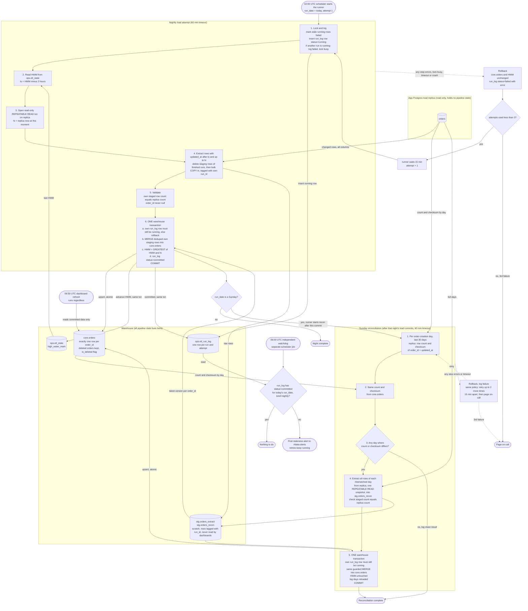

# Nightly orders ETL into the warehouse

## Summary

Every night at 02:00 UTC a runner copies changed rows from the app's `orders` table (read replica) into `core.orders` in the warehouse. It reads everything changed since the last saved high-water mark, minus a 2-hour overlap. It loads the rows in one warehouse transaction, so a dashboard sees either the old night or the whole new night. On Sundays a reconciliation then compares the last 30 days and reloads any day that does not match. A failed run is retried twice, 15 minutes apart, and then pages on-call. A separate watchdog at 06:00 posts an alert if the night has not committed.

This is a new pipeline. Nothing exists today. We have no write access to the app database, so all bookkeeping lives in the warehouse.

## Terms

- **Runner**: the job the scheduler starts at 02:00. It runs the attempts, waits between them, and is the only thing that retries.
- **Attempt**: one try at a nightly load or a recon. Each has a `run_id`.
- **High-water mark (HWM)**: the latest replica time we have fully loaded, stored in `ops.etl_state`.
- **Lookback**: the 2 hours we re-read before the HWM. Bulk imports stamp `updated_at` when a row is written but the row becomes visible only when its transaction commits, up to 90 minutes later. Two hours is longer than that.
- **Staging**: scratch tables `stg.orders_extract` and `stg.orders_recon`. Each row carries the `run_id` that wrote it. Dashboards never read them.
- **Soft delete**: the app sets `deleted_at` (a normal write with a new `updated_at`). The warehouse keeps the row and sets `is_deleted`.
- **Recon**: the Sunday check that compares row counts and checksums per creation day.

## Diagram



## How it runs

Where state lives:

| Table | Holds |
|---|---|
| `ops.etl_state` | One row per pipeline: `pipeline` (key), `high_water_mark` (timestamptz, not null), `updated_at`. |
| `ops.etl_run_log` | One row per attempt: `run_id`, `run_date`, `kind` (nightly or recon), `attempt`, `status` (running, failed, committed), `window_lo`, `window_hi`, `rows_extracted`, `rows_merged`, `started_at`, `finished_at`, `error`. |
| `stg.*` | Scratch rows tagged with `run_id`. |
| `core.orders` | The served table, one row per `order_id`. |

The lock is a partial unique index that allows only one `running` row in `etl_run_log`, across both kinds. A nightly retry and a Sunday recon therefore never overlap.

### Nightly load, step by step

1. **Lock and log.**
   - Starts: the runner, at 02:00 for attempt 1, or 15 minutes after the previous attempt failed.
   - Does: marks any `running` row older than 60 minutes as `failed` (error "stale"). Then inserts its own `running` row.
   - Data: `etl_run_log`.
   - If it goes wrong: if another `running` row exists, the insert fails. The attempt logs itself `failed` ("lock busy") and follows the normal retry rule.
2. **Read the window start.**
   - Does: reads the HWM and sets `lo = HWM - 2h`.
   - Data: `etl_state`.
   - If it goes wrong: the attempt fails and retries.
3. **Open a snapshot.**
   - Does: opens one read-only `REPEATABLE READ` transaction on the replica and sets `hi` to the replica's `now()`. All reads of the extract come from this snapshot. Using `hi` as the upper bound keeps the window repeatable and lets the HWM advance on quiet nights.
   - Data: replica, read only.
   - If it goes wrong: the attempt fails and retries.
4. **Extract.**
   - Does: deletes staging rows of runs that are no longer `running`. Then bulk-loads `WHERE updated_at > lo AND updated_at <= hi` into `stg.orders_extract`, tagged with its own `run_id`.
   - Data: replica to staging.
   - If it goes wrong: the attempt fails. A retry starts with a clean staging area, and later steps only use rows with their own `run_id`.
5. **Validate.**
   - Does: compares its own staged row count with a `count(*)` over the same window in the same snapshot, both before deduping. It also checks that `order_id` is never null.
   - If it goes wrong: the attempt fails and retries.
6. **Load, in one warehouse transaction.**
   - Does: (a) updates its own `run_log` row from `running` to `committed` and checks that exactly one row changed. If the runner or the stale cleanup already marked it `failed`, none changes and the transaction rolls back. (b) Merges its staged rows into `core.orders` (see below). (c) Sets `HWM = GREATEST(HWM, hi)`. Then commits.
   - Data: staging to `core.orders`, plus `etl_state` and `etl_run_log`.
   - If it goes wrong: the whole transaction rolls back. `core.orders` and the HWM stay as they were. Because all three changes commit together, a crash cannot leave a load without its HWM advance, and dashboards see either the previous night or the full new night.
7. **Sunday only.** If `run_date` is a Sunday, the runner starts the reconciliation right after this commit. If the load never commits, recon does not run.

The advance to `hi` is safe because the lookback is longer than the 90-minute lag. A row stamped just before `hi` that is not yet visible falls inside tomorrow's lookback.

### The merge

The overlap re-extracts orders the warehouse already has, possibly in an older version. The merge keeps only the newest version in staging and never lets an older version overwrite a newer one.

```sql
WITH latest AS (
  SELECT * FROM (
    SELECT s.*, ROW_NUMBER() OVER (PARTITION BY order_id ORDER BY updated_at DESC) AS rn
    FROM stg.orders_extract s
    WHERE s.run_id = :run_id
  ) WHERE rn = 1
)
MERGE INTO core.orders t
USING latest s ON t.order_id = s.order_id
WHEN MATCHED AND s.updated_at > t.updated_at THEN
  UPDATE SET /* every business column from s */, is_deleted = (s.deleted_at IS NOT NULL)
WHEN NOT MATCHED THEN
  INSERT (/* all columns */, is_deleted) VALUES (/* s.* */, s.deleted_at IS NOT NULL);
```

- Re-runs and overlap are harmless: rows with an equal or older `updated_at` are skipped, newer ones are applied.
- Soft deletes flow through the same merge. Nothing is ever physically deleted from `core.orders`.
- Two versions of one order with the identical `updated_at` would look like the same version. We assume microsecond write stamps make this negligible.

### Sunday reconciliation, step by step

It catches rows that became visible later than the lookback covers, for example when the replica lagged. Its attempts use `kind = recon`, the Sunday `run_date`, and their own attempt counter starting at 1, so its retry budget is separate from the nightly's. It uses the same lock, stale cleanup, 60-minute timeout and own-row-still-running check as a nightly attempt.

1. **Compare the replica.** For each creation day (UTC `created_at` date) in the last 30 days, ask the replica, inside one `REPEATABLE READ` transaction, for `count(*)` and a checksum. The checksum is the sum of the low 60 bits of `md5(order_id || '|' || updated_at)`, with `updated_at` normalised to UTC at microsecond precision on both sides.
2. **Compare the warehouse.** Ask `core.orders` for the same numbers a moment later. The runner compares about 30 small rows per side. Soft-deleted orders count on both sides.
3. **Any mismatch?** If none, log a clean result and finish.
4. **Extract mismatched days.** Take all rows of every mismatched day from the replica, in one `REPEATABLE READ` snapshot, into `stg.orders_recon`. Check that the staged count equals a `count(*)` over the same days in that snapshot.
5. **Load.** One warehouse transaction: check the own row is still `running`, run the same guarded merge for all days, log the days reloaded, and commit. The HWM is not touched.

What recon cannot fix: days older than 30, a replica that is still behind (the day mismatches again next Sunday), and two versions with the same `updated_at`, because the checksum uses only `order_id` and `updated_at`. The guard means a lagging replica cannot overwrite a newer warehouse row.

False positives are expected. The warehouse holds data only up to the nightly `hi`, and recon reads the replica a little later. Orders edited in that gap or between the two compare reads show up as mismatches, usually for recent creation days. Reloading a day is cheap and idempotent, so we accept these.

### The 06:00 watchdog

A separate cron job at 06:00 UTC, independent of the runner, checks `etl_run_log` for a `committed` nightly row with today's `run_date`. If there is none, it posts a staleness alert to #data-alerts. This covers an attempt still running, retries in progress, and a job that never started. Retries keep going after the alert, and whatever commits later is picked up at the next dashboard refresh. The watchdog ignores recon: a recon that fails three times only pages on-call, and dashboards stay consistent as of the nightly load.

## What happens when things fail

| What fails | What happens |
|---|---|
| Any error, failed validation, lock busy, crash, or 60-minute timeout in an attempt | Nothing in `core.orders` or the HWM changes. The attempt is logged `failed`. The runner starts each attempt as its own process and kills it at 60 minutes, then marks it failed. After a crash, the stale cleanup at the next attempt marks it failed. |
| A timed-out or killed attempt tries to commit late | The own-row check at the start of the load transaction changes no row, so it rolls back. Its staging rows are ignored because they carry another `run_id`. |
| Attempt 1 or 2 fails (nightly or recon) | The runner waits 15 minutes and retries. A retry reads the unchanged HWM and covers the same ground. Worst case, attempt 3 starts by 04:30 and times out by 05:30, before 06:00. |
| Attempt 3 fails | The runner pages on-call. A recon page says it was the reconciliation. The paging tool is outside this design. |
| Nightly not committed by 06:00 | The watchdog posts to #data-alerts. Dashboards refresh anyway and show the previous night. |
| The runner itself dies | Nothing retries until the next 02:00. The 06:00 watchdog still alerts. |

## Setup and assumptions

Setup, done once before the first run: create the tables and the lock index, and seed `ops.etl_state` with a time earlier than the oldest order's `updated_at`. The first run uses the normal path and loads all history in one window.

Assumptions to confirm:

- The scheduler can run the watchdog as a job independent of the runner.
- The warehouse supports multi-statement transactions with snapshot isolation for readers. If not, merge into a shadow table and swap it atomically, in the same commit as the HWM.
- Replica and warehouse clocks are never compared. Windows come from the replica's own `now()` and from `updated_at` values.
- Every order has an immutable `created_at`.
- The 60-minute attempt timeout is my choice, so a hung attempt cannot block the retries.
- Recon uses the same retry and paging rule as the nightly. Change it if recon should be lower urgency.

## Open questions

- If the load commits after the 06:00 alert, nothing tells people the dashboards are current again, and dashboards show no "previous night" marker. Do we want a recovery message or a freshness stamp?
- If the runner process dies, nothing retries until the next 02:00. Is the watchdog alert enough, or should the scheduler restart the runner?
- The first run loads all history in one window. If that cannot finish in 60 minutes, history needs a separate one-off backfill. The table size is not known.
