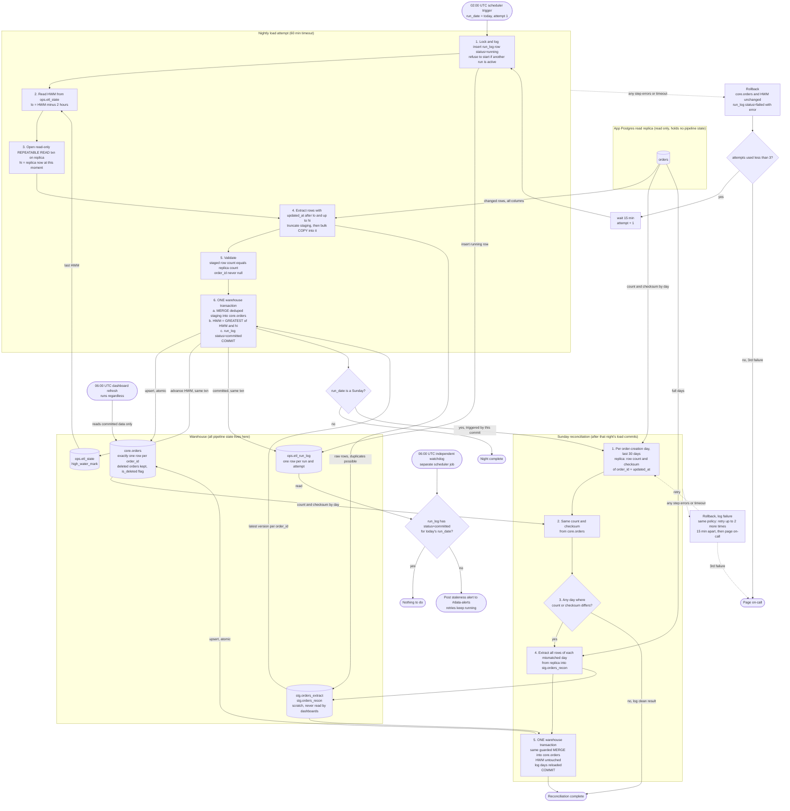

# Nightly orders ETL into the warehouse

## Pipeline flowchart



## Notes

### What starts each step

| Step | Trigger |
|---|---|
| Nightly load, attempt 1 | Scheduler cron at 02:00 UTC |
| Attempts 2 and 3 | 15 minutes after the previous attempt is recorded as failed |
| Page on-call | The third failed attempt |
| Reconciliation | The nightly commit, only when `run_date` is a Sunday. It does not run if that night's load never commits. |
| Staleness watchdog | Its own cron at 06:00 UTC. It does not depend on the load job, so it still fires if the job hangs or never starts. |
| Dashboard refresh | 06:00 UTC, outside this pipeline. It only ever sees committed data. |

### Where state lives

All state is in the warehouse, because we have no write access to the app database. The replica is only read.

- **`ops.etl_state`** has one row per pipeline: `pipeline` (primary key), `high_water_mark` (timestamptz, not null) and `updated_at`. Seed it once with the backfill start.
- **`ops.etl_run_log`** has one row per attempt: `run_id`, `run_date`, `kind` (nightly or recon), `attempt`, `status` (running, failed or committed), `window_lo`, `window_hi`, `rows_extracted`, `rows_merged`, `started_at`, `finished_at` and `error`.
  - A partial unique index allows only one `running` row per `kind`. This is the lock that keeps two runs from overlapping, including a Sunday recon and a late nightly retry.
  - The watchdog reads this table.
- **`stg.orders_extract` and `stg.orders_recon`** are scratch tables. Each attempt truncates its table before loading it, so a retry never inherits a half-filled staging table. Dashboards never read them.
- **`core.orders`** is the served table.

### Extract

- At the start of each attempt, read the HWM and set `lo = HWM - 2h`.
- Open one read-only `REPEATABLE READ` transaction on the replica, so the whole extract comes from one snapshot. Set `hi` to the replica's `now()` at that moment.
- Extract `WHERE updated_at > lo AND updated_at <= hi` and bulk-load it into staging.
- Using `hi` as the upper bound makes the window closed and repeatable. It also lets the HWM advance on nights with no changes.
- Advancing to `hi` is safe because the 2-hour lookback is longer than the 90-minute bulk-import lag. Rows stamped just before `hi` that are not yet visible fall inside tomorrow's lookback.
- Validation before the load transaction compares the staged row count with a `count(*)` over the same window on the same replica snapshot. It also checks that `order_id` is never null. A failure counts as a failed attempt.

### Merge logic

Staging can hold the same `order_id` more than once, and the warehouse can hold an older version than staging. The load therefore does two things. It dedupes inside staging, then it merges with a guard so an older version never overwrites a newer one.

```sql
WITH latest AS (
  SELECT * FROM (
    SELECT s.*, ROW_NUMBER() OVER (PARTITION BY order_id ORDER BY updated_at DESC) AS rn
    FROM stg.orders_extract s
  ) WHERE rn = 1
)
MERGE INTO core.orders t
USING latest s ON t.order_id = s.order_id
WHEN MATCHED AND s.updated_at > t.updated_at THEN
  UPDATE SET /* every business column from s */, is_deleted = (s.deleted_at IS NOT NULL)
WHEN NOT MATCHED THEN
  INSERT (/* all columns */, is_deleted) VALUES (/* s.* */, s.deleted_at IS NOT NULL);
```

- **Soft deletes:** a soft delete is just another write with a new `updated_at`, so it flows through the same merge. `is_deleted` is derived from `deleted_at`. Nothing is ever physically deleted from `core.orders`.
- **Re-runs:** re-extracting overlap rows or re-running a night does nothing harmful. Rows with an equal or older `updated_at` are skipped by the guard. Rows with a newer `updated_at` are applied.
- **Same-timestamp collisions:** two different versions of an order with an identical `updated_at` would be treated as the same version. I'm assuming write-time stamping at microsecond precision makes this negligible.

### High-water mark

- **Storage:** one row in `ops.etl_state`.
- **Update:** `UPDATE ops.etl_state SET high_water_mark = GREATEST(high_water_mark, :hi)`, run in the same transaction as the MERGE and the `committed` log row. The load, the HWM advance and the status therefore commit together or not at all. A crash between "load done" and "HWM advanced" cannot happen.
- **Monotonic:** `GREATEST` keeps a manual or out-of-order re-run from moving the mark backwards.
- **No half-loaded night:** the whole night's MERGE is a single transaction, so dashboards at 06:00 see either the previous night or the full new night.
- **Assumption:** the warehouse supports multi-statement transactions with snapshot isolation for readers. If it doesn't, do the merge into a shadow table and swap it atomically, still in the same commit as the HWM.

### Failure and retry

- **Failure:** any error, failed validation or 60-minute attempt timeout rolls back the transaction. `core.orders` and the HWM are untouched. The attempt is logged as `failed`.
- **Retry:** a failed attempt is retried after 15 minutes, up to two more times, for three attempts in total.
- **Retry window:** a retry reads the unchanged HWM, so it re-covers the same ground. In the worst case, attempt 3 starts by 04:30 and times out by 05:30, still before 06:00.
- **Third failure:** page on-call.
- **60-minute timeout:** this is my choice, so a hung attempt can't block the retries.

### Staleness at 06:00

The watchdog checks `etl_run_log` for a `committed` row with today's `run_date`. If it finds none, it posts to #data-alerts. This covers an attempt that is still running, retries in progress, and a job that never started. Retries keep going after the alert. Whatever commits later is picked up at the next dashboard refresh.

### Sunday reconciliation

- **Trigger:** it runs after the Sunday nightly load commits, so it compares against fresh data.
- **Compare:** for each creation day (`created_at` date, UTC) in the last 30 days, compute `count(*)` and an order-independent checksum on both sides.
  - Checksum: the sum of the low 60 bits of `md5(order_id || '|' || updated_at)`.
  - `updated_at` is normalised to UTC at microsecond precision on both sides, so the two systems produce identical strings.
- **Reload:** for every mismatched day, extract all of that day's rows from the replica into `stg.orders_recon`. Merge them with the same guarded MERGE, in one transaction for all days. The HWM is not touched.
- **Lagging replica:** the guard means a lagging replica cannot overwrite a newer warehouse row. The day may keep mismatching until the replica catches up, and next Sunday's run rechecks it.
- **False positives:** orders edited between the nightly load and the compare can cause a spurious mismatch. Reloading a day is idempotent and cheap, so I accept these.
- **Deleted orders:** these are included on both sides as soft-deleted rows, so counts line up.
- **Failure policy:** I applied the same retry and paging rule as the nightly load. Change it if you want recon to be lower urgency.

### Assumptions to confirm

- The scheduler can run the watchdog as a job independent of the load, and can chain recon off a successful nightly commit.
- The replica and warehouse clocks are not compared directly. All windows are computed from the replica's own `now()` and from `updated_at` values.
- Every order has an immutable `created_at`, used for the reconciliation day buckets.
