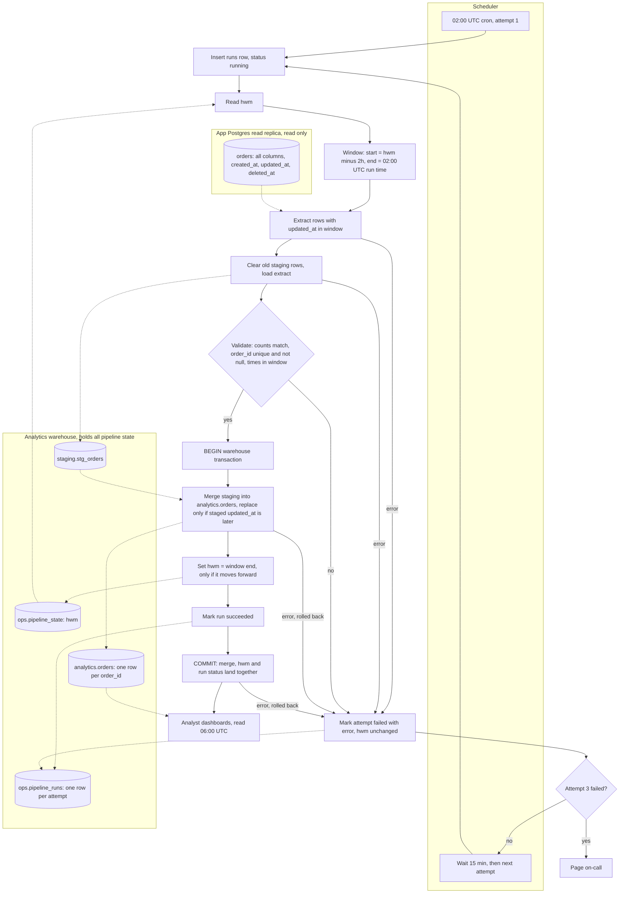

# Nightly orders ETL: pipeline design

## Summary

This is a new nightly job. At 02:00 UTC it reads the rows changed since the last committed run from the app's read replica and loads them into a staging table. Then, in one warehouse transaction, it merges them into `analytics.orders`, moves the high-water mark forward and marks the run succeeded. Dashboards see a night only after that commit, so they never see half a night. Late or changed rows are caught because each night re-reads a 2-hour overlap, and a merge only replaces a row with a newer version of it.

## Terms

- **Replica**: a read-only copy of the app's Postgres database. The job only reads from it.
- **Warehouse**: the analytics database. It holds all of the pipeline's own state.
- **High-water mark (hwm)**: the window end of the last committed run. It is not the largest `updated_at` seen.
- **Window**: the `updated_at` range one run extracts. It starts 2 hours before the hwm and ends at the night's 02:00 UTC time.
- **Staging**: a holding table for the current extract. Dashboards never read it.
- **Merge**: an insert-or-update keyed on `order_id`. It replaces an existing row only when the incoming `updated_at` is later.
- **Attempt**: one try at the night's job. Each attempt gets its own `run_id`.
- **Creation day**: the UTC date of `created_at`.

## Flowchart

## Steps

Each step says what starts it, what it does, which data it keeps, and what happens when it fails. The failures are also listed in the table under Failure handling.

1. **Start the attempt.**
   - Starts: the 02:00 UTC cron for attempt 1, or the scheduler 15 minutes after a failed attempt.
   - Does: inserts an `ops.pipeline_runs` row with status `running` and the attempt number.
   - Keeps: `ops.pipeline_runs`.
   - On failure: the attempt fails before any data moves.

2. **Read the hwm.**
   - Starts: step 1 succeeded.
   - Does: reads `hwm` from `ops.pipeline_state`. If there is no row, this is the first run. It is a bootstrap with no lower bound: it extracts the full table and seeds the hwm at its window end.
   - Keeps: `ops.pipeline_state`, read only.
   - On failure: the attempt fails. The hwm is unchanged.

3. **Set the window.**
   - Starts: step 2 succeeded.
   - Does: sets start = hwm minus 2 hours and end = the night's 02:00 UTC run time. The end stays fixed for the whole night, so every retry extracts the same window. Rows written after 02:00 fall into a later window.
   - Keeps: the window start and end on the run row.
   - On failure: the attempt fails. Nothing has been extracted yet.

4. **Extract.**
   - Starts: step 3 succeeded.
   - Does: runs a read-only query on the replica for all columns, including `created_at`, `updated_at` and `deleted_at`, where `updated_at > start` and `updated_at <= end`. A delete is a write that sets `updated_at`, so it matches with no special case. It also logs the replica's replay lag.
   - Keeps: nothing on the replica. The extract lives in the job until step 5.
   - On failure: the attempt fails. The hwm is unchanged and nothing is visible.

5. **Stage.**
   - Starts: step 4 succeeded.
   - Does: deletes all rows left in `staging.stg_orders` by earlier attempts, then writes this extract to it with this `run_id`. Sets `is_deleted` to true when `deleted_at` is set.
   - Keeps: `staging.stg_orders`, which holds this attempt's rows and is cleared after the commit.
   - On failure: the attempt fails. Leftover rows are cleared when the next attempt starts, so they do no harm.

6. **Validate.**
   - Starts: step 5 succeeded.
   - Does: runs three checks. The staged row count equals the extract count. `order_id` is not null and unique. Every `updated_at` falls inside the window.
   - Keeps: nothing new.
   - On failure: any failed check fails the attempt. Nothing is merged.

7. **Merge and commit.**
   - Starts: step 6 passed.
   - Does: opens one warehouse transaction and does three things in it.
     - Merges staging into `analytics.orders` on `order_id`. A row is replaced only when the staged `updated_at` is later. A replaced row takes all business columns, plus `is_deleted`, `deleted_at`, `updated_at` and `loaded_run_id`. New `order_id` values are inserted.
     - Sets the hwm with `UPDATE ops.pipeline_state SET hwm = :end WHERE pipeline = 'orders' AND hwm < :end`. The hwm can never move backward.
     - Marks the run `succeeded` in `ops.pipeline_runs`.
     - The commit makes all three visible together.
   - Keeps: `analytics.orders`, `ops.pipeline_state` and `ops.pipeline_runs`.
   - On failure: an error or a crash rolls back the whole transaction. The hwm is unchanged, nothing is visible, and the attempt is marked failed with its error.
   - Note: use the warehouse's own dialect. Where MERGE is not available, use a staged update plus an insert in the same transaction, with the same "later only" guard.

8. **Dashboards read.**
   - Starts: the 06:00 UTC refresh, whether or not the night has finished.
   - Does: reads `analytics.orders`. If the night committed, they see all of it. If not, they see the previous night.
   - Keeps: nothing. They read `analytics.orders` only.
   - On failure: nothing to handle here. A missing night is caught by the staleness alert.

## Failure handling

| Event | What happens | hwm | Dashboards see |
|---|---|---|---|
| Extract, staging, validation or merge fails, on attempt 1 or 2 | Rollback. Attempt marked failed with its error. Next attempt starts 15 minutes later. | Unchanged | Nothing new |
| Attempt 3 fails | Page on-call. No further automatic attempt. | Unchanged | Previous night |
| Crash or error during commit | Warehouse rolls back the open transaction. The next attempt uses the same window. | Unchanged | Previous night |
| Night skipped after attempt 3 | The next night's window starts at the old hwm minus 2 hours, so it covers the missed span. Manual backfill is needed only for a very large gap. | Advances on success | Catches up on success |
| Forced re-run of a committed night | Window end is not later than the hwm, so the run is skipped. If it runs anyway, the merge guard leaves unchanged rows alone. | Never moves backward | No change |
| Row visible only after the lookback | Missed by the nightly run. Caught by the Sunday reconciliation. | Unaffected | Corrected on Sunday |

## Replica lag budget

A bulk-import row can become visible up to 90 minutes after its `updated_at`, and replica lag adds to that. The 2-hour lookback covers both only while the import delay plus replica lag stays under 2 hours. That leaves about 30 minutes of replica lag headroom. Each extract logs replica replay lag, and an alert fires as lag approaches 30 minutes. Rows that arrive beyond the lookback are caught by the Sunday reconciliation.

## Staleness alert

A separate job runs at 06:00 UTC, independent of the ETL job, so a hung job still triggers it. It reads `ops.pipeline_state`. If the committed window end is tonight's 02:00 run, it stays silent. Otherwise it posts a staleness alert to the Slack channel `data-alerts`. Retries continue after the alert. Dashboards still refresh at 06:00 and show the previous night. A later commit appears on the next dashboard read, and a recovery note can be posted.

## Sunday reconciliation

A separate job runs after the Sunday night's commit. It uses the committed hwm, so it still runs if that night failed.

1. **Compare.** For each creation day in the last 30 days, it computes the row count and a checksum on both the replica and the warehouse. It uses only rows with `updated_at` at or before the hwm, so in-flight writes do not cause false mismatches. The checksum is order-independent: build the text `order_id || '|' || updated_at` in UTC at a fixed precision, hash each string, and sum a prefix of the hashes. Normalise timestamp precision on both sides to the warehouse's precision, or every day mismatches forever.
2. **Log a match.** If the count and checksum both match, write the result to `ops.reconciliation_results`.
3. **Reload a mismatch.** Reload that day with the same "later only" merge, in one transaction. Never delete and re-insert, so a lagging replica cannot push a row backward. If the reload errors, the transaction rolls back and the day is unchanged.
4. **Re-check.** Compare the day again and write both results to `ops.reconciliation_results`. If it still mismatches, post to `data-alerts`.

## Open questions

- `created_at` exists and never changes. The creation-day reconciliation depends on this.
- `updated_at` is unique per write per order. Equal timestamps count as the same version, so the copy already loaded is kept.
- The warehouse supports a MERGE, or an equivalent, inside one transaction that also updates `pipeline_state`. If it does not, use the staged update plus insert described in step 7.
- App clocks are synchronised by NTP. The lookback absorbs small skew, but skew also uses up the replica lag headroom.
- The first-run bootstrap is a full extract. Its size and duration are not estimated.
- Nothing says whether two attempts can run at once, for example a forced run during a retry. This design assumes one at a time.