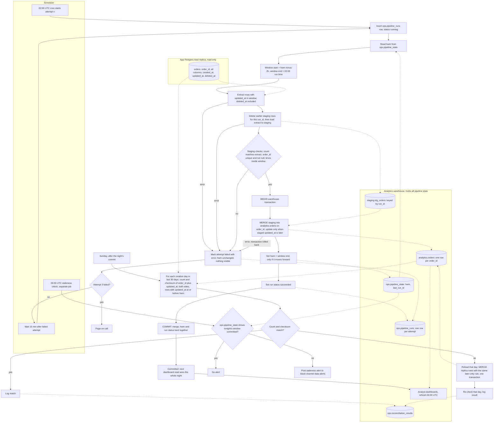

# Nightly orders ETL: pipeline design

## Decisions in brief

- **Window.** Each night extracts rows where `updated_at` is later than `hwm - 2h` and no later than the run start (02:00 UTC). The high-water mark (hwm) is the window end of the last committed run. It is not the max `updated_at` seen.
- **Staging, then one transaction.** Every extract lands in a staging table first. The merge into `analytics.orders`, the hwm update, and the run status are written in one warehouse transaction. Nothing becomes visible until that commit, so dashboards never see a half-loaded night.
- **Monotone merge.** A staged version replaces a target row only when its `updated_at` is later. Re-extracting the overlap, retrying, or re-running a night cannot regress a row.
- **All state is in the warehouse.** The replica is read only. The hwm, attempt records, staging, and reconciliation results live in the warehouse `ops` and `staging` schemas.

## Flowchart



## Step notes

1. **Trigger.** The scheduler starts attempt 1 at 02:00 UTC. It inserts an `ops.pipeline_runs` row with status `running` and the attempt number. Retries are started by the scheduler 15 minutes after the previous attempt fails.
2. **Read state.** The job reads `hwm` from `ops.pipeline_state` in the warehouse. On the first run there is no hwm. That run is a bootstrap: it extracts the full table through the same staging and merge, then seeds the hwm at its window end.
3. **Window.** Start = `hwm - 2h`. End = the night's 02:00 UTC run time. The end is fixed for the whole night, so every retry extracts the same window. Rows written after 02:00 are excluded and fall into a later window.
4. **Extract.** A read-only query on the replica selects all columns, including `created_at`, `updated_at`, and `deleted_at`. It filters on `updated_at > :start AND updated_at <= :end`. Deletes are writes that set `updated_at`, so they fall in the window with no special case.
5. **Stage.** The job deletes any staging rows for this `run_id` and writes the extract tagged with `run_id`. Staging is separate from the target, so dashboards never read it. `is_deleted` is computed here as `deleted_at IS NOT NULL`.
6. **Validate.** Three checks: the staging row count equals the extract count; `order_id` is not null and unique within the extract; every `updated_at` falls inside the window. Any failure counts as an attempt failure.
7. **Merge and commit.** One warehouse transaction runs the merge, sets the hwm, and marks the run succeeded. The hwm update is `UPDATE ops.pipeline_state SET hwm = :end WHERE pipeline = 'orders' AND hwm < :end`, so it can never move backward. The merge is:

```sql
MERGE INTO analytics.orders AS t
USING staging.stg_orders AS s
  ON t.order_id = s.order_id
WHEN MATCHED AND s.updated_at > t.updated_at THEN UPDATE SET
  -- all business columns, plus is_deleted, deleted_at, updated_at, loaded_run_id
WHEN NOT MATCHED THEN INSERT (...) VALUES (...);
```

   Use the warehouse's dialect. Where MERGE is unavailable, use a staged update plus insert inside the same transaction, keeping the same guard.
8. **Dashboards.** Dashboards read `analytics.orders` at 06:00 UTC. If the night has not committed, they show the previous night. They never see a partial night.

## State and where it lives

| Object | Schema | Purpose |
|---|---|---|
| `pipeline_state` | `ops` | One row per pipeline: `hwm`, `last_run_id`, `committed_at`. The only place the hwm is stored. |
| `pipeline_runs` | `ops` | One row per attempt: `run_id`, `window_start`, `window_end`, `attempt`, `status`, `error`, row counts. |
| `stg_orders` | `staging` | Raw extract for the current run, keyed by `run_id`. Cleared after commit. |
| `orders` | `analytics` | One row per `order_id`, latest version, with `is_deleted`, `created_at`, `updated_at`, `deleted_at`, `loaded_run_id`. |
| `reconciliation_results` | `ops` | Per creation day: replica and warehouse counts and checksums, match result, reload result. |

## Failure and retry

| Event | What happens | hwm | Visible to dashboards |
|---|---|---|---|
| Extract, staging, validation, or merge fails | Transaction rolled back. Attempt marked failed with error. Retry starts 15 min later. | Unchanged | Nothing new |
| Attempt 2 fails | Same, retry 15 min later | Unchanged | Nothing new |
| Attempt 3 fails | Page on-call. No further automatic attempt. | Unchanged | Previous night |
| Crash mid-merge | Warehouse rolls back the open transaction. The next attempt is identical. | Unchanged | Previous night |
| Night skipped after attempt 3 | The next night's window starts at the old hwm minus 2h, so it covers the missed span. No manual backfill is needed unless the gap is very large. | Advances on success | Catches up on success |
| Forced re-run of a committed night | Window end is not later than hwm, so the run is skipped. A forced run is still safe: the merge guard makes unchanged rows no-ops. | Never moves backward | No change |
| Row visible after the lookback | Missed by the nightly run. Caught by the Sunday reconciliation. | Unaffected | Corrected on Sunday |

## Staleness alert

A separate job runs at 06:00 UTC, independent of the ETL job, so a hung job still triggers it. It reads `ops.pipeline_state`. If the committed window end is tonight's 02:00 run, it stays silent. Otherwise it posts a staleness alert to Slack channel `data-alerts`. Dashboards still refresh at 06:00 and show the previous committed night. Retries continue after the alert. A later commit is picked up on the next dashboard read, and a recovery note can be posted.

## Replica lag budget

A row can become visible up to 90 minutes after its `updated_at` because of bulk-import transactions. Replica lag adds to that. A row written before the window start must be visible by the time of the next run. The lookback therefore only works if import delay plus replica lag stays under 2 hours. That leaves about 30 minutes of replica lag headroom. Each extract should log replica replay lag, and an alert should fire when lag approaches that budget. Rows that exceed the budget are caught by the reconciliation.

## Sunday reconciliation

1. Runs after the Sunday night's commit. It uses the committed hwm, so it still works if that night failed.
2. For each creation day in the last 30 days (`created_at` in UTC), it computes two values on both sides: row count, and a checksum of `order_id` plus `updated_at`. It uses rows with `updated_at` at or before the hwm, so in-flight writes do not cause false mismatches.
3. The checksum is order-independent. Build the string `order_id || '|' || updated_at` with UTC text and a fixed precision, hash it, and sum a prefix of the hash. Normalise the timestamp precision on both sides. If the warehouse stores less precision than Postgres, every day will mismatch forever.
4. On a mismatch, the job reloads that day with the same later-only MERGE, inside one transaction. It never does delete-then-insert, so a lagging replica cannot push a row backward. It then re-checks the day. If the day still mismatches, it posts to `data-alerts`.
5. Every result is written to `ops.reconciliation_results`.

## Assumptions to confirm

- `created_at` exists and never changes.
- `updated_at` is unique per write per order. Equal timestamps are treated as the same version.
- The warehouse supports a MERGE, or an equivalent, inside one transaction that includes the `pipeline_state` update.
- App clocks are synchronised closely (NTP). The 2-hour lookback absorbs small skew, but the replica lag budget is shared with it.
- The first-run bootstrap is a full extract. Its size and duration are not estimated here.