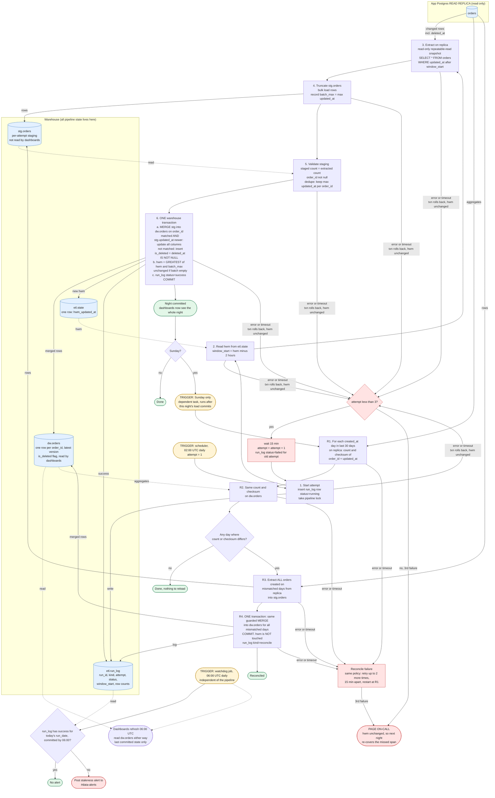

# Nightly orders ETL into the warehouse

## Summary

Every night at 02:00 UTC, a job copies changed rows from the app's `orders` table (read replica) into the warehouse table `dw.orders`. It extracts everything newer than a saved high-water mark minus 2 hours, loads it into a staging table, then in one warehouse transaction merges it into `dw.orders` and advances the mark. Dashboards see the whole night or none of it. On Sundays a reconciliation compares the last 30 days and reloads any day that does not match. All pipeline state lives in the warehouse, because we cannot write to the app database.

## Terms

- **High-water mark (hwm):** the newest `updated_at` we have loaded. It is stored in `etl.state` (one row, `pipeline='orders'`, column `hwm_updated_at`). It is the only state that affects correctness.
- **Lookback:** each night re-reads 2 hours before the mark. Bulk imports can become visible up to 90 minutes after their `updated_at`, so the overlap catches them.
- **Staging (`stg.orders`):** a scratch table that dashboards never read. Each attempt empties it first.
- **Guarded merge:** match on `order_id`, and overwrite only if the incoming `updated_at` is strictly greater. Older or repeated versions change nothing.
- **Run log (`etl.run_log`):** one row per attempt (`run_id`, `run_date`, `kind` nightly or reconcile, `attempt`, `status`, `window_start`, row counts, times, `error`). It is for audit and for the watchdog.
- **Soft delete:** the app sets `deleted_at`, which is a write with a newer `updated_at`. We keep the row and set `is_deleted = (deleted_at IS NOT NULL)`.

## How it runs

The first-ever run starts the mark at the epoch, which gives a full backfill. The scheduler holds only the attempt counter. If it loses the counter, the retry starts again at step 1.

## Flowchart

## Notes on the steps

**Nightly run (steps 1 to 6).**
- Each attempt re-reads the mark from `etl.state` and never reuses a window from a failed attempt. The mark moves only on commit, so any retry or later night re-covers the missed span.
- Extract is one read-only, repeatable-read statement on the replica, so it is a consistent snapshot.
- The mark is the newest `updated_at` actually extracted, never `now()`. It therefore stays at or before the snapshot time, even when the replica lags.
- Why the lookback is enough: a row with `updated_at = X` is visible by X + 90 min. A row missed by an extract at time E has X later than E minus 90 min. The next window starts at least 2 h before a mark that is at most E, so it covers that row, with a 30 min margin.
- An empty batch leaves the mark unchanged. `GREATEST` means the mark never moves backward, even if a stale attempt commits late.

**Watchdog (06:00).** It is a separate job, so it fires even if the pipeline hung. If `run_log` has no successful nightly run for today's `run_date`, it posts to #data-alerts. Dashboards refresh from `dw.orders` regardless and show the last committed state.

**Sunday reconciliation.** It starts as a dependent task after that night's load commits, not at a clock time.
- For each `created_at` day in the last 30 days, compare `count(*)` and a checksum on the replica and `dw.orders`. The checksum is the sum of the first 64 bits of `md5(order_id || '|' || updated_at as UTC epoch microseconds)`. It does not depend on row order, and both sides normalize the same way.
- `created_at` never changes, so a day's membership is stable.
- Every mismatching day is re-extracted in full, staged, and merged with the same guarded merge, all in one transaction.
- It never touches the mark.
- A false mismatch caused by a write during the compare only causes a harmless reload.
- The warehouse never holds more orders than the replica, since nothing is hard-deleted. So a count difference means missing rows.

## What happens when things fail

| Failure point | Effect | Recovery |
|---|---|---|
| Replica unreachable, extract error or cancelled query (steps 2 to 3) | `stg.orders` and `dw.orders` untouched. | Retry in 15 min, up to 2 more times, then page. |
| Staging load or validation fails (steps 4 to 5) | Only `stg.orders` is dirty. The next attempt truncates it. | Same retry policy. |
| Merge or mark update fails (step 6) | The transaction rolls back. `dw.orders` and the mark stay as before. | Same retry policy. |
| Attempt runs past its timeout | Counts as a failure. No timeout value is set yet. | Same retry policy. A late-committing old attempt is safe: the merge is guarded and the mark uses `GREATEST`. |
| All 3 attempts fail | The mark has not moved. On-call is paged. At 06:00 the watchdog also posts to #data-alerts. | The next night's window starts at the old mark minus 2 h, so it covers the missed night. |
| Rerun of a night that already committed | Every row is a no-op. The mark stays or moves forward only. | None needed. |
| Rows invisible beyond the lookback (for example replica lag) | Missed by the nightly run. | Caught by the Sunday reconciliation for orders created in the last 30 days. |
| Reconciliation fails | Nothing is committed. | Same retry policy, restarting at R1, then page. |

## Open questions

- Does the warehouse support multi-statement transactions with snapshot isolation? The design needs one transaction for the merge plus the mark update. If not, load into a shadow table and swap or repoint a view in the same atomic step as the mark update.
- Reconciliation reuses the nightly retry and page policy. The brief does not say what it should do on failure.
- If the Sunday nightly run fails all 3 attempts, that Sunday's reconciliation is skipped. The next Sunday's 30-day window covers the gap.
- The per-attempt timeout value is not set.
