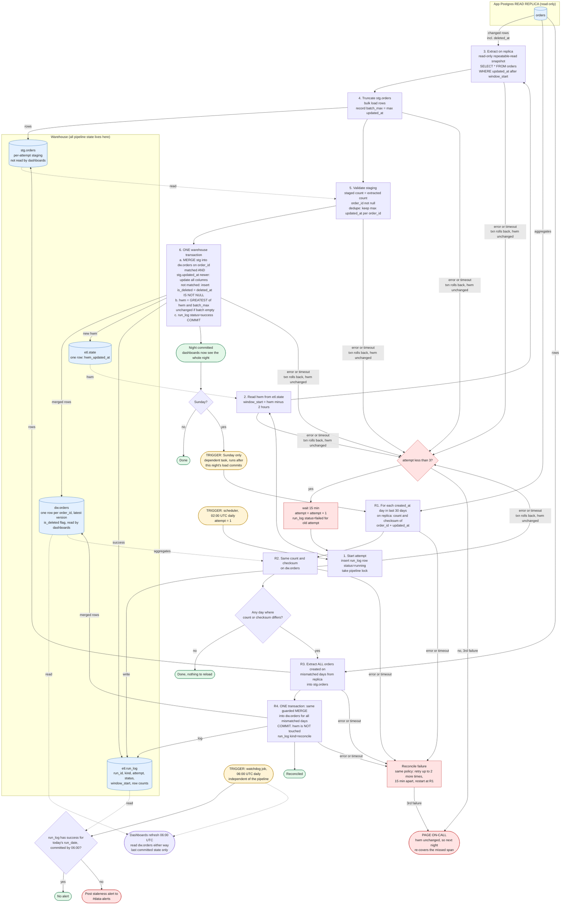

# Nightly orders ETL into the warehouse

## Design summary

- **Triggers.**
  - The scheduler starts the nightly run at 02:00 UTC and each retry.
  - A separate watchdog job runs at 06:00 UTC.
  - The Sunday reconciliation runs as a dependent task. It starts only after that night's load commits, not at a clock time.
- **Where state lives.** All pipeline state is in the warehouse, in schema `etl`.
  - `etl.state` has one row, `pipeline='orders'`, with `hwm_updated_at`. This is the only state that affects correctness.
  - `etl.run_log` holds one row per attempt, for audit and for the watchdog. It has `run_id`, `run_date`, `kind` (nightly or reconcile), `attempt`, `status`, `window_start`, `rows_extracted`, `rows_merged`, `started_at`, `ended_at` and `error`.
  - The scheduler keeps only the attempt counter. A crash that loses it just means a retry starts again from step 1.
- **Staging.** `stg.orders` is a plain table that dashboards never read. Each attempt truncates it, bulk-loads the extract, validates it, and only then touches `dw.orders`.
- **Atomic publish.** One warehouse transaction does three things: it merges staging into `dw.orders`, advances the high-water mark, and marks `run_log` as success. Dashboards see all of the night or none of it. A failure rolls back both the data and the mark.
- **Merge logic.** Match on `order_id` and overwrite only when the incoming `updated_at` is strictly greater than the stored one. A re-delivered or older version changes nothing, so re-running a night does no harm. `is_deleted` is derived as `deleted_at IS NOT NULL`. A soft delete is a write with a newer `updated_at`, so it flows through the same path and the row stays in the warehouse.
- **Extract.** The extract runs on the read replica in one read-only, repeatable-read statement, so it is a consistent snapshot:
  `SELECT * FROM orders WHERE updated_at > :hwm - interval '2 hours'`
  - Every attempt re-reads the mark from `etl.state` and does not carry a window over from the failed attempt. Because the mark moves only on commit, a retry, a re-run, or the next night after a total failure automatically re-covers the missed span.
  - The first-ever run seeds the mark at the epoch, which gives a full backfill.
- **High-water mark update.** `hwm = GREATEST(hwm, max(updated_at) of the staged batch)`.
  - The mark is the newest `updated_at` actually extracted, never `now()`. That keeps it at or before the snapshot time, even when the replica lags.
  - The invariant is that a row with `updated_at = X` is visible by X + 90 min. A row missed by an extract at time E therefore has X > E - 90 min. The next window starts at least 2 h before a mark that is at most E, so it still covers that row. The margin is 30 min.
  - An empty batch leaves the mark unchanged. `GREATEST` means the mark never moves backward, even if a stale attempt commits late.
- **Staleness alert.** The 06:00 watchdog is a separate job, so it fires even if the pipeline hung or died. It looks in `etl.run_log` for a successful nightly run for today's `run_date`. If there is none, it posts to #data-alerts. Dashboards refresh from `dw.orders` regardless and show the last committed state.
- **Sunday reconciliation.**
  - For each `created_at` day in the last 30 days, compute `count(*)` and a checksum on both the replica and `dw.orders`. The checksum is the sum of the first 64 bits of `md5(order_id || '|' || updated_at as UTC epoch microseconds)`. It is order-independent, and both sides use identical normalization.
  - `created_at` never changes, so a day's membership is stable.
  - Every mismatching day is re-extracted in full, staged, and merged with the same guarded MERGE. All mismatched days go in one transaction, so dashboards never see a half-reloaded set.
  - Reconciliation never touches the high-water mark.
  - A false mismatch from a write during the compare only causes an idempotent reload.
  - The warehouse never has more orders than the replica, since nothing is hard-deleted. A count difference therefore means missing rows.

## Flowchart

## Failure and retry behavior

| Failure point | Effect | Recovery |
|---|---|---|
| Replica unreachable, extract error, or replica query cancelled (steps 2 to 3) | `stg.orders` and `dw.orders` untouched. | Retry in 15 min, up to 2 more times, then page. |
| Staging load or validation fails (steps 4 to 5) | Only `stg.orders` is dirty, and the next attempt truncates it. | Same retry policy. |
| Merge or mark update fails (step 6) | The transaction rolls back, so `dw.orders` and `hwm` both stay as before. | Same retry policy. |
| Attempt runs past its per-attempt timeout | The timeout counts as a failure. The timeout value is mine to tune, and I set none. | Same retry policy. A late-committing zombie attempt is safe because the merge is guarded and the mark uses `GREATEST`. |
| All 3 attempts fail | The mark has not moved. On-call is paged. At 06:00 the watchdog also posts to #data-alerts. | The next night's window starts at the old mark minus 2 h, so it covers the missed night automatically. |
| Rerun of a night that already committed | The MERGE guard makes every row a no-op, and the mark stays the same or moves forward only. | None needed. |
| Rows invisible beyond the 2-hour lookback (for example replica lag) | Missed by the nightly run. | Caught by the Sunday reconciliation for orders created in the last 30 days. |

## Assumptions to confirm

- The warehouse supports multi-statement transactions with snapshot isolation, so that one transaction covers MERGE plus the mark update. If it does not, load into a shadow table and swap or repoint a view in the same step, and keep the mark update in that same atomic operation.
- Reconciliation inherits the nightly retry and page policy. The brief does not say what should happen if it fails.
- If the Sunday nightly run fails all 3 attempts, that Sunday's reconciliation is skipped. The next Sunday's 30-day window covers the gap.
