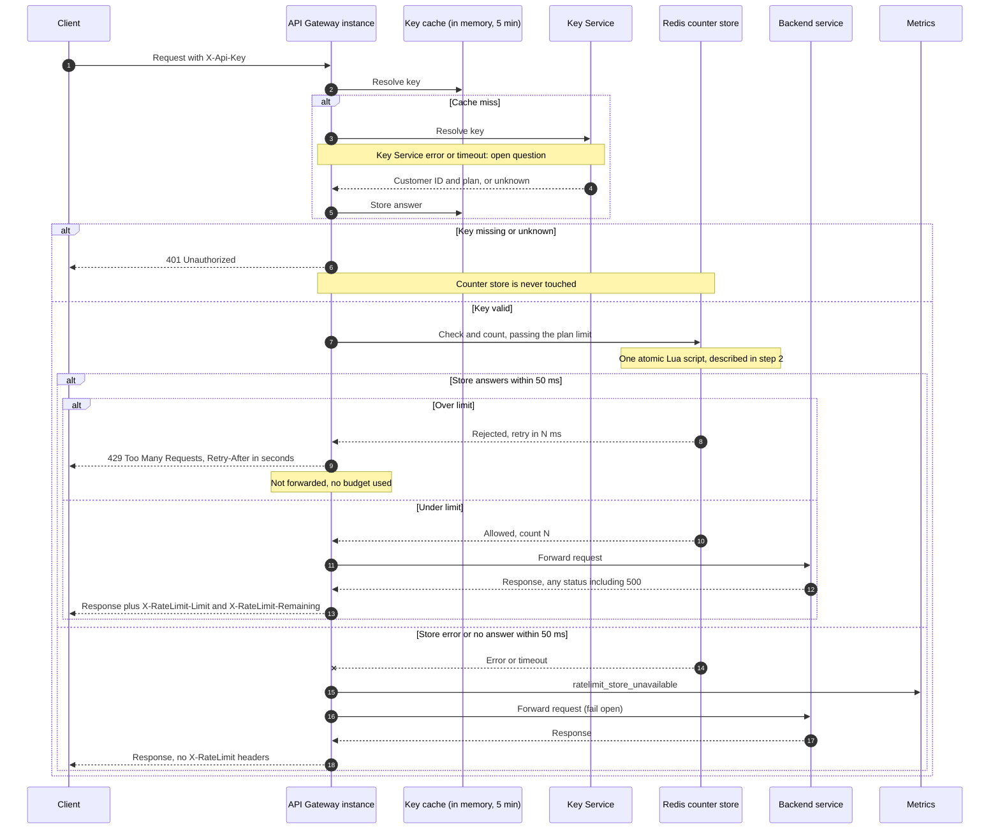

# Per-customer rate limiting on the public API

## Summary

Today the API Gateway turns each `X-Api-Key` into a customer and plan through the Key Service, caches that answer in memory for 5 minutes, and forwards the request to the backend. This change adds one check between key resolution and forwarding: each customer gets a budget per clock minute (Standard: 100 requests), counted in a shared Redis store so that all 6 gateway instances share one count. A request over budget gets `429` and is never forwarded. If Redis errors or is slow, the request is forwarded anyway (fail open).

## Terms

- **Budget**: the number of requests a customer may make in one window. All of a customer's keys share one budget.
- **Window**: one clock minute, by Redis server time. The window index is `floor(Redis server time / 60)`. A fixed window lets a customer send about 200 requests within a few seconds across a minute boundary. This is accepted for v1. A sliding window is the upgrade path.
- **Plan limit**: the budget for a plan. Standard is 100. Enterprise uses `ENTERPRISE_LIMIT`, which is not yet decided.
- **Counter**: a number in Redis for one customer and one window. Key: `rl:{customerId}:{windowIndex}`. Value: an integer. It expires 60 seconds after it is created.
- **Fail open**: the counter store errors or does not answer within 50 ms, so the request is forwarded with no limit check.

## Sequence diagram

## Steps

Each request runs steps 1 to 4 in order. A request with a missing or unknown key stops at step 1.

1. **Resolve the key.**
   - Starts when: a request with `X-Api-Key` reaches a gateway instance.
   - What it does: looks up the key in the instance's in-memory key cache. On a miss, it asks the Key Service for the customer ID and plan, then stores the answer for 5 minutes. A missing or unknown key gets `401`, and the request ends here.
   - Data kept: the key cache, in each instance's memory. The Key Service holds the key-to-customer mapping.
   - If it goes wrong: a missing or unknown key gets `401`, and no counter is read or changed. A Key Service error or timeout on a cache miss is not decided (see open questions).

2. **Check and count the budget.**
   - Starts when: step 1 gives a valid customer and plan.
   - What it does: the gateway makes one call to Redis, passing the plan limit. Standard is 100. Enterprise is `ENTERPRISE_LIMIT`, or no limit while it is unset. One Lua script runs atomically in Redis:
     1. Compute the window index from Redis server time.
     2. Read the counter `rl:{customerId}:{windowIndex}`. Treat it as 0 if it does not exist.
     3. If no limit was passed, increment and allow. Enterprise requests are counted but never rejected until `ENTERPRISE_LIMIT` is set.
     4. If the count is at or over the limit, reject and return the milliseconds until the window ends. Do not increment.
     5. Otherwise increment and allow. Set a 60-second expiry only when the counter was just created. Return the new count.
   - Why it is one script: two instances cannot both read 99 and both proceed. Standard customers get exactly 100 counted requests per window.
   - Data kept: the counter in Redis. Redis stores no plans. The plan limit comes from the gateway on each call.
   - If it goes wrong: a store error or no answer within 50 ms means fail open. The gateway forwards the request, emits `ratelimit_store_unavailable`, and sends no `X-RateLimit` headers. A timed-out script may still have run, so that request may or may not be counted.

3. **Reject a request over the limit.**
   - Starts when: step 2 finds the count at the limit.
   - What it does: returns `429 Too Many Requests` with `Retry-After` in whole seconds. The value is the milliseconds until the window ends, rounded up, with a minimum of 1. The request is not forwarded.
   - Data kept: nothing. The rejected request was never counted, so it uses no budget.
   - If it goes wrong: nothing further. The response is the `429`.

4. **Forward and respond.**
   - Starts when: step 2 allows the request. The count was already taken before forwarding.
   - What it does: forwards the request to the backend that owns the route, and returns that backend's response. Adds `X-RateLimit-Limit` (the plan limit) and `X-RateLimit-Remaining` (the limit minus the count after this request, floored at 0). These headers appear only when the request passed the check with a limit. Enterprise requests before `ENTERPRISE_LIMIT` is set get no headers, because a guessed value would mislead clients.
   - Data kept: nothing new.
   - If it goes wrong: a backend error, of any status including 500, still uses the budget. The response is passed back.

## What happens when things fail

| Step | Failure | What happens |
|---|---|---|
| 1. Key cache miss | Key Service error or timeout | Not decided. See open questions. |
| 1. Key check | Key missing or unknown | `401`. The counter store is not touched. |
| 2. Counter store | Error, or no answer within 50 ms | Fail open: forward the request, emit `ratelimit_store_unavailable`, send no `X-RateLimit` headers. Each request adds up to 50 ms of latency during the outage. Counts can run slightly low, which is accepted. |
| 2. Redis failover | Calls error or time out | Fail open, as above, until the gateway reaches the new primary. The store is one primary and one replica. A failover can lose a few recent counts, which is accepted. |
| 3. Limit check | Over limit | `429` with `Retry-After`. Not forwarded. No budget used. |
| 4. Backend | Any status, including 500 | Budget already used. Response passed back. |

## Open questions

- **Enterprise limit: open, owned by Product.** No number is chosen here. `ENTERPRISE_LIMIT` must be set before Enterprise enforcement is switched on. Until then, Enterprise requests are counted but never rejected.
- **Headers for Enterprise before the limit is set.** These responses carry no `X-RateLimit` headers. This departs from requirement 6 as written. Product or the spec owner should confirm.
- **Key Service failure on a cache miss.** The brief does not say what happens. Fail open covers only the counter store.
- **Caching of unknown keys.** Not known whether an "unknown" answer is cached, or for how long. If it is, a newly created key could get `401` until that entry expires.
- **Redis failover discovery.** Not decided how the gateway finds the new primary, for example through Sentinel or a cluster-aware client. Calls fail open until it does.
- **Headers on 429.** Sending `X-RateLimit-Limit` and `X-RateLimit-Remaining: 0` is recommended. Not yet decided.
- **Metric for rejections.** A counter such as `ratelimit_rejected` is recommended for watching noisy customers. The brief does not ask for it.
- **Key revocation lag.** A key revoked in the Key Service can keep resolving for up to 5 minutes. This is current behavior and is not changed here.