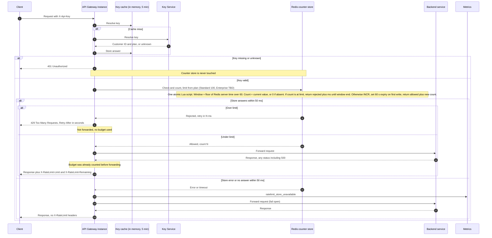

# Per-customer rate limiting on the public API

## Sequence diagram

## Design notes

1. **Counter store: Redis.** Every gateway instance shares one counter, which meets requirement 7. Local in-process counters would give 6x the limit and are ruled out. Redis runs a Lua script atomically, so the check and the increment happen in one step.

2. **Per-customer key.** The key is `rl:{customerId}:{windowIndex}`, never the API key. All of a customer's keys therefore share one budget (requirement 1). The customer ID and plan come from the existing Key Service resolution, so the limiter adds no new lookup.

3. **Window: fixed one minute, aligned to the clock minute.** The window index comes from Redis server time, so skew between gateway hosts does not move window boundaries. Known trade-off: a customer can send up to about 200 requests in a few seconds across a minute boundary (100 at the end of one minute, 100 at the start of the next). This is accepted for a first version. A sliding-window counter is the upgrade path if that burst matters.

4. **No overshoot across instances.** Because the check and the increment are one atomic script, two instances cannot both read 99 and both proceed. Standard customers get exactly 100 counted requests per window. Rejected requests return before the INCR, so they use no budget (requirement 4).

5. **Counting before forwarding.** The increment happens before the backend call, so a backend 500 still uses budget (requirement 5).

6. **Retry-After.** The script returns the milliseconds until the window ends. The gateway sends `Retry-After` as that value rounded up to whole seconds, with a minimum of 1.

7. **Headers.** `X-RateLimit-Limit` is the plan limit. `X-RateLimit-Remaining` is the limit minus the count after this request, floored at 0. Both appear only on responses to requests that passed the check, as required (requirement 6).

8. **Fail open.** The gateway sets a 50 ms deadline on the store call. On error or timeout it forwards the request, emits `ratelimit_store_unavailable`, and omits the X-RateLimit headers rather than guess their values (requirement 8). A timed-out script may still have run, so counts can be slightly low during a blip. That is acceptable under fail-open. Each request during an outage pays up to 50 ms of extra latency. A circuit breaker that skips the store after repeated failures is a v2 item.

9. **Auth first.** The limiter sits after key resolution. The 401 path never calls the store (requirement 3).

10. **Store availability.** One Redis primary with one replica. A failover can lose a few recent counts. This is acceptable for v1 and is covered by the fail-open rule.

## Open items

- **Enterprise limit: OPEN, owned by Product.** No number is chosen here. Until `ENTERPRISE_LIMIT` is configured, Enterprise traffic should pass through unlimited and not be enforced. The value must be set before Enterprise enforcement is switched on. Each Enterprise request should still be counted so Product can see real usage when it decides.
- **Headers on 429.** The brief only requires `Retry-After` on 429s. Sending `X-RateLimit-Limit` and `X-RateLimit-Remaining: 0` on them too is recommended and would be a small change. Not yet decided.
- **Metric for rejections.** A counter for 429s (for example `ratelimit_rejected`) is recommended for watching noisy customers. The brief does not ask for it.
- **Key cache lag.** A key revoked in the Key Service can keep resolving for up to 5 minutes through the existing cache. This is current behavior and is not changed here.