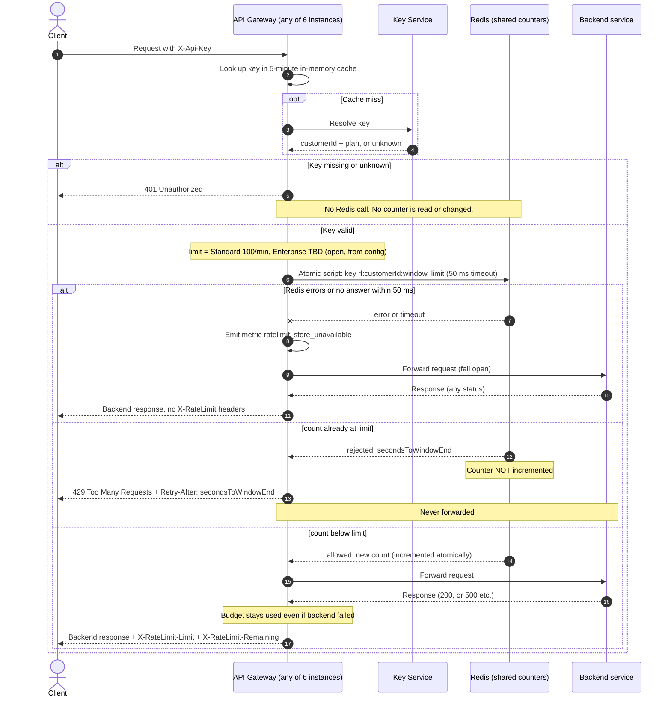

## Per-customer rate limiting: design

Every public request goes through the API Gateway (6 stateless instances; any can get any request). The gateway turns the `X-Api-Key` header into a customer ID and plan by asking the Key Service, and caches the answer in memory for 5 minutes. Then it forwards the request to the backend. This design adds a rate-limit check after authentication and before forwarding. All 6 instances count in one shared Redis, so each customer has one budget.

### Terms

- **Plan:** `Standard` or `Enterprise`. The Key Service returns it with the customer ID.
- **Limit:** requests allowed per customer per minute. Standard is 100. Enterprise is open (see Open questions).
- **Window:** a fixed calendar minute, read from the Redis clock.
- **Fail open:** if the counter store cannot answer, let the request through.

### Decisions

- **Store:** one shared Redis (a replicated primary with failover), used only for rate-limit counters.
- **Budget is per customer:** the counter key uses the customer ID, never the API key. Several keys share one budget.
- **Window:** fixed one minute. Key is `rl:{customerId}:{floor(redisNow / 60)}`, where `redisNow` is the Redis clock, so gateway clock skew does not matter. The key expires after 120 s. Trade-off: a customer can send up to 2x the limit across a window boundary. Accepted for v1.
- **No overshoot:** the check is one atomic Lua script. Redis runs scripts one at a time, so two instances cannot both take the last slot.
- **Rejected requests cost nothing.** Passed requests always count, even if the backend then fails. Nothing is refunded.
- **Limit by plan:** the gateway picks the limit from the plan and passes it to the script. It keeps its own copy for headers.
- **Enterprise limit is open.** Product has not decided. It is a config value with no default, and no number is guessed. While it is unset, Enterprise requests skip the check: no Redis call, no headers, forwarded as today.
- **Retry-After:** `60 - (redisNow mod 60)` whole seconds (1 to 60). Sent only on 429.
- **Headers:** on every request that passed the check, including backend errors like 500, the gateway adds `X-RateLimit-Limit` (the limit) and `X-RateLimit-Remaining` (`limit - count`, never below 0) to the backend's response.
- **Fail open:** the Redis call has a 50 ms timeout. On a timeout or any error, the gateway forwards the request, emits the `ratelimit_store_unavailable` metric, and adds no rate-limit headers, because it does not know the count. There is no circuit breaker in v1, so during a slow outage each request can wait up to 50 ms.

### Diagram

### Notes

**The Redis script (one atomic call).** It returns a status (`allowed` or `rejected`), the count, and the seconds to window end. The gateway uses the status to choose between 429 and forwarding.
1. `now = TIME`; key = `rl:{customerId}:{floor(now / 60)}`.
2. `count = GET key` (0 if absent).
3. If `count >= limit`: return `rejected` and `60 - (now mod 60)`. No write.
4. Otherwise `INCR key`; if the result is 1, `EXPIRE key 120`. Return `allowed` and the new count.

**Failure cases**
- Missing or unknown key: 401, and rate limiting never runs. If the Key Service is down and the key is not cached, that is an existing authentication failure and out of scope.
- Redis slow or down: fail open, as above.
- Redis failover can lose some recent counts, so a few extra requests may get through. Accepted, and consistent with fail open.
- Backend slow or failing after the check passed: the count stays used. The client sees whatever the gateway already does today.
- The key cache is per instance and already exists. A revoked key or changed plan can keep working for up to 5 minutes, and the limit follows the cached plan. Accepted.

**Out of scope for v1:** sliding window or token bucket, per-route limits, a local fallback or circuit breaker during Redis outages, and the Enterprise limit value.

### Open questions

- Enterprise requests per minute: Product must decide. Until it is set, Enterprise customers are not rate limited.
- What timeout does the gateway apply to slow backends today? Not known from this brief.
